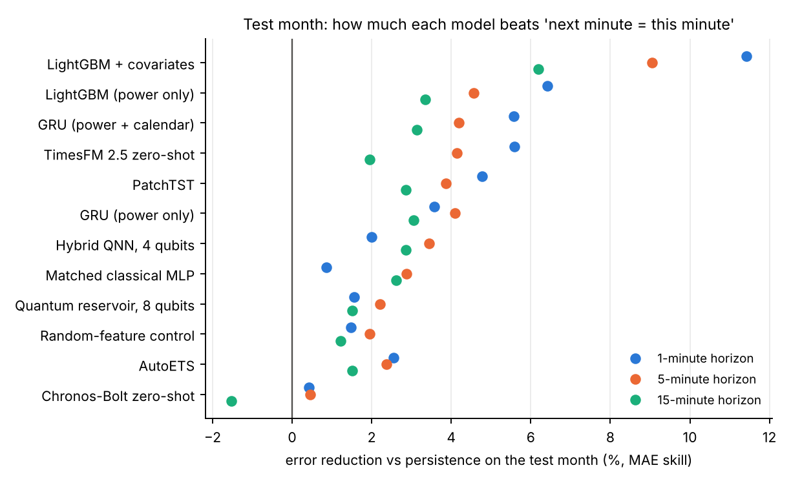
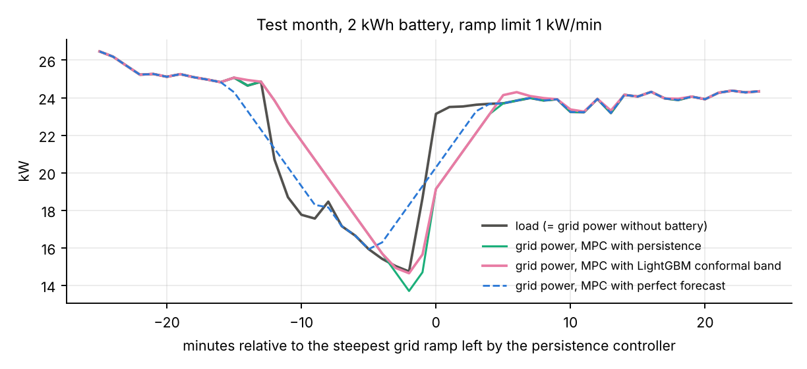
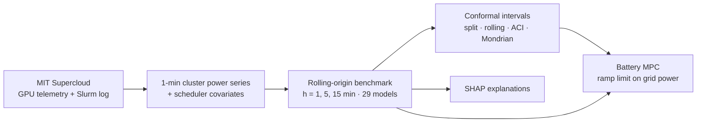

# GPU Power: from Forecast to Control

**Short-term forecasting of AI data-center GPU power, with calibrated uncertainty and a battery controller that uses it to limit grid ramps.**

Bachelor project · MIT Supercloud GPU telemetry (2021) · classical, deep, foundation and hybrid quantum models · conformal prediction · model predictive control


---

## Why

GPU clusters for AI training switch between idle and full load within minutes. For the grid operator this shows up as fast power **ramps**, which a large data center can turn into a stability problem. This project asks how well these swings can be predicted 1–15 minutes ahead, how much the forecast can be trusted, and whether a small battery steered by the forecast can keep the grid-side ramp within a limit.

## Key results (test split, opened once)

| # | Question | Result |
|---|---|---|
| RQ1 | Which model forecasts best? | **LightGBM + cluster scheduler covariates** beats persistence by **11 / 9 / 6 % MAE** at 1 / 5 / 15 min and every other model of the 29 benchmarked (Diebold–Mariano, Holm-corrected, p < 1e-7). |
| RQ2 | Do hybrid quantum models help? | A **287-parameter hybrid QNN** is statistically tied with LightGBM, PatchTST and GRU at 15 min: parameter-efficient, **no quantum advantage claimed** (the circuits are classically simulable). |
| RQ3 | Can the uncertainty be calibrated? | **Adaptive conformal inference** gives **0.900 coverage** in all 12 model × horizon cells, stable from validation to test; a better model gives 5–13 % narrower intervals. |
| RQ4 | Does the forecast help control? | A **2 kWh battery** with MPC cuts ramp-limit violations from **2.2 % to 0.03 %** of minutes (5 kWh: zero). Feeding the model's conformal band into the MPC gives the best practical controller: **−21 % maximum grid ramp** vs. persistence. |

**Limits, stated up front:** ramp *onsets* are not predicted by any model; coverage during ramps is low (0.18–0.49) even though overall coverage is exact; the controller gains are small (5–9 %) and come from one test month; power is job-attributed GPU power, not facility power.

<p align="center">
  
  
</p>

## Pipeline



## Data

- **Source:** [MIT Supercloud Dataset](https://dcc.mit.edu/data) (Samsi et al., 2021), 109,946 GPU telemetry files (≈ 2.3 TiB) and the Slurm scheduler log, 448 V100 GPUs.
- **Series:** one-minute total GPU power, built by streaming each file, averaging per GPU stream and summing across streams (`src/data/`). Raw files were processed on Google Colab; only the 18.5 MiB series is kept.
- **Window and split (chronological):** train 4 Mar – 29 Jul 2021, validation – 30 Aug, test – 30 Sep. Maintenance windows, outages and the DST gap are flagged and excluded from scoring (`docs/data_quality.md`).
- **The data is not in this repository.** It is licensed CC BY-NC-ND 4.0; see the dataset page to obtain it.

## Methods

| Block | What was done |
|---|---|
| Protocol | Rolling origin, horizons 1 / 5 / 15 min, MAE and skill vs. persistence, all design choices on validation, test opened once under a frozen, hashed protocol |
| Classical | Persistence, ridge AR, AutoARIMA / AutoETS, LightGBM with and without covariates |
| Deep | GRU, LSTM, N-HiTS, PatchTST, DLinear, NLinear (3 seeds) |
| Foundation | Chronos-Bolt and TimesFM 2.5, zero-shot (secondary, leakage caveat) |
| Hybrid quantum | Variational circuits and quantum reservoir computing (PennyLane), ablations over data size, qubits, entanglement and shot noise |
| Uncertainty | Split, rolling, ACI and Mondrian conformal prediction at 90 % |
| Explanation | Exact TreeSHAP on the frozen LightGBM |
| Control | Battery model + ramp-limiting MPC (cvxpy, 15-min horizon); oracle / model / persistence / myopic scenarios; scenario MPC on the conformal band |

## Repository layout

```
├── src/
│   ├── data/          # series and feature builders, modelling dataset
│   ├── models/        # tabular, state-space, RNN, neuralforecast and quantum models
│   ├── evaluation/    # metrics, rolling origin, frozen re-creation, DM tests, conformal
│   ├── control/       # battery MPC and scenario MPC
│   └── tools/         # notebook output export
├── notebooks/         # 00–27, numbered in run order (see docs/CODE_MAP.md)
├── scripts/           # reproduce.py, verify_freeze.py
├── configs/           # model and tracking configs
├── reports/           # result tables, freeze records, figures per week
└── docs/              # code map, data quality, weekly reports, handoffs, paper list
```

`docs/CODE_MAP.md` maps every module to the notebooks that use it.

## Getting started

```bash
git clone https://github.com/AryanElahi/gpu-power-forecast-control.git
cd gpu-power-forecast-control
conda create -n dcpower python=3.11 -y
conda activate dcpower
pip install -r requirements.txt        # exact versions: requirements.lock
```

Tested on an Apple M1 (8 GB). One month of MPC takes about 40 s.

## Reproducing

```bash
python scripts/reproduce.py                       # show the plan only
python scripts/reproduce.py --run --from 06 --to 15
python scripts/verify_freeze.py                   # inputs unchanged since the freeze?
```

`reproduce.py` runs notebooks 06–27 in order into `notebooks/_reproduced/` and logs to `reports/reproduce_log.csv`. Notebooks that open the test split (16, 23, 24, 26, 27) are skipped unless `--include-test` is given, so the one-time test evaluation is not repeated by accident.

## Future work

1. Predict ramp onsets from scheduler signals (queued jobs, allocations) and test stochastic / tube MPC over several months.
2. More sites and facility-level power; sub-second storage sizing (battery + supercapacitor).
3. Hardware-in-the-loop test; quantum models only with a clear hypothesis, real hardware and a matched classical control.

## License

Code: [MIT](LICENSE). The MIT Supercloud data is CC BY-NC-ND 4.0 and is not redistributed here. Third-party papers are listed in `docs/papers/README.md` but not included.

## Citation

```bibtex
@misc{elahi2026gpupower,
  author = {Aryan Elahi},
  title  = {GPU Power: from Forecast to Control},
  year   = {2026},
  note   = {Bachelor project},
  url    = {https://github.com/AryanElahi/gpu-power-forecast-control}
}
```

Data: Samsi, S. et al. (2021). *The MIT Supercloud Dataset.* IEEE HPEC. arXiv:2108.02037.
