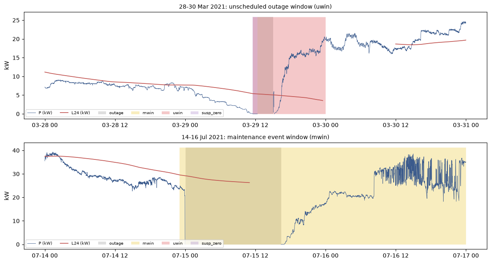

# Outputs of `06_model_dataset.ipynb`
Exported 2026-10-09 10:06 from the saved notebook file.

## Cell 1: setup, paths, input checks, versions (needed by every cell)
_execution count: 1_

```
OK      src/data/build_model_dataset.py
OK      data/processed/series_full_features.parquet
python 3.11.16 | polars 1.44.2 | numpy 2.4.6 | matplotlib 3.11.2
output exists already: True (cell 2 overwrites it)
```

## Cell 2: run build_model_dataset.py (needs cell 1). Overwrites OUT, META and the log file.
_execution count: 2_

```
[10:06:10] build_model_dataset.py 1.0 (2026-10-08)
[10:06:10] input: /Users/aryaneuse/Desktop/Uni Project/datacenter-power-forecasting/data/processed/series_full_features.parquet
[10:06:10] rows 303,840 | 2021-03-04 00:00 .. 2021-09-30 23:59 | step 60 s | columns 20
[10:06:10] maintenance days in input: ['2021-03-18', '2021-04-15', '2021-05-20', '2021-06-17', '2021-07-15', '2021-08-10', '2021-09-16']
[10:06:10] DST gap days: [{'date': '2021-03-14', 'hours': [2]}]
[10:06:10] unscheduled outage runs (outside mwin): 2
[10:06:10]   outage 2021-03-29 12:22 .. 2021-03-29 15:03 (162 min) | first susp_zero 2021-03-29 11:32 | uwin 2021-03-29 11:32 .. 2021-03-29 23:59 (748 min)
[10:06:10]   outage 2021-03-29 15:12 .. 2021-03-29 15:12 (1 min) | first susp_zero 2021-03-29 11:32 | uwin 2021-03-29 11:32 .. 2021-03-29 23:59 (748 min)
[10:06:10] counts: rows 303,840, outage 5,548, mwin 20,580, dst_gap 60, susp_zero 49, no_gpu 585, uwin 748, uwin_removed_from_valid 536, zero_power 585, zero_power_valid 0, valid_before_uwin 282,988, valid 282,452
[10:06:10] valid share: 92.9608%
[10:06:10] util/temp nulls before fill {'util_gpu_mean': 6133, 'util_mem_mean': 6133, 'temp_gpu_mean': 6133, 'temp_mem_mean': 6133}; covariate nulls outside outage after fill: none
[10:06:10] split: i_tr 212,688 (2021-07-29 16:48) | i_va 258,264 (2021-08-30 08:24) | valid minutes train 197,180 / val 42,636 / test 42,636
[10:06:10] h= 1: rel p95 0.0295 p99 0.0563 | abs p95 0.821 p99 1.500 kW | ramp rate p95 val 0.045 test 0.040
[10:06:10]       persistence MAE pairs train/val/test 0.2651 / 0.2864 / 0.2407 | samples 0.2653 / 0.2866 / 0.2407 | samples n 196,700 / 42,575 / 42,575
[10:06:10] h= 5: rel p95 0.0399 p99 0.0800 | abs p95 1.075 p99 2.154 kW | ramp rate p95 val 0.058 test 0.071
[10:06:10]       persistence MAE pairs train/val/test 0.3523 / 0.4300 / 0.4000 | samples 0.3522 / 0.4299 / 0.4000 | samples n 196,668 / 42,567 / 42,567
[10:06:10] h=15: rel p95 0.0568 p99 0.1095 | abs p95 1.522 p99 2.921 kW | ramp rate p95 val 0.065 test 0.088
[10:06:10]       persistence MAE pairs train/val/test 0.4835 / 0.6051 / 0.6221 | samples 0.4835 / 0.6048 / 0.6221 | samples n 196,588 / 42,547 / 42,547
[10:06:10] written /Users/aryaneuse/Desktop/Uni Project/datacenter-power-forecasting/data/processed/model_dataset.parquet: 303,840 rows x 68 columns, 45.6 MiB
[10:06:10] CHECK ok       rows: expected 303840 | observed 303840
[10:06:10] CHECK ok       first_minute: expected 2021-03-04 00:00 | observed 2021-03-04 00:00
[10:06:10] CHECK ok       last_minute: expected 2021-09-30 23:59 | observed 2021-09-30 23:59
[10:06:10] CHECK ok       outage: expected 5548 | observed 5548
[10:06:10] CHECK ok       mwin: expected 20580 | observed 20580
[10:06:10] CHECK ok       dst_gap: expected 60 | observed 60
[10:06:10] CHECK ok       susp_zero: expected 49 | observed 49
[10:06:10] CHECK ok       no_gpu: expected 585 | observed 585
[10:06:10] CHECK ok       valid_before_uwin: expected 282988 | observed 282988
[10:06:10] CHECK MISMATCH uwin_runs: expected 1 | observed 2
[10:06:10] CHECK ok       uwin_first_start: expected 2021-03-29 11:32 | observed 2021-03-29 11:32
[10:06:10] CHECK ok       val_start: expected 2021-07-29 16:48 | observed 2021-07-29 16:48
[10:06:10] CHECK ok       test_start: expected 2021-08-30 08:24 | observed 2021-08-30 08:24
[10:06:10] CHECK ok       persistence_MAE_test_h1: expected 0.2407 | observed 0.240727
[10:06:10] CHECK ok       persistence_MAE_test_h5: expected 0.4 | observed 0.399958
[10:06:10] CHECK ok       persistence_MAE_test_h15: expected 0.6221 | observed 0.622146
[10:06:10] reference checks: 15 ok, 1 mismatch
[10:06:11] written /Users/aryaneuse/Desktop/Uni Project/datacenter-power-forecasting/data/processed/model_dataset_meta.json
[10:06:11] total 0.8 s

exit code: 0 | log: reports/model_dataset_build.log
```

## Cell 3: load the output; schema, nulls, flag counts, reasons for invalid minutes (needs cell 1; cell 2 run once)
_execution count: 3_

```
rows 303,840 | columns 68 | 45.6 MiB | built 2026-10-09 09:06:10 UTC | script 1.0 (2026-10-08)
input sha256 3c0afe2c9d4fcce2...
shape: (68, 3)
┌────────────────────┬──────────────────────────────────────────┬───────┐
│ column             ┆ dtype                                    ┆ nulls │
│ ---                ┆ ---                                      ┆ ---   │
│ str                ┆ str                                      ┆ i64   │
╞════════════════════╪══════════════════════════════════════════╪═══════╡
│ minute_epoch       ┆ Int64                                    ┆ 0     │
│ minute_local       ┆ Datetime(time_unit='us', time_zone=None) ┆ 0     │
│ split              ┆ String                                   ┆ 0     │
│ P_kW               ┆ Float64                                  ┆ 5548  │
│ valid              ┆ Boolean                                  ┆ 0     │
│ outage             ┆ Boolean                                  ┆ 0     │
│ mwin               ┆ Boolean                                  ┆ 0     │
│ uwin               ┆ Boolean                                  ┆ 0     │
│ dst_gap            ┆ Boolean                                  ┆ 0     │
│ susp_zero          ┆ Boolean                                  ┆ 0     │
│ no_gpu             ┆ Boolean                                  ┆ 0     │
│ maint_day          ┆ Boolean                                  ┆ 0     │
│ util_gpu_mean      ┆ Float64                                  ┆ 5548  │
│ util_mem_mean      ┆ Float64                                  ┆ 5548  │
│ temp_gpu_mean      ┆ Float64                                  ┆ 5548  │
│ temp_mem_mean      ┆ Float64                                  ┆ 5548  │
│ mem_used_sum       ┆ Float64                                  ┆ 5548  │
│ mem_free_sum       ┆ Float64                                  ┆ 5548  │
│ n_gpu_equiv        ┆ Float64                                  ┆ 0     │
│ gpus_alloc         ┆ Int64                                    ┆ 0     │
│ active_gpu_jobs    ┆ Int64                                    ┆ 0     │
│ active_jobs        ┆ Int64                                    ┆ 0     │
│ queued_gpu_jobs    ┆ Int64                                    ┆ 0     │
│ queued_jobs        ┆ Int64                                    ┆ 0     │
│ n_gpu_streams      ┆ Int64                                    ┆ 0     │
│ n_edge_streams     ┆ Int64                                    ┆ 0     │
│ cluster_gap        ┆ Boolean                                  ┆ 0     │
│ mod5               ┆ Int8                                     ┆ 0     │
│ hour_sin           ┆ Float64                                  ┆ 0     │
│ hour_cos           ┆ Float64                                  ┆ 0     │
│ L24_kW             ┆ Float64                                  ┆ 22039 │
│ n_valid_in60       ┆ Int16                                    ┆ 0     │
│ d1_util_gpu_mean   ┆ Float64                                  ┆ 21398 │
│ d5_util_gpu_mean   ┆ Float64                                  ┆ 21438 │
│ d1_util_mem_mean   ┆ Float64                                  ┆ 21398 │
│ d5_util_mem_mean   ┆ Float64                                  ┆ 21438 │
│ d1_temp_gpu_mean   ┆ Float64                                  ┆ 21398 │
│ d5_temp_gpu_mean   ┆ Float64                                  ┆ 21438 │
│ d1_temp_mem_mean   ┆ Float64                                  ┆ 21398 │
│ d5_temp_mem_mean   ┆ Float64                                  ┆ 21438 │
│ d1_mem_used_sum    ┆ Float64                                  ┆ 21398 │
│ d5_mem_used_sum    ┆ Float64                                  ┆ 21438 │
│ d1_mem_free_sum    ┆ Float64                                  ┆ 21398 │
│ d5_mem_free_sum    ┆ Float64                                  ┆ 21438 │
│ d1_n_gpu_equiv     ┆ Float64                                  ┆ 21398 │
│ d5_n_gpu_equiv     ┆ Float64                                  ┆ 21438 │
│ d1_gpus_alloc      ┆ Float64                                  ┆ 21398 │
│ d5_gpus_alloc      ┆ Float64                                  ┆ 21438 │
│ d1_active_gpu_jobs ┆ Float64                                  ┆ 21398 │
│ d5_active_gpu_jobs ┆ Float64                                  ┆ 21438 │
│ d1_active_jobs     ┆ Float64                                  ┆ 21398 │
│ d5_active_jobs     ┆ Float64                                  ┆ 21438 │
│ d1_queued_gpu_jobs ┆ Float64                                  ┆ 21398 │
│ d5_queued_gpu_jobs ┆ Float64                                  ┆ 21438 │
│ d1_queued_jobs     ┆ Float64                                  ┆ 21398 │
│ d5_queued_jobs     ┆ Float64                                  ┆ 21438 │
│ ok_h1              ┆ Boolean                                  ┆ 0     │
│ split_h1           ┆ String                                   ┆ 3     │
│ ramp_h1            ┆ Int8                                     ┆ 27869 │
│ ramp99_h1          ┆ Int8                                     ┆ 27869 │
│ ok_h5              ┆ Boolean                                  ┆ 0     │
│ split_h5           ┆ String                                   ┆ 15    │
│ ramp_h5            ┆ Int8                                     ┆ 27909 │
│ ramp99_h5          ┆ Int8                                     ┆ 27909 │
│ ok_h15             ┆ Boolean                                  ┆ 0     │
│ split_h15          ┆ String                                   ┆ 45    │
│ ramp_h15           ┆ Int8                                     ┆ 28009 │
│ ramp99_h15         ┆ Int8                                     ┆ 28009 │
└────────────────────┴──────────────────────────────────────────┴───────┘

flag counts (minutes):
shape: (1, 8)
┌────────┬────────┬───────┬──────┬─────────┬───────────┬────────┬───────────┐
│ valid  ┆ outage ┆ mwin  ┆ uwin ┆ dst_gap ┆ susp_zero ┆ no_gpu ┆ maint_day │
│ ---    ┆ ---    ┆ ---   ┆ ---  ┆ ---     ┆ ---       ┆ ---    ┆ ---       │
│ u32    ┆ u32    ┆ u32   ┆ u32  ┆ u32     ┆ u32       ┆ u32    ┆ u32       │
╞════════╪════════╪═══════╪══════╪═════════╪═══════════╪════════╪═══════════╡
│ 282452 ┆ 5548   ┆ 20580 ┆ 748  ┆ 60      ┆ 49        ┆ 585    ┆ 10080     │
└────────┴────────┴───────┴──────┴─────────┴───────────┴────────┴───────────┘
valid share 92.9608%

invalid minutes by first reason (outage > mwin > uwin > dst_gap > susp_zero) and split:
shape: (5, 4)
┌─────────┬────────┬───────┬───────┐
│ reason  ┆ train  ┆ val   ┆ test  │
│ ---     ┆ ---    ┆ ---   ┆ ---   │
│ str     ┆ u32    ┆ u32   ┆ u32   │
╞═════════╪════════╪═══════╪═══════╡
│ dst_gap ┆ 60     ┆ 0     ┆ 0     │
│ mwin    ┆ 10649  ┆ 2280  ┆ 2266  │
│ outage  ┆ 4214   ┆ 660   ┆ 674   │
│ uwin    ┆ 585    ┆ 0     ┆ 0     │
│ valid   ┆ 197180 ┆ 42636 ┆ 42636 │
└─────────┴────────┴───────┴───────┘

zero-power minutes that are valid: 0 (expected 0 after the uwin rule)
valid minutes with P_kW null: 0
```

## Cell 4: reference checks against notebook 05 v2, unscheduled-outage runs (needs cell 3)
_execution count: 4_

```
shape: (16, 4)
┌──────────────────────────┬──────────────────┬──────────────────┬───────┐
│ check                    ┆ expected         ┆ observed         ┆ ok    │
│ ---                      ┆ ---              ┆ ---              ┆ ---   │
│ str                      ┆ str              ┆ str              ┆ bool  │
╞══════════════════════════╪══════════════════╪══════════════════╪═══════╡
│ rows                     ┆ 303840           ┆ 303840           ┆ true  │
│ first_minute             ┆ 2021-03-04 00:00 ┆ 2021-03-04 00:00 ┆ true  │
│ last_minute              ┆ 2021-09-30 23:59 ┆ 2021-09-30 23:59 ┆ true  │
│ outage                   ┆ 5548             ┆ 5548             ┆ true  │
│ mwin                     ┆ 20580            ┆ 20580            ┆ true  │
│ dst_gap                  ┆ 60               ┆ 60               ┆ true  │
│ susp_zero                ┆ 49               ┆ 49               ┆ true  │
│ no_gpu                   ┆ 585              ┆ 585              ┆ true  │
│ valid_before_uwin        ┆ 282988           ┆ 282988           ┆ true  │
│ uwin_runs                ┆ 1                ┆ 2                ┆ false │
│ uwin_first_start         ┆ 2021-03-29 11:32 ┆ 2021-03-29 11:32 ┆ true  │
│ val_start                ┆ 2021-07-29 16:48 ┆ 2021-07-29 16:48 ┆ true  │
│ test_start               ┆ 2021-08-30 08:24 ┆ 2021-08-30 08:24 ┆ true  │
│ persistence_MAE_test_h1  ┆ 0.2407           ┆ 0.240727         ┆ true  │
│ persistence_MAE_test_h5  ┆ 0.4              ┆ 0.399958         ┆ true  │
│ persistence_MAE_test_h15 ┆ 0.6221           ┆ 0.622146         ┆ true  │
└──────────────────────────┴──────────────────┴──────────────────┴───────┘
all reference checks ok: False

unscheduled outage runs (uwin):
shape: (2, 7)
┌──────────────────┬──────────────────┬────────────────┬──────────────────┬──────────────────┬──────────────────┬──────────────┐
│ outage_start     ┆ outage_end       ┆ outage_minutes ┆ first_susp_zero  ┆ uwin_start       ┆ uwin_end         ┆ uwin_minutes │
│ ---              ┆ ---              ┆ ---            ┆ ---              ┆ ---              ┆ ---              ┆ ---          │
│ str              ┆ str              ┆ i64            ┆ str              ┆ str              ┆ str              ┆ i64          │
╞══════════════════╪══════════════════╪════════════════╪══════════════════╪══════════════════╪══════════════════╪══════════════╡
│ 2021-03-29 12:22 ┆ 2021-03-29 15:03 ┆ 162            ┆ 2021-03-29 11:32 ┆ 2021-03-29 11:32 ┆ 2021-03-29 23:59 ┆ 748          │
│ 2021-03-29 15:12 ┆ 2021-03-29 15:12 ┆ 1              ┆ 2021-03-29 11:32 ┆ 2021-03-29 11:32 ┆ 2021-03-29 23:59 ┆ 748          │
└──────────────────┴──────────────────┴────────────────┴──────────────────┴──────────────────┴──────────────────┴──────────────┘

valid before uwin 282,988 -> after 282,452 (uwin 748 min, of which 536 were valid before)
maintenance days: ['2021-03-18', '2021-04-15', '2021-05-20', '2021-06-17', '2021-07-15', '2021-08-10', '2021-09-16']
DST gap days: [{'date': '2021-03-14', 'hours': [2]}]
covariate nulls outside outage after fill: {'util_gpu_mean': 0, 'util_mem_mean': 0, 'temp_gpu_mean': 0, 'temp_mem_mean': 0, 'mem_used_sum': 0, 'mem_free_sum': 0, 'n_gpu_equiv': 0, 'gpus_alloc': 0, 'active_gpu_jobs': 0, 'active_jobs': 0, 'queued_gpu_jobs': 0, 'queued_jobs': 0}
```

## Cell 5: splits, valid minutes and usable samples per horizon (needs cell 3)
_execution count: 5_

```
val starts 2021-07-29 16:48 (i_tr 212,688) | test starts 2021-08-30 08:24 (i_va 258,264)
shape: (3, 7)
┌───────┬─────────┬────────┬─────────────────────┬─────────────────────┬─────────┬────────┐
│ split ┆ minutes ┆ valid  ┆ first               ┆ last                ┆ mean_kW ┆ std_kW │
│ ---   ┆ ---     ┆ ---    ┆ ---                 ┆ ---                 ┆ ---     ┆ ---    │
│ str   ┆ u32     ┆ u32    ┆ datetime[μs]        ┆ datetime[μs]        ┆ f64     ┆ f64    │
╞═══════╪═════════╪════════╪═════════════════════╪═════════════════════╪═════════╪════════╡
│ train ┆ 212688  ┆ 197180 ┆ 2021-03-04 00:00:00 ┆ 2021-07-29 16:47:00 ┆ 26.311  ┆ 9.654  │
│ val   ┆ 45576   ┆ 42636  ┆ 2021-07-29 16:48:00 ┆ 2021-08-30 08:23:00 ┆ 29.505  ┆ 8.725  │
│ test  ┆ 45576   ┆ 42636  ┆ 2021-08-30 08:24:00 ┆ 2021-09-30 23:59:00 ┆ 27.607  ┆ 5.856  │
└───────┴─────────┴────────┴─────────────────────┴─────────────────────┴─────────┴────────┘
shape: (9, 6)
┌─────┬───────┬─────────────┬──────────────────────────────┬─────────────────────┬────────────┐
│ h   ┆ split ┆ valid pairs ┆ usable samples (60-min rule) ┆ lost by 60-min rule ┆ lost share │
│ --- ┆ ---   ┆ ---         ┆ ---                          ┆ ---                 ┆ ---        │
│ i64 ┆ str   ┆ i64         ┆ i64                          ┆ i64                 ┆ f64        │
╞═════╪═══════╪═════════════╪══════════════════════════════╪═════════════════════╪════════════╡
│ 1   ┆ train ┆ 197172      ┆ 196700                       ┆ 472                 ┆ 0.00239    │
│ 1   ┆ val   ┆ 42634       ┆ 42575                        ┆ 59                  ┆ 0.00138    │
│ 1   ┆ test  ┆ 42634       ┆ 42575                        ┆ 59                  ┆ 0.00138    │
│ 5   ┆ train ┆ 197140      ┆ 196668                       ┆ 472                 ┆ 0.00239    │
│ 5   ┆ val   ┆ 42626       ┆ 42567                        ┆ 59                  ┆ 0.00138    │
│ 5   ┆ test  ┆ 42626       ┆ 42567                        ┆ 59                  ┆ 0.00138    │
│ 15  ┆ train ┆ 197060      ┆ 196588                       ┆ 472                 ┆ 0.0024     │
│ 15  ┆ val   ┆ 42606       ┆ 42547                        ┆ 59                  ┆ 0.00138    │
│ 15  ┆ test  ┆ 42606       ┆ 42547                        ┆ 59                  ┆ 0.00138    │
└─────┴───────┴─────────────┴──────────────────────────────┴─────────────────────┴────────────┘
h=1: ok_h by split_h -> {'test': 42575, 'train': 196700, 'val': 42575, None: 2} (None = origin before a split boundary with the target after it; not used)
h=5: ok_h by split_h -> {'test': 42567, 'train': 196668, 'val': 42567, None: 10} (None = origin before a split boundary with the target after it; not used)
h=15: ok_h by split_h -> {'test': 42547, 'train': 196588, 'val': 42547, None: 30} (None = origin before a split boundary with the target after it; not used)
```

## Cell 6: ramp thresholds (new vs notebook 05 v2) and ramp rates (needs cell 3)
_execution count: 6_

```
shape: (12, 6)
┌─────┬────────────┬────────┬─────────┬────────────┬─────────┐
│ h   ┆ threshold  ┆ new    ┆ nb05_v2 ┆ rel_change ┆ n_train │
│ --- ┆ ---        ┆ ---    ┆ ---     ┆ ---        ┆ ---     │
│ i64 ┆ str        ┆ f64    ┆ f64     ┆ f64        ┆ i64     │
╞═════╪════════════╪════════╪═════════╪════════════╪═════════╡
│ 1   ┆ rel_p95    ┆ 0.0295 ┆ 0.0299  ┆ -0.0119    ┆ 192139  │
│ 1   ┆ rel_p99    ┆ 0.0563 ┆ 0.0577  ┆ -0.0246    ┆ 192139  │
│ 1   ┆ abs_p95_kW ┆ 0.8215 ┆ 0.821   ┆ 0.0006     ┆ 197172  │
│ 1   ┆ abs_p99_kW ┆ 1.4996 ┆ 1.499   ┆ 0.0004     ┆ 197172  │
│ 5   ┆ rel_p95    ┆ 0.0399 ┆ 0.0409  ┆ -0.0252    ┆ 192107  │
│ 5   ┆ rel_p99    ┆ 0.08   ┆ 0.0834  ┆ -0.0402    ┆ 192107  │
│ 5   ┆ abs_p95_kW ┆ 1.0747 ┆ 1.075   ┆ -0.0002    ┆ 197140  │
│ 5   ┆ abs_p99_kW ┆ 2.1545 ┆ 2.157   ┆ -0.0012    ┆ 197140  │
│ 15  ┆ rel_p95    ┆ 0.0568 ┆ 0.058   ┆ -0.0201    ┆ 192027  │
│ 15  ┆ rel_p99    ┆ 0.1095 ┆ 0.1155  ┆ -0.0524    ┆ 192027  │
│ 15  ┆ abs_p95_kW ┆ 1.5216 ┆ 1.525   ┆ -0.0022    ┆ 197060  │
│ 15  ┆ abs_p99_kW ┆ 2.9208 ┆ 2.93    ┆ -0.0031    ┆ 197060  │
└─────┴────────────┴────────┴─────────┴────────────┴─────────┘
shape: (9, 7)
┌─────┬───────┬────────────────┬───────────┬──────────┬───────────┬──────────┐
│ h   ┆ split ┆ pairs with L24 ┆ ramps p95 ┆ rate p95 ┆ ramps p99 ┆ rate p99 │
│ --- ┆ ---   ┆ ---            ┆ ---       ┆ ---      ┆ ---       ┆ ---      │
│ i64 ┆ str   ┆ i64            ┆ i64       ┆ f64      ┆ i64       ┆ f64      │
╞═════╪═══════╪════════════════╪═══════════╪══════════╪═══════════╪══════════╡
│ 1   ┆ train ┆ 192139         ┆ 9607      ┆ 0.05     ┆ 1922      ┆ 0.01     │
│ 1   ┆ val   ┆ 41915          ┆ 1903      ┆ 0.0454   ┆ 440       ┆ 0.0105   │
│ 1   ┆ test  ┆ 41915          ┆ 1659      ┆ 0.0396   ┆ 426       ┆ 0.0102   │
│ 5   ┆ train ┆ 192107         ┆ 9606      ┆ 0.05     ┆ 1922      ┆ 0.01     │
│ 5   ┆ val   ┆ 41907          ┆ 2444      ┆ 0.0583   ┆ 812       ┆ 0.0194   │
│ 5   ┆ test  ┆ 41907          ┆ 2969      ┆ 0.0708   ┆ 786       ┆ 0.0188   │
│ 15  ┆ train ┆ 192027         ┆ 9602      ┆ 0.05     ┆ 1921      ┆ 0.01     │
│ 15  ┆ val   ┆ 41887          ┆ 2740      ┆ 0.0654   ┆ 892       ┆ 0.0213   │
│ 15  ┆ test  ┆ 41887          ┆ 3705      ┆ 0.0885   ┆ 1059      ┆ 0.0253   │
└─────┴───────┴────────────────┴───────────┴──────────┴───────────┴──────────┘
expected rates on train: 0.05 (p95) and 0.01 (p99) by construction

ramp rates on usable samples:
shape: (9, 5)
┌─────┬───────┬────────┬──────────┬──────────┐
│ h   ┆ split ┆ n      ┆ rate p95 ┆ rate p99 │
│ --- ┆ ---   ┆ ---    ┆ ---      ┆ ---      │
│ i32 ┆ str   ┆ u32    ┆ f64      ┆ f64      │
╞═════╪═══════╪════════╪══════════╪══════════╡
│ 1   ┆ test  ┆ 41915  ┆ 0.0396   ┆ 0.0102   │
│ 1   ┆ train ┆ 192080 ┆ 0.05     ┆ 0.01     │
│ 1   ┆ val   ┆ 41915  ┆ 0.0454   ┆ 0.0105   │
│ 5   ┆ test  ┆ 41907  ┆ 0.0708   ┆ 0.0188   │
│ 5   ┆ train ┆ 192048 ┆ 0.05     ┆ 0.01     │
│ 5   ┆ val   ┆ 41907  ┆ 0.0583   ┆ 0.0194   │
│ 15  ┆ test  ┆ 41887  ┆ 0.0885   ┆ 0.0253   │
│ 15  ┆ train ┆ 191968 ┆ 0.05     ┆ 0.01     │
│ 15  ┆ val   ┆ 41887  ┆ 0.0654   ┆ 0.0213   │
└─────┴───────┴────────┴──────────┴──────────┘
```

## Cell 7: persistence on valid pairs (as notebook 05) and on usable samples (reference for the models) (needs cell 3)
_execution count: 7_

```
shape: (9, 9)
┌─────┬───────┬─────────┬───────────┬────────────┬───────────┬─────────────┬──────────────┬───────────────┐
│ h   ┆ split ┆ pairs n ┆ MAE pairs ┆ RMSE pairs ┆ samples n ┆ MAE samples ┆ RMSE samples ┆ nb05 test MAE │
│ --- ┆ ---   ┆ ---     ┆ ---       ┆ ---        ┆ ---       ┆ ---         ┆ ---          ┆ ---           │
│ i64 ┆ str   ┆ i64     ┆ f64       ┆ f64        ┆ i64       ┆ f64         ┆ f64          ┆ f64           │
╞═════╪═══════╪═════════╪═══════════╪════════════╪═══════════╪═════════════╪══════════════╪═══════════════╡
│ 1   ┆ train ┆ 197172  ┆ 0.2651    ┆ 0.434      ┆ 196700    ┆ 0.2653      ┆ 0.4341       ┆ null          │
│ 1   ┆ val   ┆ 42634   ┆ 0.2864    ┆ 0.5108     ┆ 42575     ┆ 0.2866      ┆ 0.511        ┆ null          │
│ 1   ┆ test  ┆ 42634   ┆ 0.2407    ┆ 0.3838     ┆ 42575     ┆ 0.2407      ┆ 0.3839       ┆ 0.2407        │
│ 5   ┆ train ┆ 197140  ┆ 0.3523    ┆ 0.6184     ┆ 196668    ┆ 0.3522      ┆ 0.6179       ┆ null          │
│ 5   ┆ val   ┆ 42626   ┆ 0.43      ┆ 0.8969     ┆ 42567     ┆ 0.4299      ┆ 0.8971       ┆ null          │
│ 5   ┆ test  ┆ 42626   ┆ 0.4       ┆ 0.6779     ┆ 42567     ┆ 0.4         ┆ 0.678        ┆ 0.4           │
│ 15  ┆ train ┆ 197060  ┆ 0.4835    ┆ 0.8211     ┆ 196588    ┆ 0.4835      ┆ 0.8209       ┆ null          │
│ 15  ┆ val   ┆ 42606   ┆ 0.6051    ┆ 1.1784     ┆ 42547     ┆ 0.6048      ┆ 1.1784       ┆ null          │
│ 15  ┆ test  ┆ 42606   ┆ 0.6221    ┆ 0.9988     ┆ 42547     ┆ 0.6221      ┆ 0.9989       ┆ 0.6221        │
└─────┴───────┴─────────┴───────────┴────────────┴───────────┴─────────────┴──────────────┴───────────────┘

h = 1 without mod-0 targets (usable samples):
shape: (3, 4)
┌───────┬────────┬──────────┬──────────┐
│ split ┆ n      ┆ MAE      ┆ RMSE     │
│ ---   ┆ ---    ┆ ---      ┆ ---      │
│ str   ┆ i64    ┆ f64      ┆ f64      │
╞═══════╪════════╪══════════╪══════════╡
│ train ┆ 157359 ┆ 0.257018 ┆ 0.423015 │
│ val   ┆ 34060  ┆ 0.271103 ┆ 0.481406 │
│ test  ┆ 34060  ┆ 0.235107 ┆ 0.371015 │
└───────┴────────┴──────────┴──────────┘
```

## Cell 8: independent spot checks and a leakage (truncation) test (needs cells 1 and 3)
_execution count: 8_

```
truncated at minute 200,534 (2021-07-21 06:13:00); changed columns: none
L24 max abs diff                              2.3248958314070478e-11
n_valid_in60 mismatches                       0
d1/d5 max abs diff                            0.0
ok_h mismatches                               0
split_h mismatches                            0
ramp label / threshold mismatches             0
leakage test: causal columns that changed     0
all spot checks ok: True
```

## Cell 9: invalid windows around the 29 Mar unscheduled outage and the 15 Jul maintenance (needs cells 1 and 3)
_execution count: 9_



```
saved reports/figures/model_dataset/01_invalid_windows.png
shape: (9, 8)
┌─────────────────────┬──────────┬────────────┬───────────────┬────────┬───────────┬───────┬───────┐
│ minute_local        ┆ P_kW     ┆ gpus_alloc ┆ n_gpu_streams ┆ outage ┆ susp_zero ┆ uwin  ┆ valid │
│ ---                 ┆ ---      ┆ ---        ┆ ---           ┆ ---    ┆ ---       ┆ ---   ┆ ---   │
│ datetime[μs]        ┆ f64      ┆ i64        ┆ i64           ┆ bool   ┆ bool      ┆ bool  ┆ bool  │
╞═════════════════════╪══════════╪════════════╪═══════════════╪════════╪═══════════╪═══════╪═══════╡
│ 2021-03-29 11:28:00 ┆ 0.119855 ┆ 23         ┆ 2             ┆ false  ┆ false     ┆ false ┆ true  │
│ 2021-03-29 11:29:00 ┆ 0.124455 ┆ 23         ┆ 2             ┆ false  ┆ false     ┆ false ┆ true  │
│ 2021-03-29 11:30:00 ┆ 0.10924  ┆ 22         ┆ 2             ┆ false  ┆ false     ┆ false ┆ true  │
│ 2021-03-29 11:31:00 ┆ 0.072265 ┆ 21         ┆ 1             ┆ false  ┆ false     ┆ false ┆ true  │
│ 2021-03-29 11:32:00 ┆ 0.0      ┆ 21         ┆ 0             ┆ false  ┆ true      ┆ true  ┆ false │
│ 2021-03-29 11:33:00 ┆ 0.0      ┆ 21         ┆ 0             ┆ false  ┆ true      ┆ true  ┆ false │
│ 2021-03-29 11:34:00 ┆ 0.0      ┆ 21         ┆ 0             ┆ false  ┆ true      ┆ true  ┆ false │
│ 2021-03-29 11:35:00 ┆ 0.0      ┆ 21         ┆ 0             ┆ false  ┆ true      ┆ true  ┆ false │
│ 2021-03-29 11:36:00 ┆ 0.0      ┆ 21         ┆ 0             ┆ false  ┆ true      ┆ true  ┆ false │
└─────────────────────┴──────────┴────────────┴───────────────┴────────┴───────────┴───────┴───────┘
```

## Cell 10: summary (needs cells 4 and 8)
_execution count: 10_

```
model dataset: 303,840 minutes x 68 columns | valid 282,452 (92.96%)
h= 1: usable samples train/val/test 196,700 / 42,575 / 42,575 | rel p95 0.0295 | persistence MAE (samples) val 0.2866 test 0.2407 kW
h= 5: usable samples train/val/test 196,668 / 42,567 / 42,567 | rel p95 0.0399 | persistence MAE (samples) val 0.4299 test 0.4000 kW
h=15: usable samples train/val/test 196,588 / 42,547 / 42,547 | rel p95 0.0568 | persistence MAE (samples) val 0.6048 test 0.6221 kW
reference checks ok: False | spot checks ok: True
NOT READY: send the outputs
```

## %run ../src/tools/nb_outputs_to_md.py 06_model_dataset.ipynb
_execution count: 11_

```
written 06_model_dataset_outputs.md | code cells 12 | figures 1 in 06_model_dataset_outputs_figures
```

## Cell 12
_execution count: None_

(no output)
