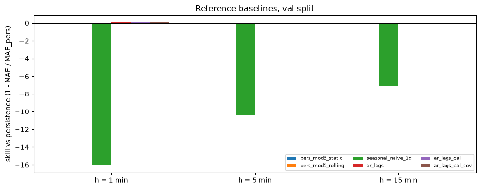
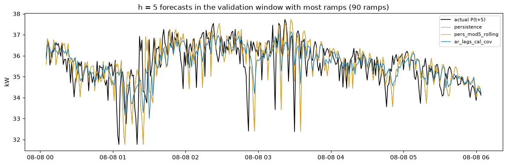

# Outputs of `07_baselines.ipynb`
Exported 2026-10-09 10:16 from the saved notebook file.

## Cell 1
_execution count: None_

(no output)

## Cell 1: setup, paths, imports, versions (needed by every cell)
_execution count: 1_

```
OK      data/processed/model_dataset.parquet
OK      data/processed/model_dataset_meta.json
OK      src/evaluation/metrics.py
python 3.11.16 | polars 1.44.2 | numpy 2.4.6 | matplotlib 3.11.2
```

## Cell 2: load the dataset; arrays and sample indices per horizon (needs cell 1)
_execution count: 2_

```
rows 303,840 x 68 | builder 1.1 (2026-10-08) | built 2026-10-09 09:06:52 UTC
shape: (3, 6)
┌─────┬────────┬───────┬───────┬──────────────┬─────────┐
│ h   ┆ train  ┆ val   ┆ test  ┆ matches meta ┆ rel p95 │
│ --- ┆ ---    ┆ ---   ┆ ---   ┆ ---          ┆ ---     │
│ i64 ┆ i64    ┆ i64   ┆ i64   ┆ bool         ┆ f64     │
╞═════╪════════╪═══════╪═══════╪══════════════╪═════════╡
│ 1   ┆ 196700 ┆ 42575 ┆ 42575 ┆ true         ┆ 0.0295  │
│ 5   ┆ 196668 ┆ 42567 ┆ 42567 ┆ true         ┆ 0.0399  │
│ 15  ┆ 196588 ┆ 42547 ┆ 42547 ┆ true         ┆ 0.0568  │
└─────┴────────┴───────┴───────┴──────────────┴─────────┘
evaluation split: val (test is not used in this notebook)
```

## Cell 3: self-test of the metrics module on toy data (needs cell 1)
_execution count: 3_

```
ok   MAE of a known error
ok   RMSE of a known error
ok   sMAPE 0 for perfect forecast
ok   sMAPE 0/0 counts as 0
ok   R2 perfect = 1
ok   skill of persistence = 0
ok   R2_delta of persistence <= 0
ok   better model has positive skill
ok   DM: clearly better model -> stat < 0, p < 0.01
ok   DM: near-identical forecasts -> p > 0.01
ok   ramp precision/recall/F1 on a known case
ok   NaN input rejected
metrics self-test ok: True
```

## Cell 4: persistence (needs cell 2)
_execution count: 4_

```
h= 1: n 42,575 | MAE 0.2866 kW | notebook 06 0.2866 | same: True
h= 5: n 42,567 | MAE 0.4299 kW | notebook 06 0.4299 | same: True
h=15: n 42,547 | MAE 0.6048 kW | notebook 06 0.6048 | same: True
```

## Cell 5: persistence with a minute-mod-5 correction, static (train) and rolling (causal, past 7 days) (needs cell 2)
_execution count: 5_

```
h= 1: MAE persistence 0.2866 | static 0.2839 | rolling 0.2707 kW
h= 5: MAE persistence 0.4299 | static 0.4299 | rolling 0.4302 kW
h=15: MAE persistence 0.6048 | static 0.6047 | rolling 0.6059 kW

static correction (train):
shape: (15, 4)
┌─────┬────────────────┬────────────────────────┬─────────┐
│ h   ┆ mod5 of origin ┆ train mean change (kW) ┆ train n │
│ --- ┆ ---            ┆ ---                    ┆ ---     │
│ i64 ┆ i64            ┆ f64                    ┆ i64     │
╞═════╪════════════════╪════════════════════════╪═════════╡
│ 1   ┆ 0              ┆ 0.1291                 ┆ 39341   │
│ 1   ┆ 1              ┆ -0.0041                ┆ 39340   │
│ 1   ┆ 2              ┆ 0.0036                 ┆ 39339   │
│ 1   ┆ 3              ┆ 0.0054                 ┆ 39339   │
│ 1   ┆ 4              ┆ -0.1345                ┆ 39341   │
│ 5   ┆ 0              ┆ -0.0007                ┆ 39333   │
│ 5   ┆ 1              ┆ -0.0006                ┆ 39333   │
│ 5   ┆ 2              ┆ -0.0006                ┆ 39332   │
│ 5   ┆ 3              ┆ -0.0006                ┆ 39331   │
│ 5   ┆ 4              ┆ -0.0007                ┆ 39339   │
│ 15  ┆ 0              ┆ -0.0018                ┆ 39317   │
│ 15  ┆ 1              ┆ -0.0018                ┆ 39317   │
│ 15  ┆ 2              ┆ -0.0018                ┆ 39316   │
│ 15  ┆ 3              ┆ -0.0018                ┆ 39315   │
│ 15  ┆ 4              ┆ -0.0018                ┆ 39323   │
└─────┴────────────────┴────────────────────────┴─────────┘
note: for h = 5 and 15 origin and target share the mod-5 class, so the correction is only a mean drift
```

## Cell 6: daily seasonal naive P(t + h - 1440), persistence where that minute is invalid (needs cell 2)
_execution count: 6_

```
h= 1: MAE 4.8896 kW | fallback to persistence on 3.24% of samples
h= 5: MAE 4.8958 kW | fallback to persistence on 3.23% of samples
h=15: MAE 4.9088 kW | fallback to persistence on 3.21% of samples
```

## Cell 7: linear AR (ridge, direct per horizon) with three feature sets; penalty chosen on validation (needs cell 2)
_execution count: 7_

```
shape: (9, 12)
┌─────┬─────────────────┬──────────┬─────────┬───────────────┬─────────────┬──────────────┬───────────────┬────────────────┬─────────────────┬────────────────┬─────┐
│ h   ┆ model           ┆ features ┆ alpha   ┆ val MAE a=0.1 ┆ val MAE a=1 ┆ val MAE a=10 ┆ val MAE a=100 ┆ val MAE a=1000 ┆ val MAE a=10000 ┆ R2_delta train ┆ s   │
│ --- ┆ ---             ┆ ---      ┆ ---     ┆ ---           ┆ ---         ┆ ---          ┆ ---           ┆ ---            ┆ ---             ┆ ---            ┆ --- │
│ i64 ┆ str             ┆ i64      ┆ f64     ┆ f64           ┆ f64         ┆ f64          ┆ f64           ┆ f64            ┆ f64             ┆ f64            ┆ f64 │
╞═════╪═════════════════╪══════════╪═════════╪═══════════════╪═════════════╪══════════════╪═══════════════╪════════════════╪═════════════════╪════════════════╪═════╡
│ 1   ┆ ar_lags         ┆ 59       ┆ 1000.0  ┆ 0.2673        ┆ 0.2673      ┆ 0.2673       ┆ 0.2673        ┆ 0.2673         ┆ 0.2678          ┆ 0.1842         ┆ 0.4 │
│ 1   ┆ ar_lags_cal     ┆ 65       ┆ 0.1     ┆ 0.2677        ┆ 0.2677      ┆ 0.2677       ┆ 0.2677        ┆ 0.2677         ┆ 0.2683          ┆ 0.1902         ┆ 0.4 │
│ 1   ┆ ar_lags_cal_cov ┆ 90       ┆ 1000.0  ┆ 0.2637        ┆ 0.2637      ┆ 0.2637       ┆ 0.2637        ┆ 0.2637         ┆ 0.264           ┆ 0.2441         ┆ 0.7 │
│ 5   ┆ ar_lags         ┆ 59       ┆ 10000.0 ┆ 0.4165        ┆ 0.4165      ┆ 0.4165       ┆ 0.4165        ┆ 0.4164         ┆ 0.4161          ┆ 0.134          ┆ 0.3 │
│ 5   ┆ ar_lags_cal     ┆ 65       ┆ 10000.0 ┆ 0.4167        ┆ 0.4167      ┆ 0.4167       ┆ 0.4167        ┆ 0.4167         ┆ 0.4163          ┆ 0.1352         ┆ 0.3 │
│ 5   ┆ ar_lags_cal_cov ┆ 90       ┆ 10000.0 ┆ 0.4097        ┆ 0.4097      ┆ 0.4097       ┆ 0.4097        ┆ 0.4097         ┆ 0.409           ┆ 0.1959         ┆ 0.5 │
│ 15  ┆ ar_lags         ┆ 59       ┆ 10000.0 ┆ 0.5876        ┆ 0.5876      ┆ 0.5876       ┆ 0.5876        ┆ 0.5876         ┆ 0.5876          ┆ 0.097          ┆ 0.3 │
│ 15  ┆ ar_lags_cal     ┆ 65       ┆ 10000.0 ┆ 0.587         ┆ 0.587       ┆ 0.587        ┆ 0.587         ┆ 0.587          ┆ 0.5869          ┆ 0.0992         ┆ 0.3 │
│ 15  ┆ ar_lags_cal_cov ┆ 90       ┆ 10000.0 ┆ 0.579         ┆ 0.579       ┆ 0.579        ┆ 0.579         ┆ 0.5789         ┆ 0.5786          ┆ 0.1408         ┆ 0.5 │
└─────┴─────────────────┴──────────┴─────────┴───────────────┴─────────────┴──────────────┴───────────────┴────────────────┴─────────────────┴────────────────┴─────┘

largest standardised coefficients of ar_lags_cal_cov (h = 5):
shape: (15, 2)
┌────────────────────┬──────────────────────┐
│ feature            ┆ beta (per train std) │
│ ---                ┆ ---                  │
│ str                ┆ f64                  │
╞════════════════════╪══════════════════════╡
│ d5_mem_used_sum    ┆ 0.0482               │
│ lag5               ┆ 0.0481               │
│ d1_gpus_alloc      ┆ 0.0443               │
│ lag4               ┆ 0.0406               │
│ d5_n_gpu_equiv     ┆ 0.037                │
│ d5_active_gpu_jobs ┆ 0.0368               │
│ lag2               ┆ 0.0357               │
│ lag25              ┆ 0.0297               │
│ lag10              ┆ 0.0287               │
│ lag1               ┆ 0.0286               │
│ lag3               ┆ 0.0283               │
│ lag7               ┆ 0.0255               │
│ d1_util_gpu_mean   ┆ -0.0255              │
│ lag6               ┆ 0.0231               │
│ lag35              ┆ 0.0219               │
└────────────────────┴──────────────────────┘
```

## Cell 8: comparison on validation; Diebold-Mariano vs persistence; H3 out-of-sample check (needs cells 4-7)
_execution count: 8_

```
shape: (21, 16)
┌─────┬───────────────────┬───────┬────────┬────────┬─────────┬────────┬───────────┬───────────┬────────────┬──────────┬────────────┬─────────────┬─────────┬─────────┬────────┐
│ h   ┆ model             ┆ n     ┆ MAE    ┆ RMSE   ┆ sMAPE   ┆ R2     ┆ R2_delta  ┆ skill_MAE ┆ skill_RMSE ┆ MAE_ramp ┆ MAE_normal ┆ ramp_recall ┆ ramp_F1 ┆ DM_stat ┆ DM_p   │
│ --- ┆ ---               ┆ ---   ┆ ---    ┆ ---    ┆ ---     ┆ ---    ┆ ---       ┆ ---       ┆ ---        ┆ ---      ┆ ---        ┆ ---         ┆ ---     ┆ ---     ┆ ---    │
│ i64 ┆ str               ┆ i64   ┆ f64    ┆ f64    ┆ f64     ┆ f64    ┆ f64       ┆ f64       ┆ f64        ┆ f64      ┆ f64        ┆ f64         ┆ f64     ┆ f64     ┆ f64    │
╞═════╪═══════════════════╪═══════╪════════╪════════╪═════════╪════════╪═══════════╪═══════════╪════════════╪══════════╪════════════╪═════════════╪═════════╪═════════╪════════╡
│ 1   ┆ persistence       ┆ 42575 ┆ 0.2866 ┆ 0.511  ┆ 0.9163  ┆ 0.9966 ┆ -0.0      ┆ 0.0       ┆ 0.0        ┆ 1.6074   ┆ 0.2264     ┆ 0.0         ┆ 0.0     ┆ NaN     ┆ NaN    │
│ 1   ┆ pers_mod5_static  ┆ 42575 ┆ 0.2839 ┆ 0.4972 ┆ 0.9353  ┆ 0.9967 ┆ 0.0532    ┆ 0.0092    ┆ 0.027      ┆ 1.5567   ┆ 0.2257     ┆ 0.0         ┆ 0.0     ┆ -2.5269 ┆ 0.0115 │
│ 1   ┆ pers_mod5_rolling ┆ 42575 ┆ 0.2707 ┆ 0.4829 ┆ 0.9001  ┆ 0.9969 ┆ 0.1071    ┆ 0.0556    ┆ 0.0551     ┆ 1.445    ┆ 0.2157     ┆ 0.0         ┆ 0.0     ┆ -7.179  ┆ 0.0    │
│ 1   ┆ seasonal_naive_1d ┆ 42575 ┆ 4.8896 ┆ 6.4663 ┆ 18.9993 ┆ 0.4489 ┆ -159.1217 ┆ -16.062   ┆ -11.6539   ┆ 4.9733   ┆ 4.9642     ┆ 0.8581      ┆ 0.0871  ┆ 29.5402 ┆ 0.0    │
│ 1   ┆ ar_lags           ┆ 42575 ┆ 0.2673 ┆ 0.4916 ┆ 0.8741  ┆ 0.9968 ┆ 0.0745    ┆ 0.0674    ┆ 0.038      ┆ 1.4067   ┆ 0.2152     ┆ 0.0878      ┆ 0.1452  ┆ -7.1687 ┆ 0.0    │
│ 1   ┆ ar_lags_cal       ┆ 42575 ┆ 0.2677 ┆ 0.4897 ┆ 0.8839  ┆ 0.9968 ┆ 0.0817    ┆ 0.0658    ┆ 0.0417     ┆ 1.4007   ┆ 0.2159     ┆ 0.0862      ┆ 0.1434  ┆ -6.8846 ┆ 0.0    │
│ 1   ┆ ar_lags_cal_cov   ┆ 42575 ┆ 0.2637 ┆ 0.4858 ┆ 0.8693  ┆ 0.9969 ┆ 0.0963    ┆ 0.08      ┆ 0.0494     ┆ 1.3332   ┆ 0.2151     ┆ 0.1182      ┆ 0.1803  ┆ -7.513  ┆ 0.0    │
│ 5   ┆ persistence       ┆ 42567 ┆ 0.4299 ┆ 0.8971 ┆ 1.427   ┆ 0.9894 ┆ -0.0      ┆ 0.0       ┆ 0.0        ┆ 2.6311   ┆ 0.2967     ┆ 0.0         ┆ 0.0     ┆ NaN     ┆ NaN    │
│ 5   ┆ pers_mod5_static  ┆ 42567 ┆ 0.4299 ┆ 0.8971 ┆ 1.4269  ┆ 0.9894 ┆ -0.0      ┆ 0.0001    ┆ 0.0        ┆ 2.6311   ┆ 0.2967     ┆ 0.0         ┆ 0.0     ┆ -4.5483 ┆ 0.0    │
│ 5   ┆ pers_mod5_rolling ┆ 42567 ┆ 0.4302 ┆ 0.8974 ┆ 1.4278  ┆ 0.9894 ┆ -0.0006   ┆ -0.0005   ┆ -0.0003    ┆ 2.6317   ┆ 0.2969     ┆ 0.0         ┆ 0.0     ┆ 5.2139  ┆ 0.0    │
│ 5   ┆ seasonal_naive_1d ┆ 42567 ┆ 4.8958 ┆ 6.4684 ┆ 19.0323 ┆ 0.4483 ┆ -50.9866  ┆ -10.3875  ┆ -6.2102    ┆ 5.0321   ┆ 4.9652     ┆ 0.8142      ┆ 0.1102  ┆ 28.5283 ┆ 0.0    │
│ 5   ┆ ar_lags           ┆ 42567 ┆ 0.4161 ┆ 0.8486 ┆ 1.3991  ┆ 0.9905 ┆ 0.1052    ┆ 0.0321    ┆ 0.0541     ┆ 2.3774   ┆ 0.2971     ┆ 0.1158      ┆ 0.1938  ┆ -4.727  ┆ 0.0    │
│ 5   ┆ ar_lags_cal       ┆ 42567 ┆ 0.4163 ┆ 0.8479 ┆ 1.4028  ┆ 0.9905 ┆ 0.1066    ┆ 0.0317    ┆ 0.0548     ┆ 2.3745   ┆ 0.2975     ┆ 0.1158      ┆ 0.1934  ┆ -4.6459 ┆ 0.0    │
│ 5   ┆ ar_lags_cal_cov   ┆ 42567 ┆ 0.409  ┆ 0.8377 ┆ 1.375   ┆ 0.9907 ┆ 0.128     ┆ 0.0486    ┆ 0.0662     ┆ 2.2495   ┆ 0.298      ┆ 0.1673      ┆ 0.2552  ┆ -6.1204 ┆ 0.0    │
│ 15  ┆ persistence       ┆ 42547 ┆ 0.6048 ┆ 1.1784 ┆ 2.0806  ┆ 0.9817 ┆ -0.0      ┆ 0.0       ┆ 0.0        ┆ 3.2787   ┆ 0.4199     ┆ 0.0         ┆ 0.0     ┆ NaN     ┆ NaN    │
│ 15  ┆ pers_mod5_static  ┆ 42547 ┆ 0.6047 ┆ 1.1784 ┆ 2.0803  ┆ 0.9817 ┆ -0.0      ┆ 0.0002    ┆ 0.0        ┆ 3.2789   ┆ 0.4197     ┆ 0.0         ┆ 0.0     ┆ -4.8613 ┆ 0.0    │
│ 15  ┆ pers_mod5_rolling ┆ 42547 ┆ 0.6059 ┆ 1.1793 ┆ 2.0844  ┆ 0.9816 ┆ -0.0014   ┆ -0.0017   ┆ -0.0007    ┆ 3.2798   ┆ 0.4209     ┆ 0.0         ┆ 0.0     ┆ 4.7393  ┆ 0.0    │
│ 15  ┆ seasonal_naive_1d ┆ 42547 ┆ 4.9088 ┆ 6.4735 ┆ 19.1002 ┆ 0.4468 ┆ -29.1768  ┆ -7.1157   ┆ -4.4933    ┆ 5.136    ┆ 4.9676     ┆ 0.7482      ┆ 0.1234  ┆ 27.4052 ┆ 0.0    │
│ 15  ┆ ar_lags           ┆ 42547 ┆ 0.5876 ┆ 1.1248 ┆ 2.0408  ┆ 0.9833 ┆ 0.0889    ┆ 0.0285    ┆ 0.0455     ┆ 3.0313   ┆ 0.4186     ┆ 0.0661      ┆ 0.1186  ┆ -4.7187 ┆ 0.0    │
│ 15  ┆ ar_lags_cal       ┆ 42547 ┆ 0.5869 ┆ 1.1223 ┆ 2.0435  ┆ 0.9834 ┆ 0.093     ┆ 0.0297    ┆ 0.0476     ┆ 3.023    ┆ 0.4185     ┆ 0.0679      ┆ 0.1218  ┆ -4.88   ┆ 0.0    │
│ 15  ┆ ar_lags_cal_cov   ┆ 42547 ┆ 0.5786 ┆ 1.1094 ┆ 2.0102  ┆ 0.9838 ┆ 0.1137    ┆ 0.0434    ┆ 0.0586     ┆ 2.8905   ┆ 0.419      ┆ 0.1029      ┆ 0.1748  ┆ -6.2286 ┆ 0.0    │
└─────┴───────────────────┴───────┴────────┴────────┴─────────┴────────┴───────────┴───────────┴────────────┴──────────┴────────────┴─────────────┴─────────┴─────────┴────────┘

h = 1, MAE without mod-0 targets:
shape: (7, 2)
┌───────────────────┬────────────────────┐
│ model             ┆ MAE_no_mod0_target │
│ ---               ┆ ---                │
│ str               ┆ f64                │
╞═══════════════════╪════════════════════╡
│ persistence       ┆ 0.2711             │
│ pers_mod5_static  ┆ 0.2697             │
│ pers_mod5_rolling ┆ 0.2609             │
│ seasonal_naive_1d ┆ 4.8942             │
│ ar_lags           ┆ 0.2603             │
│ ar_lags_cal       ┆ 0.2599             │
│ ar_lags_cal_cov   ┆ 0.2556             │
└───────────────────┴────────────────────┘

H3 out of sample (validation): covariates vs no covariates (same lags and calendar)
shape: (3, 8)
┌─────┬─────────────────┬──────────────┬─────────────┬──────────────────┬───────────────┬─────────┬──────────┐
│ h   ┆ MAE without cov ┆ MAE with cov ┆ rel. change ┆ R2_delta without ┆ R2_delta with ┆ DM stat ┆ DM p     │
│ --- ┆ ---             ┆ ---          ┆ ---         ┆ ---              ┆ ---           ┆ ---     ┆ ---      │
│ i64 ┆ f64             ┆ f64          ┆ f64         ┆ f64              ┆ f64           ┆ f64     ┆ f64      │
╞═════╪═════════════════╪══════════════╪═════════════╪══════════════════╪═══════════════╪═════════╪══════════╡
│ 1   ┆ 0.2677          ┆ 0.2637       ┆ -0.0152     ┆ 0.0817           ┆ 0.0963        ┆ -4.64   ┆ 0.000004 │
│ 5   ┆ 0.4163          ┆ 0.409        ┆ -0.0175     ┆ 0.1066           ┆ 0.128         ┆ -4.85   ┆ 0.000001 │
│ 15  ┆ 0.5869          ┆ 0.5786       ┆ -0.0142     ┆ 0.093            ┆ 0.1137        ┆ -4.74   ┆ 0.000002 │
└─────┴─────────────────┴──────────────┴─────────────┴──────────────────┴───────────────┴─────────┴──────────┘

best baseline per horizon (validation MAE):
shape: (3, 4)
┌─────┬─────────────────┬────────┬───────────┐
│ h   ┆ model           ┆ MAE    ┆ skill_MAE │
│ --- ┆ ---             ┆ ---    ┆ ---       │
│ i64 ┆ str             ┆ f64    ┆ f64       │
╞═════╪═════════════════╪════════╪═══════════╡
│ 1   ┆ ar_lags_cal_cov ┆ 0.2637 ┆ 0.08      │
│ 5   ┆ ar_lags_cal_cov ┆ 0.409  ┆ 0.0486    │
│ 15  ┆ ar_lags_cal_cov ┆ 0.5786 ┆ 0.0434    │
└─────┴─────────────────┴────────┴───────────┘
```

## Cell 9: figures: skill per model and horizon; one validation window (needs cell 8)
_execution count: 9_





```
saved reports/figures/baselines/01_skill_val.png and reports/figures/baselines/02_window_h5.png
```

## Cell 10: save tables, predictions and a summary; optional W&B (needs cell 8)
_execution count: 10_

```
written reports/baselines/val_metrics.csv (0.01 MiB)
written reports/baselines/val_h3_covariates.csv (0.00 MiB)
written reports/baselines/val_predictions.parquet (17.45 MiB)
written reports/baselines/baselines_summary.json (0.01 MiB)
```

## Cell 11: summary (needs cells 3, 8 and 10)
_execution count: 11_

```
split val | test not opened | metrics self-test ok: True
h= 1: persistence MAE 0.2866 kW | best ar_lags_cal_cov 0.2637 kW (skill +0.080, DM p 5.8e-14) | covariates change MAE by -1.52% (DM p 3.6e-06)
h= 5: persistence MAE 0.4299 kW | best ar_lags_cal_cov 0.4090 kW (skill +0.049, DM p 9.3e-10) | covariates change MAE by -1.75% (DM p 1.3e-06)
h=15: persistence MAE 0.6048 kW | best ar_lags_cal_cov 0.5786 kW (skill +0.043, DM p 4.7e-10) | covariates change MAE by -1.42% (DM p 2.1e-06)
```

## %run ../src/tools/nb_outputs_to_md.py 07_baselines.ipynb
_execution count: None_

(no output)
