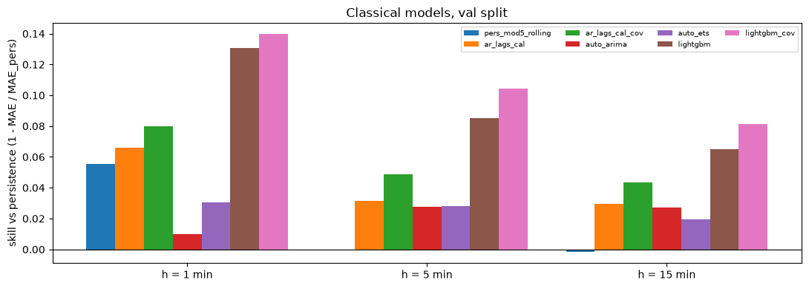

# Outputs of `08_classical_models.ipynb`
Exported 2026-10-09 11:12 from the saved notebook file.

## One-off repair: install lightgbm and make libomp.dylib available inside the kernel's own environment
_execution count: 1_

```
python: /opt/miniconda3/envs/dcpower/bin/python
$ /opt/miniconda3/envs/dcpower/bin/python -m pip install lightgbm
Requirement already satisfied: lightgbm in /opt/miniconda3/envs/dcpower/lib/python3.11/site-packages (4.7.0)
Requirement already satisfied: narwhals>=1.15 in /opt/miniconda3/envs/dcpower/lib/python3.11/site-packages (from lightgbm) (2.26.0)
Requirement already satisfied: numpy>=1.21.3 in /opt/miniconda3/envs/dcpower/lib/python3.11/site-packages (from lightgbm) (2.4.6)
Requirement already satisfied: scipy in /opt/miniconda3/envs/dcpower/lib/python3.11/site-packages (from lightgbm) (1.17.1)

libomp in environment: True /opt/miniconda3/envs/dcpower/lib/libomp.dylib
```

## Cell 1: setup, paths, packages, settings (needed by every cell)
_execution count: 2_

```
OK      data/processed/model_dataset.parquet
OK      data/processed/model_dataset_meta.json
OK      reports/baselines/val_predictions.parquet
OK      src/models/statespace.py
OK      src/models/tabular_features.py
python 3.11.16 | polars 1.44.2 | numpy 2.4.6 | statsforecast 2.1.1 | statsmodels 0.15.0 | lightgbm 4.7.0 | optuna 5.0.0
```

## Cell 2: dataset, sample indices, notebook-07 references (needs cell 1)
_execution count: 3_

```
rows 303,840 | builder 1.1 (2026-10-08) | val samples: {1: 42575, 5: 42567, 15: 42547}
notebook-07 references loaded and aligned: ['persistence', 'pers_mod5_rolling', 'ar_lags_cal', 'ar_lags_cal_cov']
```

## Cell 3: fitting segment for AutoARIMA / AutoETS (needs cell 2)
_execution count: 4_

```
fitting segment: 2021-07-17 00:00:00 .. 2021-07-29 16:47:00 | 18,288 minutes (12.7 days) | interpolated 0 minutes | long gaps cut: 1
filter series: 63,864 minutes, NaN 2,940
```

## Cell 4: AutoARIMA (statsforecast) on the segment, then a fixed-parameter Kalman filter over validation (needs cell 3)
_execution count: 5_

```
AutoARIMA order (p, d, q) = (1, 1, 5) | fit 4.9 s | AICc 24875.0
parameters: {'ar.L1': -0.3969, 'ma.L1': 0.1615, 'ma.L2': -0.1832, 'ma.L3': -0.2339, 'ma.L4': -0.2454, 'ma.L5': 0.1547, 'sigma2': 0.2281}
check one-step vs statsforecast fitted (after 500 min burn-in): max abs diff 1.09e-08 kW
h= 1: MAE 0.2838 kW (persistence 0.2866)
h= 5: MAE 0.4180 kW (persistence 0.4299)
h=15: MAE 0.5885 kW (persistence 0.6048)
```

## Cell 5: AutoETS (additive error, no season) on the segment, then fixed-parameter recursion over validation (needs cell 3)
_execution count: 6_

```
AutoETS model ANNN | fit 0.4 s | AICc 155174.1
{'alpha': 0.6957, 'beta': 0.0, 'phi': 0.0, 'l0': 35.0651, 'b0': 0.0, 'trend': False, 'damped': False, 'components': 'ANNN'}
check recursion vs statsforecast fitted: max abs diff 7.11e-15 kW
h= 1: MAE 0.2778 kW (persistence 0.2866)
h= 5: MAE 0.4178 kW (persistence 0.4299)
h=15: MAE 0.5930 kW (persistence 0.6048)
```

## Cell 6: LightGBM, Optuna tuning per horizon and arm on validation MAE (needs cell 2)
_execution count: 7_

```
h= 1 gbm     :  15 trials,    144 s | best MAE of change 0.2491 kW | rounds 692 | {'objective': 'regression_l1', 'learning_rate': 0.02523965106709417, 'num_leaves': 56, 'min_data_in_leaf': 241, 'feature_fraction': 0.5371044513568065, 'bagging_fraction': 0.8859056902990231, 'lambda_l2': 0.09849759569524298}
h= 1 gbm_cov :  15 trials,     88 s | best MAE of change 0.2465 kW | rounds 966 | {'objective': 'regression_l1', 'learning_rate': 0.056161972583919355, 'num_leaves': 26, 'min_data_in_leaf': 570, 'feature_fraction': 0.6435247769623673, 'bagging_fraction': 0.9949028979893475, 'lambda_l2': 0.7590410939827547}
h= 5 gbm     :  15 trials,    126 s | best MAE of change 0.3934 kW | rounds 646 | {'objective': 'regression_l1', 'learning_rate': 0.029827572824100364, 'num_leaves': 38, 'min_data_in_leaf': 199, 'feature_fraction': 0.6284400156137786, 'bagging_fraction': 0.951692187563174, 'lambda_l2': 0.28224321807470754}
h= 5 gbm_cov :  15 trials,    140 s | best MAE of change 0.3852 kW | rounds 491 | {'objective': 'regression_l1', 'learning_rate': 0.029827572824100364, 'num_leaves': 38, 'min_data_in_leaf': 199, 'feature_fraction': 0.6284400156137786, 'bagging_fraction': 0.951692187563174, 'lambda_l2': 0.28224321807470754}
h=15 gbm     :  15 trials,     67 s | best MAE of change 0.5654 kW | rounds 90 | {'objective': 'regression_l1', 'learning_rate': 0.07013150820373311, 'num_leaves': 49, 'min_data_in_leaf': 388, 'feature_fraction': 0.7187936056313462, 'bagging_fraction': 0.9458865003910399, 'lambda_l2': 7.155682161754866}
h=15 gbm_cov :  15 trials,    128 s | best MAE of change 0.5556 kW | rounds 284 | {'objective': 'regression_l1', 'learning_rate': 0.047888306530826215, 'num_leaves': 103, 'min_data_in_leaf': 353, 'feature_fraction': 0.5906586863891674, 'bagging_fraction': 0.8772183068894066, 'lambda_l2': 1.6440751547016361}
```

## Cell 7: LightGBM refit of the best setting with three seeds; feature importance (needs cell 6)
_execution count: 8_

```
h= 1 lightgbm     : MAE over seeds 0.2491 ± 0.0001 kW (seeds 0.2491, 0.2492, 0.2491)
h= 1 lightgbm_cov : MAE over seeds 0.2464 ± 0.0003 kW (seeds 0.2465, 0.2466, 0.2461)
h= 5 lightgbm     : MAE over seeds 0.3934 ± 0.0001 kW (seeds 0.3934, 0.3933, 0.3935)
h= 5 lightgbm_cov : MAE over seeds 0.3850 ± 0.0005 kW (seeds 0.3852, 0.3844, 0.3853)
h=15 lightgbm     : MAE over seeds 0.5659 ± 0.0004 kW (seeds 0.5654, 0.5662, 0.5662)
h=15 lightgbm_cov : MAE over seeds 0.5559 ± 0.0008 kW (seeds 0.5556, 0.5569, 0.5553)

top 15 features by gain share, lightgbm_cov, h = 5:
shape: (15, 2)
┌────────────────────┬────────────┐
│ feature            ┆ gain share │
│ ---                ┆ ---        │
│ str                ┆ f64        │
╞════════════════════╪════════════╡
│ d5_util_gpu_mean   ┆ 0.1707     │
│ lag1               ┆ 0.0639     │
│ lag2               ┆ 0.0624     │
│ lag3               ┆ 0.0543     │
│ lag4               ┆ 0.0387     │
│ d1_util_gpu_mean   ┆ 0.0385     │
│ lag10              ┆ 0.034      │
│ L24                ┆ 0.0306     │
│ d5_gpus_alloc      ┆ 0.0301     │
│ d5_util_mem_mean   ┆ 0.0269     │
│ d5_active_gpu_jobs ┆ 0.0261     │
│ lag7               ┆ 0.0235     │
│ d5_mem_used_sum    ┆ 0.0203     │
│ d5_n_gpu_equiv     ┆ 0.0202     │
│ d1_temp_mem_mean   ┆ 0.0174     │
└────────────────────┴────────────┘
```

## Cell 8: comparison on validation; DM vs persistence and vs ar_lags_cal_cov; covariate arm (needs cells 4, 5, 7)
_execution count: 9_

```
shape: (24, 15)
┌─────┬───────────────────┬────────┬────────┬────────┬──────────┬───────────┬──────────┬────────────┬─────────────┬─────────┬──────────┬────────┬──────────────────┬───────────────┐
│ h   ┆ model             ┆ MAE    ┆ RMSE   ┆ sMAPE  ┆ R2_delta ┆ skill_MAE ┆ MAE_ramp ┆ MAE_normal ┆ ramp_recall ┆ ramp_F1 ┆ DM_stat  ┆ DM_p   ┆ DM_vs_ARcov_stat ┆ DM_vs_ARcov_p │
│ --- ┆ ---               ┆ ---    ┆ ---    ┆ ---    ┆ ---      ┆ ---       ┆ ---      ┆ ---        ┆ ---         ┆ ---     ┆ ---      ┆ ---    ┆ ---              ┆ ---           │
│ i64 ┆ str               ┆ f64    ┆ f64    ┆ f64    ┆ f64      ┆ f64       ┆ f64      ┆ f64        ┆ f64         ┆ f64     ┆ f64      ┆ f64    ┆ f64              ┆ f64           │
╞═════╪═══════════════════╪════════╪════════╪════════╪══════════╪═══════════╪══════════╪════════════╪═════════════╪═════════╪══════════╪════════╪══════════════════╪═══════════════╡
│ 1   ┆ persistence       ┆ 0.2866 ┆ 0.511  ┆ 0.9163 ┆ -0.0     ┆ 0.0       ┆ 1.6074   ┆ 0.2264     ┆ 0.0         ┆ 0.0     ┆ NaN      ┆ NaN    ┆ 7.513            ┆ 0.0           │
│ 1   ┆ pers_mod5_rolling ┆ 0.2707 ┆ 0.4829 ┆ 0.9001 ┆ 0.1071   ┆ 0.0556    ┆ 1.445    ┆ 0.2157     ┆ 0.0         ┆ 0.0     ┆ -7.179   ┆ 0.0    ┆ 2.7045           ┆ 0.0068        │
│ 1   ┆ ar_lags_cal       ┆ 0.2677 ┆ 0.4897 ┆ 0.8839 ┆ 0.0817   ┆ 0.0658    ┆ 1.4007   ┆ 0.2159     ┆ 0.0862      ┆ 0.1434  ┆ -6.8846  ┆ 0.0    ┆ 4.636            ┆ 0.0           │
│ 1   ┆ ar_lags_cal_cov   ┆ 0.2637 ┆ 0.4858 ┆ 0.8693 ┆ 0.0963   ┆ 0.08      ┆ 1.3332   ┆ 0.2151     ┆ 0.1182      ┆ 0.1803  ┆ -7.513   ┆ 0.0    ┆ NaN              ┆ NaN           │
│ 1   ┆ auto_arima        ┆ 0.2838 ┆ 0.5051 ┆ 0.9213 ┆ 0.023    ┆ 0.0098    ┆ 1.4651   ┆ 0.2299     ┆ 0.0541      ┆ 0.0914  ┆ -1.3882  ┆ 0.1651 ┆ 12.8851          ┆ 0.0           │
│ 1   ┆ auto_ets          ┆ 0.2778 ┆ 0.5109 ┆ 0.8927 ┆ 0.0005   ┆ 0.0307    ┆ 1.5581   ┆ 0.2194     ┆ 0.0368      ┆ 0.0683  ┆ -7.3698  ┆ 0.0    ┆ 6.6477           ┆ 0.0           │
│ 1   ┆ lightgbm          ┆ 0.2491 ┆ 0.4662 ┆ 0.8107 ┆ 0.1677   ┆ 0.1309    ┆ 1.341    ┆ 0.1993     ┆ 0.1114      ┆ 0.1911  ┆ -16.6591 ┆ 0.0    ┆ -7.7131          ┆ 0.0           │
│ 1   ┆ lightgbm_cov      ┆ 0.2465 ┆ 0.4615 ┆ 0.8168 ┆ 0.1845   ┆ 0.1398    ┆ 1.2764   ┆ 0.1998     ┆ 0.1692      ┆ 0.2664  ┆ -15.8752 ┆ 0.0    ┆ -10.0192         ┆ 0.0           │
│ 5   ┆ persistence       ┆ 0.4299 ┆ 0.8971 ┆ 1.427  ┆ -0.0     ┆ 0.0       ┆ 2.6311   ┆ 0.2967     ┆ 0.0         ┆ 0.0     ┆ NaN      ┆ NaN    ┆ 6.1204           ┆ 0.0           │
│ 5   ┆ pers_mod5_rolling ┆ 0.4302 ┆ 0.8974 ┆ 1.4278 ┆ -0.0006  ┆ -0.0005   ┆ 2.6317   ┆ 0.2969     ┆ 0.0         ┆ 0.0     ┆ 5.2139   ┆ 0.0    ┆ 6.1783           ┆ 0.0           │
│ 5   ┆ ar_lags_cal       ┆ 0.4163 ┆ 0.8479 ┆ 1.4028 ┆ 0.1066   ┆ 0.0317    ┆ 2.3745   ┆ 0.2975     ┆ 0.1158      ┆ 0.1934  ┆ -4.6459  ┆ 0.0    ┆ 4.8453           ┆ 0.0           │
│ 5   ┆ ar_lags_cal_cov   ┆ 0.409  ┆ 0.8377 ┆ 1.375  ┆ 0.128    ┆ 0.0486    ┆ 2.2495   ┆ 0.298      ┆ 0.1673      ┆ 0.2552  ┆ -6.1204  ┆ 0.0    ┆ NaN              ┆ NaN           │
│ 5   ┆ auto_arima        ┆ 0.418  ┆ 0.857  ┆ 1.4004 ┆ 0.0875   ┆ 0.0278    ┆ 2.3819   ┆ 0.2989     ┆ 0.1105      ┆ 0.1849  ┆ -4.8275  ┆ 0.0    ┆ 4.8201           ┆ 0.0           │
│ 5   ┆ auto_ets          ┆ 0.4178 ┆ 0.8802 ┆ 1.3909 ┆ 0.0374   ┆ 0.0283    ┆ 2.555    ┆ 0.2883     ┆ 0.0168      ┆ 0.0326  ┆ -12.9859 ┆ 0.0    ┆ 3.1007           ┆ 0.0019        │
│ 5   ┆ lightgbm          ┆ 0.3934 ┆ 0.8244 ┆ 1.319  ┆ 0.1556   ┆ 0.0849    ┆ 2.2762   ┆ 0.2793     ┆ 0.1477      ┆ 0.2491  ┆ -13.4376 ┆ 0.0    ┆ -5.7395          ┆ 0.0           │
│ 5   ┆ lightgbm_cov      ┆ 0.3852 ┆ 0.8113 ┆ 1.3042 ┆ 0.1822   ┆ 0.1041    ┆ 2.1899   ┆ 0.2761     ┆ 0.1837      ┆ 0.2985  ┆ -14.9374 ┆ 0.0    ┆ -8.9203          ┆ 0.0           │
│ 15  ┆ persistence       ┆ 0.6048 ┆ 1.1784 ┆ 2.0806 ┆ -0.0     ┆ 0.0       ┆ 3.2787   ┆ 0.4199     ┆ 0.0         ┆ 0.0     ┆ NaN      ┆ NaN    ┆ 6.2286           ┆ 0.0           │
│ 15  ┆ pers_mod5_rolling ┆ 0.6059 ┆ 1.1793 ┆ 2.0844 ┆ -0.0014  ┆ -0.0017   ┆ 3.2798   ┆ 0.4209     ┆ 0.0         ┆ 0.0     ┆ 4.7393   ┆ 0.0    ┆ 6.4508           ┆ 0.0           │
│ 15  ┆ ar_lags_cal       ┆ 0.5869 ┆ 1.1223 ┆ 2.0435 ┆ 0.093    ┆ 0.0297    ┆ 3.023    ┆ 0.4185     ┆ 0.0679      ┆ 0.1218  ┆ -4.88    ┆ 0.0    ┆ 4.7395           ┆ 0.0           │
│ 15  ┆ ar_lags_cal_cov   ┆ 0.5786 ┆ 1.1094 ┆ 2.0102 ┆ 0.1137   ┆ 0.0434    ┆ 2.8905   ┆ 0.419      ┆ 0.1029      ┆ 0.1748  ┆ -6.2286  ┆ 0.0    ┆ NaN              ┆ NaN           │
│ 15  ┆ auto_arima        ┆ 0.5885 ┆ 1.1329 ┆ 2.0369 ┆ 0.0758   ┆ 0.0271    ┆ 3.0566   ┆ 0.4177     ┆ 0.0569      ┆ 0.1036  ┆ -6.5988  ┆ 0.0    ┆ 3.7016           ┆ 0.0002        │
│ 15  ┆ auto_ets          ┆ 0.593  ┆ 1.1589 ┆ 2.0448 ┆ 0.0328   ┆ 0.0195    ┆ 3.2113   ┆ 0.4119     ┆ 0.0095      ┆ 0.0187  ┆ -14.4006 ┆ 0.0    ┆ 3.8765           ┆ 0.0001        │
│ 15  ┆ lightgbm          ┆ 0.5654 ┆ 1.0992 ┆ 1.9668 ┆ 0.1299   ┆ 0.0652    ┆ 2.9096   ┆ 0.4027     ┆ 0.1131      ┆ 0.1981  ┆ -10.0107 ┆ 0.0    ┆ -3.7374          ┆ 0.0002        │
│ 15  ┆ lightgbm_cov      ┆ 0.5556 ┆ 1.0843 ┆ 1.9325 ┆ 0.1534   ┆ 0.0815    ┆ 2.8054   ┆ 0.3995     ┆ 0.138       ┆ 0.2337  ┆ -10.6807 ┆ 0.0    ┆ -6.3384          ┆ 0.0           │
└─────┴───────────────────┴────────┴────────┴────────┴──────────┴───────────┴──────────┴────────────┴─────────────┴─────────┴──────────┴────────┴──────────────────┴───────────────┘

h = 1, MAE without mod-0 targets:
shape: (8, 2)
┌───────────────────┬────────────────────┐
│ model             ┆ MAE_no_mod0_target │
│ ---               ┆ ---                │
│ str               ┆ f64                │
╞═══════════════════╪════════════════════╡
│ persistence       ┆ 0.2711             │
│ pers_mod5_rolling ┆ 0.2609             │
│ ar_lags_cal       ┆ 0.2599             │
│ ar_lags_cal_cov   ┆ 0.2556             │
│ auto_arima        ┆ 0.273              │
│ auto_ets          ┆ 0.261              │
│ lightgbm          ┆ 0.2412             │
│ lightgbm_cov      ┆ 0.2382             │
└───────────────────┴────────────────────┘

covariate arm, LightGBM:
shape: (3, 6)
┌─────┬──────────────┬────────────────────┬─────────────┬─────────┬────────────┐
│ h   ┆ LightGBM MAE ┆ LightGBM + cov MAE ┆ rel. change ┆ DM stat ┆ DM p       │
│ --- ┆ ---          ┆ ---                ┆ ---         ┆ ---     ┆ ---        │
│ i64 ┆ f64          ┆ f64                ┆ f64         ┆ f64     ┆ f64        │
╞═════╪══════════════╪════════════════════╪═════════════╪═════════╪════════════╡
│ 1   ┆ 0.2491       ┆ 0.2465             ┆ -0.0102     ┆ -2.81   ┆ 0.004888   │
│ 5   ┆ 0.3934       ┆ 0.3852             ┆ -0.021      ┆ -6.84   ┆ 7.8602e-12 │
│ 15  ┆ 0.5654       ┆ 0.5556             ┆ -0.0174     ┆ -6.34   ┆ 2.3008e-10 │
└─────┴──────────────┴────────────────────┴─────────────┴─────────┴────────────┘

ranking by validation MAE:
shape: (3, 2)
┌─────┬───────────────────────────────────────────────────────────────────────────────────────────────────────────────────┐
│ h   ┆ model                                                                                                             │
│ --- ┆ ---                                                                                                               │
│ i64 ┆ str                                                                                                               │
╞═════╪═══════════════════════════════════════════════════════════════════════════════════════════════════════════════════╡
│ 1   ┆ lightgbm_cov < lightgbm < ar_lags_cal_cov < ar_lags_cal < pers_mod5_rolling < auto_ets < auto_arima < persistence │
│ 5   ┆ lightgbm_cov < lightgbm < ar_lags_cal_cov < ar_lags_cal < auto_ets < auto_arima < persistence < pers_mod5_rolling │
│ 15  ┆ lightgbm_cov < lightgbm < ar_lags_cal_cov < ar_lags_cal < auto_arima < auto_ets < persistence < pers_mod5_rolling │
└─────┴───────────────────────────────────────────────────────────────────────────────────────────────────────────────────┘
```

## Cell 9: figure: skill vs persistence per model and horizon (needs cell 8)
_execution count: 10_



```
saved reports/figures/classical/01_skill_val.png
```

## Cell 10: save tables, predictions and a summary (needs cell 8)
_execution count: 11_

```
written reports/classical/val_metrics.csv (0.01 MiB)
written reports/classical/val_covariate_arm_lightgbm.csv (0.00 MiB)
written reports/classical/val_predictions.parquet (7.95 MiB)
written reports/classical/classical_summary.json (0.03 MiB)
```

## Cell 11: summary (needs cells 8 and 10)
_execution count: 12_

```
split val | test not opened | AutoARIMA (1, 1, 5) | AutoETS ANNN
h= 1: persistence 0.2866 | best lightgbm_cov 0.2465 kW (skill +0.140) | auto_arima +0.010 | auto_ets +0.031 | lightgbm +0.131 | lightgbm_cov +0.140 | LightGBM covariates -1.02% (DM p 0.0049)
h= 5: persistence 0.4299 | best lightgbm_cov 0.3852 kW (skill +0.104) | auto_arima +0.028 | auto_ets +0.028 | lightgbm +0.085 | lightgbm_cov +0.104 | LightGBM covariates -2.10% (DM p 7.9e-12)
h=15: persistence 0.6048 | best lightgbm_cov 0.5556 kW (skill +0.081) | auto_arima +0.027 | auto_ets +0.020 | lightgbm +0.065 | lightgbm_cov +0.081 | LightGBM covariates -1.74% (DM p 2.3e-10)
```

## %run ../src/tools/nb_outputs_to_md.py 08_classical_models.ipynb
_execution count: 13_

```
written 08_classical_models_outputs.md | code cells 12 | figures 1 in 08_classical_models_outputs_figures
```

## Cell 14
_execution count: None_

(no output)
