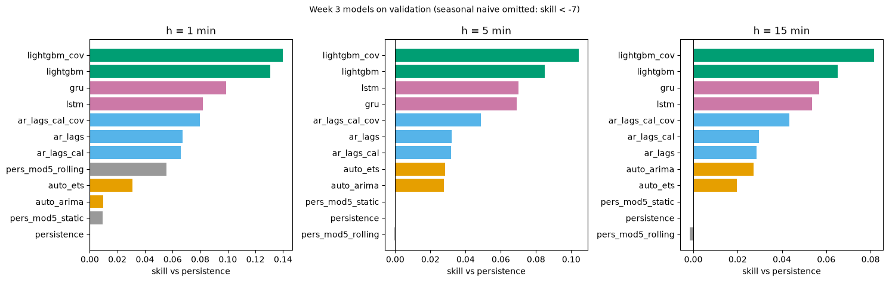
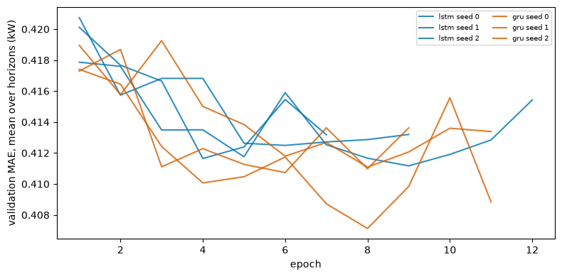

# Outputs of `09_week3_completion.ipynb`
Exported 2026-10-09 13:33 from the saved notebook file.

## Cell 1: setup, packages, helper to run a config (needed by every cell)
_execution count: 1_

```
OK      data/processed/model_dataset.parquet
OK      data/processed/model_dataset_meta.json
OK      configs/rnn_lstm.yaml
OK      configs/rnn_gru.yaml
OK      configs/tracking.yaml
OK      src/run_experiment.py
OK      src/models/rnn.py
OK      src/tracking.py
OK      src/evaluation/rolling.py
OK      reports/baselines/val_metrics.csv
OK      reports/classical/val_metrics.csv
python 3.11.16 | torch 2.14.1 | wandb 0.30.0 | polars 1.44.2
```

## Cell 2: tracking check: can this machine log to W&B? (needs cell 1)
_execution count: 2_

```
tracking config: {'project': 'datacenter-power-forecasting', 'entity': 'aryan-faghirollahy-uok', 'mode': 'auto'}
```

```stderr
wandb: [wandb.login()] Loaded credentials for https://api.wandb.ai from /Users/aryaneuse/.netrc.
```

```
W&B mode used: online | record experiments/runs/checks/tracking_check.json
```

## Cell 3: scaling decision with LSTM seed 0: minmax (protocol default) vs local (needs cell 1)
_execution count: 3_

```
$ -u src/run_experiment.py --config configs/rnn_lstm.yaml --set scaling=minmax seed=0
[12:28:33] run lstm_minmax_s0 | config /Users/aryaneuse/Desktop/Uni Project/datacenter-power-forecasting/configs/rnn_lstm.yaml | overrides ['scaling=minmax', 'seed=0']
  epoch   1 | train loss 0.00020 | val MAE 0.2852 / 0.4343 / 0.6043 kW | 54 s
  epoch   2 | train loss 0.00017 | val MAE 0.2998 / 0.4301 / 0.6077 kW | 109 s
  epoch   3 | train loss 0.00017 | val MAE 0.2893 / 0.4431 / 0.6051 kW | 164 s
  epoch   4 | train loss 0.00017 | val MAE 0.2902 / 0.4454 / 0.6128 kW | 217 s
wandb: [wandb.login()] Loaded credentials for https://api.wandb.ai from /Users/aryaneuse/.netrc.
[12:32:25] done lstm_minmax_s0 | params 52,419 | train 217 s | best epoch 1 | val MAE 0.2852 / 0.4343 / 0.6043 kW | tracking: online | experiments/runs/week3_rnn/lstm_minmax_s0.json
$ -u src/run_experiment.py --config configs/rnn_lstm.yaml --set scaling=local seed=0
[12:32:26] run lstm_local_s0 | config /Users/aryaneuse/Desktop/Uni Project/datacenter-power-forecasting/configs/rnn_lstm.yaml | overrides ['scaling=local', 'seed=0']
  epoch   1 | train loss 1.94028 | val MAE 0.2760 / 0.4078 / 0.5784 kW | 53 s
  epoch   2 | train loss 1.88230 | val MAE 0.2722 / 0.4033 / 0.5718 kW | 107 s
  epoch   3 | train loss 1.86526 | val MAE 0.2720 / 0.4055 / 0.5730 kW | 161 s
  epoch   4 | train loss 1.84852 | val MAE 0.2705 / 0.4057 / 0.5742 kW | 214 s
  epoch   5 | train loss 1.83802 | val MAE 0.2675 / 0.4004 / 0.5700 kW | 270 s
  epoch   6 | train loss 1.82916 | val MAE 0.2644 / 0.4008 / 0.5722 kW | 330 s
  epoch   7 | train loss 1.82019 | val MAE 0.2624 / 0.4016 / 0.5741 kW | 384 s
  epoch   8 | train loss 1.81600 | val MAE 0.2616 / 0.4025 / 0.5745 kW | 438 s
  epoch   9 | train loss 1.80541 | val MAE 0.2598 / 0.4040 / 0.5759 kW | 495 s
wandb: [wandb.login()] Loaded credentials for https://api.wandb.ai from /Users/aryaneuse/.netrc.
[12:42:43] done lstm_local_s0 | params 52,419 | train 495 s | best epoch 6 | val MAE 0.2644 / 0.4008 / 0.5722 kW | tracking: online | experiments/runs/week3_rnn/lstm_local_s0.json
shape: (2, 7)
┌─────────┬─────────────┬─────────────┬──────────────┬────────┬────────────┬─────────┐
│ scaling ┆ val MAE h=1 ┆ val MAE h=5 ┆ val MAE h=15 ┆ mean   ┆ best epoch ┆ train s │
│ ---     ┆ ---         ┆ ---         ┆ ---          ┆ ---    ┆ ---        ┆ ---     │
│ str     ┆ f64         ┆ f64         ┆ f64          ┆ f64    ┆ i64        ┆ i64     │
╞═════════╪═════════════╪═════════════╪══════════════╪════════╪════════════╪═════════╡
│ minmax  ┆ 0.2852      ┆ 0.4343      ┆ 0.6043       ┆ 0.4412 ┆ 1          ┆ 217     │
│ local   ┆ 0.2644      ┆ 0.4008      ┆ 0.5722       ┆ 0.4125 ┆ 6          ┆ 495     │
└─────────┴─────────────┴─────────────┴──────────────┴────────┴────────────┴─────────┘
chosen scaling (lowest mean validation MAE): local
```

## Cell 4: remaining seeds: LSTM seeds 1, 2 and GRU seeds 0, 1, 2 with the chosen scaling (needs cell 3)
_execution count: 4_

```
$ -u src/run_experiment.py --config configs/rnn_lstm.yaml --set scaling=local seed=1
[12:42:44] run lstm_local_s1 | config /Users/aryaneuse/Desktop/Uni Project/datacenter-power-forecasting/configs/rnn_lstm.yaml | overrides ['scaling=local', 'seed=1']
  epoch   1 | train loss 1.94424 | val MAE 0.2749 / 0.4046 / 0.5741 kW | 55 s
  epoch   2 | train loss 1.88799 | val MAE 0.2728 / 0.4044 / 0.5756 kW | 108 s
  epoch   3 | train loss 1.86482 | val MAE 0.2684 / 0.4019 / 0.5701 kW | 161 s
  epoch   4 | train loss 1.85116 | val MAE 0.2687 / 0.4005 / 0.5712 kW | 216 s
  epoch   5 | train loss 1.83319 | val MAE 0.2644 / 0.3994 / 0.5715 kW | 274 s
  epoch   6 | train loss 1.82380 | val MAE 0.2658 / 0.4045 / 0.5774 kW | 333 s
  epoch   7 | train loss 1.81448 | val MAE 0.2613 / 0.4013 / 0.5750 kW | 387 s
  epoch   8 | train loss 1.80302 | val MAE 0.2586 / 0.4005 / 0.5759 kW | 441 s
  epoch   9 | train loss 1.79800 | val MAE 0.2570 / 0.3998 / 0.5767 kW | 494 s
  epoch  10 | train loss 1.79431 | val MAE 0.2559 / 0.4020 / 0.5779 kW | 548 s
  epoch  11 | train loss 1.78684 | val MAE 0.2567 / 0.4026 / 0.5792 kW | 601 s
  epoch  12 | train loss 1.78118 | val MAE 0.2605 / 0.4047 / 0.5811 kW | 654 s
wandb: [wandb.login()] Loaded credentials for https://api.wandb.ai from /Users/aryaneuse/.netrc.
[12:54:30] done lstm_local_s1 | params 52,419 | train 654 s | best epoch 9 | val MAE 0.2570 / 0.3998 / 0.5767 kW | tracking: online | experiments/runs/week3_rnn/lstm_local_s1.json
$ -u src/run_experiment.py --config configs/rnn_lstm.yaml --set scaling=local seed=2
[12:54:31] run lstm_local_s2 | config /Users/aryaneuse/Desktop/Uni Project/datacenter-power-forecasting/configs/rnn_lstm.yaml | overrides ['scaling=local', 'seed=2']
  epoch   1 | train loss 1.94168 | val MAE 0.2769 / 0.4077 / 0.5757 kW | 52 s
  epoch   2 | train loss 1.88518 | val MAE 0.2722 / 0.4069 / 0.5740 kW | 104 s
  epoch   3 | train loss 1.86273 | val MAE 0.2711 / 0.4053 / 0.5736 kW | 157 s
  epoch   4 | train loss 1.84596 | val MAE 0.2679 / 0.3989 / 0.5682 kW | 209 s
  epoch   5 | train loss 1.83495 | val MAE 0.2648 / 0.4007 / 0.5717 kW | 262 s
  epoch   6 | train loss 1.82125 | val MAE 0.2670 / 0.4050 / 0.5743 kW | 315 s
  epoch   7 | train loss 1.81317 | val MAE 0.2601 / 0.4056 / 0.5738 kW | 368 s
wandb: [wandb.login()] Loaded credentials for https://api.wandb.ai from /Users/aryaneuse/.netrc.
[13:01:20] done lstm_local_s2 | params 52,419 | train 368 s | best epoch 4 | val MAE 0.2679 / 0.3989 / 0.5682 kW | tracking: online | experiments/runs/week3_rnn/lstm_local_s2.json
$ -u src/run_experiment.py --config configs/rnn_gru.yaml --set scaling=local seed=0
[13:01:21] run gru_local_s0 | config /Users/aryaneuse/Desktop/Uni Project/datacenter-power-forecasting/configs/rnn_gru.yaml | overrides ['scaling=local', 'seed=0']
  epoch   1 | train loss 1.94151 | val MAE 0.2710 / 0.4070 / 0.5789 kW | 50 s
  epoch   2 | train loss 1.87476 | val MAE 0.2688 / 0.4040 / 0.5746 kW | 101 s
  epoch   3 | train loss 1.85125 | val MAE 0.2711 / 0.4092 / 0.5774 kW | 153 s
  epoch   4 | train loss 1.83462 | val MAE 0.2667 / 0.4042 / 0.5741 kW | 207 s
  epoch   5 | train loss 1.82281 | val MAE 0.2663 / 0.4020 / 0.5732 kW | 259 s
  epoch   6 | train loss 1.81095 | val MAE 0.2609 / 0.4012 / 0.5733 kW | 314 s
  epoch   7 | train loss 1.79901 | val MAE 0.2597 / 0.4030 / 0.5753 kW | 368 s
  epoch   8 | train loss 1.78887 | val MAE 0.2563 / 0.4026 / 0.5744 kW | 419 s
  epoch   9 | train loss 1.77833 | val MAE 0.2577 / 0.4028 / 0.5756 kW | 470 s
  epoch  10 | train loss 1.77175 | val MAE 0.2564 / 0.4055 / 0.5789 kW | 521 s
  epoch  11 | train loss 1.76130 | val MAE 0.2576 / 0.4066 / 0.5760 kW | 572 s
wandb: [wandb.login()] Loaded credentials for https://api.wandb.ai from /Users/aryaneuse/.netrc.
[13:11:16] done gru_local_s0 | params 39,363 | train 572 s | best epoch 8 | val MAE 0.2563 / 0.4026 / 0.5744 kW | tracking: online | experiments/runs/week3_rnn/gru_local_s0.json
$ -u src/run_experiment.py --config configs/rnn_gru.yaml --set scaling=local seed=1
[13:11:17] run gru_local_s1 | config /Users/aryaneuse/Desktop/Uni Project/datacenter-power-forecasting/configs/rnn_gru.yaml | overrides ['scaling=local', 'seed=1']
  epoch   1 | train loss 1.93873 | val MAE 0.2722 / 0.4053 / 0.5744 kW | 53 s
  epoch   2 | train loss 1.87594 | val MAE 0.2739 / 0.4054 / 0.5767 kW | 105 s
  epoch   3 | train loss 1.84873 | val MAE 0.2655 / 0.3999 / 0.5680 kW | 156 s
  epoch   4 | train loss 1.83421 | val MAE 0.2674 / 0.4003 / 0.5691 kW | 210 s
  epoch   5 | train loss 1.82145 | val MAE 0.2638 / 0.4003 / 0.5697 kW | 264 s
  epoch   6 | train loss 1.81116 | val MAE 0.2622 / 0.4004 / 0.5695 kW | 319 s
  epoch   7 | train loss 1.80315 | val MAE 0.2608 / 0.4050 / 0.5751 kW | 375 s
  epoch   8 | train loss 1.79282 | val MAE 0.2602 / 0.4019 / 0.5708 kW | 427 s
  epoch   9 | train loss 1.78399 | val MAE 0.2635 / 0.4032 / 0.5742 kW | 479 s
wandb: [wandb.login()] Loaded credentials for https://api.wandb.ai from /Users/aryaneuse/.netrc.
[13:19:29] done gru_local_s1 | params 39,363 | train 479 s | best epoch 6 | val MAE 0.2622 / 0.4004 / 0.5695 kW | tracking: online | experiments/runs/week3_rnn/gru_local_s1.json
$ -u src/run_experiment.py --config configs/rnn_gru.yaml --set scaling=local seed=2
[13:19:30] run gru_local_s2 | config /Users/aryaneuse/Desktop/Uni Project/datacenter-power-forecasting/configs/rnn_gru.yaml | overrides ['scaling=local', 'seed=2']
  epoch   1 | train loss 1.93884 | val MAE 0.2709 / 0.4063 / 0.5750 kW | 49 s
  epoch   2 | train loss 1.87419 | val MAE 0.2677 / 0.4071 / 0.5746 kW | 100 s
  epoch   3 | train loss 1.84708 | val MAE 0.2668 / 0.4007 / 0.5697 kW | 151 s
  epoch   4 | train loss 1.82912 | val MAE 0.2638 / 0.3981 / 0.5683 kW | 204 s
  epoch   5 | train loss 1.81602 | val MAE 0.2608 / 0.4008 / 0.5698 kW | 254 s
  epoch   6 | train loss 1.80455 | val MAE 0.2598 / 0.4027 / 0.5727 kW | 305 s
  epoch   7 | train loss 1.79515 | val MAE 0.2562 / 0.4008 / 0.5691 kW | 357 s
  epoch   8 | train loss 1.78308 | val MAE 0.2563 / 0.3977 / 0.5674 kW | 409 s
  epoch   9 | train loss 1.77521 | val MAE 0.2556 / 0.4007 / 0.5732 kW | 460 s
  epoch  10 | train loss 1.76314 | val MAE 0.2579 / 0.4073 / 0.5815 kW | 510 s
  epoch  11 | train loss 1.75407 | val MAE 0.2551 / 0.4004 / 0.5710 kW | 562 s
wandb: [wandb.login()] Loaded credentials for https://api.wandb.ai from /Users/aryaneuse/.netrc.
[13:29:18] done gru_local_s2 | params 39,363 | train 562 s | best epoch 8 | val MAE 0.2563 / 0.3977 / 0.5674 kW | tracking: online | experiments/runs/week3_rnn/gru_local_s2.json
{'lstm/s0': 'lstm_local_s0', 'lstm/s1': 'lstm_local_s1', 'lstm/s2': 'lstm_local_s2', 'gru/s0': 'gru_local_s0', 'gru/s1': 'gru_local_s1', 'gru/s2': 'gru_local_s2'}
```

## Cell 5: network results: mean ± sd over seeds, parameters, training and inference time (needs cell 4)
_execution count: 5_

```
shape: (6, 11)
┌───────┬─────┬──────────┬────────┬────────────┬──────────┬──────────┬────────┬─────────┬─────────────────┬────────────┐
│ model ┆ h   ┆ MAE mean ┆ MAE sd ┆ skill mean ┆ skill sd ┆ MAE ramp ┆ params ┆ train s ┆ infer ms/sample ┆ best epoch │
│ ---   ┆ --- ┆ ---      ┆ ---    ┆ ---        ┆ ---      ┆ ---      ┆ ---    ┆ ---     ┆ ---             ┆ ---        │
│ str   ┆ i64 ┆ f64      ┆ f64    ┆ f64        ┆ f64      ┆ f64      ┆ i64    ┆ f64     ┆ f64             ┆ f64        │
╞═══════╪═════╪══════════╪════════╪════════════╪══════════╪══════════╪════════╪═════════╪═════════════════╪════════════╡
│ gru   ┆ 1   ┆ 0.2583   ┆ 0.0034 ┆ 0.0987     ┆ 0.0119   ┆ 1.3133   ┆ 39363  ┆ 538.0   ┆ 0.0651          ┆ 7.333333   │
│ gru   ┆ 5   ┆ 0.4002   ┆ 0.0025 ┆ 0.0691     ┆ 0.0057   ┆ 2.1969   ┆ 39363  ┆ 538.0   ┆ 0.0651          ┆ 7.333333   │
│ gru   ┆ 15  ┆ 0.5704   ┆ 0.0036 ┆ 0.0569     ┆ 0.0059   ┆ 2.8108   ┆ 39363  ┆ 538.0   ┆ 0.0651          ┆ 7.333333   │
│ lstm  ┆ 1   ┆ 0.2631   ┆ 0.0056 ┆ 0.0819     ┆ 0.0195   ┆ 1.3232   ┆ 52419  ┆ 506.0   ┆ 0.0866          ┆ 6.333333   │
│ lstm  ┆ 5   ┆ 0.3998   ┆ 0.001  ┆ 0.07       ┆ 0.0023   ┆ 2.1822   ┆ 52419  ┆ 506.0   ┆ 0.0866          ┆ 6.333333   │
│ lstm  ┆ 15  ┆ 0.5724   ┆ 0.0043 ┆ 0.0537     ┆ 0.007    ┆ 2.8163   ┆ 52419  ┆ 506.0   ┆ 0.0866          ┆ 6.333333   │
└───────┴─────┴──────────┴────────┴────────────┴──────────┴──────────┴────────┴─────────┴─────────────────┴────────────┘
```

## Cell 6: Alberta comparison (LSTM). Their numbers are as reported in the paper (arXiv 2503.07756), not re-run. (needs cell 5)
_execution count: 6_

```
shape: (7, 8)
┌─────────────────────────┬────────────┬───────────────────┬─────────┬─────────┬────────────────┬────────┬─────────┐
│ source                  ┆ resolution ┆ window            ┆ horizon ┆ runs    ┆ naive baseline ┆ R2     ┆ sMAPE % │
│ ---                     ┆ ---        ┆ ---               ┆ ---     ┆ ---     ┆ ---            ┆ ---    ┆ ---     │
│ str                     ┆ str        ┆ str               ┆ str     ┆ str     ┆ str            ┆ f64    ┆ f64     │
╞═════════════════════════╪════════════╪═══════════════════╪═════════╪═════════╪════════════════╪════════╪═════════╡
│ Alberta LSTM (paper)    ┆ 1 s        ┆ 300 steps (5 min) ┆ 90 s    ┆ 1       ┆ none           ┆ 0.9639 ┆ 2.26    │
│ our LSTM, h = 1 min     ┆ 1 min      ┆ 60 steps (60 min) ┆ 1 min   ┆ 3 seeds ┆ persistence    ┆ 0.997  ┆ 0.87    │
│ persistence, h = 1 min  ┆ 1 min      ┆ -                 ┆ 1 min   ┆ -       ┆ -              ┆ 0.9966 ┆ 0.916   │
│ our LSTM, h = 5 min     ┆ 1 min      ┆ 60 steps (60 min) ┆ 5 min   ┆ 3 seeds ┆ persistence    ┆ 0.9911 ┆ 1.355   │
│ persistence, h = 5 min  ┆ 1 min      ┆ -                 ┆ 5 min   ┆ -       ┆ -              ┆ 0.9894 ┆ 1.427   │
│ our LSTM, h = 15 min    ┆ 1 min      ┆ 60 steps (60 min) ┆ 15 min  ┆ 3 seeds ┆ persistence    ┆ 0.9837 ┆ 2.005   │
│ persistence, h = 15 min ┆ 1 min      ┆ -                 ┆ 15 min  ┆ -       ┆ -              ┆ 0.9817 ┆ 2.081   │
└─────────────────────────┴────────────┴───────────────────┴─────────┴─────────┴────────────────┴────────┴─────────┘
Note: at 1-minute resolution persistence alone reaches R2 > 0.98, so R2 does not separate models here;
the numbers are not comparable across settings (resolution, window, horizon, data period, split).
```

## Cell 7: rolling-origin evaluation: (a) per-week skill of fixed models on validation, (b) expanding-window re-fit demo (needs cell 5)
_execution count: 7_

```
(a) skill per validation week (weeks start Monday; partial weeks with < 500 samples dropped)
shape: (16, 6)
┌─────┬─────────────────────┬───────┬─────────────────┬──────────────┬──────────────┐
│ h   ┆ block_start         ┆ n     ┆ ar_lags_cal_cov ┆ lightgbm_cov ┆ gru (seed 0) │
│ --- ┆ ---                 ┆ ---   ┆ ---             ┆ ---          ┆ ---          │
│ i32 ┆ datetime[μs]        ┆ i64   ┆ f64             ┆ f64          ┆ f64          │
╞═════╪═════════════════════╪═══════╪═════════════════╪══════════════╪══════════════╡
│ 1   ┆ 2021-07-26 00:00:00 ┆ 4752  ┆ 0.2288          ┆ 0.2438       ┆ 0.2134       │
│ 1   ┆ 2021-08-02 00:00:00 ┆ 10080 ┆ 0.1336          ┆ 0.1896       ┆ 0.1542       │
│ 1   ┆ 2021-08-09 00:00:00 ┆ 7080  ┆ 0.0435          ┆ 0.1454       ┆ 0.0377       │
│ 1   ┆ 2021-08-16 00:00:00 ┆ 10080 ┆ -0.1148         ┆ -0.0361      ┆ -0.048       │
│ 1   ┆ 2021-08-23 00:00:00 ┆ 10080 ┆ 0.0091          ┆ 0.0817       ┆ 0.0647       │
│ 1   ┆ 2021-08-30 00:00:00 ┆ 503   ┆ 0.0556          ┆ 0.1221       ┆ 0.0714       │
│ 5   ┆ 2021-07-26 00:00:00 ┆ 4752  ┆ 0.1381          ┆ 0.1516       ┆ 0.1259       │
│ 5   ┆ 2021-08-02 00:00:00 ┆ 10080 ┆ 0.0754          ┆ 0.13         ┆ 0.0816       │
│ 5   ┆ 2021-08-09 00:00:00 ┆ 7076  ┆ -0.0055         ┆ 0.0705       ┆ -0.0215      │
│ 5   ┆ 2021-08-16 00:00:00 ┆ 10080 ┆ -0.0042         ┆ 0.056        ┆ 0.0154       │
│ 5   ┆ 2021-08-23 00:00:00 ┆ 10080 ┆ 0.0209          ┆ 0.0911       ┆ 0.0862       │
│ 15  ┆ 2021-07-26 00:00:00 ┆ 4752  ┆ 0.1086          ┆ 0.1194       ┆ 0.114        │
│ 15  ┆ 2021-08-02 00:00:00 ┆ 10080 ┆ 0.0642          ┆ 0.0991       ┆ 0.0645       │
│ 15  ┆ 2021-08-09 00:00:00 ┆ 7066  ┆ 0.023           ┆ 0.0396       ┆ -0.029       │
│ 15  ┆ 2021-08-16 00:00:00 ┆ 10080 ┆ 0.0236          ┆ 0.0828       ┆ 0.0342       │
│ 15  ┆ 2021-08-23 00:00:00 ┆ 10080 ┆ 0.0101          ┆ 0.0611       ┆ 0.0671       │
└─────┴─────────────────────┴───────┴─────────────────┴──────────────┴──────────────┘

(b) expanding-window re-fit (AR, alpha fixed at 1000) vs the same model fitted once on train
shape: (3, 7)
┌─────┬────────┬───────┬──────────────────────────┬───────────────────┬─────────────────┬────────────────────────────────────────────────┐
│ h   ┆ blocks ┆ n     ┆ MAE fixed (fit on train) ┆ MAE weekly re-fit ┆ MAE persistence ┆ fit sizes                                      │
│ --- ┆ ---    ┆ ---   ┆ ---                      ┆ ---               ┆ ---             ┆ ---                                            │
│ i64 ┆ i64    ┆ i64   ┆ f64                      ┆ f64               ┆ f64             ┆ str                                            │
╞═════╪════════╪═══════╪══════════════════════════╪═══════════════════╪═════════════════╪════════════════════════════════════════════════╡
│ 1   ┆ 6      ┆ 42575 ┆ 0.2637                   ┆ 0.2632            ┆ 0.2866          ┆ 196700, 201451, 211531, 218611, 228691, 238771 │
│ 5   ┆ 6      ┆ 42567 ┆ 0.4097                   ┆ 0.4096            ┆ 0.4299          ┆ 196668, 201415, 211495, 218571, 228651, 238731 │
│ 15  ┆ 6      ┆ 42547 ┆ 0.5789                   ┆ 0.5794            ┆ 0.6048          ┆ 196588, 201325, 211405, 218471, 228551, 238631 │
└─────┴────────┴───────┴──────────────────────────┴───────────────────┴─────────────────┴────────────────────────────────────────────────┘
```

## Cell 8: back-fill tracking for notebooks 07 and 08 (one run per model, metrics per horizon) (needs cells 1, 2)
_execution count: 8_

```
shape: (11, 3)
┌─────────────────┬───────────────────┬──────────┐
│ group           ┆ model             ┆ W&B mode │
│ ---             ┆ ---               ┆ ---      │
│ str             ┆ str               ┆ str      │
╞═════════════════╪═══════════════════╪══════════╡
│ week3_baselines ┆ persistence       ┆ online   │
│ week3_baselines ┆ pers_mod5_static  ┆ online   │
│ week3_baselines ┆ pers_mod5_rolling ┆ online   │
│ week3_baselines ┆ seasonal_naive_1d ┆ online   │
│ week3_baselines ┆ ar_lags           ┆ online   │
│ week3_baselines ┆ ar_lags_cal       ┆ online   │
│ week3_baselines ┆ ar_lags_cal_cov   ┆ online   │
│ week3_classical ┆ auto_arima        ┆ online   │
│ week3_classical ┆ auto_ets          ┆ online   │
│ week3_classical ┆ lightgbm          ┆ online   │
│ week3_classical ┆ lightgbm_cov      ┆ online   │
└─────────────────┴───────────────────┴──────────┘
```

## Cell 9: one Week 3 benchmark table on validation: model x horizon, mean ± sd over seeds (needs cells 5, 8)
_execution count: 9_

```
shape: (39, 15)
┌─────┬─────────────┬───────────────────┬────────────┬─────────┬──────────┬────────┬────────┬─────────┬───────────┬───────────┬──────────┬────────────┬─────────┬────────┐
│ h   ┆ family      ┆ model             ┆ covariates ┆ n_seeds ┆ MAE_mean ┆ MAE_sd ┆ RMSE   ┆ sMAPE   ┆ R2_delta  ┆ skill_MAE ┆ MAE_ramp ┆ MAE_normal ┆ ramp_F1 ┆ DM_p   │
│ --- ┆ ---         ┆ ---               ┆ ---        ┆ ---     ┆ ---      ┆ ---    ┆ ---    ┆ ---     ┆ ---       ┆ ---       ┆ ---      ┆ ---        ┆ ---     ┆ ---    │
│ i64 ┆ str         ┆ str               ┆ bool       ┆ i64     ┆ f64      ┆ f64    ┆ f64    ┆ f64     ┆ f64       ┆ f64       ┆ f64      ┆ f64        ┆ f64     ┆ f64    │
╞═════╪═════════════╪═══════════════════╪════════════╪═════════╪══════════╪════════╪════════╪═════════╪═══════════╪═══════════╪══════════╪════════════╪═════════╪════════╡
│ 1   ┆ ML          ┆ lightgbm_cov      ┆ true       ┆ 3       ┆ 0.2464   ┆ 0.0003 ┆ 0.4615 ┆ 0.8168  ┆ 0.1845    ┆ 0.1398    ┆ 1.2764   ┆ 0.1998     ┆ 0.2664  ┆ 0.0    │
│ 1   ┆ ML          ┆ lightgbm          ┆ false      ┆ 3       ┆ 0.2491   ┆ 0.0001 ┆ 0.4662 ┆ 0.8107  ┆ 0.1677    ┆ 0.1309    ┆ 1.341    ┆ 0.1993     ┆ 0.1911  ┆ 0.0    │
│ 1   ┆ deep        ┆ gru               ┆ false      ┆ 3       ┆ 0.2583   ┆ 0.0034 ┆ 0.4717 ┆ 0.8508  ┆ 0.1479    ┆ 0.0987    ┆ 1.3133   ┆ 0.2103     ┆ 0.1992  ┆ 0.0    │
│ 1   ┆ deep        ┆ lstm              ┆ false      ┆ 3       ┆ 0.2631   ┆ 0.0056 ┆ 0.4775 ┆ 0.8702  ┆ 0.1267    ┆ 0.0819    ┆ 1.3232   ┆ 0.2149     ┆ 0.2335  ┆ 0.0    │
│ 1   ┆ linear      ┆ ar_lags_cal_cov   ┆ true       ┆ 1       ┆ 0.2637   ┆ 0.0    ┆ 0.4858 ┆ 0.8693  ┆ 0.0963    ┆ 0.08      ┆ 1.3332   ┆ 0.2151     ┆ 0.1803  ┆ 0.0    │
│ 1   ┆ linear      ┆ ar_lags           ┆ false      ┆ 1       ┆ 0.2673   ┆ 0.0    ┆ 0.4916 ┆ 0.8741  ┆ 0.0745    ┆ 0.0674    ┆ 1.4067   ┆ 0.2152     ┆ 0.1452  ┆ 0.0    │
│ 1   ┆ linear      ┆ ar_lags_cal       ┆ false      ┆ 1       ┆ 0.2677   ┆ 0.0    ┆ 0.4897 ┆ 0.8839  ┆ 0.0817    ┆ 0.0658    ┆ 1.4007   ┆ 0.2159     ┆ 0.1434  ┆ 0.0    │
│ 1   ┆ naive       ┆ pers_mod5_rolling ┆ false      ┆ 1       ┆ 0.2707   ┆ 0.0    ┆ 0.4829 ┆ 0.9001  ┆ 0.1071    ┆ 0.0556    ┆ 1.445    ┆ 0.2157     ┆ 0.0     ┆ 0.0    │
│ 1   ┆ statistical ┆ auto_ets          ┆ false      ┆ 1       ┆ 0.2778   ┆ 0.0    ┆ 0.5109 ┆ 0.8927  ┆ 0.0005    ┆ 0.0307    ┆ 1.5581   ┆ 0.2194     ┆ 0.0683  ┆ 0.0    │
│ 1   ┆ statistical ┆ auto_arima        ┆ false      ┆ 1       ┆ 0.2838   ┆ 0.0    ┆ 0.5051 ┆ 0.9213  ┆ 0.023     ┆ 0.0098    ┆ 1.4651   ┆ 0.2299     ┆ 0.0914  ┆ 0.1651 │
│ 1   ┆ naive       ┆ pers_mod5_static  ┆ false      ┆ 1       ┆ 0.2839   ┆ 0.0    ┆ 0.4972 ┆ 0.9353  ┆ 0.0532    ┆ 0.0092    ┆ 1.5567   ┆ 0.2257     ┆ 0.0     ┆ 0.0115 │
│ 1   ┆ naive       ┆ persistence       ┆ false      ┆ 1       ┆ 0.2866   ┆ 0.0    ┆ 0.511  ┆ 0.9163  ┆ -0.0      ┆ 0.0       ┆ 1.6074   ┆ 0.2264     ┆ 0.0     ┆ NaN    │
│ 1   ┆ naive       ┆ seasonal_naive_1d ┆ false      ┆ 1       ┆ 4.8896   ┆ 0.0    ┆ 6.4663 ┆ 18.9993 ┆ -159.1217 ┆ -16.062   ┆ 4.9733   ┆ 4.9642     ┆ 0.0871  ┆ 0.0    │
│ 5   ┆ ML          ┆ lightgbm_cov      ┆ true       ┆ 3       ┆ 0.385    ┆ 0.0005 ┆ 0.8113 ┆ 1.3042  ┆ 0.1822    ┆ 0.1041    ┆ 2.1899   ┆ 0.2761     ┆ 0.2985  ┆ 0.0    │
│ 5   ┆ ML          ┆ lightgbm          ┆ false      ┆ 3       ┆ 0.3934   ┆ 0.0001 ┆ 0.8244 ┆ 1.319   ┆ 0.1556    ┆ 0.0849    ┆ 2.2762   ┆ 0.2793     ┆ 0.2491  ┆ 0.0    │
│ 5   ┆ deep        ┆ lstm              ┆ false      ┆ 3       ┆ 0.3998   ┆ 0.001  ┆ 0.8196 ┆ 1.3547  ┆ 0.1653    ┆ 0.07      ┆ 2.1822   ┆ 0.292      ┆ 0.2703  ┆ 0.0    │
│ 5   ┆ deep        ┆ gru               ┆ false      ┆ 3       ┆ 0.4002   ┆ 0.0025 ┆ 0.8202 ┆ 1.3576  ┆ 0.1641    ┆ 0.0691    ┆ 2.1969   ┆ 0.2915     ┆ 0.2461  ┆ 0.0    │
│ 5   ┆ linear      ┆ ar_lags_cal_cov   ┆ true       ┆ 1       ┆ 0.409    ┆ 0.0    ┆ 0.8377 ┆ 1.375   ┆ 0.128     ┆ 0.0486    ┆ 2.2495   ┆ 0.298      ┆ 0.2552  ┆ 0.0    │
│ 5   ┆ linear      ┆ ar_lags           ┆ false      ┆ 1       ┆ 0.4161   ┆ 0.0    ┆ 0.8486 ┆ 1.3991  ┆ 0.1052    ┆ 0.0321    ┆ 2.3774   ┆ 0.2971     ┆ 0.1938  ┆ 0.0    │
│ 5   ┆ linear      ┆ ar_lags_cal       ┆ false      ┆ 1       ┆ 0.4163   ┆ 0.0    ┆ 0.8479 ┆ 1.4028  ┆ 0.1066    ┆ 0.0317    ┆ 2.3745   ┆ 0.2975     ┆ 0.1934  ┆ 0.0    │
│ 5   ┆ statistical ┆ auto_ets          ┆ false      ┆ 1       ┆ 0.4178   ┆ 0.0    ┆ 0.8802 ┆ 1.3909  ┆ 0.0374    ┆ 0.0283    ┆ 2.555    ┆ 0.2883     ┆ 0.0326  ┆ 0.0    │
│ 5   ┆ statistical ┆ auto_arima        ┆ false      ┆ 1       ┆ 0.418    ┆ 0.0    ┆ 0.857  ┆ 1.4004  ┆ 0.0875    ┆ 0.0278    ┆ 2.3819   ┆ 0.2989     ┆ 0.1849  ┆ 0.0    │
│ 5   ┆ naive       ┆ pers_mod5_static  ┆ false      ┆ 1       ┆ 0.4299   ┆ 0.0    ┆ 0.8971 ┆ 1.4269  ┆ -0.0      ┆ 0.0001    ┆ 2.6311   ┆ 0.2967     ┆ 0.0     ┆ 0.0    │
│ 5   ┆ naive       ┆ persistence       ┆ false      ┆ 1       ┆ 0.4299   ┆ 0.0    ┆ 0.8971 ┆ 1.427   ┆ -0.0      ┆ 0.0       ┆ 2.6311   ┆ 0.2967     ┆ 0.0     ┆ NaN    │
│ 5   ┆ naive       ┆ pers_mod5_rolling ┆ false      ┆ 1       ┆ 0.4302   ┆ 0.0    ┆ 0.8974 ┆ 1.4278  ┆ -0.0006   ┆ -0.0005   ┆ 2.6317   ┆ 0.2969     ┆ 0.0     ┆ 0.0    │
│ 5   ┆ naive       ┆ seasonal_naive_1d ┆ false      ┆ 1       ┆ 4.8958   ┆ 0.0    ┆ 6.4684 ┆ 19.0323 ┆ -50.9866  ┆ -10.3875  ┆ 5.0321   ┆ 4.9652     ┆ 0.1102  ┆ 0.0    │
│ 15  ┆ ML          ┆ lightgbm_cov      ┆ true       ┆ 3       ┆ 0.5559   ┆ 0.0008 ┆ 1.0843 ┆ 1.9325  ┆ 0.1534    ┆ 0.0815    ┆ 2.8054   ┆ 0.3995     ┆ 0.2337  ┆ 0.0    │
│ 15  ┆ ML          ┆ lightgbm          ┆ false      ┆ 3       ┆ 0.5659   ┆ 0.0004 ┆ 1.0992 ┆ 1.9668  ┆ 0.1299    ┆ 0.0652    ┆ 2.9096   ┆ 0.4027     ┆ 0.1981  ┆ 0.0    │
│ 15  ┆ deep        ┆ gru               ┆ false      ┆ 3       ┆ 0.5704   ┆ 0.0036 ┆ 1.1124 ┆ 2.0023  ┆ 0.1089    ┆ 0.0569    ┆ 2.8108   ┆ 0.4152     ┆ 0.2212  ┆ 0.001  │
│ 15  ┆ deep        ┆ lstm              ┆ false      ┆ 3       ┆ 0.5724   ┆ 0.0043 ┆ 1.111  ┆ 2.0047  ┆ 0.1111    ┆ 0.0537    ┆ 2.8163   ┆ 0.417      ┆ 0.2234  ┆ 0.0029 │
│ 15  ┆ linear      ┆ ar_lags_cal_cov   ┆ true       ┆ 1       ┆ 0.5786   ┆ 0.0    ┆ 1.1094 ┆ 2.0102  ┆ 0.1137    ┆ 0.0434    ┆ 2.8905   ┆ 0.419      ┆ 0.1748  ┆ 0.0    │
│ 15  ┆ linear      ┆ ar_lags_cal       ┆ false      ┆ 1       ┆ 0.5869   ┆ 0.0    ┆ 1.1223 ┆ 2.0435  ┆ 0.093     ┆ 0.0297    ┆ 3.023    ┆ 0.4185     ┆ 0.1218  ┆ 0.0    │
│ 15  ┆ linear      ┆ ar_lags           ┆ false      ┆ 1       ┆ 0.5876   ┆ 0.0    ┆ 1.1248 ┆ 2.0408  ┆ 0.0889    ┆ 0.0285    ┆ 3.0313   ┆ 0.4186     ┆ 0.1186  ┆ 0.0    │
│ 15  ┆ statistical ┆ auto_arima        ┆ false      ┆ 1       ┆ 0.5885   ┆ 0.0    ┆ 1.1329 ┆ 2.0369  ┆ 0.0758    ┆ 0.0271    ┆ 3.0566   ┆ 0.4177     ┆ 0.1036  ┆ 0.0    │
│ 15  ┆ statistical ┆ auto_ets          ┆ false      ┆ 1       ┆ 0.593    ┆ 0.0    ┆ 1.1589 ┆ 2.0448  ┆ 0.0328    ┆ 0.0195    ┆ 3.2113   ┆ 0.4119     ┆ 0.0187  ┆ 0.0    │
│ 15  ┆ naive       ┆ pers_mod5_static  ┆ false      ┆ 1       ┆ 0.6047   ┆ 0.0    ┆ 1.1784 ┆ 2.0803  ┆ -0.0      ┆ 0.0002    ┆ 3.2789   ┆ 0.4197     ┆ 0.0     ┆ 0.0    │
│ 15  ┆ naive       ┆ persistence       ┆ false      ┆ 1       ┆ 0.6048   ┆ 0.0    ┆ 1.1784 ┆ 2.0806  ┆ -0.0      ┆ 0.0       ┆ 3.2787   ┆ 0.4199     ┆ 0.0     ┆ NaN    │
│ 15  ┆ naive       ┆ pers_mod5_rolling ┆ false      ┆ 1       ┆ 0.6059   ┆ 0.0    ┆ 1.1793 ┆ 2.0844  ┆ -0.0014   ┆ -0.0017   ┆ 3.2798   ┆ 0.4209     ┆ 0.0     ┆ 0.0    │
│ 15  ┆ naive       ┆ seasonal_naive_1d ┆ false      ┆ 1       ┆ 4.9088   ┆ 0.0    ┆ 6.4735 ┆ 19.1002 ┆ -29.1768  ┆ -7.1157   ┆ 5.136    ┆ 4.9676     ┆ 0.1234  ┆ 0.0    │
└─────┴─────────────┴───────────────────┴────────────┴─────────┴──────────┴────────┴────────┴─────────┴───────────┴───────────┴──────────┴────────────┴─────────┴────────┘

written reports/week3/benchmark_val.csv
```

## Cell 10: figures: skill of all models per horizon; LSTM / GRU learning curves (needs cells 4, 9)
_execution count: 10_





```
saved reports/figures/week3/01_skill_all.png and reports/figures/week3/02_learning_curves.png
```

## Cell 11: summary, save, log the table, Week 3 completion check (needs cells 3-10)
_execution count: 11_

```
written reports/week3/week3_summary.json | table logged (online)

h= 1: best lightgbm_cov MAE 0.2464 (skill +0.140) | gru 0.2583 ± 0.0034 (skill +0.099) | lstm 0.2631 ± 0.0056 (skill +0.082)
h= 5: best lightgbm_cov MAE 0.3850 (skill +0.104) | lstm 0.3998 ± 0.0010 (skill +0.070) | gru 0.4002 ± 0.0025 (skill +0.069)
h=15: best lightgbm_cov MAE 0.5559 (skill +0.081) | gru 0.5704 ± 0.0036 (skill +0.057) | lstm 0.5724 ± 0.0043 (skill +0.054)
ok   LSTM and GRU, 3 seeds each
ok   all models on 3 horizons in one table
ok   seeds: 3 for stochastic models (LightGBM, LSTM, GRU)
ok   runs logged (JSON records)
ok   network runs reproducible from a YAML config
ok   rolling-origin module works (re-fit demo)
WEEK 3 MAIN ITEMS COMPLETE
```

## Cell 12
_execution count: None_

(no output)
