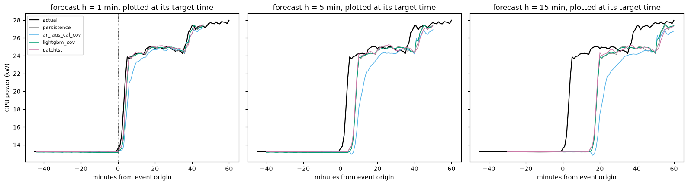

# Outputs of `12_week4_val_analysis.ipynb`
Exported 2026-10-09 16:56 from the saved notebook file.

## Cell 1: setup and inputs
_execution count: 1_

```
dataset rows 303,840 | benchmark rows 54 | models 18
```

## Cell 2: all validation predictions in one table, aligned on common origins per horizon (needs cell 1)
_execution count: 2_

```
shape: (18, 4)
┌───────────────────┬───────┬───────┬───────┐
│ model             ┆ 1     ┆ 5     ┆ 15    │
│ ---               ┆ ---   ┆ ---   ┆ ---   │
│ str               ┆ u32   ┆ u32   ┆ u32   │
╞═══════════════════╪═══════╪═══════╪═══════╡
│ ar_lags           ┆ 42575 ┆ 42567 ┆ 42547 │
│ ar_lags_cal       ┆ 42575 ┆ 42567 ┆ 42547 │
│ ar_lags_cal_cov   ┆ 42575 ┆ 42567 ┆ 42547 │
│ auto_arima        ┆ 42575 ┆ 42567 ┆ 42547 │
│ auto_ets          ┆ 42575 ┆ 42567 ┆ 42547 │
│ dlinear           ┆ 42575 ┆ 42567 ┆ 42547 │
│ gru               ┆ 42575 ┆ 42567 ┆ 42547 │
│ gru_uni           ┆ 42575 ┆ 42567 ┆ 42547 │
│ lightgbm          ┆ 42575 ┆ 42567 ┆ 42547 │
│ lightgbm_cov      ┆ 42575 ┆ 42567 ┆ 42547 │
│ lstm              ┆ 42575 ┆ 42567 ┆ 42547 │
│ nhits             ┆ 42575 ┆ 42567 ┆ 42547 │
│ nlinear           ┆ 42575 ┆ 42567 ┆ 42547 │
│ patchtst          ┆ 42575 ┆ 42567 ┆ 42547 │
│ pers_mod5_rolling ┆ 42575 ┆ 42567 ┆ 42547 │
│ pers_mod5_static  ┆ 42575 ┆ 42567 ┆ 42547 │
│ persistence       ┆ 42575 ┆ 42567 ┆ 42547 │
│ seasonal_naive_1d ┆ 42575 ┆ 42567 ┆ 42547 │
└───────────────────┴───────┴───────┴───────┘
shape: (3, 4)
┌─────┬──────────┬───────┬───────┐
│ h   ┆ n_common ┆ n_min ┆ n_max │
│ --- ┆ ---      ┆ ---   ┆ ---   │
│ i64 ┆ u32      ┆ u32   ┆ u32   │
╞═════╪══════════╪═══════╪═══════╡
│ 1   ┆ 42575    ┆ 42575 ┆ 42575 │
│ 5   ┆ 42567    ┆ 42567 ┆ 42567 │
│ 15  ┆ 42547    ┆ 42547 ┆ 42547 │
└─────┴──────────┴───────┴───────┘
models in the aligned table: ['ar_lags', 'ar_lags_cal', 'ar_lags_cal_cov', 'auto_arima', 'auto_ets', 'dlinear', 'gru', 'gru_uni', 'lightgbm', 'lightgbm_cov', 'lstm', 'nhits', 'nlinear', 'patchtst', 'pers_mod5_rolling', 'pers_mod5_static', 'persistence', 'seasonal_naive_1d']
```

## Cell 3: cost table: parameters, training and inference time (networks; seeds averaged) (needs cell 1)
_execution count: 3_

```
shape: (8, 10)
┌───────────┬─────────────┬──────────────────┬────────┬───────┬──────────┬─────────┬─────────────┬────────────┬─────────────────────┐
│ group     ┆ model       ┆ inputs           ┆ device ┆ seeds ┆ n_params ┆ train_s ┆ s_per_epoch ┆ best_epoch ┆ infer_ms_per_sample │
│ ---       ┆ ---         ┆ ---              ┆ ---    ┆ ---   ┆ ---      ┆ ---     ┆ ---         ┆ ---        ┆ ---                 │
│ str       ┆ str         ┆ str              ┆ str    ┆ u32   ┆ i64      ┆ f64     ┆ f64         ┆ f64        ┆ f64                 │
╞═══════════╪═════════════╪══════════════════╪════════╪═══════╪══════════╪═════════╪═════════════╪════════════╪═════════════════════╡
│ week4_nf  ┆ nlinear     ┆ power only       ┆ cpu    ┆ 3     ┆ 915      ┆ 1.0     ┆ 0.2         ┆ 3.3        ┆ 0.0004              │
│ week4_nf  ┆ dlinear     ┆ power only       ┆ cpu    ┆ 3     ┆ 1830     ┆ 1.0     ┆ 0.3         ┆ 2.0        ┆ 0.0006              │
│ week4_nf  ┆ gru_uni     ┆ power only       ┆ mps    ┆ 3     ┆ 38019    ┆ 255.0   ┆ 36.4        ┆ 4.0        ┆ 0.0291              │
│ week3_rnn ┆ gru         ┆ power + calendar ┆ cpu    ┆ 3     ┆ 39363    ┆ 538.0   ┆ 52.1        ┆ 7.3        ┆ 0.0651              │
│ week3_rnn ┆ lstm        ┆ power + calendar ┆ cpu    ┆ 3     ┆ 52419    ┆ 506.0   ┆ 54.0        ┆ 6.3        ┆ 0.0866              │
│ week3_rnn ┆ lstm_minmax ┆ power + calendar ┆ cpu    ┆ 1     ┆ 52419    ┆ 217.0   ┆ 54.2        ┆ 1.0        ┆ 0.0818              │
│ week4_nf  ┆ patchtst    ┆ power only       ┆ mps    ┆ 3     ┆ 75215    ┆ 203.0   ┆ 13.3        ┆ 12.3       ┆ 0.0143              │
│ week4_nf  ┆ nhits       ┆ power only       ┆ cpu    ┆ 3     ┆ 676301   ┆ 20.0    ┆ 4.6         ┆ 1.3        ┆ 0.0055              │
└───────────┴─────────────┴──────────────────┴────────┴───────┴──────────┴─────────┴─────────────┴────────────┴─────────────────────┘
note: LightGBM, AR and state-space costs are in notebooks 07/08 (not parameter-comparable); devices differ (CPU vs MPS), so times are indicative only.
```

## Cell 4: ramp-error analysis on aligned validation origins (needs cell 2)
_execution count: 4_

```

=== h = 1 min | ramp steps 1,903 of 42,575 | severe (p99) 440 ===
shape: (18, 12)
┌───────────────────┬────────────┬──────────┬─────────────┬───────────────┬────────────┬────────────────┬──────────────┬────────────┬──────────────┬─────────────┬─────────┐
│ model             ┆ MAE_normal ┆ MAE_ramp ┆ MAE_ramp_up ┆ MAE_ramp_down ┆ MAE_severe ┆ ramp_to_normal ┆ skill_normal ┆ skill_ramp ┆ skill_severe ┆ ramp_recall ┆ ramp_F1 │
│ ---               ┆ ---        ┆ ---      ┆ ---         ┆ ---           ┆ ---        ┆ ---            ┆ ---          ┆ ---        ┆ ---          ┆ ---         ┆ ---     │
│ str               ┆ f64        ┆ f64      ┆ f64         ┆ f64           ┆ f64        ┆ f64            ┆ f64          ┆ f64        ┆ f64          ┆ f64         ┆ f64     │
╞═══════════════════╪════════════╪══════════╪═════════════╪═══════════════╪════════════╪════════════════╪══════════════╪════════════╪══════════════╪═════════════╪═════════╡
│ lightgbm_cov      ┆ 0.1998     ┆ 1.276    ┆ 1.034       ┆ 1.524         ┆ 2.486      ┆ 6.4            ┆ 0.117        ┆ 0.206      ┆ 0.117        ┆ 0.169       ┆ 0.266   │
│ patchtst          ┆ 0.2046     ┆ 1.322    ┆ 1.147       ┆ 1.5           ┆ 2.55       ┆ 6.5            ┆ 0.096        ┆ 0.178      ┆ 0.094        ┆ 0.098       ┆ 0.169   │
│ ar_lags_cal_cov   ┆ 0.2151     ┆ 1.333    ┆ 1.196       ┆ 1.473         ┆ 2.527      ┆ 6.2            ┆ 0.05         ┆ 0.171      ┆ 0.102        ┆ 0.118       ┆ 0.18    │
│ gru               ┆ 0.2072     ┆ 1.336    ┆ 1.162       ┆ 1.512         ┆ 2.534      ┆ 6.4            ┆ 0.085        ┆ 0.169      ┆ 0.1          ┆ 0.092       ┆ 0.158   │
│ lightgbm          ┆ 0.1993     ┆ 1.341    ┆ 1.165       ┆ 1.521         ┆ 2.608      ┆ 6.7            ┆ 0.12         ┆ 0.166      ┆ 0.074        ┆ 0.111       ┆ 0.191   │
│ lstm              ┆ 0.2149     ┆ 1.352    ┆ 1.118       ┆ 1.591         ┆ 2.473      ┆ 6.3            ┆ 0.051        ┆ 0.159      ┆ 0.121        ┆ 0.131       ┆ 0.209   │
│ nhits             ┆ 0.2099     ┆ 1.356    ┆ 1.254       ┆ 1.461         ┆ 2.571      ┆ 6.5            ┆ 0.073        ┆ 0.156      ┆ 0.087        ┆ 0.072       ┆ 0.125   │
│ gru_uni           ┆ 0.2193     ┆ 1.392    ┆ 1.16        ┆ 1.629         ┆ 2.543      ┆ 6.3            ┆ 0.032        ┆ 0.134      ┆ 0.096        ┆ 0.109       ┆ 0.182   │
│ ar_lags_cal       ┆ 0.2159     ┆ 1.401    ┆ 1.309       ┆ 1.494         ┆ 2.659      ┆ 6.5            ┆ 0.046        ┆ 0.129      ┆ 0.055        ┆ 0.086       ┆ 0.143   │
│ dlinear           ┆ 0.2157     ┆ 1.405    ┆ 1.315       ┆ 1.497         ┆ 2.676      ┆ 6.5            ┆ 0.047        ┆ 0.126      ┆ 0.049        ┆ 0.085       ┆ 0.141   │
│ ar_lags           ┆ 0.2152     ┆ 1.407    ┆ 1.313       ┆ 1.503         ┆ 2.664      ┆ 6.5            ┆ 0.049        ┆ 0.125      ┆ 0.054        ┆ 0.088       ┆ 0.145   │
│ nlinear           ┆ 0.2147     ┆ 1.412    ┆ 1.328       ┆ 1.497         ┆ 2.687      ┆ 6.6            ┆ 0.052        ┆ 0.122      ┆ 0.045        ┆ 0.079       ┆ 0.134   │
│ pers_mod5_rolling ┆ 0.2157     ┆ 1.445    ┆ 1.496       ┆ 1.392         ┆ 2.749      ┆ 6.7            ┆ 0.047        ┆ 0.101      ┆ 0.023        ┆ 0.0         ┆ 0.0     │
│ auto_arima        ┆ 0.2299     ┆ 1.465    ┆ 1.399       ┆ 1.533         ┆ 2.653      ┆ 6.4            ┆ -0.015       ┆ 0.089      ┆ 0.057        ┆ 0.054       ┆ 0.091   │
│ pers_mod5_static  ┆ 0.2257     ┆ 1.557    ┆ 1.607       ┆ 1.505         ┆ 2.783      ┆ 6.9            ┆ 0.003        ┆ 0.032      ┆ 0.011        ┆ 0.0         ┆ 0.0     │
│ auto_ets          ┆ 0.2194     ┆ 1.558    ┆ 1.505       ┆ 1.613         ┆ 2.84       ┆ 7.1            ┆ 0.031        ┆ 0.031      ┆ -0.009       ┆ 0.037       ┆ 0.068   │
│ persistence       ┆ 0.2264     ┆ 1.607    ┆ 1.654       ┆ 1.56          ┆ 2.815      ┆ 7.1            ┆ 0.0          ┆ 0.0        ┆ 0.0          ┆ 0.0         ┆ 0.0     │
│ seasonal_naive_1d ┆ 4.9642     ┆ 4.973    ┆ 4.783       ┆ 5.168         ┆ 5.15       ┆ 1.0            ┆ -20.927      ┆ -2.094     ┆ -0.83        ┆ 0.858       ┆ 0.087   │
└───────────────────┴────────────┴──────────┴─────────────┴───────────────┴────────────┴────────────────┴──────────────┴────────────┴──────────────┴─────────────┴─────────┘

=== h = 5 min | ramp steps 2,444 of 42,567 | severe (p99) 812 ===
shape: (18, 12)
┌───────────────────┬────────────┬──────────┬─────────────┬───────────────┬────────────┬────────────────┬──────────────┬────────────┬──────────────┬─────────────┬─────────┐
│ model             ┆ MAE_normal ┆ MAE_ramp ┆ MAE_ramp_up ┆ MAE_ramp_down ┆ MAE_severe ┆ ramp_to_normal ┆ skill_normal ┆ skill_ramp ┆ skill_severe ┆ ramp_recall ┆ ramp_F1 │
│ ---               ┆ ---        ┆ ---      ┆ ---         ┆ ---           ┆ ---        ┆ ---            ┆ ---          ┆ ---        ┆ ---          ┆ ---         ┆ ---     │
│ str               ┆ f64        ┆ f64      ┆ f64         ┆ f64           ┆ f64        ┆ f64            ┆ f64          ┆ f64        ┆ f64          ┆ f64         ┆ f64     │
╞═══════════════════╪════════════╪══════════╪═════════════╪═══════════════╪════════════╪════════════════╪══════════════╪════════════╪══════════════╪═════════════╪═════════╡
│ lstm              ┆ 0.2929     ┆ 2.186    ┆ 1.682       ┆ 2.767         ┆ 3.621      ┆ 7.5            ┆ 0.013        ┆ 0.169      ┆ 0.215        ┆ 0.169       ┆ 0.271   │
│ lightgbm_cov      ┆ 0.2761     ┆ 2.19     ┆ 1.694       ┆ 2.763         ┆ 3.809      ┆ 7.9            ┆ 0.07         ┆ 0.168      ┆ 0.175        ┆ 0.184       ┆ 0.299   │
│ nhits             ┆ 0.2928     ┆ 2.191    ┆ 1.687       ┆ 2.773         ┆ 3.693      ┆ 7.5            ┆ 0.013        ┆ 0.167      ┆ 0.2          ┆ 0.184       ┆ 0.292   │
│ gru               ┆ 0.2936     ┆ 2.204    ┆ 1.737       ┆ 2.742         ┆ 3.688      ┆ 7.5            ┆ 0.01         ┆ 0.163      ┆ 0.201        ┆ 0.157       ┆ 0.248   │
│ gru_uni           ┆ 0.2912     ┆ 2.234    ┆ 1.806       ┆ 2.728         ┆ 3.759      ┆ 7.7            ┆ 0.019        ┆ 0.151      ┆ 0.186        ┆ 0.139       ┆ 0.23    │
│ patchtst          ┆ 0.287      ┆ 2.236    ┆ 1.815       ┆ 2.723         ┆ 3.83       ┆ 7.8            ┆ 0.033        ┆ 0.15       ┆ 0.17         ┆ 0.156       ┆ 0.257   │
│ ar_lags_cal_cov   ┆ 0.298      ┆ 2.249    ┆ 1.917       ┆ 2.633         ┆ 3.918      ┆ 7.5            ┆ -0.004       ┆ 0.145      ┆ 0.151        ┆ 0.167       ┆ 0.255   │
│ lightgbm          ┆ 0.2793     ┆ 2.276    ┆ 1.851       ┆ 2.768         ┆ 3.918      ┆ 8.2            ┆ 0.059        ┆ 0.135      ┆ 0.151        ┆ 0.148       ┆ 0.249   │
│ ar_lags_cal       ┆ 0.2975     ┆ 2.374    ┆ 2.14        ┆ 2.646         ┆ 4.126      ┆ 8.0            ┆ -0.003       ┆ 0.098      ┆ 0.106        ┆ 0.116       ┆ 0.193   │
│ ar_lags           ┆ 0.2971     ┆ 2.377    ┆ 2.145       ┆ 2.646         ┆ 4.13       ┆ 8.0            ┆ -0.001       ┆ 0.096      ┆ 0.105        ┆ 0.116       ┆ 0.194   │
│ auto_arima        ┆ 0.2989     ┆ 2.382    ┆ 2.153       ┆ 2.646         ┆ 4.144      ┆ 8.0            ┆ -0.007       ┆ 0.095      ┆ 0.102        ┆ 0.11        ┆ 0.185   │
│ nlinear           ┆ 0.2944     ┆ 2.401    ┆ 2.197       ┆ 2.637         ┆ 4.187      ┆ 8.2            ┆ 0.008        ┆ 0.087      ┆ 0.093        ┆ 0.102       ┆ 0.174   │
│ dlinear           ┆ 0.2942     ┆ 2.403    ┆ 2.204       ┆ 2.632         ┆ 4.189      ┆ 8.2            ┆ 0.009        ┆ 0.087      ┆ 0.092        ┆ 0.099       ┆ 0.171   │
│ auto_ets          ┆ 0.2883     ┆ 2.555    ┆ 2.467       ┆ 2.656         ┆ 4.502      ┆ 8.9            ┆ 0.028        ┆ 0.029      ┆ 0.025        ┆ 0.017       ┆ 0.033   │
│ persistence       ┆ 0.2967     ┆ 2.631    ┆ 2.614       ┆ 2.651         ┆ 4.616      ┆ 8.9            ┆ 0.0          ┆ 0.0        ┆ 0.0          ┆ 0.0         ┆ 0.0     │
│ pers_mod5_static  ┆ 0.2967     ┆ 2.631    ┆ 2.615       ┆ 2.65          ┆ 4.616      ┆ 8.9            ┆ 0.0          ┆ -0.0       ┆ -0.0         ┆ 0.0         ┆ 0.0     │
│ pers_mod5_rolling ┆ 0.2969     ┆ 2.632    ┆ 2.613       ┆ 2.653         ┆ 4.617      ┆ 8.9            ┆ -0.001       ┆ -0.0       ┆ -0.0         ┆ 0.0         ┆ 0.0     │
│ seasonal_naive_1d ┆ 4.9652     ┆ 5.032    ┆ 4.807       ┆ 5.292         ┆ 5.337      ┆ 1.0            ┆ -15.733      ┆ -0.913     ┆ -0.156       ┆ 0.814       ┆ 0.11    │
└───────────────────┴────────────┴──────────┴─────────────┴───────────────┴────────────┴────────────────┴──────────────┴────────────┴──────────────┴─────────────┴─────────┘

=== h = 15 min | ramp steps 2,740 of 42,547 | severe (p99) 892 ===
shape: (18, 12)
┌───────────────────┬────────────┬──────────┬─────────────┬───────────────┬────────────┬────────────────┬──────────────┬────────────┬──────────────┬─────────────┬─────────┐
│ model             ┆ MAE_normal ┆ MAE_ramp ┆ MAE_ramp_up ┆ MAE_ramp_down ┆ MAE_severe ┆ ramp_to_normal ┆ skill_normal ┆ skill_ramp ┆ skill_severe ┆ ramp_recall ┆ ramp_F1 │
│ ---               ┆ ---        ┆ ---      ┆ ---         ┆ ---           ┆ ---        ┆ ---            ┆ ---          ┆ ---        ┆ ---          ┆ ---         ┆ ---     │
│ str               ┆ f64        ┆ f64      ┆ f64         ┆ f64           ┆ f64        ┆ f64            ┆ f64          ┆ f64        ┆ f64          ┆ f64         ┆ f64     │
╞═══════════════════╪════════════╪══════════╪═════════════╪═══════════════╪════════════╪════════════════╪══════════════╪════════════╪══════════════╪═════════════╪═════════╡
│ gru               ┆ 0.42       ┆ 2.802    ┆ 2.283       ┆ 3.475         ┆ 4.492      ┆ 6.7            ┆ -0.0         ┆ 0.145      ┆ 0.2          ┆ 0.15        ┆ 0.241   │
│ lstm              ┆ 0.4177     ┆ 2.805    ┆ 2.313       ┆ 3.443         ┆ 4.54       ┆ 6.7            ┆ 0.005        ┆ 0.145      ┆ 0.191        ┆ 0.135       ┆ 0.227   │
│ lightgbm_cov      ┆ 0.3995     ┆ 2.805    ┆ 2.377       ┆ 3.36          ┆ 4.723      ┆ 7.0            ┆ 0.048        ┆ 0.144      ┆ 0.159        ┆ 0.138       ┆ 0.234   │
│ nhits             ┆ 0.4139     ┆ 2.821    ┆ 2.39        ┆ 3.38          ┆ 4.614      ┆ 6.8            ┆ 0.014        ┆ 0.14       ┆ 0.178        ┆ 0.137       ┆ 0.231   │
│ gru_uni           ┆ 0.4159     ┆ 2.843    ┆ 2.421       ┆ 3.391         ┆ 4.603      ┆ 6.8            ┆ 0.009        ┆ 0.133      ┆ 0.18         ┆ 0.12        ┆ 0.203   │
│ patchtst          ┆ 0.4098     ┆ 2.861    ┆ 2.455       ┆ 3.387         ┆ 4.767      ┆ 7.0            ┆ 0.024        ┆ 0.127      ┆ 0.151        ┆ 0.116       ┆ 0.201   │
│ ar_lags_cal_cov   ┆ 0.419      ┆ 2.891    ┆ 2.621       ┆ 3.24          ┆ 4.857      ┆ 6.9            ┆ 0.002        ┆ 0.118      ┆ 0.135        ┆ 0.103       ┆ 0.175   │
│ lightgbm          ┆ 0.4027     ┆ 2.91     ┆ 2.552       ┆ 3.373         ┆ 4.881      ┆ 7.2            ┆ 0.041        ┆ 0.113      ┆ 0.13         ┆ 0.113       ┆ 0.198   │
│ ar_lags_cal       ┆ 0.4185     ┆ 3.023    ┆ 2.817       ┆ 3.29          ┆ 5.075      ┆ 7.2            ┆ 0.003        ┆ 0.078      ┆ 0.096        ┆ 0.068       ┆ 0.122   │
│ ar_lags           ┆ 0.4186     ┆ 3.031    ┆ 2.832       ┆ 3.29          ┆ 5.087      ┆ 7.2            ┆ 0.003        ┆ 0.075      ┆ 0.094        ┆ 0.066       ┆ 0.119   │
│ auto_arima        ┆ 0.4177     ┆ 3.057    ┆ 2.881       ┆ 3.284         ┆ 5.141      ┆ 7.3            ┆ 0.005        ┆ 0.068      ┆ 0.084        ┆ 0.057       ┆ 0.104   │
│ dlinear           ┆ 0.4144     ┆ 3.061    ┆ 2.884       ┆ 3.289         ┆ 5.153      ┆ 7.4            ┆ 0.013        ┆ 0.067      ┆ 0.082        ┆ 0.051       ┆ 0.093   │
│ nlinear           ┆ 0.4143     ┆ 3.063    ┆ 2.887       ┆ 3.29          ┆ 5.159      ┆ 7.4            ┆ 0.013        ┆ 0.066      ┆ 0.081        ┆ 0.049       ┆ 0.09    │
│ auto_ets          ┆ 0.4119     ┆ 3.211    ┆ 3.14        ┆ 3.304         ┆ 5.479      ┆ 7.8            ┆ 0.019        ┆ 0.021      ┆ 0.024        ┆ 0.009       ┆ 0.019   │
│ persistence       ┆ 0.4199     ┆ 3.279    ┆ 3.248       ┆ 3.318         ┆ 5.613      ┆ 7.8            ┆ 0.0          ┆ 0.0        ┆ 0.0          ┆ 0.0         ┆ 0.0     │
│ pers_mod5_static  ┆ 0.4197     ┆ 3.279    ┆ 3.25        ┆ 3.316         ┆ 5.614      ┆ 7.8            ┆ 0.0          ┆ -0.0       ┆ -0.0         ┆ 0.0         ┆ 0.0     │
│ pers_mod5_rolling ┆ 0.4209     ┆ 3.28     ┆ 3.245       ┆ 3.324         ┆ 5.616      ┆ 7.8            ┆ -0.002       ┆ -0.0       ┆ -0.001       ┆ 0.0         ┆ 0.0     │
│ seasonal_naive_1d ┆ 4.9676     ┆ 5.136    ┆ 4.909       ┆ 5.431         ┆ 5.668      ┆ 1.0            ┆ -10.831      ┆ -0.566     ┆ -0.01        ┆ 0.748       ┆ 0.123   │
└───────────────────┴────────────┴──────────┴─────────────┴───────────────┴────────────┴────────────────┴──────────────┴────────────┴──────────────┴─────────────┴─────────┘
```

## Cell 5: Diebold-Mariano between the four best models per horizon and persistence, Holm-corrected (needs cell 2)
_execution count: 5_

```
h=1: compared ['lightgbm_cov', 'lightgbm', 'patchtst', 'gru', 'persistence']
h=5: compared ['lightgbm_cov', 'lightgbm', 'patchtst', 'lstm', 'persistence']
h=15: compared ['lightgbm_cov', 'lightgbm', 'nhits', 'patchtst', 'persistence']
shape: (30, 10)
┌─────┬──────────────┬─────────────┬────────┬────────┬─────────┬─────────┬───────────┬──────────────┬──────────────────┐
│ h   ┆ model_a      ┆ model_b     ┆ MAE_a  ┆ MAE_b  ┆ DM_stat ┆ DM_p    ┆ DM_p_holm ┆ better       ┆ significant_5pct │
│ --- ┆ ---          ┆ ---         ┆ ---    ┆ ---    ┆ ---     ┆ ---     ┆ ---       ┆ ---          ┆ ---              │
│ i64 ┆ str          ┆ str         ┆ f64    ┆ f64    ┆ f64     ┆ f64     ┆ f64       ┆ str          ┆ bool             │
╞═════╪══════════════╪═════════════╪════════╪════════╪═════════╪═════════╪═══════════╪══════════════╪══════════════════╡
│ 1   ┆ lightgbm_cov ┆ lightgbm    ┆ 0.2465 ┆ 0.2491 ┆ -2.81   ┆ 0.00489 ┆ 0.00978   ┆ lightgbm_cov ┆ true             │
│ 1   ┆ lightgbm_cov ┆ patchtst    ┆ 0.2465 ┆ 0.2533 ┆ -6.07   ┆ 0.0     ┆ 0.0       ┆ lightgbm_cov ┆ true             │
│ 1   ┆ lightgbm_cov ┆ gru         ┆ 0.2465 ┆ 0.2563 ┆ -7.08   ┆ 0.0     ┆ 0.0       ┆ lightgbm_cov ┆ true             │
│ 1   ┆ lightgbm_cov ┆ persistence ┆ 0.2465 ┆ 0.2866 ┆ -15.88  ┆ 0.0     ┆ 0.0       ┆ lightgbm_cov ┆ true             │
│ 1   ┆ lightgbm     ┆ patchtst    ┆ 0.2491 ┆ 0.2533 ┆ -6.24   ┆ 0.0     ┆ 0.0       ┆ lightgbm     ┆ true             │
│ 1   ┆ lightgbm     ┆ gru         ┆ 0.2491 ┆ 0.2563 ┆ -5.75   ┆ 0.0     ┆ 0.0       ┆ lightgbm     ┆ true             │
│ 1   ┆ lightgbm     ┆ persistence ┆ 0.2491 ┆ 0.2866 ┆ -16.66  ┆ 0.0     ┆ 0.0       ┆ lightgbm     ┆ true             │
│ 1   ┆ patchtst     ┆ gru         ┆ 0.2533 ┆ 0.2563 ┆ -2.77   ┆ 0.00557 ┆ 0.00978   ┆ patchtst     ┆ true             │
│ 1   ┆ patchtst     ┆ persistence ┆ 0.2533 ┆ 0.2866 ┆ -14.91  ┆ 0.0     ┆ 0.0       ┆ patchtst     ┆ true             │
│ 1   ┆ gru          ┆ persistence ┆ 0.2563 ┆ 0.2866 ┆ -12.05  ┆ 0.0     ┆ 0.0       ┆ gru          ┆ true             │
│ 5   ┆ lightgbm_cov ┆ lightgbm    ┆ 0.3852 ┆ 0.3934 ┆ -6.84   ┆ 0.0     ┆ 0.0       ┆ lightgbm_cov ┆ true             │
│ 5   ┆ lightgbm_cov ┆ patchtst    ┆ 0.3852 ┆ 0.3982 ┆ -6.86   ┆ 0.0     ┆ 0.0       ┆ lightgbm_cov ┆ true             │
│ 5   ┆ lightgbm_cov ┆ lstm        ┆ 0.3852 ┆ 0.4008 ┆ -3.83   ┆ 0.00013 ┆ 0.00052   ┆ lightgbm_cov ┆ true             │
│ 5   ┆ lightgbm_cov ┆ persistence ┆ 0.3852 ┆ 0.4299 ┆ -14.94  ┆ 0.0     ┆ 0.0       ┆ lightgbm_cov ┆ true             │
│ 5   ┆ lightgbm     ┆ patchtst    ┆ 0.3934 ┆ 0.3982 ┆ -3.39   ┆ 0.00069 ┆ 0.00207   ┆ lightgbm     ┆ true             │
│ 5   ┆ lightgbm     ┆ lstm        ┆ 0.3934 ┆ 0.4008 ┆ -1.87   ┆ 0.06142 ┆ 0.12284   ┆ lightgbm     ┆ false            │
│ 5   ┆ lightgbm     ┆ persistence ┆ 0.3934 ┆ 0.4299 ┆ -13.44  ┆ 0.0     ┆ 0.0       ┆ lightgbm     ┆ true             │
│ 5   ┆ patchtst     ┆ lstm        ┆ 0.3982 ┆ 0.4008 ┆ -0.78   ┆ 0.43415 ┆ 0.43415   ┆ patchtst     ┆ false            │
│ 5   ┆ patchtst     ┆ persistence ┆ 0.3982 ┆ 0.4299 ┆ -10.15  ┆ 0.0     ┆ 0.0       ┆ patchtst     ┆ true             │
│ 5   ┆ lstm         ┆ persistence ┆ 0.4008 ┆ 0.4299 ┆ -5.36   ┆ 0.0     ┆ 0.0       ┆ lstm         ┆ true             │
│ 15  ┆ lightgbm_cov ┆ lightgbm    ┆ 0.5556 ┆ 0.5654 ┆ -6.34   ┆ 0.0     ┆ 0.0       ┆ lightgbm_cov ┆ true             │
│ 15  ┆ lightgbm_cov ┆ nhits       ┆ 0.5556 ┆ 0.5701 ┆ -5.88   ┆ 0.0     ┆ 0.0       ┆ lightgbm_cov ┆ true             │
│ 15  ┆ lightgbm_cov ┆ patchtst    ┆ 0.5556 ┆ 0.5688 ┆ -5.21   ┆ 0.0     ┆ 0.0       ┆ lightgbm_cov ┆ true             │
│ 15  ┆ lightgbm_cov ┆ persistence ┆ 0.5556 ┆ 0.6048 ┆ -10.68  ┆ 0.0     ┆ 0.0       ┆ lightgbm_cov ┆ true             │
│ 15  ┆ lightgbm     ┆ nhits       ┆ 0.5654 ┆ 0.5701 ┆ -1.83   ┆ 0.06653 ┆ 0.19959   ┆ lightgbm     ┆ false            │
│ 15  ┆ lightgbm     ┆ patchtst    ┆ 0.5654 ┆ 0.5688 ┆ -1.45   ┆ 0.14697 ┆ 0.29394   ┆ lightgbm     ┆ false            │
│ 15  ┆ lightgbm     ┆ persistence ┆ 0.5654 ┆ 0.6048 ┆ -10.01  ┆ 0.0     ┆ 0.0       ┆ lightgbm     ┆ true             │
│ 15  ┆ nhits        ┆ patchtst    ┆ 0.5701 ┆ 0.5688 ┆ 0.71    ┆ 0.48069 ┆ 0.48069   ┆ patchtst     ┆ false            │
│ 15  ┆ nhits        ┆ persistence ┆ 0.5701 ┆ 0.6048 ┆ -6.23   ┆ 0.0     ┆ 0.0       ┆ nhits        ┆ true             │
│ 15  ┆ patchtst     ┆ persistence ┆ 0.5688 ┆ 0.6048 ┆ -7.69   ┆ 0.0     ┆ 0.0       ┆ patchtst     ┆ true             │
└─────┴──────────────┴─────────────┴────────┴────────┴─────────┴─────────┴───────────┴──────────────┴──────────────────┘
DM on absolute errors, Newey-West lag 60; origins with gaps treated as one sequence (approximation).
```

## Cell 6: figure: one severe ramp in validation, forecasts of four models at h = 1, 5, 15 (needs cells 2, 5)
_execution count: 6_

```
event origin 2021-08-23 12:25:00 (index 248425) | |dP|/L24 at h=5 = 0.776 | models ['persistence', 'ar_lags_cal_cov', 'lightgbm_cov', 'patchtst']
```



```
saved reports/figures/week4/01_ramp_event_val.png
```

## Cell 7: weekly skill at h = 1 with and without five-minute-dip targets (tests the Week 3 hypothesis) (needs cell 5)
_execution count: 7_

```
shape: (6, 7)
┌─────────────────────┬────────────────────┬────────────────────────┬────────────────┬────────────────────┬────────────────┬────────────────────┐
│ block_start         ┆ lightgbm_cov | all ┆ lightgbm_cov | no_mod0 ┆ lightgbm | all ┆ lightgbm | no_mod0 ┆ patchtst | all ┆ patchtst | no_mod0 │
│ ---                 ┆ ---                ┆ ---                    ┆ ---            ┆ ---                ┆ ---            ┆ ---                │
│ datetime[μs]        ┆ f64                ┆ f64                    ┆ f64            ┆ f64                ┆ f64            ┆ f64                │
╞═════════════════════╪════════════════════╪════════════════════════╪════════════════╪════════════════════╪════════════════╪════════════════════╡
│ 2021-07-26 00:00:00 ┆ 0.244              ┆ 0.21                   ┆ 0.229          ┆ 0.191              ┆ 0.217          ┆ 0.18               │
│ 2021-08-02 00:00:00 ┆ 0.19               ┆ 0.154                  ┆ 0.18           ┆ 0.144              ┆ 0.164          ┆ 0.127              │
│ 2021-08-09 00:00:00 ┆ 0.145              ┆ 0.126                  ┆ 0.065          ┆ 0.038              ┆ 0.05           ┆ 0.028              │
│ 2021-08-16 00:00:00 ┆ -0.036             ┆ -0.021                 ┆ 0.003          ┆ 0.013              ┆ -0.012         ┆ -0.008             │
│ 2021-08-23 00:00:00 ┆ 0.082              ┆ 0.094                  ┆ 0.076          ┆ 0.09               ┆ 0.062          ┆ 0.064              │
│ 2021-08-30 00:00:00 ┆ 0.122              ┆ null                   ┆ 0.08           ┆ null               ┆ 0.04           ┆ null               │
└─────────────────────┴────────────────────┴────────────────────────┴────────────────┴────────────────────┴────────────────┴────────────────────┘
If the week of 16 Aug turns positive (or much less negative) without mod-0 targets, the Week 3 hypothesis (over-correction of the five-minute dip) is supported; otherwise it is not.
```

## Cell 8: summary
_execution count: 8_

```
h= 1: best lightgbm_cov (skill +0.140) | vs second lightgbm: Holm p = 0.0098
h= 5: best lightgbm_cov (skill +0.104) | vs second lightgbm: Holm p = 4.7e-11
h=15: best lightgbm_cov (skill +0.081) | vs second lightgbm: Holm p = 1.6e-09
written: ['chronos_smoke.json', 'weekly_skill_mod5_val.csv', 'week4_val_analysis.json', 'dm_pairs_val.csv', 'cost_networks.csv', 'benchmark_val_week4_nf.csv', 'ramp_breakdown_val.csv', 'nf_val_summary.csv', 'benchmark_val_week4_all.csv', 'nf_smoke.json', 'nf_val_runs.csv', 'fm_val_summary.csv']
```

## Cell 9: export outputs (save the notebook first with Cmd+S)
_execution count: 9_

```
written 12_week4_val_analysis_outputs.md | code cells 9 | figures 0
```
