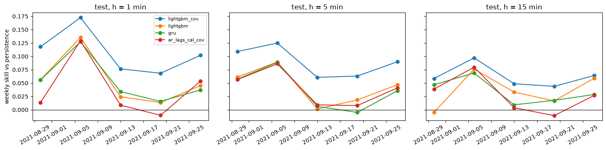

# Outputs of `16_week4_test_evaluation.ipynb`
Exported 2026-10-09 19:50 from the saved notebook file.

## Cell 1: setup
_execution count: 1_

```
usable origins: {1: {'train': 196700, 'val': 42575, 'test': 42575}, 5: {'train': 196668, 'val': 42567, 'test': 42567}, 15: {'train': 196588, 'val': 42547, 'test': 42547}}
freeze record exists: True (if True, the test split was already opened once)
```

## Cell 2: REPRODUCE every validation forecast from the frozen settings (test split untouched)
_execution count: 2_

```
baselines + state space: 9 s
  lightgbm h= 1 lightgbm: 3 seeds, 692 rounds
  lightgbm h= 1 lightgbm_cov: 3 seeds, 966 rounds
  lightgbm h= 5 lightgbm: 3 seeds, 646 rounds
  lightgbm h= 5 lightgbm_cov: 3 seeds, 491 rounds
  lightgbm h=15 lightgbm: 3 seeds, 90 rounds
  lightgbm h=15 lightgbm_cov: 3 seeds, 284 rounds
LightGBM: 400 s
  networks lstm: seeds [0, 1, 2]
  networks gru: seeds [0, 1, 2]
```

```stderr
2026-10-09 19:11:02,594	INFO util.py:155 -- Missing packages: ['ipywidgets']. Run `pip install -U ipywidgets`, then restart the notebook server for rich notebook output.
2026-10-09 19:11:03,320	INFO util.py:155 -- Missing packages: ['ipywidgets']. Run `pip install -U ipywidgets`, then restart the notebook server for rich notebook output.
Seed set to 0
Seed set to 1
Seed set to 2
Seed set to 0
```

```
  networks nhits: seeds [0, 1, 2]
```

```stderr
Seed set to 1
Seed set to 2
Seed set to 0
Seed set to 1
Seed set to 2
```

```
  networks patchtst: seeds [0, 1, 2]
```

```stderr
Seed set to 0
Seed set to 1
Seed set to 2
```

```
  networks dlinear: seeds [0, 1, 2]
  networks nlinear: seeds [0, 1, 2]
  networks gru_uni: seeds [0, 1, 2]
networks: 460 s
shape: (18, 4)
┌───────────────────┬────────┬─────────────────┬────────┐
│ model             ┆ checks ┆ max_abs_diff_kW ┆ all_ok │
│ ---               ┆ ---    ┆ ---             ┆ ---    │
│ str               ┆ u32    ┆ f64             ┆ bool   │
╞═══════════════════╪════════╪═════════════════╪════════╡
│ ar_lags           ┆ 3      ┆ 7.1054e-15      ┆ true   │
│ ar_lags_cal       ┆ 3      ┆ 7.1054e-15      ┆ true   │
│ ar_lags_cal_cov   ┆ 3      ┆ 7.1054e-15      ┆ true   │
│ auto_arima        ┆ 3      ┆ 0.0             ┆ true   │
│ auto_ets          ┆ 3      ┆ 0.0             ┆ true   │
│ dlinear           ┆ 9      ┆ 0.0             ┆ true   │
│ gru               ┆ 9      ┆ 0.0             ┆ true   │
│ gru_uni           ┆ 9      ┆ 0.000002        ┆ true   │
│ lightgbm          ┆ 9      ┆ 0.0             ┆ true   │
│ lightgbm_cov      ┆ 9      ┆ 0.0             ┆ true   │
│ lstm              ┆ 9      ┆ 0.0             ┆ true   │
│ nhits             ┆ 9      ┆ 0.0             ┆ true   │
│ nlinear           ┆ 9      ┆ 0.0             ┆ true   │
│ patchtst          ┆ 9      ┆ 0.000003        ┆ true   │
│ pers_mod5_rolling ┆ 3      ┆ 0.0             ┆ true   │
│ pers_mod5_static  ┆ 3      ┆ 0.0             ┆ true   │
│ persistence       ┆ 3      ┆ 0.0             ┆ true   │
│ seasonal_naive_1d ┆ 3      ┆ 0.0             ┆ true   │
└───────────────────┴────────┴─────────────────┴────────┘
state-space start minute S0: 194400 | ARIMA order (1, 1, 5)

REPRODUCTION PASSED: the frozen settings re-create the validation forecasts
```

## Cell 3: freeze record (written before the test split is opened)
_execution count: 3_

```
NOTE: a freeze record already exists; it is kept and a second one is written next to it
{
 "frozen_at": "2026-10-09 19:11:27",
 "git_head": "96597605437198fbfb9cb0a5da4aee2b50ccbbd4",
 "protocol": [
  "model set frozen",
  "train only, no refit on train+val",
  "networks from saved checkpoints",
  "LightGBM refit on train with tuned params and rounds, seeds 0-2",
  "ARIMA/ETS fixed filters",
  "ridge AR refit on train with validation alpha",
  "foundation models zero-shot, validation-chosen context",
  "one test run; later fixes reported"
 ],
 "foundation_context": {
  "chronos_bolt_small": 512,
  "timesfm_2p5_200m": 512
 },
 "inputs_sha256": {
  "data/processed/model_dataset.parquet": "55001c2f957c3be21cf9c0b21250c61ad55ddf3daa7714e4e4c69ae2c29edf47",
  "reports/baselines/baselines_summary.json": "e3f728c48a7bd9154830e2ec6ea2af463ca625db88e6936cd9c2c1e318a4e54b",
  "reports/classical/classical_summary.json": "acbd2af76de456566c835b34adb8bb049ec18eb080172c22326b74f8cf108a7c"
 },
 "val_reproduction_max_diff_kW": 2.86102294921875e-06,
 "models": [
  "ar_lags",
  "ar_lags_cal",
  "ar_lags_cal_cov",
  "auto_arima",
  "auto_ets",
  "chronos_bolt_small_ctx512",
  "dlinear",
  "gru",
  "gru_uni",
  "lightgbm",
  "lightgbm_cov",
  "lstm",
  "nhits",
  "nlinear",
  "patchtst",
  "pers_mod5_rolling",
  "pers_mod5_static",
  "persistence",
  "seasonal_naive_1d",
  "timesfm_2p5_200m_ctx512"
 ]
}
```

## Cell 4: OPEN THE TEST SPLIT: forecasts of all frozen models (one run)
_execution count: 4_

```
baselines + state space: 7 s
  lightgbm h= 1 lightgbm: 3 seeds, 692 rounds
  lightgbm h= 1 lightgbm_cov: 3 seeds, 966 rounds
  lightgbm h= 5 lightgbm: 3 seeds, 646 rounds
  lightgbm h= 5 lightgbm_cov: 3 seeds, 491 rounds
  lightgbm h=15 lightgbm: 3 seeds, 90 rounds
  lightgbm h=15 lightgbm_cov: 3 seeds, 284 rounds
LightGBM: 538 s
  networks lstm: seeds [0, 1, 2]
```

```stderr
Seed set to 0
```

```
  networks gru: seeds [0, 1, 2]
```

```stderr
Seed set to 1
Seed set to 2
Seed set to 0
```

```
  networks nhits: seeds [0, 1, 2]
```

```stderr
Seed set to 1
Seed set to 2
Seed set to 0
Seed set to 1
Seed set to 2
```

```
  networks patchtst: seeds [0, 1, 2]
```

```stderr
Seed set to 0
Seed set to 1
Seed set to 2
```

```
  networks dlinear: seeds [0, 1, 2]
  networks nlinear: seeds [0, 1, 2]
  networks gru_uni: seeds [0, 1, 2]
networks: 592 s
```

```stderr
Loading weights: 100%|████████████████████| 143/143 [00:00<00:00, 24508.05it/s]
```

```
chronos_bolt_small (context 512): 158 s
timesfm_2p5_200m (context 512): 1542 s
test predictions: 4,852,182 rows | models 20 | sha256 04890aac0591129f...
```

## Cell 5: test metrics, mean +- sd over seeds, ranking, and rank stability validation -> test
_execution count: 5_

```

=== TEST h = 1 min (sorted by MAE) ===
shape: (20, 11)
┌─────────────┬────────────────────┬─────────┬──────────┬────────┬───────────┬────────┬──────────┬────────────┬─────────┬────────────────────┐
│ family      ┆ model              ┆ n_seeds ┆ MAE_mean ┆ MAE_sd ┆ skill_MAE ┆ R2     ┆ MAE_ramp ┆ MAE_normal ┆ ramp_F1 ┆ MAE_no_mod0_target │
│ ---         ┆ ---                ┆ ---     ┆ ---      ┆ ---    ┆ ---       ┆ ---    ┆ ---      ┆ ---        ┆ ---     ┆ ---                │
│ str         ┆ str                ┆ u32     ┆ f64      ┆ f64    ┆ f64       ┆ f64    ┆ f64      ┆ f64        ┆ f64     ┆ f64                │
╞═════════════╪════════════════════╪═════════╪══════════╪════════╪═══════════╪════════╪══════════╪════════════╪═════════╪════════════════════╡
│ ML          ┆ lightgbm_cov       ┆ 3       ┆ 0.2132   ┆ 0.0001 ┆ 0.114     ┆ 0.9964 ┆ 1.005    ┆ 0.1803     ┆ 0.237   ┆ 0.2084             │
│ ML          ┆ lightgbm           ┆ 3       ┆ 0.2253   ┆ 0.0001 ┆ 0.064     ┆ 0.9961 ┆ 1.118    ┆ 0.1883     ┆ 0.138   ┆ 0.2206             │
│ foundation  ┆ timesfm_2p5_200m   ┆ 1       ┆ 0.2273   ┆ null   ┆ 0.056     ┆ 0.9961 ┆ 1.125    ┆ 0.1901     ┆ 0.125   ┆ 0.2217             │
│ deep        ┆ gru                ┆ 3       ┆ 0.2273   ┆ 0.0014 ┆ 0.056     ┆ 0.9961 ┆ 1.099    ┆ 0.1913     ┆ 0.135   ┆ 0.2227             │
│ linear      ┆ ar_lags_cal_cov    ┆ 1       ┆ 0.2291   ┆ null   ┆ 0.048     ┆ 0.9962 ┆ 1.008    ┆ 0.1968     ┆ 0.212   ┆ 0.2256             │
│ deep        ┆ patchtst           ┆ 3       ┆ 0.2292   ┆ 0.0011 ┆ 0.048     ┆ 0.9961 ┆ 1.12     ┆ 0.1924     ┆ 0.102   ┆ 0.2253             │
│ deep        ┆ lstm               ┆ 3       ┆ 0.2303   ┆ 0.003  ┆ 0.043     ┆ 0.996  ┆ 1.089    ┆ 0.1949     ┆ 0.179   ┆ 0.2257             │
│ deep        ┆ gru_uni            ┆ 3       ┆ 0.2321   ┆ 0.0008 ┆ 0.036     ┆ 0.996  ┆ 1.102    ┆ 0.1962     ┆ 0.175   ┆ 0.2263             │
│ statistical ┆ auto_ets           ┆ 1       ┆ 0.2346   ┆ null   ┆ 0.025     ┆ 0.9958 ┆ 1.201    ┆ 0.1946     ┆ 0.052   ┆ 0.2293             │
│ deep        ┆ nhits              ┆ 3       ┆ 0.2359   ┆ 0.0041 ┆ 0.02      ┆ 0.9959 ┆ 1.119    ┆ 0.1994     ┆ 0.123   ┆ 0.2315             │
│ naive       ┆ pers_mod5_rolling  ┆ 1       ┆ 0.2368   ┆ null   ┆ 0.016     ┆ 0.9958 ┆ 1.239    ┆ 0.1951     ┆ 0.0     ┆ 0.2331             │
│ naive       ┆ pers_mod5_static   ┆ 1       ┆ 0.238    ┆ null   ┆ 0.011     ┆ 0.9958 ┆ 1.232    ┆ 0.1966     ┆ 0.0     ┆ 0.2339             │
│ linear      ┆ ar_lags_cal        ┆ 1       ┆ 0.238    ┆ null   ┆ 0.011     ┆ 0.9957 ┆ 1.146    ┆ 0.2006     ┆ 0.102   ┆ 0.2349             │
│ deep        ┆ nlinear            ┆ 3       ┆ 0.2382   ┆ 0.0009 ┆ 0.011     ┆ 0.9957 ┆ 1.16     ┆ 0.2001     ┆ 0.098   ┆ 0.2351             │
│ linear      ┆ ar_lags            ┆ 1       ┆ 0.2393   ┆ null   ┆ 0.006     ┆ 0.9957 ┆ 1.152    ┆ 0.2016     ┆ 0.104   ┆ 0.2363             │
│ foundation  ┆ chronos_bolt_small ┆ 1       ┆ 0.2397   ┆ null   ┆ 0.004     ┆ 0.9958 ┆ 1.165    ┆ 0.2014     ┆ 0.059   ┆ 0.2333             │
│ deep        ┆ dlinear            ┆ 3       ┆ 0.2399   ┆ 0.0022 ┆ 0.003     ┆ 0.9957 ┆ 1.152    ┆ 0.2023     ┆ 0.109   ┆ 0.2368             │
│ naive       ┆ persistence        ┆ 1       ┆ 0.2407   ┆ null   ┆ 0.0       ┆ 0.9957 ┆ 1.252    ┆ 0.1986     ┆ 0.0     ┆ 0.2351             │
│ statistical ┆ auto_arima         ┆ 1       ┆ 0.2501   ┆ null   ┆ -0.039    ┆ 0.9955 ┆ 1.178    ┆ 0.2118     ┆ 0.072   ┆ 0.2458             │
│ naive       ┆ seasonal_naive_1d  ┆ 1       ┆ 3.9596   ┆ null   ┆ -15.45    ┆ 0.2661 ┆ 3.908    ┆ 4.0223     ┆ 0.076   ┆ 3.9616             │
└─────────────┴────────────────────┴─────────┴──────────┴────────┴───────────┴────────┴──────────┴────────────┴─────────┴────────────────────┘

=== TEST h = 5 min (sorted by MAE) ===
shape: (20, 11)
┌─────────────┬────────────────────┬─────────┬──────────┬────────┬───────────┬────────┬──────────┬────────────┬─────────┬────────────────────┐
│ family      ┆ model              ┆ n_seeds ┆ MAE_mean ┆ MAE_sd ┆ skill_MAE ┆ R2     ┆ MAE_ramp ┆ MAE_normal ┆ ramp_F1 ┆ MAE_no_mod0_target │
│ ---         ┆ ---                ┆ ---     ┆ ---      ┆ ---    ┆ ---       ┆ ---    ┆ ---      ┆ ---        ┆ ---     ┆ ---                │
│ str         ┆ str                ┆ u32     ┆ f64      ┆ f64    ┆ f64       ┆ f64    ┆ f64      ┆ f64        ┆ f64     ┆ f64                │
╞═════════════╪════════════════════╪═════════╪══════════╪════════╪═══════════╪════════╪══════════╪════════════╪═════════╪════════════════════╡
│ ML          ┆ lightgbm_cov       ┆ 3       ┆ 0.3638   ┆ 0.0001 ┆ 0.09      ┆ 0.9885 ┆ 1.589    ┆ 0.2712     ┆ 0.196   ┆ null               │
│ ML          ┆ lightgbm           ┆ 3       ┆ 0.3817   ┆ 0.0002 ┆ 0.046     ┆ 0.9876 ┆ 1.681    ┆ 0.2835     ┆ 0.147   ┆ null               │
│ deep        ┆ gru                ┆ 3       ┆ 0.3832   ┆ 0.0017 ┆ 0.042     ┆ 0.9877 ┆ 1.673    ┆ 0.2858     ┆ 0.141   ┆ null               │
│ foundation  ┆ timesfm_2p5_200m   ┆ 1       ┆ 0.3834   ┆ null   ┆ 0.041     ┆ 0.9876 ┆ 1.674    ┆ 0.2859     ┆ 0.142   ┆ null               │
│ deep        ┆ gru_uni            ┆ 3       ┆ 0.3836   ┆ 0.0006 ┆ 0.041     ┆ 0.9877 ┆ 1.678    ┆ 0.2859     ┆ 0.146   ┆ null               │
│ deep        ┆ patchtst           ┆ 3       ┆ 0.3845   ┆ 0.0009 ┆ 0.039     ┆ 0.9877 ┆ 1.686    ┆ 0.2862     ┆ 0.126   ┆ null               │
│ deep        ┆ lstm               ┆ 3       ┆ 0.3851   ┆ 0.0014 ┆ 0.037     ┆ 0.9875 ┆ 1.666    ┆ 0.2885     ┆ 0.168   ┆ null               │
│ linear      ┆ ar_lags_cal_cov    ┆ 1       ┆ 0.3854   ┆ null   ┆ 0.036     ┆ 0.9877 ┆ 1.577    ┆ 0.2955     ┆ 0.198   ┆ null               │
│ statistical ┆ auto_ets           ┆ 1       ┆ 0.3905   ┆ null   ┆ 0.024     ┆ 0.987  ┆ 1.792    ┆ 0.2845     ┆ 0.013   ┆ null               │
│ deep        ┆ nhits              ┆ 3       ┆ 0.3908   ┆ 0.0013 ┆ 0.023     ┆ 0.9874 ┆ 1.661    ┆ 0.295      ┆ 0.197   ┆ null               │
│ statistical ┆ auto_arima         ┆ 1       ┆ 0.3973   ┆ null   ┆ 0.007     ┆ 0.9869 ┆ 1.725    ┆ 0.297      ┆ 0.098   ┆ null               │
│ foundation  ┆ chronos_bolt_small ┆ 1       ┆ 0.3982   ┆ null   ┆ 0.004     ┆ 0.9868 ┆ 1.732    ┆ 0.2972     ┆ 0.066   ┆ null               │
│ deep        ┆ dlinear            ┆ 3       ┆ 0.3983   ┆ 0.0051 ┆ 0.004     ┆ 0.987  ┆ 1.72     ┆ 0.2985     ┆ 0.098   ┆ null               │
│ linear      ┆ ar_lags_cal        ┆ 1       ┆ 0.3984   ┆ null   ┆ 0.004     ┆ 0.987  ┆ 1.713    ┆ 0.2992     ┆ 0.108   ┆ null               │
│ linear      ┆ ar_lags            ┆ 1       ┆ 0.3986   ┆ null   ┆ 0.003     ┆ 0.987  ┆ 1.715    ┆ 0.2993     ┆ 0.105   ┆ null               │
│ deep        ┆ nlinear            ┆ 3       ┆ 0.3997   ┆ 0.0051 ┆ 0.001     ┆ 0.9869 ┆ 1.714    ┆ 0.3005     ┆ 0.109   ┆ null               │
│ naive       ┆ pers_mod5_rolling  ┆ 1       ┆ 0.3999   ┆ null   ┆ 0.0       ┆ 0.9866 ┆ 1.834    ┆ 0.2914     ┆ 0.0     ┆ null               │
│ naive       ┆ pers_mod5_static   ┆ 1       ┆ 0.3999   ┆ null   ┆ 0.0       ┆ 0.9866 ┆ 1.833    ┆ 0.2915     ┆ 0.0     ┆ null               │
│ naive       ┆ persistence        ┆ 1       ┆ 0.4      ┆ null   ┆ 0.0       ┆ 0.9866 ┆ 1.833    ┆ 0.2915     ┆ 0.0     ┆ null               │
│ naive       ┆ seasonal_naive_1d  ┆ 1       ┆ 3.9636   ┆ null   ┆ -8.91     ┆ 0.2657 ┆ 4.102    ┆ 4.0142     ┆ 0.13    ┆ null               │
└─────────────┴────────────────────┴─────────┴──────────┴────────┴───────────┴────────┴──────────┴────────────┴─────────┴────────────────────┘

=== TEST h = 15 min (sorted by MAE) ===
shape: (20, 11)
┌─────────────┬────────────────────┬─────────┬──────────┬────────┬───────────┬────────┬──────────┬────────────┬─────────┬────────────────────┐
│ family      ┆ model              ┆ n_seeds ┆ MAE_mean ┆ MAE_sd ┆ skill_MAE ┆ R2     ┆ MAE_ramp ┆ MAE_normal ┆ ramp_F1 ┆ MAE_no_mod0_target │
│ ---         ┆ ---                ┆ ---     ┆ ---      ┆ ---    ┆ ---       ┆ ---    ┆ ---      ┆ ---        ┆ ---     ┆ ---                │
│ str         ┆ str                ┆ u32     ┆ f64      ┆ f64    ┆ f64       ┆ f64    ┆ f64      ┆ f64        ┆ f64     ┆ f64                │
╞═════════════╪════════════════════╪═════════╪══════════╪════════╪═══════════╪════════╪══════════╪════════════╪═════════╪════════════════════╡
│ ML          ┆ lightgbm_cov       ┆ 3       ┆ 0.5836   ┆ 0.0002 ┆ 0.062     ┆ 0.9738 ┆ 2.267    ┆ 0.4226     ┆ 0.134   ┆ null               │
│ linear      ┆ ar_lags_cal_cov    ┆ 1       ┆ 0.5996   ┆ null   ┆ 0.036     ┆ 0.973  ┆ 2.277    ┆ 0.4395     ┆ 0.104   ┆ null               │
│ ML          ┆ lightgbm           ┆ 3       ┆ 0.6013   ┆ 0.0003 ┆ 0.033     ┆ 0.9723 ┆ 2.362    ┆ 0.4328     ┆ 0.112   ┆ null               │
│ deep        ┆ gru                ┆ 3       ┆ 0.6026   ┆ 0.0028 ┆ 0.031     ┆ 0.9724 ┆ 2.338    ┆ 0.4367     ┆ 0.106   ┆ null               │
│ deep        ┆ gru_uni            ┆ 3       ┆ 0.6031   ┆ 0.0015 ┆ 0.031     ┆ 0.9725 ┆ 2.351    ┆ 0.4361     ┆ 0.103   ┆ null               │
│ deep        ┆ patchtst           ┆ 3       ┆ 0.6043   ┆ 0.0004 ┆ 0.029     ┆ 0.9724 ┆ 2.371    ┆ 0.4354     ┆ 0.082   ┆ null               │
│ deep        ┆ lstm               ┆ 3       ┆ 0.6049   ┆ 0.0035 ┆ 0.028     ┆ 0.9722 ┆ 2.337    ┆ 0.4394     ┆ 0.111   ┆ null               │
│ deep        ┆ nhits              ┆ 3       ┆ 0.6063   ┆ 0.0017 ┆ 0.025     ┆ 0.9719 ┆ 2.341    ┆ 0.4407     ┆ 0.136   ┆ null               │
│ foundation  ┆ timesfm_2p5_200m   ┆ 1       ┆ 0.61     ┆ null   ┆ 0.019     ┆ 0.9723 ┆ 2.331    ┆ 0.4459     ┆ 0.108   ┆ null               │
│ statistical ┆ auto_ets           ┆ 1       ┆ 0.6127   ┆ null   ┆ 0.015     ┆ 0.9715 ┆ 2.488    ┆ 0.4332     ┆ 0.002   ┆ null               │
│ statistical ┆ auto_arima         ┆ 1       ┆ 0.6135   ┆ null   ┆ 0.014     ┆ 0.9716 ┆ 2.422    ┆ 0.4406     ┆ 0.04    ┆ null               │
│ deep        ┆ dlinear            ┆ 3       ┆ 0.6145   ┆ 0.0004 ┆ 0.012     ┆ 0.9716 ┆ 2.428    ┆ 0.4412     ┆ 0.035   ┆ null               │
│ deep        ┆ nlinear            ┆ 3       ┆ 0.6149   ┆ 0.0012 ┆ 0.011     ┆ 0.9716 ┆ 2.421    ┆ 0.4425     ┆ 0.038   ┆ null               │
│ linear      ┆ ar_lags_cal        ┆ 1       ┆ 0.6154   ┆ null   ┆ 0.011     ┆ 0.9718 ┆ 2.392    ┆ 0.4459     ┆ 0.054   ┆ null               │
│ linear      ┆ ar_lags            ┆ 1       ┆ 0.6166   ┆ null   ┆ 0.009     ┆ 0.9717 ┆ 2.395    ┆ 0.4469     ┆ 0.052   ┆ null               │
│ naive       ┆ pers_mod5_rolling  ┆ 1       ┆ 0.6217   ┆ null   ┆ 0.001     ┆ 0.9708 ┆ 2.525    ┆ 0.4395     ┆ 0.0     ┆ null               │
│ naive       ┆ pers_mod5_static   ┆ 1       ┆ 0.6219   ┆ null   ┆ 0.0       ┆ 0.9708 ┆ 2.523    ┆ 0.4399     ┆ 0.0     ┆ null               │
│ naive       ┆ persistence        ┆ 1       ┆ 0.6221   ┆ null   ┆ 0.0       ┆ 0.9708 ┆ 2.523    ┆ 0.4401     ┆ 0.0     ┆ null               │
│ foundation  ┆ chronos_bolt_small ┆ 1       ┆ 0.6316   ┆ null   ┆ -0.015    ┆ 0.9709 ┆ 2.4      ┆ 0.4623     ┆ 0.053   ┆ null               │
│ naive       ┆ seasonal_naive_1d  ┆ 1       ┆ 3.9683   ┆ null   ┆ -5.379    ┆ 0.2651 ┆ 4.281    ┆ 3.9983     ┆ 0.16    ┆ null               │
└─────────────┴────────────────────┴─────────┴──────────┴────────┴───────────┴────────┴──────────┴────────────┴─────────┴────────────────────┘

rank stability (Spearman rank correlation of MAE, validation vs test, models present in both):
h= 1: 20 models | Spearman 0.829 | best on val lightgbm_cov | best on test lightgbm_cov
h= 5: 20 models | Spearman 0.886 | best on val lightgbm_cov | best on test lightgbm_cov
h=15: 20 models | Spearman 0.887 | best on val lightgbm_cov | best on test lightgbm_cov
```

## Cell 6: Diebold-Mariano (Holm) among the four best trained models + persistence, ramp breakdown, weekly skill (test)
_execution count: 6_

```
shape: (30, 9)
┌─────┬─────────────────┬─────────────────┬────────┬────────┬─────────┬─────────────┬─────────────────┬──────────────────┐
│ h   ┆ model_a         ┆ model_b         ┆ MAE_a  ┆ MAE_b  ┆ DM_stat ┆ DM_p_holm   ┆ better          ┆ significant_5pct │
│ --- ┆ ---             ┆ ---             ┆ ---    ┆ ---    ┆ ---     ┆ ---         ┆ ---             ┆ ---              │
│ i64 ┆ str             ┆ str             ┆ f64    ┆ f64    ┆ f64     ┆ f64         ┆ str             ┆ bool             │
╞═════╪═════════════════╪═════════════════╪════════╪════════╪═════════╪═════════════╪═════════════════╪══════════════════╡
│ 1   ┆ lightgbm_cov    ┆ lightgbm        ┆ 0.2131 ┆ 0.2254 ┆ -16.18  ┆ 6.5202e-58  ┆ lightgbm_cov    ┆ true             │
│ 1   ┆ lightgbm_cov    ┆ gru             ┆ 0.2131 ┆ 0.2258 ┆ -15.13  ┆ 8.0786e-51  ┆ lightgbm_cov    ┆ true             │
│ 1   ┆ lightgbm_cov    ┆ ar_lags_cal_cov ┆ 0.2131 ┆ 0.2291 ┆ -14.94  ┆ 1.3612e-49  ┆ lightgbm_cov    ┆ true             │
│ 1   ┆ lightgbm_cov    ┆ persistence     ┆ 0.2131 ┆ 0.2407 ┆ -22.5   ┆ 3.9750e-111 ┆ lightgbm_cov    ┆ true             │
│ 1   ┆ lightgbm        ┆ gru             ┆ 0.2254 ┆ 0.2258 ┆ -0.96   ┆ 0.337134    ┆ lightgbm        ┆ false            │
│ 1   ┆ lightgbm        ┆ ar_lags_cal_cov ┆ 0.2254 ┆ 0.2291 ┆ -3.02   ┆ 0.007568    ┆ lightgbm        ┆ true             │
│ 1   ┆ lightgbm        ┆ persistence     ┆ 0.2254 ┆ 0.2407 ┆ -13.48  ┆ 1.2613e-40  ┆ lightgbm        ┆ true             │
│ 1   ┆ gru             ┆ ar_lags_cal_cov ┆ 0.2258 ┆ 0.2291 ┆ -2.77   ┆ 0.011206    ┆ gru             ┆ true             │
│ 1   ┆ gru             ┆ persistence     ┆ 0.2258 ┆ 0.2407 ┆ -13.35  ┆ 5.9494e-40  ┆ gru             ┆ true             │
│ 1   ┆ ar_lags_cal_cov ┆ persistence     ┆ 0.2291 ┆ 0.2407 ┆ -7.0    ┆ 9.9396e-12  ┆ ar_lags_cal_cov ┆ true             │
│ 5   ┆ lightgbm_cov    ┆ lightgbm        ┆ 0.3639 ┆ 0.382  ┆ -13.41  ┆ 4.8099e-40  ┆ lightgbm_cov    ┆ true             │
│ 5   ┆ lightgbm_cov    ┆ gru             ┆ 0.3639 ┆ 0.3851 ┆ -9.18   ┆ 2.6591e-19  ┆ lightgbm_cov    ┆ true             │
│ 5   ┆ lightgbm_cov    ┆ gru_uni         ┆ 0.3639 ┆ 0.3836 ┆ -12.52  ┆ 4.8511e-35  ┆ lightgbm_cov    ┆ true             │
│ 5   ┆ lightgbm_cov    ┆ persistence     ┆ 0.3639 ┆ 0.4    ┆ -21.71  ┆ 1.6946e-103 ┆ lightgbm_cov    ┆ true             │
│ 5   ┆ lightgbm        ┆ gru             ┆ 0.382  ┆ 0.3851 ┆ -1.69   ┆ 0.267031    ┆ lightgbm        ┆ false            │
│ 5   ┆ lightgbm        ┆ gru_uni         ┆ 0.382  ┆ 0.3836 ┆ -1.7    ┆ 0.267031    ┆ lightgbm        ┆ false            │
│ 5   ┆ lightgbm        ┆ persistence     ┆ 0.382  ┆ 0.4    ┆ -9.31   ┆ 9.0162e-20  ┆ lightgbm        ┆ true             │
│ 5   ┆ gru             ┆ gru_uni         ┆ 0.3851 ┆ 0.3836 ┆ 1.26    ┆ 0.267031    ┆ gru_uni         ┆ false            │
│ 5   ┆ gru             ┆ persistence     ┆ 0.3851 ┆ 0.4    ┆ -5.54   ┆ 1.1799e-7   ┆ gru             ┆ true             │
│ 5   ┆ gru_uni         ┆ persistence     ┆ 0.3836 ┆ 0.4    ┆ -8.15   ┆ 1.8223e-15  ┆ gru_uni         ┆ true             │
│ 15  ┆ lightgbm_cov    ┆ ar_lags_cal_cov ┆ 0.5835 ┆ 0.5996 ┆ -5.65   ┆ 7.9535e-8   ┆ lightgbm_cov    ┆ true             │
│ 15  ┆ lightgbm_cov    ┆ lightgbm        ┆ 0.5835 ┆ 0.601  ┆ -9.21   ┆ 3.0241e-19  ┆ lightgbm_cov    ┆ true             │
│ 15  ┆ lightgbm_cov    ┆ gru             ┆ 0.5835 ┆ 0.6059 ┆ -5.89   ┆ 2.2499e-8   ┆ lightgbm_cov    ┆ true             │
│ 15  ┆ lightgbm_cov    ┆ persistence     ┆ 0.5835 ┆ 0.6221 ┆ -12.24  ┆ 1.9152e-33  ┆ lightgbm_cov    ┆ true             │
│ 15  ┆ ar_lags_cal_cov ┆ lightgbm        ┆ 0.5996 ┆ 0.601  ┆ -0.39   ┆ 0.698808    ┆ ar_lags_cal_cov ┆ false            │
│ 15  ┆ ar_lags_cal_cov ┆ gru             ┆ 0.5996 ┆ 0.6059 ┆ -1.27   ┆ 0.471132    ┆ ar_lags_cal_cov ┆ false            │
│ 15  ┆ ar_lags_cal_cov ┆ persistence     ┆ 0.5996 ┆ 0.6221 ┆ -7.3    ┆ 2.3562e-12  ┆ ar_lags_cal_cov ┆ true             │
│ 15  ┆ lightgbm        ┆ gru             ┆ 0.601  ┆ 0.6059 ┆ -1.42   ┆ 0.471132    ┆ lightgbm        ┆ false            │
│ 15  ┆ lightgbm        ┆ persistence     ┆ 0.601  ┆ 0.6221 ┆ -6.77   ┆ 9.3063e-11  ┆ lightgbm        ┆ true             │
│ 15  ┆ gru             ┆ persistence     ┆ 0.6059 ┆ 0.6221 ┆ -3.23   ┆ 0.004876    ┆ gru             ┆ true             │
└─────┴─────────────────┴─────────────────┴────────┴────────┴─────────┴─────────────┴─────────────────┴──────────────────┘

=== ramps, test, h = 1 ===
shape: (10, 9)
┌──────────────────┬────────┬──────────┬────────────┬──────────┬──────────────┬────────────┬──────────────┬─────────┐
│ model            ┆ n_ramp ┆ n_severe ┆ MAE_normal ┆ MAE_ramp ┆ skill_normal ┆ skill_ramp ┆ skill_severe ┆ ramp_F1 │
│ ---              ┆ ---    ┆ ---      ┆ ---        ┆ ---      ┆ ---          ┆ ---        ┆ ---          ┆ ---     │
│ str              ┆ i64    ┆ i64      ┆ f64        ┆ f64      ┆ f64          ┆ f64        ┆ f64          ┆ f64     │
╞══════════════════╪════════╪══════════╪════════════╪══════════╪══════════════╪════════════╪══════════════╪═════════╡
│ lightgbm_cov     ┆ 1659   ┆ 426      ┆ 0.1803     ┆ 1.005    ┆ 0.093        ┆ 0.197      ┆ 0.163        ┆ 0.235   │
│ ar_lags_cal_cov  ┆ 1659   ┆ 426      ┆ 0.1968     ┆ 1.008    ┆ 0.009        ┆ 0.195      ┆ 0.195        ┆ 0.212   │
│ lstm             ┆ 1659   ┆ 426      ┆ 0.1929     ┆ 1.094    ┆ 0.029        ┆ 0.126      ┆ 0.123        ┆ 0.164   │
│ gru_uni          ┆ 1659   ┆ 426      ┆ 0.1972     ┆ 1.1      ┆ 0.007        ┆ 0.121      ┆ 0.113        ┆ 0.169   │
│ gru              ┆ 1659   ┆ 426      ┆ 0.1893     ┆ 1.108    ┆ 0.047        ┆ 0.115      ┆ 0.1          ┆ 0.114   │
│ lightgbm         ┆ 1659   ┆ 426      ┆ 0.1884     ┆ 1.12     ┆ 0.052        ┆ 0.106      ┆ 0.084        ┆ 0.137   │
│ patchtst         ┆ 1659   ┆ 426      ┆ 0.1912     ┆ 1.12     ┆ 0.037        ┆ 0.106      ┆ 0.092        ┆ 0.102   │
│ timesfm_2p5_200m ┆ 1659   ┆ 426      ┆ 0.1901     ┆ 1.125    ┆ 0.043        ┆ 0.101      ┆ 0.091        ┆ 0.125   │
│ nhits            ┆ 1659   ┆ 426      ┆ 0.1959     ┆ 1.135    ┆ 0.014        ┆ 0.094      ┆ 0.092        ┆ 0.081   │
│ ar_lags_cal      ┆ 1659   ┆ 426      ┆ 0.2006     ┆ 1.146    ┆ -0.01        ┆ 0.085      ┆ 0.085        ┆ 0.102   │
└──────────────────┴────────┴──────────┴────────────┴──────────┴──────────────┴────────────┴──────────────┴─────────┘

=== ramps, test, h = 5 ===
shape: (10, 9)
┌──────────────────┬────────┬──────────┬────────────┬──────────┬──────────────┬────────────┬──────────────┬─────────┐
│ model            ┆ n_ramp ┆ n_severe ┆ MAE_normal ┆ MAE_ramp ┆ skill_normal ┆ skill_ramp ┆ skill_severe ┆ ramp_F1 │
│ ---              ┆ ---    ┆ ---      ┆ ---        ┆ ---      ┆ ---          ┆ ---        ┆ ---          ┆ ---     │
│ str              ┆ i64    ┆ i64      ┆ f64        ┆ f64      ┆ f64          ┆ f64        ┆ f64          ┆ f64     │
╞══════════════════╪════════╪══════════╪════════════╪══════════╪══════════════╪════════════╪══════════════╪═════════╡
│ ar_lags_cal_cov  ┆ 2969   ┆ 786      ┆ 0.2955     ┆ 1.577    ┆ -0.014       ┆ 0.14       ┆ 0.135        ┆ 0.198   │
│ lightgbm_cov     ┆ 2969   ┆ 786      ┆ 0.2713     ┆ 1.589    ┆ 0.069        ┆ 0.133      ┆ 0.14         ┆ 0.196   │
│ nhits            ┆ 2969   ┆ 786      ┆ 0.2949     ┆ 1.657    ┆ -0.012       ┆ 0.096      ┆ 0.128        ┆ 0.204   │
│ patchtst         ┆ 2969   ┆ 786      ┆ 0.2889     ┆ 1.664    ┆ 0.009        ┆ 0.092      ┆ 0.11         ┆ 0.154   │
│ lstm             ┆ 2969   ┆ 786      ┆ 0.2903     ┆ 1.664    ┆ 0.004        ┆ 0.092      ┆ 0.119        ┆ 0.168   │
│ gru              ┆ 2969   ┆ 786      ┆ 0.2885     ┆ 1.665    ┆ 0.01         ┆ 0.092      ┆ 0.112        ┆ 0.149   │
│ timesfm_2p5_200m ┆ 2969   ┆ 786      ┆ 0.2859     ┆ 1.674    ┆ 0.019        ┆ 0.087      ┆ 0.09         ┆ 0.142   │
│ gru_uni          ┆ 2969   ┆ 786      ┆ 0.2856     ┆ 1.682    ┆ 0.02         ┆ 0.083      ┆ 0.103        ┆ 0.127   │
│ lightgbm         ┆ 2969   ┆ 786      ┆ 0.2837     ┆ 1.682    ┆ 0.027        ┆ 0.082      ┆ 0.101        ┆ 0.143   │
│ ar_lags_cal      ┆ 2969   ┆ 786      ┆ 0.2992     ┆ 1.713    ┆ -0.026       ┆ 0.065      ┆ 0.081        ┆ 0.108   │
└──────────────────┴────────┴──────────┴────────────┴──────────┴──────────────┴────────────┴──────────────┴─────────┘

=== ramps, test, h = 15 ===
shape: (10, 9)
┌──────────────────┬────────┬──────────┬────────────┬──────────┬──────────────┬────────────┬──────────────┬─────────┐
│ model            ┆ n_ramp ┆ n_severe ┆ MAE_normal ┆ MAE_ramp ┆ skill_normal ┆ skill_ramp ┆ skill_severe ┆ ramp_F1 │
│ ---              ┆ ---    ┆ ---      ┆ ---        ┆ ---      ┆ ---          ┆ ---        ┆ ---          ┆ ---     │
│ str              ┆ i64    ┆ i64      ┆ f64        ┆ f64      ┆ f64          ┆ f64        ┆ f64          ┆ f64     │
╞══════════════════╪════════╪══════════╪════════════╪══════════╪══════════════╪════════════╪══════════════╪═════════╡
│ lightgbm_cov     ┆ 3705   ┆ 1059     ┆ 0.4223     ┆ 2.268    ┆ 0.04         ┆ 0.101      ┆ 0.111        ┆ 0.133   │
│ ar_lags_cal_cov  ┆ 3705   ┆ 1059     ┆ 0.4395     ┆ 2.277    ┆ 0.001        ┆ 0.097      ┆ 0.103        ┆ 0.104   │
│ gru              ┆ 3705   ┆ 1059     ┆ 0.4423     ┆ 2.318    ┆ -0.005       ┆ 0.081      ┆ 0.107        ┆ 0.132   │
│ lstm             ┆ 3705   ┆ 1059     ┆ 0.4438     ┆ 2.321    ┆ -0.008       ┆ 0.08       ┆ 0.101        ┆ 0.117   │
│ timesfm_2p5_200m ┆ 3705   ┆ 1059     ┆ 0.4459     ┆ 2.331    ┆ -0.013       ┆ 0.076      ┆ 0.077        ┆ 0.108   │
│ nhits            ┆ 3705   ┆ 1059     ┆ 0.439      ┆ 2.343    ┆ 0.003        ┆ 0.071      ┆ 0.092        ┆ 0.129   │
│ gru_uni          ┆ 3705   ┆ 1059     ┆ 0.4352     ┆ 2.351    ┆ 0.011        ┆ 0.068      ┆ 0.088        ┆ 0.092   │
│ lightgbm         ┆ 3705   ┆ 1059     ┆ 0.4326     ┆ 2.361    ┆ 0.017        ┆ 0.064      ┆ 0.077        ┆ 0.109   │
│ patchtst         ┆ 3705   ┆ 1059     ┆ 0.4362     ┆ 2.366    ┆ 0.009        ┆ 0.062      ┆ 0.073        ┆ 0.097   │
│ ar_lags_cal      ┆ 3705   ┆ 1059     ┆ 0.4459     ┆ 2.392    ┆ -0.013       ┆ 0.052      ┆ 0.06         ┆ 0.054   │
└──────────────────┴────────┴──────────┴────────────┴──────────┴──────────────┴────────────┴──────────────┴─────────┘

weekly skill on test (all targets):
shape: (5, 13)
┌─────────────────────┬─────────────────┬─────────────┬────────┬────────────────────┬─────────────────┬─────────────┬────────┬────────────┬──────────────────┬─────────────────────┬──────────────┬─────────┐
│ block_start         ┆ lightgbm_cov h1 ┆ lightgbm h1 ┆ gru h1 ┆ ar_lags_cal_cov h1 ┆ lightgbm_cov h5 ┆ lightgbm h5 ┆ gru h5 ┆ gru_uni h5 ┆ lightgbm_cov h15 ┆ ar_lags_cal_cov h15 ┆ lightgbm h15 ┆ gru h15 │
│ ---                 ┆ ---             ┆ ---         ┆ ---    ┆ ---                ┆ ---             ┆ ---         ┆ ---    ┆ ---        ┆ ---              ┆ ---                 ┆ ---          ┆ ---     │
│ datetime[μs]        ┆ f64             ┆ f64         ┆ f64    ┆ f64                ┆ f64             ┆ f64         ┆ f64    ┆ f64        ┆ f64              ┆ f64                 ┆ f64          ┆ f64     │
╞═════════════════════╪═════════════════╪═════════════╪════════╪════════════════════╪═════════════════╪═════════════╪════════╪════════════╪══════════════════╪═════════════════════╪══════════════╪═════════╡
│ 2021-08-30 00:00:00 ┆ 0.118           ┆ 0.056       ┆ 0.056  ┆ 0.013              ┆ 0.109           ┆ 0.061       ┆ 0.057  ┆ 0.056      ┆ 0.059            ┆ -0.005              ┆ 0.047        ┆ 0.039   │
│ 2021-09-06 00:00:00 ┆ 0.173           ┆ 0.136       ┆ 0.127  ┆ 0.129              ┆ 0.125           ┆ 0.089       ┆ 0.089  ┆ 0.086      ┆ 0.097            ┆ 0.076               ┆ 0.069        ┆ 0.08    │
│ 2021-09-13 00:00:00 ┆ 0.077           ┆ 0.024       ┆ 0.034  ┆ 0.009              ┆ 0.061           ┆ 0.001       ┆ 0.006  ┆ 0.009      ┆ 0.049            ┆ 0.033               ┆ 0.009        ┆ 0.004   │
│ 2021-09-20 00:00:00 ┆ 0.068           ┆ 0.014       ┆ 0.016  ┆ -0.01              ┆ 0.063           ┆ 0.019       ┆ -0.005 ┆ 0.008      ┆ 0.044            ┆ 0.017               ┆ 0.018        ┆ -0.011  │
│ 2021-09-27 00:00:00 ┆ 0.102           ┆ 0.045       ┆ 0.037  ┆ 0.054              ┆ 0.09            ┆ 0.047       ┆ 0.036  ┆ 0.041      ┆ 0.064            ┆ 0.059               ┆ 0.029        ┆ 0.027   │
└─────────────────────┴─────────────────┴─────────────┴────────┴────────────────────┴─────────────────┴─────────────┴────────┴────────────┴──────────────────┴─────────────────────┴──────────────┴─────────┘
```

## Cell 7: figure: weekly skill vs persistence on test, best trained model per family, h = 1, 5, 15
_execution count: 7_



```
saved reports/figures/week4/02_weekly_skill_test.png
```

## Cell 8: summary
_execution count: 8_

```
h= 1: best lightgbm_cov (skill +0.114) | top 5: ['lightgbm_cov', 'lightgbm', 'timesfm_2p5_200m', 'gru', 'ar_lags_cal_cov']
h= 5: best lightgbm_cov (skill +0.090) | top 5: ['lightgbm_cov', 'lightgbm', 'gru', 'timesfm_2p5_200m', 'gru_uni']
h=15: best lightgbm_cov (skill +0.062) | top 5: ['lightgbm_cov', 'ar_lags_cal_cov', 'lightgbm', 'gru', 'gru_uni']
written: ['ramp_breakdown_test.csv', 'benchmark_test.csv', 'test_freeze_20261009_191127.json', 'test_predictions.parquet', 'dm_pairs_test.csv', 'test_runs.csv', 'test_summary.json', 'test_freeze.json', 'weekly_skill_test.csv']
```

## Cell 9: export outputs (save the notebook first with Cmd+S)
_execution count: 9_

```
written 16_week4_test_evaluation_outputs.md | code cells 10 | figures 0
```

## Cell 10
_execution count: None_

(no output)
