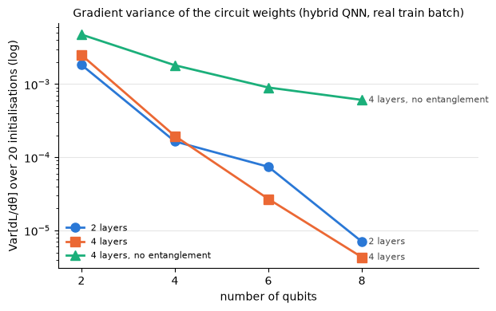

# Outputs of `17_week5_qnn_smoke.ipynb`
Exported 2026-10-10 14:29 from the saved notebook file.

## Cell 1: setup
_execution count: 1_

```
pennylane 0.45.1 | lightning 0.45.0 | torch 2.14.1 | threads 4
```

## Cell 2: unit checks of the circuit code (no real data)
_execution count: 2_

```
(a) entangle=True: max |out diff| 1.2e-07 | max |grad diff| 2.4e-07
(a) entangle=False: max |out diff| 3.6e-07 | max |grad diff| 9.5e-07
(b) vs qml.StronglyEntanglingLayers: max |diff| 0.0e+00
(c) change of <Z_i> when only angle 0 changes | no entanglement: [1.3962 0.     0.     0.    ] | entangled: [0.1378 0.1362 0.0507 0.1256]
(d) parameter counts (input 60 minutes):
shape: (18, 7)
┌──────────┬──────────┬────────────┬──────────┬──────────────────┬─────────────────┬──────────────────┐
│ n_qubits ┆ n_layers ┆ middle     ┆ n_params ┆ n_params_encoder ┆ n_params_middle ┆ n_params_decoder │
│ ---      ┆ ---      ┆ ---        ┆ ---      ┆ ---              ┆ ---             ┆ ---              │
│ i64      ┆ i64      ┆ str        ┆ i64      ┆ i64              ┆ i64             ┆ i64              │
╞══════════╪══════════╪════════════╪══════════╪══════════════════╪═════════════════╪══════════════════╡
│ 2        ┆ 2        ┆ quantum    ┆ 145      ┆ 124              ┆ 12              ┆ 9                │
│ 2        ┆ 2        ┆ mlp        ┆ 145      ┆ 124              ┆ 12              ┆ 9                │
│ 2        ┆ 2        ┆ bottleneck ┆ 133      ┆ 124              ┆ 0               ┆ 9                │
│ 4        ┆ 2        ┆ quantum    ┆ 287      ┆ 248              ┆ 24              ┆ 15               │
│ 4        ┆ 2        ┆ mlp        ┆ 285      ┆ 248              ┆ 22              ┆ 15               │
│ 4        ┆ 2        ┆ bottleneck ┆ 263      ┆ 248              ┆ 0               ┆ 15               │
│ 4        ┆ 4        ┆ quantum    ┆ 311      ┆ 248              ┆ 48              ┆ 15               │
│ 4        ┆ 4        ┆ mlp        ┆ 312      ┆ 248              ┆ 49              ┆ 15               │
│ 4        ┆ 4        ┆ bottleneck ┆ 263      ┆ 248              ┆ 0               ┆ 15               │
│ 6        ┆ 2        ┆ quantum    ┆ 429      ┆ 372              ┆ 36              ┆ 21               │
│ 6        ┆ 2        ┆ mlp        ┆ 425      ┆ 372              ┆ 32              ┆ 21               │
│ 6        ┆ 2        ┆ bottleneck ┆ 393      ┆ 372              ┆ 0               ┆ 21               │
│ 8        ┆ 2        ┆ quantum    ┆ 571      ┆ 496              ┆ 48              ┆ 27               │
│ 8        ┆ 2        ┆ mlp        ┆ 565      ┆ 496              ┆ 42              ┆ 27               │
│ 8        ┆ 2        ┆ bottleneck ┆ 523      ┆ 496              ┆ 0               ┆ 27               │
│ 8        ┆ 4        ┆ quantum    ┆ 619      ┆ 496              ┆ 96              ┆ 27               │
│ 8        ┆ 4        ┆ mlp        ┆ 616      ┆ 496              ┆ 93              ┆ 27               │
│ 8        ┆ 4        ┆ bottleneck ┆ 523      ┆ 496              ┆ 0               ┆ 27               │
└──────────┴──────────┴────────────┴──────────┴──────────────────┴─────────────────┴──────────────────┘

 {'backends_agree_entangle_True': True, 'backends_agree_entangle_False': True, 'equals_StronglyEntanglingLayers': True, 'no_entanglement_is_product_state': True, 'control_matched_within_15pct': True} 
UNIT CHECKS PASSED
```

## Cell 3: DRY RUN of the whole pipeline on SYNTHETIC data (2 epochs, 5,000 samples, no tracking; deleted afterwards)
_execution count: 3_

```
hqnn_q4_l2               files ok: True | prediction rows 12,831 | metrics finite: True | params 287 | skill h1/h5/h15: +0.004 / -0.004 / -0.005
ctrl_mlp_q4_l2           files ok: True | prediction rows 12,831 | metrics finite: True | params 285 | skill h1/h5/h15: -0.034 / +0.032 / +0.047
ctrl_bottleneck_q4_l2    files ok: True | prediction rows 12,831 | metrics finite: True | params 263 | skill h1/h5/h15: -0.080 / -0.001 / -0.002

DRY RUN PASSED (pipeline works end to end; skills after 2 epochs on synthetic data are not meaningful)
```

## Cell 4: TIMING on real data (train split only; nothing is scored). Decision point of the plan: an epoch > ~10 min.
_execution count: 4_

```
rows 303,840 | train origins 196,700 | val origins 42,575
shape: (11, 7)
┌───────────────────────┬─────────────────┬──────────┬─────────────────┬─────────────────────┬────────────────────┬────────────────────┐
│ variant               ┆ backend         ┆ n_params ┆ n_params_middle ┆ ms_per_train_sample ┆ ms_per_pred_sample ┆ est_epoch_min_full │
│ ---                   ┆ ---             ┆ ---      ┆ ---             ┆ ---                 ┆ ---                ┆ ---                │
│ str                   ┆ str             ┆ i64      ┆ i64             ┆ f64                 ┆ f64                ┆ f64                │
╞═══════════════════════╪═════════════════╪══════════╪═════════════════╪═════════════════════╪════════════════════╪════════════════════╡
│ hqnn_q4_l2            ┆ lightning.qubit ┆ 287      ┆ 24              ┆ 3.1266              ┆ 1.8612             ┆ 11.57              │
│ hqnn_q2_l2            ┆ default.qubit   ┆ 145      ┆ 12              ┆ 0.012               ┆ 0.0012             ┆ 0.04               │
│ hqnn_q2_l4            ┆ default.qubit   ┆ 157      ┆ 24              ┆ 0.0169              ┆ 0.0017             ┆ 0.06               │
│ hqnn_q4_l2            ┆ default.qubit   ┆ 287      ┆ 24              ┆ 0.0277              ┆ 0.004              ┆ 0.09               │
│ hqnn_q4_l4            ┆ default.qubit   ┆ 311      ┆ 48              ┆ 0.0418              ┆ 0.0088             ┆ 0.14               │
│ hqnn_q6_l2            ┆ default.qubit   ┆ 429      ┆ 36              ┆ 0.0699              ┆ 0.0209             ┆ 0.24               │
│ hqnn_q6_l4            ┆ default.qubit   ┆ 465      ┆ 72              ┆ 0.1294              ┆ 0.0527             ┆ 0.46               │
│ hqnn_q8_l2            ┆ default.qubit   ┆ 571      ┆ 48              ┆ 0.4323              ┆ 0.1327             ┆ 1.51               │
│ hqnn_q8_l4            ┆ default.qubit   ┆ 619      ┆ 96              ┆ 0.6628              ┆ 0.151              ┆ 2.28               │
│ ctrl_mlp_q4_l2        ┆ default.qubit   ┆ 285      ┆ 22              ┆ 0.005               ┆ 0.0006             ┆ 0.02               │
│ ctrl_bottleneck_q4_l2 ┆ default.qubit   ┆ 263      ┆ 0               ┆ 0.0043              ┆ 0.0005             ┆ 0.01               │
└───────────────────────┴─────────────────┴──────────┴─────────────────┴─────────────────────┴────────────────────┴────────────────────┘

default.qubit (backprop, broadcasting) is 113x faster than lightning.qubit (adjoint) per sample; both exact and equal to 1e-5 (cell 2)
slowest hybrid in the grid (8 qubits, 4 layers): about 2.3 min per epoch on the full train split
DECISION (provisional): backend default.qubit; full train split, no subsample (every epoch <= 10 min)
```

## Cell 5: OVERFIT SANITY CHECK on 1% of the train origins (plan item). Not the protocol: lr 1e-2, batch 64, 60 epochs,
_execution count: 5_

```
1% subsample: 1,967 train origins | persistence MAE on it: 0.2689 / 0.3622 / 0.4783 kW
shape: (3, 10)
┌───────────────────────┬──────────┬───────────┬─────────────┬───┬────────────────┬─────────────────┬──────┬───────┐
│ variant               ┆ n_params ┆ n_samples ┆ loss_epoch1 ┆ … ┆ train_skill_h5 ┆ train_skill_h15 ┆ s    ┆ check │
│ ---                   ┆ ---      ┆ ---       ┆ ---         ┆   ┆ ---            ┆ ---             ┆ ---  ┆ ---   │
│ str                   ┆ i64      ┆ i64       ┆ f64         ┆   ┆ f64            ┆ f64             ┆ f64  ┆ str   │
╞═══════════════════════╪══════════╪═══════════╪═════════════╪═══╪════════════════╪═════════════════╪══════╪═══════╡
│ hqnn_q4_l2            ┆ 287      ┆ 1967      ┆ 2.0817      ┆ … ┆ 0.104          ┆ 0.078           ┆ 16.7 ┆ CHECK │
│ ctrl_mlp_q4_l2        ┆ 285      ┆ 1967      ┆ 2.0054      ┆ … ┆ 0.117          ┆ 0.088           ┆ 1.1  ┆ CHECK │
│ ctrl_bottleneck_q4_l2 ┆ 263      ┆ 1967      ┆ 2.087       ┆ … ┆ 0.027          ┆ 0.046           ┆ 0.9  ┆ CHECK │
└───────────────────────┴──────────┴───────────┴─────────────┴───┴────────────────┴─────────────────┴──────┴───────┘

PASS = training loss fell by >= 20% and the TRAINING skill vs persistence is positive at every horizon (a check that the pipeline can learn, not a performance result)
```

## Cell 6: GRADIENT VARIANCE vs number of qubits (barren-plateau diagnostic; McClean et al. 2018, Cerezo et al. 2025).
_execution count: 6_

```
shape: (12, 6)
┌──────────────────┬──────────┬──────────┬──────────┬─────────────────┬──────────────────┐
│ variant          ┆ n_qubits ┆ n_layers ┆ entangle ┆ var_grad_middle ┆ var_grad_encoder │
│ ---              ┆ ---      ┆ ---      ┆ ---      ┆ ---             ┆ ---              │
│ str              ┆ i64      ┆ i64      ┆ bool     ┆ str             ┆ str              │
╞══════════════════╪══════════╪══════════╪══════════╪═════════════════╪══════════════════╡
│ hqnn_q2_l2       ┆ 2        ┆ 2        ┆ true     ┆ 1.84e-03        ┆ 5.22e-03         │
│ hqnn_q4_l2       ┆ 4        ┆ 2        ┆ true     ┆ 1.65e-04        ┆ 5.18e-04         │
│ hqnn_q6_l2       ┆ 6        ┆ 2        ┆ true     ┆ 7.42e-05        ┆ 3.25e-04         │
│ hqnn_q8_l2       ┆ 8        ┆ 2        ┆ true     ┆ 7.03e-06        ┆ 3.85e-05         │
│ hqnn_q2_l4       ┆ 2        ┆ 4        ┆ true     ┆ 2.50e-03        ┆ 9.03e-03         │
│ hqnn_noent_q2_l4 ┆ 2        ┆ 4        ┆ false    ┆ 4.76e-03        ┆ 7.92e-03         │
│ hqnn_q4_l4       ┆ 4        ┆ 4        ┆ true     ┆ 1.96e-04        ┆ 1.89e-03         │
│ hqnn_noent_q4_l4 ┆ 4        ┆ 4        ┆ false    ┆ 1.81e-03        ┆ 3.99e-03         │
│ hqnn_q6_l4       ┆ 6        ┆ 4        ┆ true     ┆ 2.69e-05        ┆ 3.25e-04         │
│ hqnn_noent_q6_l4 ┆ 6        ┆ 4        ┆ false    ┆ 8.99e-04        ┆ 3.42e-03         │
│ hqnn_q8_l4       ┆ 8        ┆ 4        ┆ true     ┆ 4.31e-06        ┆ 7.31e-05         │
│ hqnn_noent_q8_l4 ┆ 8        ┆ 4        ┆ false    ┆ 6.09e-04        ┆ 2.77e-03         │
└──────────────────┴──────────┴──────────┴──────────┴─────────────────┴──────────────────┘
```



```
fitted log10 slope per added qubit: {'2 layers': -0.38, '4 layers': -0.458, '4 layers, no entanglement': -0.149}
```

## Cell 7: FIRST VALIDATION RUN (seed 0, full protocol: Adam 1e-3, batch 512, patience 3, cap 30 epochs, CPU).
_execution count: 7_

```
[14:24:06] hqnn_q4_l2_s0: training
  epoch   1 | train loss 2.16810 | val MAE 0.2782 / 0.4265 / 0.5958 kW | epoch 5 s
  epoch   2 | train loss 2.06198 | val MAE 0.2742 / 0.4199 / 0.5916 kW | epoch 5 s
  epoch   3 | train loss 2.03006 | val MAE 0.2768 / 0.4195 / 0.5903 kW | epoch 6 s
  epoch   4 | train loss 2.01298 | val MAE 0.2749 / 0.4142 / 0.5870 kW | epoch 5 s
  epoch   5 | train loss 2.00110 | val MAE 0.2756 / 0.4129 / 0.5865 kW | epoch 5 s
  epoch   6 | train loss 1.99219 | val MAE 0.2800 / 0.4167 / 0.5899 kW | epoch 6 s
  epoch   7 | train loss 1.98471 | val MAE 0.2800 / 0.4144 / 0.5877 kW | epoch 6 s
  epoch   8 | train loss 1.97972 | val MAE 0.2745 / 0.4097 / 0.5834 kW | epoch 6 s
  epoch   9 | train loss 1.97648 | val MAE 0.2786 / 0.4121 / 0.5855 kW | epoch 7 s
  epoch  10 | train loss 1.97362 | val MAE 0.2745 / 0.4079 / 0.5821 kW | epoch 4 s
  epoch  11 | train loss 1.97004 | val MAE 0.2751 / 0.4081 / 0.5818 kW | epoch 5 s
  epoch  12 | train loss 1.96678 | val MAE 0.2753 / 0.4080 / 0.5825 kW | epoch 5 s
  epoch  13 | train loss 1.96471 | val MAE 0.2782 / 0.4082 / 0.5820 kW | epoch 4 s
```

```stderr
wandb: [wandb.login()] Loaded credentials for https://api.wandb.ai from /Users/aryaneuse/.netrc.
```

```
[14:25:35] hqnn_q4_l2_s0: params 287 (middle 24) | train 69 s | best epoch 10/13 | val MAE 0.2745 / 0.4079 / 0.5821 kW | skill +0.042 / +0.051 / +0.038
[14:25:35] ctrl_mlp_q4_l2_s0: training
  epoch   1 | train loss 2.09402 | val MAE 0.2769 / 0.4183 / 0.5924 kW | epoch 0 s
  epoch   2 | train loss 2.01940 | val MAE 0.2763 / 0.4148 / 0.5883 kW | epoch 0 s
  epoch   3 | train loss 1.99833 | val MAE 0.2811 / 0.4179 / 0.5921 kW | epoch 0 s
  epoch   4 | train loss 1.98643 | val MAE 0.2786 / 0.4136 / 0.5879 kW | epoch 0 s
  epoch   5 | train loss 1.98112 | val MAE 0.2780 / 0.4121 / 0.5859 kW | epoch 0 s
  epoch   6 | train loss 1.97394 | val MAE 0.2847 / 0.4186 / 0.5942 kW | epoch 0 s
  epoch   7 | train loss 1.96788 | val MAE 0.2820 / 0.4136 / 0.5878 kW | epoch 0 s
  epoch   8 | train loss 1.96311 | val MAE 0.2757 / 0.4087 / 0.5819 kW | epoch 0 s
  epoch   9 | train loss 1.95665 | val MAE 0.2781 / 0.4099 / 0.5822 kW | epoch 0 s
  epoch  10 | train loss 1.95266 | val MAE 0.2774 / 0.4091 / 0.5811 kW | epoch 0 s
  epoch  11 | train loss 1.94756 | val MAE 0.2766 / 0.4086 / 0.5807 kW | epoch 0 s
  epoch  12 | train loss 1.94445 | val MAE 0.2767 / 0.4087 / 0.5807 kW | epoch 0 s
  epoch  13 | train loss 1.94122 | val MAE 0.2795 / 0.4086 / 0.5804 kW | epoch 0 s
  epoch  14 | train loss 1.93601 | val MAE 0.2757 / 0.4077 / 0.5798 kW | epoch 0 s
  epoch  15 | train loss 1.93709 | val MAE 0.2763 / 0.4061 / 0.5786 kW | epoch 0 s
  epoch  16 | train loss 1.93367 | val MAE 0.2803 / 0.4092 / 0.5793 kW | epoch 0 s
  epoch  17 | train loss 1.93171 | val MAE 0.2764 / 0.4060 / 0.5788 kW | epoch 0 s
  epoch  18 | train loss 1.92972 | val MAE 0.2802 / 0.4086 / 0.5810 kW | epoch 0 s
[14:25:50] ctrl_mlp_q4_l2_s0: params 285 (middle 22) | train 6 s | best epoch 15/18 | val MAE 0.2763 / 0.4061 / 0.5786 kW | skill +0.036 / +0.055 / +0.043
[14:25:50] ctrl_bottleneck_q4_l2_s0: training
  epoch   1 | train loss 2.20156 | val MAE 0.2897 / 0.4286 / 0.6007 kW | epoch 0 s
  epoch   2 | train loss 2.09134 | val MAE 0.2684 / 0.4158 / 0.5905 kW | epoch 0 s
  epoch   3 | train loss 2.02919 | val MAE 0.2678 / 0.4173 / 0.5901 kW | epoch 0 s
  epoch   4 | train loss 2.00623 | val MAE 0.2646 / 0.4121 / 0.5869 kW | epoch 0 s
  epoch   5 | train loss 1.99735 | val MAE 0.2628 / 0.4111 / 0.5864 kW | epoch 0 s
  epoch   6 | train loss 1.98893 | val MAE 0.2701 / 0.4181 / 0.5908 kW | epoch 0 s
  epoch   7 | train loss 1.98122 | val MAE 0.2693 / 0.4149 / 0.5875 kW | epoch 0 s
  epoch   8 | train loss 1.97605 | val MAE 0.2656 / 0.4126 / 0.5855 kW | epoch 0 s
[14:26:02] ctrl_bottleneck_q4_l2_s0: params 263 (middle 0) | train 2 s | best epoch 5/8 | val MAE 0.2628 / 0.4111 / 0.5864 kW | skill +0.083 / +0.044 / +0.030
[14:26:02] hqnn_noent_q4_l2_s0: training
  epoch   1 | train loss 2.15046 | val MAE 0.2758 / 0.4189 / 0.5908 kW | epoch 4 s
  epoch   2 | train loss 2.03413 | val MAE 0.2696 / 0.4145 / 0.5887 kW | epoch 4 s
  epoch   3 | train loss 2.00389 | val MAE 0.2715 / 0.4139 / 0.5903 kW | epoch 4 s
  epoch   4 | train loss 1.98722 | val MAE 0.2727 / 0.4125 / 0.5883 kW | epoch 5 s
  epoch   5 | train loss 1.97696 | val MAE 0.2675 / 0.4113 / 0.5875 kW | epoch 5 s
  epoch   6 | train loss 1.96771 | val MAE 0.2688 / 0.4188 / 0.5918 kW | epoch 4 s
  epoch   7 | train loss 1.95992 | val MAE 0.2678 / 0.4129 / 0.5905 kW | epoch 4 s
  epoch   8 | train loss 1.95346 | val MAE 0.2651 / 0.4102 / 0.5851 kW | epoch 4 s
  epoch   9 | train loss 1.94940 | val MAE 0.2647 / 0.4101 / 0.5834 kW | epoch 4 s
  epoch  10 | train loss 1.94544 | val MAE 0.2644 / 0.4104 / 0.5839 kW | epoch 5 s
  epoch  11 | train loss 1.94304 | val MAE 0.2650 / 0.4083 / 0.5816 kW | epoch 5 s
  epoch  12 | train loss 1.93869 | val MAE 0.2632 / 0.4094 / 0.5814 kW | epoch 6 s
  epoch  13 | train loss 1.93521 | val MAE 0.2649 / 0.4104 / 0.5815 kW | epoch 5 s
  epoch  14 | train loss 1.93281 | val MAE 0.2676 / 0.4083 / 0.5805 kW | epoch 4 s
  epoch  15 | train loss 1.93045 | val MAE 0.2641 / 0.4073 / 0.5801 kW | epoch 4 s
  epoch  16 | train loss 1.92779 | val MAE 0.2645 / 0.4089 / 0.5794 kW | epoch 4 s
  epoch  17 | train loss 1.92474 | val MAE 0.2650 / 0.4095 / 0.5810 kW | epoch 4 s
  epoch  18 | train loss 1.92329 | val MAE 0.2655 / 0.4120 / 0.5823 kW | epoch 4 s
[14:27:35] hqnn_noent_q4_l2_s0: params 287 (middle 24) | train 80 s | best epoch 15/18 | val MAE 0.2641 / 0.4073 / 0.5801 kW | skill +0.078 / +0.053 / +0.041

all runs handled in 3.5 min
references read from reports/week4/benchmark_val_week4_all.csv
shape: (8, 11)
┌──────────────────────────┬──────────┬─────────────────┬──────────┬───┬────────┬─────────┬────────────┬─────────┐
│ model                    ┆ n_params ┆ n_params_middle ┆ skill_h1 ┆ … ┆ MAE_h5 ┆ MAE_h15 ┆ best_epoch ┆ train_s │
│ ---                      ┆ ---      ┆ ---             ┆ ---      ┆   ┆ ---    ┆ ---     ┆ ---        ┆ ---     │
│ str                      ┆ i64      ┆ i64             ┆ f64      ┆   ┆ f64    ┆ f64     ┆ i64        ┆ f64     │
╞══════════════════════════╪══════════╪═════════════════╪══════════╪═══╪════════╪═════════╪════════════╪═════════╡
│ hqnn_q4_l2               ┆ 287      ┆ 24              ┆ 0.0421   ┆ … ┆ 0.4079 ┆ 0.5821  ┆ 10         ┆ 69.0    │
│ ctrl_mlp_q4_l2           ┆ 285      ┆ 22              ┆ 0.0359   ┆ … ┆ 0.4061 ┆ 0.5786  ┆ 15         ┆ 6.0     │
│ ctrl_bottleneck_q4_l2    ┆ 263      ┆ 0               ┆ 0.083    ┆ … ┆ 0.4111 ┆ 0.5864  ┆ 5          ┆ 2.0     │
│ hqnn_noent_q4_l2         ┆ 287      ┆ 24              ┆ 0.0784   ┆ … ┆ 0.4073 ┆ 0.5801  ┆ 15         ┆ 80.0    │
│ [ref] lightgbm (3 seeds) ┆ null     ┆ null            ┆ 0.130922 ┆ … ┆ null   ┆ null    ┆ null       ┆ null    │
│ [ref] patchtst (3 seeds) ┆ null     ┆ null            ┆ 0.112479 ┆ … ┆ null   ┆ null    ┆ null       ┆ null    │
│ [ref] gru_uni (3 seeds)  ┆ null     ┆ null            ┆ 0.057811 ┆ … ┆ null   ┆ null    ┆ null       ┆ null    │
│ [ref] dlinear (3 seeds)  ┆ null     ┆ null            ┆ 0.064738 ┆ … ┆ null   ┆ null    ┆ null       ┆ null    │
└──────────────────────────┴──────────┴─────────────────┴──────────┴───┴────────┴─────────┴────────────┴─────────┘
```

## Cell 8: summary
_execution count: 8_

```
written: ['qnn_first_val_s0.csv', 'qnn_grad_variance.csv', 'qnn_smoke.json', 'qnn_timing.csv', 'quantum_variants_log.csv'] | figure: /Users/aryaneuse/Desktop/Uni Project/datacenter-power-forecasting/reports/figures/week5/01_grad_variance.png
```

## Cell 9: export outputs (save the notebook first with Cmd+S, then run this cell)
_execution count: None_

(no output)
