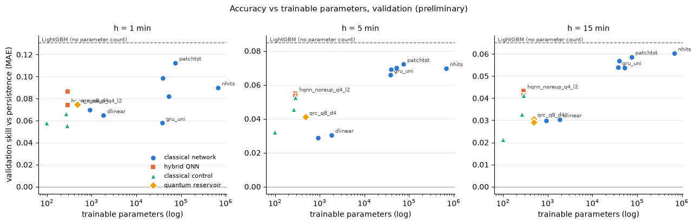

# Outputs of `20_week5_completion.ipynb`
Exported 2026-10-11 16:09 from the saved notebook file.

## Cell 1: setup and inputs
_execution count: 1_

```
missing inputs: none
```

## Cell 2: one validation table (Week 4 benchmark + hybrid QNN family + QRC family), with trainable parameters
_execution count: 2_

```

=== h = 1 min, validation (28 models; new Week 5 models marked *) ===
shape: (27, 12)
┌──────┬─────┬───────────────────┬─────────────────────────┬─────────┬──────────┬────────┬───────────┬──────────┬─────────┬──────────┬─────────────────┐
│ rank ┆ new ┆ family            ┆ model                   ┆ n_seeds ┆ MAE_mean ┆ MAE_sd ┆ skill_MAE ┆ MAE_ramp ┆ ramp_F1 ┆ n_params ┆ n_params_middle │
│ ---  ┆ --- ┆ ---               ┆ ---                     ┆ ---     ┆ ---      ┆ ---    ┆ ---       ┆ ---      ┆ ---     ┆ ---      ┆ ---             │
│ u32  ┆ str ┆ str               ┆ str                     ┆ i64     ┆ f64      ┆ f64    ┆ f64       ┆ f64      ┆ f64     ┆ i64      ┆ i64             │
╞══════╪═════╪═══════════════════╪═════════════════════════╪═════════╪══════════╪════════╪═══════════╪══════════╪═════════╪══════════╪═════════════════╡
│ 1    ┆     ┆ ML                ┆ lightgbm_cov            ┆ 3       ┆ 0.2464   ┆ 0.0003 ┆ 0.14      ┆ 1.276    ┆ 0.266   ┆ null     ┆ null            │
│ 2    ┆     ┆ ML                ┆ lightgbm                ┆ 3       ┆ 0.2491   ┆ 0.0001 ┆ 0.131     ┆ 1.341    ┆ 0.191   ┆ null     ┆ null            │
│ 3    ┆     ┆ deep              ┆ patchtst                ┆ 3       ┆ 0.2543   ┆ 0.0015 ┆ 0.112     ┆ 1.324    ┆ 0.175   ┆ 75215    ┆ null            │
│ 4    ┆     ┆ deep              ┆ gru                     ┆ 3       ┆ 0.2583   ┆ 0.0034 ┆ 0.099     ┆ 1.313    ┆ 0.199   ┆ 39363    ┆ null            │
│ 5    ┆     ┆ foundation        ┆ timesfm_2p5_200m        ┆ 1       ┆ 0.2602   ┆ 0.0    ┆ 0.092     ┆ 1.388    ┆ 0.211   ┆ null     ┆ null            │
│ 6    ┆     ┆ deep              ┆ nhits                   ┆ 3       ┆ 0.2608   ┆ 0.0024 ┆ 0.09      ┆ 1.33     ┆ 0.183   ┆ 676301   ┆ null            │
│ 7    ┆ *   ┆ hybrid quantum    ┆ hqnn_noent_noreup_q4_l2 ┆ 3       ┆ 0.2618   ┆ 0.0018 ┆ 0.086     ┆ 1.391    ┆ 0.109   ┆ 287      ┆ 24              │
│ 8    ┆     ┆ deep              ┆ lstm                    ┆ 3       ┆ 0.2631   ┆ 0.0056 ┆ 0.082     ┆ 1.323    ┆ 0.233   ┆ 52419    ┆ null            │
│ 9    ┆     ┆ linear            ┆ ar_lags_cal_cov         ┆ 1       ┆ 0.2637   ┆ 0.0    ┆ 0.08      ┆ 1.333    ┆ 0.18    ┆ null     ┆ null            │
│ 10   ┆ *   ┆ classical control ┆ ctrl_rf_q8_f40          ┆ 3       ┆ 0.2645   ┆ 0.0005 ┆ 0.077     ┆ 1.415    ┆ 0.048   ┆ 483      ┆ null            │
│ 11   ┆ *   ┆ quantum reservoir ┆ qrc_noent_q8_d4         ┆ 3       ┆ 0.2649   ┆ 0.0001 ┆ 0.076     ┆ 1.434    ┆ 0.031   ┆ 483      ┆ null            │
│ 12   ┆ *   ┆ quantum reservoir ┆ qrc_q8_d4               ┆ 3       ┆ 0.2652   ┆ 0.0004 ┆ 0.075     ┆ 1.42     ┆ 0.041   ┆ 483      ┆ null            │
│ 13   ┆ *   ┆ hybrid quantum    ┆ hqnn_noreup_q4_l2       ┆ 3       ┆ 0.2653   ┆ 0.0039 ┆ 0.074     ┆ 1.416    ┆ 0.115   ┆ 287      ┆ 24              │
│ 14   ┆     ┆ deep              ┆ nlinear                 ┆ 3       ┆ 0.2666   ┆ 0.0007 ┆ 0.07      ┆ 1.416    ┆ 0.134   ┆ 915      ┆ null            │
│ 15   ┆     ┆ linear            ┆ ar_lags                 ┆ 1       ┆ 0.2673   ┆ 0.0    ┆ 0.067     ┆ 1.407    ┆ 0.145   ┆ null     ┆ null            │
│ 16   ┆ *   ┆ classical control ┆ ctrl_bottleneck_q4_l2   ┆ 3       ┆ 0.2676   ┆ 0.0048 ┆ 0.066     ┆ 1.476    ┆ 0.013   ┆ 263      ┆ 0               │
│ 17   ┆     ┆ linear            ┆ ar_lags_cal             ┆ 1       ┆ 0.2677   ┆ 0.0    ┆ 0.066     ┆ 1.401    ┆ 0.143   ┆ null     ┆ null            │
│ 18   ┆     ┆ deep              ┆ dlinear                 ┆ 3       ┆ 0.268    ┆ 0.0018 ┆ 0.065     ┆ 1.405    ┆ 0.148   ┆ 1830     ┆ null            │
│ 19   ┆ *   ┆ classical control ┆ ctrl_raw_q8             ┆ 1       ┆ 0.27     ┆ null   ┆ 0.058     ┆ 1.479    ┆ 0.012   ┆ 99       ┆ null            │
│ 20   ┆     ┆ deep              ┆ gru_uni                 ┆ 3       ┆ 0.27     ┆ 0.0005 ┆ 0.058     ┆ 1.396    ┆ 0.189   ┆ 38019    ┆ null            │
│ 21   ┆ *   ┆ classical control ┆ ctrl_mlp_q4_l2          ┆ 3       ┆ 0.2706   ┆ 0.0054 ┆ 0.056     ┆ 1.432    ┆ 0.127   ┆ 285      ┆ 22              │
│ 22   ┆     ┆ naive             ┆ pers_mod5_rolling       ┆ 1       ┆ 0.2707   ┆ 0.0    ┆ 0.056     ┆ 1.445    ┆ 0.0     ┆ null     ┆ null            │
│ 23   ┆     ┆ statistical       ┆ auto_ets                ┆ 1       ┆ 0.2778   ┆ 0.0    ┆ 0.031     ┆ 1.558    ┆ 0.068   ┆ null     ┆ null            │
│ 24   ┆     ┆ foundation        ┆ chronos_bolt_small      ┆ 1       ┆ 0.2808   ┆ 0.0    ┆ 0.02      ┆ 1.44     ┆ 0.137   ┆ null     ┆ null            │
│ 25   ┆     ┆ statistical       ┆ auto_arima              ┆ 1       ┆ 0.2838   ┆ 0.0    ┆ 0.01      ┆ 1.465    ┆ 0.091   ┆ null     ┆ null            │
│ 26   ┆     ┆ naive             ┆ pers_mod5_static        ┆ 1       ┆ 0.2839   ┆ 0.0    ┆ 0.009     ┆ 1.557    ┆ 0.0     ┆ null     ┆ null            │
│ 27   ┆     ┆ naive             ┆ persistence             ┆ 1       ┆ 0.2866   ┆ 0.0    ┆ 0.0       ┆ 1.607    ┆ 0.0     ┆ null     ┆ null            │
└──────┴─────┴───────────────────┴─────────────────────────┴─────────┴──────────┴────────┴───────────┴──────────┴─────────┴──────────┴─────────────────┘

=== h = 5 min, validation (28 models; new Week 5 models marked *) ===
shape: (27, 12)
┌──────┬─────┬───────────────────┬─────────────────────────┬─────────┬──────────┬────────┬───────────┬──────────┬─────────┬──────────┬─────────────────┐
│ rank ┆ new ┆ family            ┆ model                   ┆ n_seeds ┆ MAE_mean ┆ MAE_sd ┆ skill_MAE ┆ MAE_ramp ┆ ramp_F1 ┆ n_params ┆ n_params_middle │
│ ---  ┆ --- ┆ ---               ┆ ---                     ┆ ---     ┆ ---      ┆ ---    ┆ ---       ┆ ---      ┆ ---     ┆ ---      ┆ ---             │
│ u32  ┆ str ┆ str               ┆ str                     ┆ i64     ┆ f64      ┆ f64    ┆ f64       ┆ f64      ┆ f64     ┆ i64      ┆ i64             │
╞══════╪═════╪═══════════════════╪═════════════════════════╪═════════╪══════════╪════════╪═══════════╪══════════╪═════════╪══════════╪═════════════════╡
│ 1    ┆     ┆ ML                ┆ lightgbm_cov            ┆ 3       ┆ 0.385    ┆ 0.0005 ┆ 0.104     ┆ 2.19     ┆ 0.299   ┆ null     ┆ null            │
│ 2    ┆     ┆ ML                ┆ lightgbm                ┆ 3       ┆ 0.3934   ┆ 0.0001 ┆ 0.085     ┆ 2.276    ┆ 0.249   ┆ null     ┆ null            │
│ 3    ┆     ┆ foundation        ┆ timesfm_2p5_200m        ┆ 1       ┆ 0.3976   ┆ 0.0    ┆ 0.075     ┆ 2.205    ┆ 0.265   ┆ null     ┆ null            │
│ 4    ┆     ┆ deep              ┆ patchtst                ┆ 3       ┆ 0.3989   ┆ 0.0018 ┆ 0.072     ┆ 2.283    ┆ 0.229   ┆ 75215    ┆ null            │
│ 5    ┆     ┆ deep              ┆ lstm                    ┆ 3       ┆ 0.3998   ┆ 0.001  ┆ 0.07      ┆ 2.182    ┆ 0.27    ┆ 52419    ┆ null            │
│ 6    ┆     ┆ deep              ┆ nhits                   ┆ 3       ┆ 0.4      ┆ 0.001  ┆ 0.07      ┆ 2.198    ┆ 0.278   ┆ 676301   ┆ null            │
│ 7    ┆     ┆ deep              ┆ gru                     ┆ 3       ┆ 0.4002   ┆ 0.0025 ┆ 0.069     ┆ 2.197    ┆ 0.246   ┆ 39363    ┆ null            │
│ 8    ┆     ┆ deep              ┆ gru_uni                 ┆ 3       ┆ 0.4016   ┆ 0.0005 ┆ 0.066     ┆ 2.228    ┆ 0.249   ┆ 38019    ┆ null            │
│ 9    ┆ *   ┆ hybrid quantum    ┆ hqnn_noreup_q4_l2       ┆ 3       ┆ 0.4064   ┆ 0.001  ┆ 0.055     ┆ 2.404    ┆ 0.154   ┆ 287      ┆ 24              │
│ 10   ┆ *   ┆ hybrid quantum    ┆ hqnn_noent_noreup_q4_l2 ┆ 3       ┆ 0.4069   ┆ 0.0015 ┆ 0.054     ┆ 2.393    ┆ 0.151   ┆ 287      ┆ 24              │
│ 11   ┆ *   ┆ classical control ┆ ctrl_mlp_q4_l2          ┆ 3       ┆ 0.4073   ┆ 0.0011 ┆ 0.053     ┆ 2.384    ┆ 0.17    ┆ 285      ┆ 22              │
│ 12   ┆     ┆ linear            ┆ ar_lags_cal_cov         ┆ 1       ┆ 0.409    ┆ 0.0    ┆ 0.049     ┆ 2.249    ┆ 0.255   ┆ null     ┆ null            │
│ 13   ┆ *   ┆ classical control ┆ ctrl_bottleneck_q4_l2   ┆ 3       ┆ 0.4104   ┆ 0.0015 ┆ 0.045     ┆ 2.494    ┆ 0.012   ┆ 263      ┆ 0               │
│ 14   ┆ *   ┆ classical control ┆ ctrl_rf_q8_f40          ┆ 3       ┆ 0.4119   ┆ 0.0005 ┆ 0.042     ┆ 2.411    ┆ 0.131   ┆ 483      ┆ null            │
│ 15   ┆ *   ┆ quantum reservoir ┆ qrc_noent_q8_d4         ┆ 3       ┆ 0.4122   ┆ 0.0001 ┆ 0.041     ┆ 2.462    ┆ 0.068   ┆ 483      ┆ null            │
│ 16   ┆ *   ┆ quantum reservoir ┆ qrc_q8_d4               ┆ 3       ┆ 0.4123   ┆ 0.0002 ┆ 0.041     ┆ 2.426    ┆ 0.119   ┆ 483      ┆ null            │
│ 17   ┆ *   ┆ classical control ┆ ctrl_raw_q8             ┆ 1       ┆ 0.4161   ┆ null   ┆ 0.032     ┆ 2.554    ┆ 0.002   ┆ 99       ┆ null            │
│ 18   ┆     ┆ linear            ┆ ar_lags                 ┆ 1       ┆ 0.4161   ┆ 0.0    ┆ 0.032     ┆ 2.377    ┆ 0.194   ┆ null     ┆ null            │
│ 19   ┆     ┆ foundation        ┆ chronos_bolt_small      ┆ 1       ┆ 0.4163   ┆ 0.0    ┆ 0.032     ┆ 2.289    ┆ 0.222   ┆ null     ┆ null            │
│ 20   ┆     ┆ linear            ┆ ar_lags_cal             ┆ 1       ┆ 0.4163   ┆ 0.0    ┆ 0.032     ┆ 2.374    ┆ 0.193   ┆ null     ┆ null            │
│ 21   ┆     ┆ deep              ┆ dlinear                 ┆ 3       ┆ 0.4168   ┆ 0.0034 ┆ 0.03      ┆ 2.389    ┆ 0.182   ┆ 1830     ┆ null            │
│ 22   ┆     ┆ deep              ┆ nlinear                 ┆ 3       ┆ 0.4176   ┆ 0.0041 ┆ 0.029     ┆ 2.38     ┆ 0.196   ┆ 915      ┆ null            │
│ 23   ┆     ┆ statistical       ┆ auto_ets                ┆ 1       ┆ 0.4178   ┆ 0.0    ┆ 0.028     ┆ 2.555    ┆ 0.033   ┆ null     ┆ null            │
│ 24   ┆     ┆ statistical       ┆ auto_arima              ┆ 1       ┆ 0.418    ┆ 0.0    ┆ 0.028     ┆ 2.382    ┆ 0.185   ┆ null     ┆ null            │
│ 25   ┆     ┆ naive             ┆ pers_mod5_static        ┆ 1       ┆ 0.4299   ┆ 0.0    ┆ 0.0       ┆ 2.631    ┆ 0.0     ┆ null     ┆ null            │
│ 26   ┆     ┆ naive             ┆ persistence             ┆ 1       ┆ 0.4299   ┆ 0.0    ┆ 0.0       ┆ 2.631    ┆ 0.0     ┆ null     ┆ null            │
│ 27   ┆     ┆ naive             ┆ pers_mod5_rolling       ┆ 1       ┆ 0.4302   ┆ 0.0    ┆ -0.001    ┆ 2.632    ┆ 0.0     ┆ null     ┆ null            │
└──────┴─────┴───────────────────┴─────────────────────────┴─────────┴──────────┴────────┴───────────┴──────────┴─────────┴──────────┴─────────────────┘

=== h = 15 min, validation (28 models; new Week 5 models marked *) ===
shape: (27, 12)
┌──────┬─────┬───────────────────┬─────────────────────────┬─────────┬──────────┬────────┬───────────┬──────────┬─────────┬──────────┬─────────────────┐
│ rank ┆ new ┆ family            ┆ model                   ┆ n_seeds ┆ MAE_mean ┆ MAE_sd ┆ skill_MAE ┆ MAE_ramp ┆ ramp_F1 ┆ n_params ┆ n_params_middle │
│ ---  ┆ --- ┆ ---               ┆ ---                     ┆ ---     ┆ ---      ┆ ---    ┆ ---       ┆ ---      ┆ ---     ┆ ---      ┆ ---             │
│ u32  ┆ str ┆ str               ┆ str                     ┆ i64     ┆ f64      ┆ f64    ┆ f64       ┆ f64      ┆ f64     ┆ i64      ┆ i64             │
╞══════╪═════╪═══════════════════╪═════════════════════════╪═════════╪══════════╪════════╪═══════════╪══════════╪═════════╪══════════╪═════════════════╡
│ 1    ┆     ┆ ML                ┆ lightgbm_cov            ┆ 3       ┆ 0.5559   ┆ 0.0008 ┆ 0.081     ┆ 2.805    ┆ 0.234   ┆ null     ┆ null            │
│ 2    ┆     ┆ ML                ┆ lightgbm                ┆ 3       ┆ 0.5659   ┆ 0.0004 ┆ 0.065     ┆ 2.91     ┆ 0.198   ┆ null     ┆ null            │
│ 3    ┆     ┆ deep              ┆ nhits                   ┆ 3       ┆ 0.5684   ┆ 0.0016 ┆ 0.06      ┆ 2.817    ┆ 0.229   ┆ 676301   ┆ null            │
│ 4    ┆     ┆ deep              ┆ patchtst                ┆ 3       ┆ 0.5693   ┆ 0.0007 ┆ 0.059     ┆ 2.89     ┆ 0.184   ┆ 75215    ┆ null            │
│ 5    ┆     ┆ deep              ┆ gru                     ┆ 3       ┆ 0.5704   ┆ 0.0036 ┆ 0.057     ┆ 2.811    ┆ 0.221   ┆ 39363    ┆ null            │
│ 6    ┆     ┆ deep              ┆ gru_uni                 ┆ 3       ┆ 0.5722   ┆ 0.0013 ┆ 0.054     ┆ 2.845    ┆ 0.215   ┆ 38019    ┆ null            │
│ 7    ┆     ┆ deep              ┆ lstm                    ┆ 3       ┆ 0.5724   ┆ 0.0043 ┆ 0.054     ┆ 2.816    ┆ 0.223   ┆ 52419    ┆ null            │
│ 8    ┆     ┆ foundation        ┆ timesfm_2p5_200m        ┆ 1       ┆ 0.5775   ┆ 0.0    ┆ 0.045     ┆ 2.809    ┆ 0.227   ┆ null     ┆ null            │
│ 9    ┆     ┆ linear            ┆ ar_lags_cal_cov         ┆ 1       ┆ 0.5786   ┆ 0.0    ┆ 0.043     ┆ 2.891    ┆ 0.175   ┆ null     ┆ null            │
│ 10   ┆ *   ┆ hybrid quantum    ┆ hqnn_noreup_q4_l2       ┆ 3       ┆ 0.5786   ┆ 0.0014 ┆ 0.043     ┆ 3.084    ┆ 0.057   ┆ 287      ┆ 24              │
│ 11   ┆ *   ┆ hybrid quantum    ┆ hqnn_noent_noreup_q4_l2 ┆ 3       ┆ 0.5799   ┆ 0.0015 ┆ 0.041     ┆ 3.077    ┆ 0.05    ┆ 287      ┆ 24              │
│ 12   ┆ *   ┆ classical control ┆ ctrl_mlp_q4_l2          ┆ 3       ┆ 0.5799   ┆ 0.0013 ┆ 0.041     ┆ 3.065    ┆ 0.064   ┆ 285      ┆ 22              │
│ 13   ┆ *   ┆ classical control ┆ ctrl_bottleneck_q4_l2   ┆ 3       ┆ 0.585    ┆ 0.002  ┆ 0.033     ┆ 3.169    ┆ 0.003   ┆ 263      ┆ 0               │
│ 14   ┆ *   ┆ quantum reservoir ┆ qrc_q8_d4               ┆ 3       ┆ 0.5863   ┆ 0.0006 ┆ 0.031     ┆ 3.094    ┆ 0.063   ┆ 483      ┆ null            │
│ 15   ┆     ┆ deep              ┆ dlinear                 ┆ 3       ┆ 0.5865   ┆ 0.0007 ┆ 0.03      ┆ 3.067    ┆ 0.088   ┆ 1830     ┆ null            │
│ 16   ┆ *   ┆ classical control ┆ ctrl_rf_q8_f40          ┆ 3       ┆ 0.5866   ┆ 0.0004 ┆ 0.03      ┆ 3.085    ┆ 0.078   ┆ 483      ┆ null            │
│ 17   ┆     ┆ deep              ┆ nlinear                 ┆ 3       ┆ 0.5867   ┆ 0.0012 ┆ 0.03      ┆ 3.061    ┆ 0.093   ┆ 915      ┆ null            │
│ 18   ┆     ┆ linear            ┆ ar_lags_cal             ┆ 1       ┆ 0.5869   ┆ 0.0    ┆ 0.03      ┆ 3.023    ┆ 0.122   ┆ null     ┆ null            │
│ 19   ┆ *   ┆ quantum reservoir ┆ qrc_noent_q8_d4         ┆ 3       ┆ 0.5873   ┆ 0.0003 ┆ 0.029     ┆ 3.12     ┆ 0.028   ┆ 483      ┆ null            │
│ 20   ┆     ┆ linear            ┆ ar_lags                 ┆ 1       ┆ 0.5876   ┆ 0.0    ┆ 0.028     ┆ 3.031    ┆ 0.119   ┆ null     ┆ null            │
│ 21   ┆     ┆ statistical       ┆ auto_arima              ┆ 1       ┆ 0.5885   ┆ 0.0    ┆ 0.027     ┆ 3.057    ┆ 0.104   ┆ null     ┆ null            │
│ 22   ┆ *   ┆ classical control ┆ ctrl_raw_q8             ┆ 1       ┆ 0.592    ┆ null   ┆ 0.021     ┆ 3.217    ┆ 0.001   ┆ 99       ┆ null            │
│ 23   ┆     ┆ statistical       ┆ auto_ets                ┆ 1       ┆ 0.593    ┆ 0.0    ┆ 0.02      ┆ 3.211    ┆ 0.019   ┆ null     ┆ null            │
│ 24   ┆     ┆ foundation        ┆ chronos_bolt_small      ┆ 1       ┆ 0.5955   ┆ 0.0    ┆ 0.015     ┆ 2.92     ┆ 0.18    ┆ null     ┆ null            │
│ 25   ┆     ┆ naive             ┆ pers_mod5_static        ┆ 1       ┆ 0.6047   ┆ 0.0    ┆ 0.0       ┆ 3.279    ┆ 0.0     ┆ null     ┆ null            │
│ 26   ┆     ┆ naive             ┆ persistence             ┆ 1       ┆ 0.6048   ┆ 0.0    ┆ 0.0       ┆ 3.279    ┆ 0.0     ┆ null     ┆ null            │
│ 27   ┆     ┆ naive             ┆ pers_mod5_rolling       ┆ 1       ┆ 0.6059   ┆ 0.0    ┆ -0.002    ┆ 3.28     ┆ 0.0     ┆ null     ┆ null            │
└──────┴─────┴───────────────────┴─────────────────────────┴─────────┴──────────┴────────┴───────────┴──────────┴─────────┴──────────┴─────────────────┘
```

## Cell 3: costs (trainable parameters, training time, time per epoch, inference) for the networks and Week 5 models
_execution count: 3_

```
shape: (16, 10)
┌───────────┬─────────────────────────┬──────────────────┬────────┬──────────┬─────────────────┬─────────┬─────────────┬────────────┬─────────────────────┐
│ group     ┆ model                   ┆ inputs           ┆ device ┆ n_params ┆ n_params_middle ┆ train_s ┆ s_per_epoch ┆ best_epoch ┆ infer_ms_per_sample │
│ ---       ┆ ---                     ┆ ---              ┆ ---    ┆ ---      ┆ ---             ┆ ---     ┆ ---         ┆ ---        ┆ ---                 │
│ str       ┆ str                     ┆ str              ┆ str    ┆ i64      ┆ i64             ┆ f64     ┆ f64         ┆ f64        ┆ f64                 │
╞═══════════╪═════════════════════════╪══════════════════╪════════╪══════════╪═════════════════╪═════════╪═════════════╪════════════╪═════════════════════╡
│ week5_qrc ┆ ctrl_raw_q8             ┆ power only       ┆ cpu    ┆ 99       ┆ null            ┆ 0.0     ┆ null        ┆ null       ┆ null                │
│ week5_qnn ┆ ctrl_bottleneck_q4_l2   ┆ power only       ┆ cpu    ┆ 263      ┆ 0               ┆ 2.0     ┆ 0.2         ┆ 7.7        ┆ 0.0006              │
│ week5_qnn ┆ ctrl_mlp_q4_l2          ┆ power only       ┆ cpu    ┆ 285      ┆ 22              ┆ 5.0     ┆ 0.3         ┆ 12.0       ┆ 0.0004              │
│ week5_qnn ┆ hqnn_noent_noreup_q4_l2 ┆ power only       ┆ cpu    ┆ 287      ┆ 24              ┆ 61.0    ┆ 3.5         ┆ 13.7       ┆ 0.0045              │
│ week5_qnn ┆ hqnn_noreup_q4_l2       ┆ power only       ┆ cpu    ┆ 287      ┆ 24              ┆ 70.0    ┆ 4.2         ┆ 13.0       ┆ 0.0041              │
│ week5_qrc ┆ qrc_noent_q8_d4         ┆ power only       ┆ cpu    ┆ 483      ┆ null            ┆ 77.0    ┆ null        ┆ null       ┆ null                │
│ week5_qrc ┆ qrc_q8_d4               ┆ power only       ┆ cpu    ┆ 483      ┆ null            ┆ 89.0    ┆ null        ┆ null       ┆ null                │
│ week5_qrc ┆ ctrl_rf_q8_f40          ┆ power only       ┆ cpu    ┆ 483      ┆ null            ┆ 1.0     ┆ null        ┆ null       ┆ null                │
│ week4_nf  ┆ nlinear                 ┆ power only       ┆ cpu    ┆ 915      ┆ null            ┆ 1.0     ┆ 0.2         ┆ 3.3        ┆ 0.0004              │
│ week4_nf  ┆ dlinear                 ┆ power only       ┆ cpu    ┆ 1830     ┆ null            ┆ 1.0     ┆ 0.3         ┆ 2.0        ┆ 0.0006              │
│ week4_nf  ┆ gru_uni                 ┆ power only       ┆ mps    ┆ 38019    ┆ null            ┆ 255.0   ┆ 36.4        ┆ 4.0        ┆ 0.0291              │
│ week3_rnn ┆ gru                     ┆ power + calendar ┆ cpu    ┆ 39363    ┆ null            ┆ 538.0   ┆ 52.1        ┆ 7.3        ┆ 0.0651              │
│ week3_rnn ┆ lstm                    ┆ power + calendar ┆ cpu    ┆ 52419    ┆ null            ┆ 506.0   ┆ 54.0        ┆ 6.3        ┆ 0.0866              │
│ week3_rnn ┆ lstm_minmax             ┆ power + calendar ┆ cpu    ┆ 52419    ┆ null            ┆ 217.0   ┆ 54.2        ┆ 1.0        ┆ 0.0818              │
│ week4_nf  ┆ patchtst                ┆ power only       ┆ mps    ┆ 75215    ┆ null            ┆ 203.0   ┆ 13.3        ┆ 12.3       ┆ 0.0143              │
│ week4_nf  ┆ nhits                   ┆ power only       ┆ cpu    ┆ 676301   ┆ null            ┆ 20.0    ┆ 4.6         ┆ 1.3        ┆ 0.0055              │
└───────────┴─────────────────────────┴──────────────────┴────────┴──────────┴─────────────────┴─────────┴─────────────┴────────────┴─────────────────────┘

QRC train_s = reservoir states for all minutes + ridge readout (kernel aggregation not timed); QNN train_s = full training on CPU with early stopping. Devices differ: times are indicative only.
```

## Cell 4: figure, validation skill vs trainable parameters (log scale), one panel per horizon (preliminary;
_execution count: 4_



## Cell 5: Week 5 checklist from the plan (Project_Context_FA.txt, Section 8, Week 5)
_execution count: 5_

```
DONE  [main] hybrid QNN (encoder -> circuit -> decoder, re-uploading, entangling layers, Z readout)
DONE  [main] classical control with matched parameter count (same encoder/decoder)
DONE  [main] quantum reservoir computing with ridge readout (+ raw, random-feature and no-entanglement controls)
OPEN  [supp] quantum kernel ridge regression on a small subsample
DONE  [main] epoch time measured and trainable sample size decided
DONE  [main] overfit sanity check (1% check of nb 17 or memorisation check of nb 18)
DONE  [main] models connected to the shared evaluation module (src/evaluation/metrics.py)
DONE  [criterion] two main models end-to-end and in the unified table

main hybrid QNN: hqnn_noreup_q4_l2 | decision point (> ~10 min per epoch): not reached (slowest grid point 2.3 min)
ALL MAIN WEEK 5 ITEMS DONE (technical); documents (Methods draft notes, weekly report) still to write
```

## Cell 6: export outputs (save the notebook first with Cmd+S, then run this cell)
_execution count: 6_

```
written 20_week5_completion_outputs.md | code cells 6 | figures 0
```
