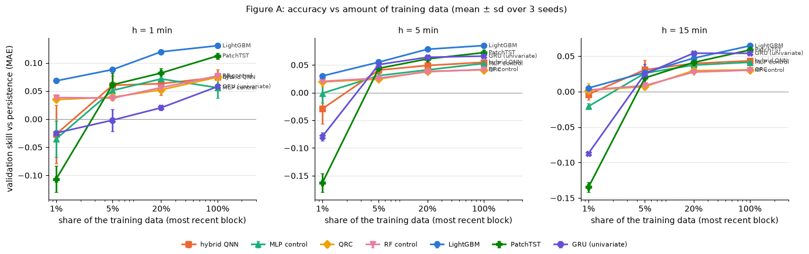
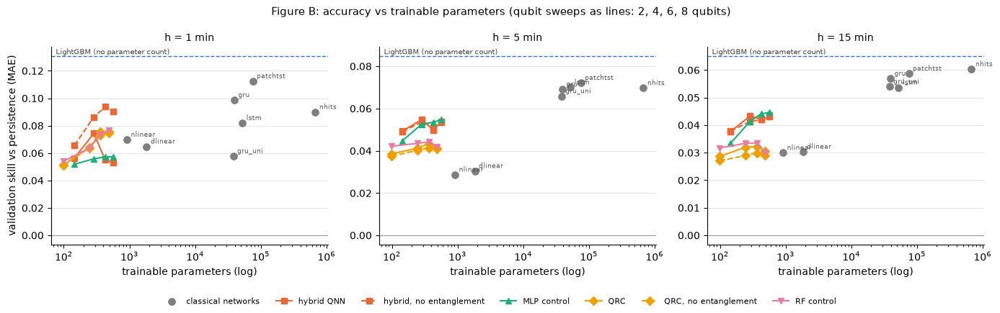
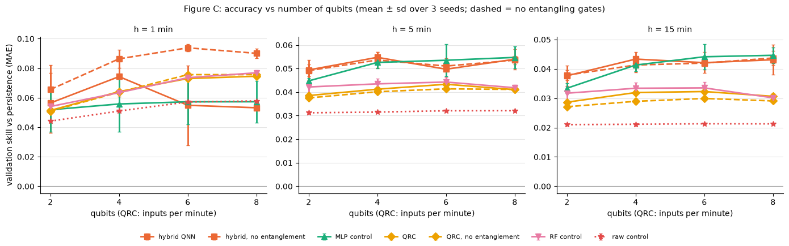

# Outputs of `21_week6_fraction_qubits.ipynb`
Exported 2026-10-12 10:35 from the saved notebook file.

## Cell 1: setup (reads the decisions of notebooks 17-19)
_execution count: 1_

```
main hybrid hqnn_noreup_q4_l2 (control ctrl_mlp_q4_l2) in group week5_qnn | epoch cap 30 | QRC n=8, depth 4, scales {'qrc': 0.098, 'qrc_noent': 0.196, 'rf': 0.098, 'raw': 1.571} | PatchTST/GRU device mps
```

## Cell 2: DRY RUN on synthetic data of every runner used here (tiny budgets; deleted afterwards)
_execution count: 2_

```stderr
2026-10-11 22:29:53,291	INFO util.py:155 -- Missing packages: ['ipywidgets']. Run `pip install -U ipywidgets`, then restart the notebook server for rich notebook output.
2026-10-11 22:29:53,908	INFO util.py:155 -- Missing packages: ['ipywidgets']. Run `pip install -U ipywidgets`, then restart the notebook server for rich notebook output.
Seed set to 0
```

```
runners: network fraction (hybrid, MLP, GRU, PatchTST), LightGBM fraction, QRC fraction, qubit sweep: all finite
DRY RUN PASSED
```

## Cell 3: real data; size of each fraction
_execution count: 3_

```
shape: (4, 4)
┌──────────┬───────────────┬─────────────────────┬──────────────┐
│ fraction ┆ train_origins ┆ first_origin        ┆ days_covered │
│ ---      ┆ ---           ┆ ---                 ┆ ---          │
│ f64      ┆ i64           ┆ str                 ┆ f64          │
╞══════════╪═══════════════╪═════════════════════╪══════════════╡
│ 0.01     ┆ 1967          ┆ 2021-07-28 08:00:00 ┆ 1.4          │
│ 0.05     ┆ 9835          ┆ 2021-07-22 20:52:00 ┆ 6.8          │
│ 0.2      ┆ 39340         ┆ 2021-06-30 07:07:00 ┆ 29.4         │
│ 1.0      ┆ 196700        ┆ 2021-03-04 00:59:00 ┆ 147.7        │
└──────────┴───────────────┴─────────────────────┴──────────────┘
```

## Cell 4: DATA FRACTION runs (1%, 5%, 20%; 3 seeds). Resumable. Order: cheap to expensive.
_execution count: 4_

```stderr
wandb: [wandb.login()] Loaded credentials for https://api.wandb.ai from /Users/aryaneuse/.netrc.
```

```
[22:30:09] lightgbm_f001_s0: rounds {1: 47, 5: 32, 15: 6} | skill +0.067 / +0.029 / +0.005
[22:30:19] lightgbm_f005_s0: rounds {1: 47, 5: 173, 15: 29} | skill +0.086 / +0.055 / +0.026
[22:30:34] lightgbm_f020_s0: rounds {1: 141, 5: 210, 15: 35} | skill +0.119 / +0.079 / +0.047
[22:31:20] lightgbm_f100_s0: rounds {1: 692, 5: 646, 15: 90} | skill +0.131 / +0.085 / +0.065
[22:31:30] lightgbm_f001_s1: rounds {1: 51, 5: 29, 15: 4} | skill +0.067 / +0.029 / +0.004
[22:31:42] lightgbm_f005_s1: rounds {1: 53, 5: 188, 15: 27} | skill +0.087 / +0.054 / +0.026
[22:32:00] lightgbm_f020_s1: rounds {1: 123, 5: 211, 15: 41} | skill +0.120 / +0.079 / +0.048
[22:32:49] lightgbm_f100_s1: rounds {1: 900, 5: 677, 15: 92} | skill +0.131 / +0.085 / +0.064
[22:33:00] lightgbm_f001_s2: rounds {1: 44, 5: 34, 15: 6} | skill +0.070 / +0.032 / +0.006
[22:33:14] lightgbm_f005_s2: rounds {1: 64, 5: 166, 15: 35} | skill +0.092 / +0.056 / +0.027
[22:33:28] lightgbm_f020_s2: rounds {1: 133, 5: 215, 15: 38} | skill +0.120 / +0.078 / +0.046
[22:34:03] lightgbm_f100_s2: rounds {1: 432, 5: 605, 15: 82} | skill +0.130 / +0.085 / +0.064
[22:36:51] qrc_q8_d4_f001_s0: skill +0.038 / +0.016 / -0.004
[22:37:04] ctrl_rf_q8_f40_f001_s0: skill +0.034 / +0.025 / +0.004
[22:37:18] qrc_q8_d4_f005_s0: skill +0.045 / +0.023 / +0.008
[22:37:32] ctrl_rf_q8_f40_f005_s0: skill +0.034 / +0.028 / +0.009
[22:37:45] qrc_q8_d4_f020_s0: skill +0.053 / +0.038 / +0.030
[22:37:55] ctrl_rf_q8_f40_f020_s0: skill +0.055 / +0.037 / +0.027
[22:40:06] qrc_q8_d4_f001_s1: skill +0.031 / +0.013 / -0.003
[22:40:17] ctrl_rf_q8_f40_f001_s1: skill +0.043 / +0.018 / +0.006
[22:40:29] qrc_q8_d4_f005_s1: skill +0.038 / +0.023 / +0.005
[22:40:40] ctrl_rf_q8_f40_f005_s1: skill +0.042 / +0.026 / +0.009
[22:40:52] qrc_q8_d4_f020_s1: skill +0.051 / +0.039 / +0.029
[22:41:05] ctrl_rf_q8_f40_f020_s1: skill +0.057 / +0.038 / +0.027
[22:43:06] qrc_q8_d4_f001_s2: skill +0.035 / +0.029 / +0.013
[22:43:19] ctrl_rf_q8_f40_f001_s2: skill +0.038 / +0.018 / -0.004
[22:43:31] qrc_q8_d4_f005_s2: skill +0.034 / +0.028 / +0.009
[22:43:42] ctrl_rf_q8_f40_f005_s2: skill +0.036 / +0.025 / +0.008
[22:43:54] qrc_q8_d4_f020_s2: skill +0.053 / +0.039 / +0.030
[22:44:06] ctrl_rf_q8_f40_f020_s2: skill +0.055 / +0.038 / +0.028
[22:44:06] hqnn_noreup_q4_l2_f001_s0: 1,967 train origins
[22:44:31] hqnn_noreup_q4_l2_f001_s0: params 287 | best epoch 1/4 | 17 s | skill -0.087 / -0.053 / -0.000
[22:44:31] ctrl_mlp_q4_l2_f001_s0: 1,967 train origins
[22:44:40] ctrl_mlp_q4_l2_f001_s0: params 285 | best epoch 1/4 | 1 s | skill -0.010 / -0.019 / -0.024
[22:44:40] hqnn_noreup_q4_l2_f005_s0: 9,835 train origins
[22:45:23] hqnn_noreup_q4_l2_f005_s0: params 287 | best epoch 5/8 | 33 s | skill +0.041 / +0.028 / +0.016
[22:45:23] ctrl_mlp_q4_l2_f005_s0: 9,835 train origins
[22:45:38] ctrl_mlp_q4_l2_f005_s0: params 285 | best epoch 10/13 | 4 s | skill +0.066 / +0.031 / +0.027
[22:45:38] hqnn_noreup_q4_l2_f020_s0: 39,340 train origins
[22:46:39] hqnn_noreup_q4_l2_f020_s0: params 287 | best epoch 8/11 | 54 s | skill +0.040 / +0.041 / +0.035
[22:46:39] ctrl_mlp_q4_l2_f020_s0: 39,340 train origins
[22:46:51] ctrl_mlp_q4_l2_f020_s0: params 285 | best epoch 10/13 | 4 s | skill +0.065 / +0.038 / +0.035
[22:46:51] hqnn_noreup_q4_l2_f001_s1: 1,967 train origins
[22:47:17] hqnn_noreup_q4_l2_f001_s1: params 287 | best epoch 1/4 | 17 s | skill +0.003 / -0.035 / -0.013
[22:47:17] ctrl_mlp_q4_l2_f001_s1: 1,967 train origins
[22:47:31] ctrl_mlp_q4_l2_f001_s1: params 285 | best epoch 1/4 | 1 s | skill -0.024 / +0.000 / -0.017
[22:47:31] hqnn_noreup_q4_l2_f005_s1: 9,835 train origins
[22:49:06] hqnn_noreup_q4_l2_f005_s1: params 287 | best epoch 18/21 | 87 s | skill +0.071 / +0.053 / +0.043
[22:49:06] ctrl_mlp_q4_l2_f005_s1: 9,835 train origins
[22:49:16] ctrl_mlp_q4_l2_f005_s1: params 285 | best epoch 4/7 | 2 s | skill +0.036 / +0.034 / +0.028
[22:49:16] hqnn_noreup_q4_l2_f020_s1: 39,340 train origins
[22:50:53] hqnn_noreup_q4_l2_f020_s1: params 287 | best epoch 11/14 | 61 s | skill +0.076 / +0.055 / +0.043
[22:50:53] ctrl_mlp_q4_l2_f020_s1: 39,340 train origins
[22:51:05] ctrl_mlp_q4_l2_f020_s1: params 285 | best epoch 9/12 | 4 s | skill +0.068 / +0.037 / +0.035
[22:51:05] hqnn_noreup_q4_l2_f001_s2: 1,967 train origins
[22:51:33] hqnn_noreup_q4_l2_f001_s2: params 287 | best epoch 1/4 | 19 s | skill +0.004 / -0.000 / +0.002
[22:51:33] ctrl_mlp_q4_l2_f001_s2: 1,967 train origins
[22:51:43] ctrl_mlp_q4_l2_f001_s2: params 285 | best epoch 1/4 | 1 s | skill -0.071 / +0.015 / -0.022
[22:51:43] hqnn_noreup_q4_l2_f005_s2: 9,835 train origins
[22:52:50] hqnn_noreup_q4_l2_f005_s2: params 287 | best epoch 10/13 | 61 s | skill +0.068 / +0.040 / +0.033
[22:52:50] ctrl_mlp_q4_l2_f005_s2: 9,835 train origins
[22:52:57] ctrl_mlp_q4_l2_f005_s2: params 285 | best epoch 2/5 | 1 s | skill +0.050 / +0.027 / +0.023
[22:52:57] hqnn_noreup_q4_l2_f020_s2: 39,340 train origins
[22:53:52] hqnn_noreup_q4_l2_f020_s2: params 287 | best epoch 9/12 | 50 s | skill +0.073 / +0.051 / +0.041
[22:53:52] ctrl_mlp_q4_l2_f020_s2: 39,340 train origins
[22:54:02] ctrl_mlp_q4_l2_f020_s2: params 285 | best epoch 13/16 | 5 s | skill +0.082 / +0.047 / +0.041
[22:54:02] gru_uni_f001_s0: 1,967 train origins
```

```stderr
Seed set to 0
```

```
[22:56:24] gru_uni_f001_s0: params 38,019 | best epoch 1/4 | 135 s | skill -0.026 / -0.087 / -0.086
[22:56:24] patchtst_f001_s0: 1,967 train origins
[23:19:46] patchtst_f001_s0: params 75,215 | best epoch 19/22 | 1396 s | skill -0.085 / -0.162 / -0.131
[23:19:47] gru_uni_f005_s0: 9,835 train origins
```

```stderr
Seed set to 0
```

```
[23:22:12] gru_uni_f005_s0: params 38,019 | best epoch 1/4 | 139 s | skill +0.007 / +0.049 / +0.028
[23:22:12] patchtst_f005_s0: 9,835 train origins
[23:23:08] patchtst_f005_s0: params 75,215 | best epoch 1/4 | 50 s | skill +0.075 / +0.038 / +0.002
[23:23:08] gru_uni_f020_s0: 39,340 train origins
```

```stderr
Seed set to 0
```

```
[23:25:35] gru_uni_f020_s0: params 38,019 | best epoch 1/4 | 141 s | skill +0.018 / +0.065 / +0.053
[23:25:36] patchtst_f020_s0: 39,340 train origins
[23:26:31] patchtst_f020_s0: params 75,215 | best epoch 1/4 | 50 s | skill +0.090 / +0.057 / +0.038
[23:26:31] gru_uni_f001_s1: 1,967 train origins
```

```stderr
Seed set to 1
```

```
[23:29:00] gru_uni_f001_s1: params 38,019 | best epoch 1/4 | 142 s | skill -0.023 / -0.079 / -0.086
[23:29:00] patchtst_f001_s1: 1,967 train origins
[23:32:52] patchtst_f001_s1: params 75,215 | best epoch 15/18 | 226 s | skill -0.104 / -0.146 / -0.130
[23:32:52] gru_uni_f005_s1: 9,835 train origins
```

```stderr
Seed set to 1
```

```
[23:35:21] gru_uni_f005_s1: params 38,019 | best epoch 1/4 | 143 s | skill +0.012 / +0.046 / +0.010
[23:35:21] patchtst_f005_s1: 9,835 train origins
[23:36:17] patchtst_f005_s1: params 75,215 | best epoch 1/4 | 50 s | skill +0.038 / +0.043 / +0.035
[23:36:17] gru_uni_f020_s1: 39,340 train origins
```

```stderr
Seed set to 1
```

```
[23:38:46] gru_uni_f020_s1: params 38,019 | best epoch 1/4 | 143 s | skill +0.025 / +0.061 / +0.055
[23:38:46] patchtst_f020_s1: 39,340 train origins
[23:40:20] patchtst_f020_s1: params 75,215 | best epoch 4/7 | 88 s | skill +0.074 / +0.056 / +0.038
[23:40:20] gru_uni_f001_s2: 1,967 train origins
```

```stderr
Seed set to 2
```

```
[23:42:50] gru_uni_f001_s2: params 38,019 | best epoch 1/4 | 144 s | skill -0.024 / -0.072 / -0.088
[23:42:50] patchtst_f001_s2: 1,967 train origins
[23:45:14] patchtst_f001_s2: params 75,215 | best epoch 8/11 | 138 s | skill -0.131 / -0.180 / -0.143
[23:45:14] gru_uni_f005_s2: 9,835 train origins
```

```stderr
Seed set to 2
```

```
[23:47:45] gru_uni_f005_s2: params 38,019 | best epoch 1/4 | 144 s | skill -0.024 / +0.057 / +0.037
[23:47:45] patchtst_f005_s2: 9,835 train origins
[23:48:41] patchtst_f005_s2: params 75,215 | best epoch 1/4 | 51 s | skill +0.071 / +0.051 / +0.021
[23:48:41] gru_uni_f020_s2: 39,340 train origins
```

```stderr
Seed set to 2
```

```
[23:51:11] gru_uni_f020_s2: params 38,019 | best epoch 1/4 | 144 s | skill +0.018 / +0.066 / +0.054
[23:51:11] patchtst_f020_s2: 39,340 train origins
[23:52:21] patchtst_f020_s2: params 75,215 | best epoch 2/5 | 63 s | skill +0.083 / +0.070 / +0.047

data-fraction runs handled in 82.4 min
```

## Cell 5: QUBIT SWEEP at 100% data (3 seeds). QRC first (fast), then the hybrid family by increasing qubit count.
_execution count: 5_

```
estimated minutes per epoch (full train) of the hybrid QNN by qubits: {'hqnn_q2_l2': 0.04, 'hqnn_q4_l2': 0.09, 'hqnn_q6_l2': 0.24, 'hqnn_q8_l2': 1.51} | x ~15 epochs x 3 seeds x 2 (with / without entanglement)
[23:52:21] qrc_q2_d4_a0p098_s0: reservoir + readout
[23:52:28] qrc_q2_d4_a0p098_s0: features 32 | readout params 99 | reservoir 1 s | val MAE 0.2719 / 0.4134 / 0.5874 kW | skill +0.051 / +0.039 / +0.029
[23:52:28] qrc_noent_q2_d4_a0p196_s0: reservoir + readout
[23:52:34] qrc_noent_q2_d4_a0p196_s0: features 32 | readout params 99 | reservoir 0 s | val MAE 0.2720 / 0.4137 / 0.5884 kW | skill +0.051 / +0.038 / +0.027
[23:52:34] ctrl_rf_q2_f8_a0p098_s0: reservoir + readout
[23:52:40] ctrl_rf_q2_f8_a0p098_s0: features 32 | readout params 99 | reservoir 0 s | val MAE 0.2706 / 0.4117 / 0.5859 kW | skill +0.056 / +0.043 / +0.031
[23:52:40] ctrl_raw_q2_s0: reservoir + readout
[23:52:46] ctrl_raw_q2_s0: features 8 | readout params 27 | reservoir 0 s | val MAE 0.2739 / 0.4165 / 0.5921 kW | skill +0.044 / +0.031 / +0.021
[23:52:46] qrc_q2_d4_a0p098_s1: reservoir + readout
[23:52:52] qrc_q2_d4_a0p098_s1: features 32 | readout params 99 | reservoir 1 s | val MAE 0.2719 / 0.4134 / 0.5876 kW | skill +0.051 / +0.038 / +0.028
[23:52:52] qrc_noent_q2_d4_a0p196_s1: reservoir + readout
[23:52:58] qrc_noent_q2_d4_a0p196_s1: features 32 | readout params 99 | reservoir 1 s | val MAE 0.2719 / 0.4136 / 0.5882 kW | skill +0.051 / +0.038 / +0.028
[23:52:58] ctrl_rf_q2_f8_a0p098_s1: reservoir + readout
[23:53:04] ctrl_rf_q2_f8_a0p098_s1: features 32 | readout params 99 | reservoir 0 s | val MAE 0.2709 / 0.4108 / 0.5842 kW | skill +0.055 / +0.045 / +0.034
[23:53:04] qrc_q2_d4_a0p098_s2: reservoir + readout
[23:53:10] qrc_q2_d4_a0p098_s2: features 32 | readout params 99 | reservoir 1 s | val MAE 0.2718 / 0.4133 / 0.5876 kW | skill +0.052 / +0.039 / +0.029
[23:53:10] qrc_noent_q2_d4_a0p196_s2: reservoir + readout
[23:53:17] qrc_noent_q2_d4_a0p196_s2: features 32 | readout params 99 | reservoir 1 s | val MAE 0.2720 / 0.4140 / 0.5888 kW | skill +0.051 / +0.037 / +0.027
[23:53:17] ctrl_rf_q2_f8_a0p098_s2: reservoir + readout
[23:53:22] ctrl_rf_q2_f8_a0p098_s2: features 32 | readout params 99 | reservoir 0 s | val MAE 0.2718 / 0.4130 / 0.5869 kW | skill +0.052 / +0.039 / +0.030
[23:53:22] qrc_q4_d4_a0p098_s0: reservoir + readout
[23:53:33] qrc_q4_d4_a0p098_s0: features 80 | readout params 243 | reservoir 4 s | val MAE 0.2682 / 0.4124 / 0.5859 kW | skill +0.064 / +0.041 / +0.031
[23:53:33] qrc_noent_q4_d4_a0p196_s0: reservoir + readout
[23:53:42] qrc_noent_q4_d4_a0p196_s0: features 80 | readout params 243 | reservoir 3 s | val MAE 0.2683 / 0.4129 / 0.5880 kW | skill +0.064 / +0.040 / +0.028
[23:53:42] ctrl_rf_q4_f20_a0p098_s0: reservoir + readout
[23:53:50] ctrl_rf_q4_f20_a0p098_s0: features 80 | readout params 243 | reservoir 0 s | val MAE 0.2685 / 0.4104 / 0.5838 kW | skill +0.063 / +0.046 / +0.035
[23:53:50] ctrl_raw_q4_s0: reservoir + readout
[23:53:56] ctrl_raw_q4_s0: features 16 | readout params 51 | reservoir 0 s | val MAE 0.2720 / 0.4164 / 0.5921 kW | skill +0.051 / +0.032 / +0.021
[23:53:56] qrc_q4_d4_a0p098_s1: reservoir + readout
[23:54:06] qrc_q4_d4_a0p098_s1: features 80 | readout params 243 | reservoir 4 s | val MAE 0.2683 / 0.4123 / 0.5858 kW | skill +0.064 / +0.041 / +0.032
[23:54:06] qrc_noent_q4_d4_a0p196_s1: reservoir + readout
[23:54:17] qrc_noent_q4_d4_a0p196_s1: features 80 | readout params 243 | reservoir 3 s | val MAE 0.2683 / 0.4126 / 0.5871 kW | skill +0.064 / +0.040 / +0.029
[23:54:17] ctrl_rf_q4_f20_a0p098_s1: reservoir + readout
[23:54:24] ctrl_rf_q4_f20_a0p098_s1: features 80 | readout params 243 | reservoir 0 s | val MAE 0.2682 / 0.4110 / 0.5842 kW | skill +0.064 / +0.044 / +0.034
[23:54:24] qrc_q4_d4_a0p098_s2: reservoir + readout
[23:54:35] qrc_q4_d4_a0p098_s2: features 80 | readout params 243 | reservoir 4 s | val MAE 0.2681 / 0.4120 / 0.5849 kW | skill +0.065 / +0.042 / +0.033
[23:54:35] qrc_noent_q4_d4_a0p196_s2: reservoir + readout
[23:54:45] qrc_noent_q4_d4_a0p196_s2: features 80 | readout params 243 | reservoir 3 s | val MAE 0.2683 / 0.4125 / 0.5869 kW | skill +0.064 / +0.041 / +0.030
[23:54:45] ctrl_rf_q4_f20_a0p098_s2: reservoir + readout
[23:54:51] ctrl_rf_q4_f20_a0p098_s2: features 80 | readout params 243 | reservoir 0 s | val MAE 0.2685 / 0.4123 / 0.5860 kW | skill +0.063 / +0.041 / +0.031
[23:54:51] qrc_q6_d4_a0p098_s0: reservoir + readout
[23:55:16] qrc_q6_d4_a0p098_s0: features 120 | readout params 363 | reservoir 17 s | val MAE 0.2660 / 0.4109 / 0.5848 kW | skill +0.072 / +0.044 / +0.033
[23:55:16] qrc_noent_q6_d4_a0p196_s0: reservoir + readout
[23:55:38] qrc_noent_q6_d4_a0p196_s0: features 120 | readout params 363 | reservoir 14 s | val MAE 0.2648 / 0.4120 / 0.5868 kW | skill +0.076 / +0.042 / +0.030
[23:55:38] ctrl_rf_q6_f30_a0p098_s0: reservoir + readout
[23:55:46] ctrl_rf_q6_f30_a0p098_s0: features 120 | readout params 363 | reservoir 0 s | val MAE 0.2654 / 0.4100 / 0.5835 kW | skill +0.074 / +0.046 / +0.035
[23:55:46] ctrl_raw_q6_s0: reservoir + readout
[23:55:52] ctrl_raw_q6_s0: features 24 | readout params 75 | reservoir 0 s | val MAE 0.2702 / 0.4161 / 0.5920 kW | skill +0.057 / +0.032 / +0.021
[23:55:52] qrc_q6_d4_a0p098_s1: reservoir + readout
[23:56:17] qrc_q6_d4_a0p098_s1: features 120 | readout params 363 | reservoir 17 s | val MAE 0.2653 / 0.4112 / 0.5853 kW | skill +0.074 / +0.044 / +0.032
[23:56:17] qrc_noent_q6_d4_a0p196_s1: reservoir + readout
[23:56:39] qrc_noent_q6_d4_a0p196_s1: features 120 | readout params 363 | reservoir 15 s | val MAE 0.2651 / 0.4122 / 0.5867 kW | skill +0.075 / +0.041 / +0.030
[23:56:39] ctrl_rf_q6_f30_a0p098_s1: reservoir + readout
[23:56:47] ctrl_rf_q6_f30_a0p098_s1: features 120 | readout params 363 | reservoir 0 s | val MAE 0.2653 / 0.4114 / 0.5843 kW | skill +0.074 / +0.043 / +0.034
[23:56:47] qrc_q6_d4_a0p098_s2: reservoir + readout
[23:57:13] qrc_q6_d4_a0p098_s2: features 120 | readout params 363 | reservoir 17 s | val MAE 0.2657 / 0.4118 / 0.5859 kW | skill +0.073 / +0.042 / +0.031
[23:57:13] qrc_noent_q6_d4_a0p196_s2: reservoir + readout
[23:57:36] qrc_noent_q6_d4_a0p196_s2: features 120 | readout params 363 | reservoir 15 s | val MAE 0.2648 / 0.4122 / 0.5868 kW | skill +0.076 / +0.041 / +0.030
[23:57:37] ctrl_rf_q6_f30_a0p098_s2: reservoir + readout
[23:57:45] ctrl_rf_q6_f30_a0p098_s2: features 120 | readout params 363 | reservoir 0 s | val MAE 0.2659 / 0.4113 / 0.5859 kW | skill +0.072 / +0.043 / +0.031
[23:57:45] qrc_q8_d4_a0p098_s0: done earlier, skipped
[23:57:45] qrc_noent_q8_d4_a0p196_s0: done earlier, skipped
[23:57:45] ctrl_rf_q8_f40_a0p098_s0: done earlier, skipped
[23:57:45] ctrl_raw_q8_s0: done earlier, skipped
[23:57:45] qrc_q8_d4_a0p098_s1: done earlier, skipped
[23:57:45] qrc_noent_q8_d4_a0p196_s1: done earlier, skipped
[23:57:45] ctrl_rf_q8_f40_a0p098_s1: done earlier, skipped
[23:57:45] qrc_q8_d4_a0p098_s2: done earlier, skipped
[23:57:45] qrc_noent_q8_d4_a0p196_s2: done earlier, skipped
[23:57:45] ctrl_rf_q8_f40_a0p098_s2: done earlier, skipped
QRC sweep handled in 5.4 min
[23:57:45] ctrl_mlp_q2_l2_s0: training
[23:57:54] ctrl_mlp_q2_l2_s0: params 145 (middle 12) | train 3 s | best epoch 8/11 | val MAE 0.2747 / 0.4107 / 0.5834 kW | skill +0.041 / +0.045 / +0.035
[23:57:54] hqnn_noreup_q2_l2_s0: training
[23:58:29] hqnn_noreup_q2_l2_s0: params 145 (middle 12) | train 30 s | best epoch 16/19 | val MAE 0.2742 / 0.4071 / 0.5806 kW | skill +0.043 / +0.053 / +0.040
[23:58:29] hqnn_noent_noreup_q2_l2_s0: training
[23:58:58] hqnn_noent_noreup_q2_l2_s0: params 145 (middle 12) | train 24 s | best epoch 14/17 | val MAE 0.2653 / 0.4090 / 0.5807 kW | skill +0.074 / +0.049 / +0.040
[23:58:58] ctrl_mlp_q2_l2_s1: training
[23:59:06] ctrl_mlp_q2_l2_s1: params 145 (middle 12) | train 4 s | best epoch 10/13 | val MAE 0.2737 / 0.4102 / 0.5853 kW | skill +0.045 / +0.046 / +0.032
[23:59:06] hqnn_noreup_q2_l2_s1: training
[23:59:25] hqnn_noreup_q2_l2_s1: params 145 (middle 12) | train 14 s | best epoch 6/9 | val MAE 0.2733 / 0.4107 / 0.5846 kW | skill +0.046 / +0.045 / +0.034
[23:59:25] hqnn_noent_noreup_q2_l2_s1: training
[23:59:56] hqnn_noent_noreup_q2_l2_s1: params 145 (middle 12) | train 25 s | best epoch 15/18 | val MAE 0.2732 / 0.4076 / 0.5826 kW | skill +0.047 / +0.052 / +0.037
[23:59:56] ctrl_mlp_q2_l2_s2: training
[00:00:04] ctrl_mlp_q2_l2_s2: params 145 (middle 12) | train 3 s | best epoch 6/9 | val MAE 0.2668 / 0.4112 / 0.5852 kW | skill +0.069 / +0.044 / +0.032
[00:00:04] hqnn_noreup_q2_l2_s2: training
[00:00:30] hqnn_noreup_q2_l2_s2: params 145 (middle 12) | train 20 s | best epoch 10/13 | val MAE 0.2637 / 0.4083 / 0.5811 kW | skill +0.080 / +0.050 / +0.039
[00:00:30] hqnn_noent_noreup_q2_l2_s2: training
[00:00:53] hqnn_noent_noreup_q2_l2_s2: params 145 (middle 12) | train 18 s | best epoch 10/13 | val MAE 0.2649 / 0.4098 / 0.5825 kW | skill +0.076 / +0.047 / +0.037
[00:00:53] ctrl_mlp_q4_l2_s0: done earlier, skipped
[00:00:53] hqnn_noreup_q4_l2_s0: done earlier, skipped
[00:00:53] hqnn_noent_noreup_q4_l2_s0: done earlier, skipped
[00:00:53] ctrl_mlp_q4_l2_s1: done earlier, skipped
[00:00:53] hqnn_noreup_q4_l2_s1: done earlier, skipped
[00:00:53] hqnn_noent_noreup_q4_l2_s1: done earlier, skipped
[00:00:53] ctrl_mlp_q4_l2_s2: done earlier, skipped
[00:00:53] hqnn_noreup_q4_l2_s2: done earlier, skipped
[00:00:53] hqnn_noent_noreup_q4_l2_s2: done earlier, skipped
[00:00:53] ctrl_mlp_q6_l2_s0: training
[00:01:03] ctrl_mlp_q6_l2_s0: params 425 (middle 32) | train 5 s | best epoch 15/18 | val MAE 0.2750 / 0.4057 / 0.5770 kW | skill +0.040 / +0.056 / +0.046
[00:01:03] hqnn_noreup_q6_l2_s0: training
[00:02:41] hqnn_noreup_q6_l2_s0: params 429 (middle 36) | train 92 s | best epoch 4/7 | val MAE 0.2746 / 0.4101 / 0.5815 kW | skill +0.042 / +0.046 / +0.039
[00:02:41] hqnn_noent_noreup_q6_l2_s0: training
[00:05:17] hqnn_noent_noreup_q6_l2_s0: params 429 (middle 36) | train 150 s | best epoch 11/14 | val MAE 0.2602 / 0.4086 / 0.5800 kW | skill +0.092 / +0.050 / +0.041
[00:05:17] ctrl_mlp_q6_l2_s1: training
[00:05:28] ctrl_mlp_q6_l2_s1: params 425 (middle 32) | train 6 s | best epoch 15/18 | val MAE 0.2664 / 0.4047 / 0.5763 kW | skill +0.070 / +0.059 / +0.047
[00:05:28] hqnn_noreup_q6_l2_s1: training
[00:09:07] hqnn_noreup_q6_l2_s1: params 429 (middle 36) | train 213 s | best epoch 14/17 | val MAE 0.2619 / 0.4064 / 0.5772 kW | skill +0.086 / +0.055 / +0.046
[00:09:07] hqnn_noent_noreup_q6_l2_s1: training
[00:12:08] hqnn_noent_noreup_q6_l2_s1: params 429 (middle 36) | train 175 s | best epoch 10/13 | val MAE 0.2588 / 0.4070 / 0.5792 kW | skill +0.097 / +0.053 / +0.042
[00:12:08] ctrl_mlp_q6_l2_s2: training
[00:12:17] ctrl_mlp_q6_l2_s2: params 425 (middle 32) | train 4 s | best epoch 7/10 | val MAE 0.2691 / 0.4103 / 0.5812 kW | skill +0.061 / +0.046 / +0.039
[00:12:17] hqnn_noreup_q6_l2_s2: training
[00:14:49] hqnn_noreup_q6_l2_s2: params 429 (middle 36) | train 146 s | best epoch 9/12 | val MAE 0.2760 / 0.4091 / 0.5794 kW | skill +0.037 / +0.048 / +0.042
[00:14:49] hqnn_noent_noreup_q6_l2_s2: training
[00:17:03] hqnn_noent_noreup_q6_l2_s2: params 429 (middle 36) | train 128 s | best epoch 7/10 | val MAE 0.2601 / 0.4084 / 0.5792 kW | skill +0.092 / +0.050 / +0.042
[00:17:03] ctrl_mlp_q8_l2_s0: training
[00:17:13] ctrl_mlp_q8_l2_s0: params 565 (middle 42) | train 4 s | best epoch 11/14 | val MAE 0.2747 / 0.4064 / 0.5767 kW | skill +0.042 / +0.055 / +0.047
[00:17:13] hqnn_noreup_q8_l2_s0: training
[00:32:44] hqnn_noreup_q8_l2_s0: params 571 (middle 48) | train 920 s | best epoch 15/18 | val MAE 0.2709 / 0.4047 / 0.5754 kW | skill +0.055 / +0.059 / +0.049
[00:32:44] hqnn_noent_noreup_q8_l2_s0: training
[00:45:48] hqnn_noent_noreup_q8_l2_s0: params 571 (middle 48) | train 776 s | best epoch 14/17 | val MAE 0.2602 / 0.4063 / 0.5773 kW | skill +0.092 / +0.055 / +0.046
[00:45:48] ctrl_mlp_q8_l2_s1: training
[00:46:00] ctrl_mlp_q8_l2_s1: params 565 (middle 42) | train 5 s | best epoch 15/18 | val MAE 0.2670 / 0.4044 / 0.5771 kW | skill +0.068 / +0.059 / +0.046
[00:46:00] hqnn_noreup_q8_l2_s1: training
[00:55:36] hqnn_noreup_q8_l2_s1: params 571 (middle 48) | train 567 s | best epoch 8/11 | val MAE 0.2719 / 0.4083 / 0.5815 kW | skill +0.051 / +0.050 / +0.039
[00:55:36] hqnn_noent_noreup_q8_l2_s1: training
[01:04:45] hqnn_noent_noreup_q8_l2_s1: params 571 (middle 48) | train 541 s | best epoch 9/12 | val MAE 0.2602 / 0.4066 / 0.5779 kW | skill +0.092 / +0.054 / +0.045
[01:04:45] ctrl_mlp_q8_l2_s2: training
[01:04:53] ctrl_mlp_q8_l2_s2: params 565 (middle 42) | train 3 s | best epoch 7/10 | val MAE 0.2689 / 0.4084 / 0.5798 kW | skill +0.062 / +0.050 / +0.041
[01:04:53] hqnn_noreup_q8_l2_s2: training
[01:12:28] hqnn_noreup_q8_l2_s2: params 571 (middle 48) | train 448 s | best epoch 6/9 | val MAE 0.2712 / 0.4072 / 0.5794 kW | skill +0.054 / +0.053 / +0.042
[01:12:28] hqnn_noent_noreup_q8_l2_s2: training
[01:20:57] hqnn_noent_noreup_q8_l2_s2: params 571 (middle 48) | train 499 s | best epoch 8/11 | val MAE 0.2619 / 0.4077 / 0.5800 kW | skill +0.086 / +0.052 / +0.041
hybrid sweep handled in 83.2 min
```

## Cell 6: tables (mean +- sd over seeds): data fraction and qubit count
_execution count: 6_

```
shape: (21, 6)
┌─────┬──────────────────┬────────┬────────┬───────┬───────┐
│ h   ┆ model            ┆ 0.01   ┆ 0.05   ┆ 0.2   ┆ 1.0   │
│ --- ┆ ---              ┆ ---    ┆ ---    ┆ ---   ┆ ---   │
│ i64 ┆ str              ┆ f64    ┆ f64    ┆ f64   ┆ f64   │
╞═════╪══════════════════╪════════╪════════╪═══════╪═══════╡
│ 1   ┆ GRU (univariate) ┆ -0.025 ┆ -0.002 ┆ 0.02  ┆ 0.058 │
│ 1   ┆ LightGBM         ┆ 0.068  ┆ 0.088  ┆ 0.12  ┆ 0.131 │
│ 1   ┆ MLP control      ┆ -0.035 ┆ 0.051  ┆ 0.072 ┆ 0.056 │
│ 1   ┆ PatchTST         ┆ -0.107 ┆ 0.061  ┆ 0.082 ┆ 0.112 │
│ 1   ┆ QRC              ┆ 0.035  ┆ 0.039  ┆ 0.052 ┆ 0.075 │
│ 1   ┆ RF control       ┆ 0.038  ┆ 0.037  ┆ 0.056 ┆ 0.077 │
│ 1   ┆ hybrid QNN       ┆ -0.027 ┆ 0.06   ┆ 0.063 ┆ 0.074 │
│ 5   ┆ GRU (univariate) ┆ -0.079 ┆ 0.051  ┆ 0.064 ┆ 0.066 │
│ 5   ┆ LightGBM         ┆ 0.03   ┆ 0.055  ┆ 0.078 ┆ 0.085 │
│ 5   ┆ MLP control      ┆ -0.001 ┆ 0.031  ┆ 0.041 ┆ 0.053 │
│ 5   ┆ PatchTST         ┆ -0.163 ┆ 0.044  ┆ 0.061 ┆ 0.072 │
│ 5   ┆ QRC              ┆ 0.019  ┆ 0.024  ┆ 0.039 ┆ 0.041 │
│ 5   ┆ RF control       ┆ 0.02   ┆ 0.026  ┆ 0.038 ┆ 0.042 │
│ 5   ┆ hybrid QNN       ┆ -0.029 ┆ 0.041  ┆ 0.049 ┆ 0.055 │
│ 15  ┆ GRU (univariate) ┆ -0.087 ┆ 0.025  ┆ 0.054 ┆ 0.054 │
│ 15  ┆ LightGBM         ┆ 0.005  ┆ 0.027  ┆ 0.047 ┆ 0.064 │
│ 15  ┆ MLP control      ┆ -0.021 ┆ 0.026  ┆ 0.037 ┆ 0.041 │
│ 15  ┆ PatchTST         ┆ -0.135 ┆ 0.019  ┆ 0.041 ┆ 0.059 │
│ 15  ┆ QRC              ┆ 0.002  ┆ 0.007  ┆ 0.029 ┆ 0.031 │
│ 15  ┆ RF control       ┆ 0.002  ┆ 0.008  ┆ 0.027 ┆ 0.03  │
│ 15  ┆ hybrid QNN       ┆ -0.004 ┆ 0.031  ┆ 0.04  ┆ 0.043 │
└─────┴──────────────────┴────────┴────────┴───────┴───────┘
missing combinations: none
shape: (21, 6)
┌─────┬─────────────────────────┬───────┬───────┬───────┬───────┐
│ h   ┆ model                   ┆ 2     ┆ 4     ┆ 6     ┆ 8     │
│ --- ┆ ---                     ┆ ---   ┆ ---   ┆ ---   ┆ ---   │
│ i64 ┆ str                     ┆ f64   ┆ f64   ┆ f64   ┆ f64   │
╞═════╪═════════════════════════╪═══════╪═══════╪═══════╪═══════╡
│ 1   ┆ MLP control             ┆ 0.052 ┆ 0.056 ┆ 0.057 ┆ 0.057 │
│ 1   ┆ QRC                     ┆ 0.051 ┆ 0.064 ┆ 0.073 ┆ 0.075 │
│ 1   ┆ QRC, no entanglement    ┆ 0.051 ┆ 0.064 ┆ 0.076 ┆ 0.076 │
│ 1   ┆ RF control              ┆ 0.054 ┆ 0.063 ┆ 0.074 ┆ 0.077 │
│ 1   ┆ hybrid QNN              ┆ 0.056 ┆ 0.074 ┆ 0.055 ┆ 0.053 │
│ 1   ┆ hybrid, no entanglement ┆ 0.066 ┆ 0.086 ┆ 0.094 ┆ 0.09  │
│ 1   ┆ raw control             ┆ 0.044 ┆ 0.051 ┆ 0.057 ┆ 0.058 │
│ 5   ┆ MLP control             ┆ 0.045 ┆ 0.053 ┆ 0.054 ┆ 0.055 │
│ 5   ┆ QRC                     ┆ 0.039 ┆ 0.041 ┆ 0.043 ┆ 0.041 │
│ 5   ┆ QRC, no entanglement    ┆ 0.038 ┆ 0.04  ┆ 0.041 ┆ 0.041 │
│ 5   ┆ RF control              ┆ 0.042 ┆ 0.043 ┆ 0.044 ┆ 0.042 │
│ 5   ┆ hybrid QNN              ┆ 0.049 ┆ 0.055 ┆ 0.05  ┆ 0.054 │
│ 5   ┆ hybrid, no entanglement ┆ 0.049 ┆ 0.054 ┆ 0.051 ┆ 0.054 │
│ 5   ┆ raw control             ┆ 0.031 ┆ 0.032 ┆ 0.032 ┆ 0.032 │
│ 15  ┆ MLP control             ┆ 0.033 ┆ 0.041 ┆ 0.044 ┆ 0.045 │
│ 15  ┆ QRC                     ┆ 0.029 ┆ 0.032 ┆ 0.032 ┆ 0.031 │
│ 15  ┆ QRC, no entanglement    ┆ 0.027 ┆ 0.029 ┆ 0.03  ┆ 0.029 │
│ 15  ┆ RF control              ┆ 0.032 ┆ 0.033 ┆ 0.034 ┆ 0.03  │
│ 15  ┆ hybrid QNN              ┆ 0.038 ┆ 0.043 ┆ 0.042 ┆ 0.043 │
│ 15  ┆ hybrid, no entanglement ┆ 0.038 ┆ 0.041 ┆ 0.042 ┆ 0.044 │
│ 15  ┆ raw control             ┆ 0.021 ┆ 0.021 ┆ 0.021 ┆ 0.021 │
└─────┴─────────────────────────┴───────┴───────┴───────┴───────┘
```

## Cell 7: the three main figures of Sprint 3 (validation): skill vs data fraction, vs trainable parameters, vs qubits.
_execution count: 7_







## Cell 8: summary
_execution count: 8_

```
written: ['data_fraction_val.csv', 'qubit_sweep_val.csv', 'week6_fraction_qubits.json'] | figures: ['A_skill_vs_data_fraction.png', 'B_skill_vs_params.png', 'C_skill_vs_qubits.png']
```

## Cell 9: export outputs (save the notebook first with Cmd+S, then run this cell)
_execution count: 10_

```
written 21_week6_fraction_qubits_outputs.md | code cells 10 | figures 3 in 21_week6_fraction_qubits_outputs_figures
```

## Cell 10
_execution count: None_

(no output)
