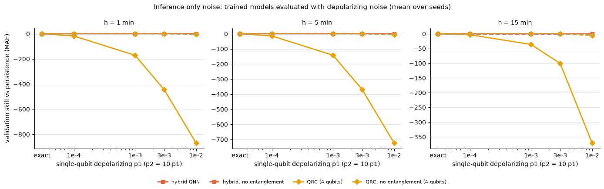

# Outputs of `22_week6_noise.ipynb`
Exported 2026-10-12 12:37 from the saved notebook file.

## Cell 1: setup
_execution count: 1_

```
hybrid: hqnn_noreup_q4_l2 / hqnn_noent_noreup_q4_l2 | QRC main n = 8 | noisy QRC at n = 4 | settings: ['exact', 'shots 1024', 'depol 1e-4 / 1e-3', 'depol 1e-3 / 1e-2', 'depol 3e-3 / 3e-2', 'depol 1e-2 / 1e-1', 'Heron r2-like (marrakesh)', 'Heron r1-like (torino)']
```

## Cell 2: unit checks of the noise code (no real data)
_execution count: 2_

```
hybrid: |noisy(p=0) - exact| 1.2e-07 | p=1e-7: 6.3e-07 | p1/p2=1e-2/1e-1: 0.225 | QRC mean |avg of 20 shot runs - exact| 0.0054
{'no_noise_equals_exact': True, 'tiny_noise_close_to_exact': True, 'strong_noise_changes_output': True, 'readout_flip_scales_Z': True, 'qrc_no_noise_equals_exact': True, 'qrc_shots_unbiased': True} 
UNIT CHECKS PASSED
```

## Cell 3: real data; reload the trained hybrid models and check that the exact simulation reproduces the stored
_execution count: 3_

```
shape: (4, 4)
┌─────────────────────────┬──────┬─────────────────┬──────┐
│ model                   ┆ seed ┆ max_abs_diff_kW ┆ ok   │
│ ---                     ┆ ---  ┆ ---             ┆ ---  │
│ str                     ┆ i64  ┆ f64             ┆ bool │
╞═════════════════════════╪══════╪═════════════════╪══════╡
│ hqnn_noreup_q4_l2       ┆ 0    ┆ 0.0             ┆ true │
│ hqnn_noreup_q4_l2       ┆ 1    ┆ 0.0             ┆ true │
│ hqnn_noreup_q4_l2       ┆ 2    ┆ 0.0             ┆ true │
│ hqnn_noent_noreup_q4_l2 ┆ 0    ┆ 0.0             ┆ true │
└─────────────────────────┴──────┴─────────────────┴──────┘
REPRODUCTION PASSED
```

## Cell 4: HYBRID QNN under noise (validation). Resumable: rows already in the CSV are skipped.
_execution count: 4_

```
[10:39:00] hqnn_noreup_q4_l2_s0 | exact                        | skill +0.059 / +0.057 / +0.046 | 0 s
[10:39:04] hqnn_noreup_q4_l2_s0 | shots 1024                   | skill +0.045 / +0.051 / +0.043 | 3 s
[10:39:28] hqnn_noreup_q4_l2_s0 | depol 1e-4 / 1e-3            | skill +0.059 / +0.057 / +0.046 | 25 s
[10:39:52] hqnn_noreup_q4_l2_s0 | depol 1e-3 / 1e-2            | skill +0.061 / +0.057 / +0.045 | 24 s
[10:40:16] hqnn_noreup_q4_l2_s0 | depol 3e-3 / 3e-2            | skill +0.061 / +0.053 / +0.040 | 24 s
[10:40:40] hqnn_noreup_q4_l2_s0 | depol 1e-2 / 1e-1            | skill +0.040 / +0.024 / +0.016 | 24 s
[10:41:07] hqnn_noreup_q4_l2_s0 | Heron r2-like (marrakesh)    | skill +0.047 / +0.051 / +0.042 | 27 s
[10:41:34] hqnn_noreup_q4_l2_s0 | Heron r1-like (torino)       | skill +0.048 / +0.052 / +0.042 | 27 s
[10:41:34] hqnn_noreup_q4_l2_s1 | exact                        | skill +0.084 / +0.056 / +0.042 | 0 s
[10:41:37] hqnn_noreup_q4_l2_s1 | shots 1024                   | skill +0.080 / +0.053 / +0.041 | 3 s
[10:42:01] hqnn_noreup_q4_l2_s1 | depol 1e-4 / 1e-3            | skill +0.084 / +0.056 / +0.042 | 24 s
[10:42:25] hqnn_noreup_q4_l2_s1 | depol 1e-3 / 1e-2            | skill +0.084 / +0.057 / +0.041 | 24 s
[10:42:49] hqnn_noreup_q4_l2_s1 | depol 3e-3 / 3e-2            | skill +0.081 / +0.045 / +0.032 | 24 s
[10:43:13] hqnn_noreup_q4_l2_s1 | depol 1e-2 / 1e-1            | skill +0.054 / -0.031 / -0.026 | 24 s
[10:43:40] hqnn_noreup_q4_l2_s1 | Heron r2-like (marrakesh)    | skill +0.080 / +0.054 / +0.040 | 26 s
[10:44:06] hqnn_noreup_q4_l2_s1 | Heron r1-like (torino)       | skill +0.080 / +0.054 / +0.040 | 26 s
[10:44:06] hqnn_noreup_q4_l2_s2 | exact                        | skill +0.080 / +0.052 / +0.042 | 0 s
[10:44:09] hqnn_noreup_q4_l2_s2 | shots 1024                   | skill +0.074 / +0.049 / +0.039 | 3 s
[10:44:33] hqnn_noreup_q4_l2_s2 | depol 1e-4 / 1e-3            | skill +0.082 / +0.052 / +0.042 | 24 s
[10:44:57] hqnn_noreup_q4_l2_s2 | depol 1e-3 / 1e-2            | skill +0.086 / +0.054 / +0.041 | 24 s
[10:45:21] hqnn_noreup_q4_l2_s2 | depol 3e-3 / 3e-2            | skill +0.046 / +0.052 / +0.034 | 24 s
[10:45:45] hqnn_noreup_q4_l2_s2 | depol 1e-2 / 1e-1            | skill -0.195 / +0.005 / -0.009 | 24 s
[10:46:12] hqnn_noreup_q4_l2_s2 | Heron r2-like (marrakesh)    | skill +0.078 / +0.050 / +0.039 | 27 s
[10:46:38] hqnn_noreup_q4_l2_s2 | Heron r1-like (torino)       | skill +0.078 / +0.051 / +0.038 | 26 s
[10:46:38] hqnn_noent_noreup_q4_l2_s0 | exact                        | skill +0.079 / +0.057 / +0.044 | 0 s
[10:46:41] hqnn_noent_noreup_q4_l2_s0 | shots 1024                   | skill +0.077 / +0.056 / +0.043 | 3 s
[10:46:53] hqnn_noent_noreup_q4_l2_s0 | depol 1e-3 / 1e-2            | skill +0.080 / +0.057 / +0.044 | 12 s
[10:47:05] hqnn_noent_noreup_q4_l2_s0 | depol 1e-2 / 1e-1            | skill +0.082 / +0.058 / +0.044 | 12 s
[10:47:19] hqnn_noent_noreup_q4_l2_s0 | Heron r2-like (marrakesh)    | skill +0.079 / +0.057 / +0.043 | 14 s
[10:47:34] hqnn_noent_noreup_q4_l2_s0 | Heron r1-like (torino)       | skill +0.080 / +0.058 / +0.043 | 14 s
hybrid noise runs handled in 8.6 min
```

## Cell 5: QRC under noise. (a) 4-qubit QRC and its no-entanglement variant (density matrix; 3 reservoirs);
_execution count: 5_

```
[10:47:38] qrc_q4_d4_s0 | exact                        | skill +0.064 / +0.041 / +0.031 | 4 s
[10:47:39] qrc_q4_d4_s0 | shots 1024                   | skill -28.908 / -151.735 / -79.854 | 1 s
[10:48:20] qrc_q4_d4_s0 | depol 1e-4 / 1e-3            | skill -0.608 / -5.104 / -2.165 | 42 s
[10:49:02] qrc_q4_d4_s0 | depol 1e-3 / 1e-2            | skill -11.719 / -53.029 / -22.891 | 42 s
[10:49:44] qrc_q4_d4_s0 | depol 3e-3 / 3e-2            | skill -36.649 / -122.603 / -32.695 | 42 s
[10:50:26] qrc_q4_d4_s0 | depol 1e-2 / 1e-1            | skill -117.523 / -80.803 / -189.318 | 42 s
[10:51:07] qrc_q4_d4_s0 | Heron r2-like (marrakesh)    | skill -30.107 / -156.000 / -90.652 | 41 s
[10:51:49] qrc_q4_d4_s0 | Heron r1-like (torino)       | skill -31.611 / -166.652 / -115.441 | 42 s
[10:51:53] qrc_q4_d4_s1 | exact                        | skill +0.064 / +0.041 / +0.032 | 4 s
[10:51:54] qrc_q4_d4_s1 | shots 1024                   | skill -90.484 / -240.180 / -55.066 | 1 s
[10:52:36] qrc_q4_d4_s1 | depol 1e-4 / 1e-3            | skill -16.822 / -13.323 / -7.681 | 42 s
[10:53:18] qrc_q4_d4_s1 | depol 1e-3 / 1e-2            | skill -168.585 / -130.469 / -81.157 | 42 s
[10:54:00] qrc_q4_d4_s1 | depol 3e-3 / 3e-2            | skill -452.888 / -323.926 / -221.436 | 42 s
[10:54:42] qrc_q4_d4_s1 | depol 1e-2 / 1e-1            | skill -1010.817 / -546.874 / -524.913 | 42 s
[10:55:25] qrc_q4_d4_s1 | Heron r2-like (marrakesh)    | skill -112.934 / -282.831 / -69.663 | 42 s
[10:56:07] qrc_q4_d4_s1 | Heron r1-like (torino)       | skill -130.824 / -386.484 / -82.879 | 42 s
[10:56:11] qrc_q4_d4_s2 | exact                        | skill +0.065 / +0.042 / +0.033 | 4 s
[10:56:11] qrc_q4_d4_s2 | shots 1024                   | skill -226.789 / -247.511 / -124.792 | 1 s
[10:56:53] qrc_q4_d4_s2 | depol 1e-4 / 1e-3            | skill -34.986 / -24.495 / +0.028 | 42 s
[10:57:35] qrc_q4_d4_s2 | depol 1e-3 / 1e-2            | skill -333.071 / -243.131 / -4.516 | 42 s
[10:58:17] qrc_q4_d4_s2 | depol 3e-3 / 3e-2            | skill -844.496 / -661.599 / -48.226 | 42 s
[10:58:58] qrc_q4_d4_s2 | depol 1e-2 / 1e-1            | skill -1482.096 / -1544.052 / -399.031 | 42 s
[10:59:40] qrc_q4_d4_s2 | Heron r2-like (marrakesh)    | skill -232.048 / -249.597 / -127.011 | 42 s
[11:00:22] qrc_q4_d4_s2 | Heron r1-like (torino)       | skill -229.970 / -251.111 / -128.486 | 42 s
[11:00:25] qrc_noent_q4_d4_s0 | exact                        | skill +0.064 / +0.040 / +0.028 | 4 s
[11:00:26] qrc_noent_q4_d4_s0 | shots 1024                   | skill -17.342 / -21.802 / -25.051 | 1 s
[11:00:59] qrc_noent_q4_d4_s0 | depol 1e-4 / 1e-3            | skill +0.065 / +0.040 / +0.027 | 33 s
[11:01:33] qrc_noent_q4_d4_s0 | depol 1e-3 / 1e-2            | skill +0.051 / +0.012 / -0.010 | 33 s
[11:02:06] qrc_noent_q4_d4_s0 | depol 3e-3 / 3e-2            | skill -0.159 / -0.347 / -0.388 | 33 s
[11:02:43] qrc_noent_q4_d4_s0 | depol 1e-2 / 1e-1            | skill -3.500 / -5.326 / -5.636 | 37 s
[11:03:19] qrc_noent_q4_d4_s0 | Heron r2-like (marrakesh)    | skill -18.186 / -22.060 / -25.373 | 36 s
[11:03:52] qrc_noent_q4_d4_s0 | Heron r1-like (torino)       | skill -18.407 / -22.258 / -25.700 | 33 s
[11:03:56] qrc_noent_q4_d4_s1 | exact                        | skill +0.064 / +0.040 / +0.029 | 4 s
[11:03:57] qrc_noent_q4_d4_s1 | shots 1024                   | skill -60.519 / -119.036 / -122.577 | 1 s
[11:04:30] qrc_noent_q4_d4_s1 | depol 1e-4 / 1e-3            | skill +0.064 / +0.040 / +0.028 | 33 s
[11:05:03] qrc_noent_q4_d4_s1 | depol 1e-3 / 1e-2            | skill +0.051 / +0.010 / -0.014 | 33 s
[11:05:37] qrc_noent_q4_d4_s1 | depol 3e-3 / 3e-2            | skill -0.167 / -0.345 / -0.455 | 33 s
[11:06:10] qrc_noent_q4_d4_s1 | depol 1e-2 / 1e-1            | skill -4.012 / -5.270 / -6.628 | 33 s
[11:06:43] qrc_noent_q4_d4_s1 | Heron r2-like (marrakesh)    | skill -61.299 / -123.421 / -126.539 | 34 s
[11:07:17] qrc_noent_q4_d4_s1 | Heron r1-like (torino)       | skill -61.027 / -120.007 / -123.024 | 34 s
[11:07:21] qrc_noent_q4_d4_s2 | exact                        | skill +0.064 / +0.041 / +0.030 | 4 s
[11:07:22] qrc_noent_q4_d4_s2 | shots 1024                   | skill -48.290 / -30.831 / -24.011 | 1 s
[11:07:55] qrc_noent_q4_d4_s2 | depol 1e-4 / 1e-3            | skill +0.064 / +0.040 / +0.029 | 33 s
[11:08:29] qrc_noent_q4_d4_s2 | depol 1e-3 / 1e-2            | skill +0.047 / +0.008 / -0.009 | 34 s
[11:10:26] qrc_noent_q4_d4_s2 | depol 3e-3 / 3e-2            | skill -0.194 / -0.362 / -0.327 | 118 s
[12:08:56] qrc_noent_q4_d4_s2 | depol 1e-2 / 1e-1            | skill -4.034 / -5.391 / -4.420 | 3510 s
[12:31:54] qrc_noent_q4_d4_s2 | Heron r2-like (marrakesh)    | skill -49.288 / -31.341 / -24.310 | 1378 s
[12:32:32] qrc_noent_q4_d4_s2 | Heron r1-like (torino)       | skill -49.981 / -31.208 / -24.232 | 39 s
[12:32:34] qrc_q8_d4_s0 | exact                        | skill +0.075 / +0.041 / +0.031 | 2 s
[12:32:36] qrc_q8_d4_s0 | shots 1024                   | skill -196.087 / -17.460 / -16.799 | 2 s
[12:32:37] qrc_q8_d4_s0 | readout 1.25e-2 + shots      | skill -280.419 / -19.774 / -16.815 | 2 s
[12:32:39] qrc_q8_d4_s0 | readout 2.41e-2 + shots      | skill -469.017 / -25.009 / -16.743 | 2 s
[12:32:41] qrc_q8_d4_s1 | exact                        | skill +0.075 / +0.041 / +0.031 | 2 s
[12:32:42] qrc_q8_d4_s1 | shots 1024                   | skill -287.863 / -32.660 / -45.594 | 2 s
[12:32:44] qrc_q8_d4_s1 | readout 1.25e-2 + shots      | skill -317.404 / -33.172 / -45.689 | 2 s
[12:32:46] qrc_q8_d4_s1 | readout 2.41e-2 + shots      | skill -401.760 / -36.646 / -50.246 | 2 s
[12:32:47] qrc_q8_d4_s2 | exact                        | skill +0.073 / +0.040 / +0.030 | 2 s
[12:32:49] qrc_q8_d4_s2 | shots 1024                   | skill -274.605 / -241.039 / -6.897 | 2 s
[12:32:51] qrc_q8_d4_s2 | readout 1.25e-2 + shots      | skill -384.235 / -244.558 / -8.573 | 2 s
[12:32:53] qrc_q8_d4_s2 | readout 2.41e-2 + shots      | skill -598.730 / -253.532 / -12.959 | 2 s
QRC noise runs handled in 105.3 min
```

## Cell 6: QRC with a NOISE-AWARE readout. With inference-only noise the readout was trained on exact reservoir
_execution count: 6_

```
[12:32:58] qrc_q8_d4_s0 | shots 1024 (noise-aware readout)     | skill +0.015 / +0.009 / +0.007 | 5 s
[12:33:03] qrc_q8_d4_s1 | shots 1024 (noise-aware readout)     | skill +0.018 / +0.007 / +0.005 | 5 s
[12:33:07] qrc_q8_d4_s2 | shots 1024 (noise-aware readout)     | skill +0.024 / +0.012 / +0.008 | 5 s
    noisy reservoir rows 1,024/303,840 | 1 s
    noisy reservoir rows 21,504/303,840 | 20 s
    noisy reservoir rows 41,984/303,840 | 38 s
    noisy reservoir rows 62,464/303,840 | 56 s
    noisy reservoir rows 82,944/303,840 | 75 s
    noisy reservoir rows 103,424/303,840 | 94 s
    noisy reservoir rows 123,904/303,840 | 112 s
    noisy reservoir rows 144,384/303,840 | 130 s
    noisy reservoir rows 164,864/303,840 | 148 s
    noisy reservoir rows 185,344/303,840 | 166 s
    noisy reservoir rows 205,824/303,840 | 184 s
    noisy reservoir rows 226,304/303,840 | 202 s
    noisy reservoir rows 246,784/303,840 | 222 s
    noisy reservoir rows 267,264/303,840 | 241 s
    noisy reservoir rows 287,744/303,840 | 260 s
[12:37:43] qrc_q4_d4_s0 | Heron r2-like (noise-aware readout)  | skill +0.016 / +0.011 / +0.009 | 276 s
noise-aware readout runs handled in 4.8 min
```

## Cell 7: noise table (mean +- sd over seeds) and figure
_execution count: 7_

```
shape: (36, 10)
┌────────────┬─────────────────────────┬─────────────────────────────────┬─────────┬───┬───────────┬─────────┬─────────┬─────────┐
│ family     ┆ model                   ┆ setting                         ┆ n_seeds ┆ … ┆ skill_h15 ┆ sd_h1   ┆ sd_h5   ┆ sd_h15  │
│ ---        ┆ ---                     ┆ ---                             ┆ ---     ┆   ┆ ---       ┆ ---     ┆ ---     ┆ ---     │
│ str        ┆ str                     ┆ str                             ┆ u32     ┆   ┆ f64       ┆ f64     ┆ f64     ┆ f64     │
╞════════════╪═════════════════════════╪═════════════════════════════════╪═════════╪═══╪═══════════╪═════════╪═════════╪═════════╡
│ QRC        ┆ qrc_noent_q4_d4         ┆ exact                           ┆ 3       ┆ … ┆ 0.029     ┆ 0.0     ┆ 0.001   ┆ 0.001   │
│ QRC        ┆ qrc_noent_q4_d4         ┆ shots 1024                      ┆ 3       ┆ … ┆ -57.213   ┆ 22.255  ┆ 53.722  ┆ 56.609  │
│ QRC        ┆ qrc_noent_q4_d4         ┆ depol 1e-4 / 1e-3               ┆ 3       ┆ … ┆ 0.028     ┆ 0.0     ┆ 0.0     ┆ 0.001   │
│ QRC        ┆ qrc_noent_q4_d4         ┆ depol 1e-3 / 1e-2               ┆ 3       ┆ … ┆ -0.011    ┆ 0.003   ┆ 0.002   ┆ 0.003   │
│ QRC        ┆ qrc_noent_q4_d4         ┆ depol 3e-3 / 3e-2               ┆ 3       ┆ … ┆ -0.39     ┆ 0.018   ┆ 0.009   ┆ 0.064   │
│ QRC        ┆ qrc_noent_q4_d4         ┆ depol 1e-2 / 1e-1               ┆ 3       ┆ … ┆ -5.562    ┆ 0.302   ┆ 0.061   ┆ 1.106   │
│ QRC        ┆ qrc_noent_q4_d4         ┆ Heron r2-like (marrakesh)       ┆ 3       ┆ … ┆ -58.74    ┆ 22.25   ┆ 56.034  ┆ 58.717  │
│ QRC        ┆ qrc_noent_q4_d4         ┆ Heron r1-like (torino)          ┆ 3       ┆ … ┆ -57.652   ┆ 22.119  ┆ 54.037  ┆ 56.618  │
│ QRC        ┆ qrc_q4_d4               ┆ exact                           ┆ 3       ┆ … ┆ 0.032     ┆ 0.0     ┆ 0.0     ┆ 0.001   │
│ QRC        ┆ qrc_q4_d4               ┆ shots 1024                      ┆ 3       ┆ … ┆ -86.571   ┆ 101.265 ┆ 53.306  ┆ 35.345  │
│ QRC        ┆ qrc_q4_d4               ┆ depol 1e-4 / 1e-3               ┆ 3       ┆ … ┆ -3.273    ┆ 17.198  ┆ 9.733   ┆ 3.972   │
│ QRC        ┆ qrc_q4_d4               ┆ depol 1e-3 / 1e-2               ┆ 3       ┆ … ┆ -36.188   ┆ 160.691 ┆ 95.593  ┆ 40.013  │
│ QRC        ┆ qrc_q4_d4               ┆ depol 3e-3 / 3e-2               ┆ 3       ┆ … ┆ -100.786  ┆ 403.986 ┆ 272.358 ┆ 104.775 │
│ QRC        ┆ qrc_q4_d4               ┆ depol 1e-2 / 1e-1               ┆ 3       ┆ … ┆ -371.087  ┆ 693.078 ┆ 747.516 ┆ 169.533 │
│ QRC        ┆ qrc_q4_d4               ┆ Heron r2-like (marrakesh)       ┆ 3       ┆ … ┆ -95.775   ┆ 101.512 ┆ 65.766  ┆ 29.015  │
│ QRC        ┆ qrc_q4_d4               ┆ Heron r1-like (torino)          ┆ 3       ┆ … ┆ -108.935  ┆ 99.179  ┆ 110.894 ┆ 23.489  │
│ QRC        ┆ qrc_q4_d4               ┆ Heron r2-like (noise-aware rea… ┆ 1       ┆ … ┆ 0.009     ┆ null    ┆ null    ┆ null    │
│ QRC        ┆ qrc_q8_d4               ┆ exact                           ┆ 3       ┆ … ┆ 0.031     ┆ 0.001   ┆ 0.001   ┆ 0.001   │
│ QRC        ┆ qrc_q8_d4               ┆ shots 1024                      ┆ 3       ┆ … ┆ -23.097   ┆ 49.604  ┆ 124.927 ┆ 20.103  │
│ QRC        ┆ qrc_q8_d4               ┆ readout 1.25e-2 + shots         ┆ 3       ┆ … ┆ -23.692   ┆ 52.618  ┆ 126.09  ┆ 19.491  │
│ QRC        ┆ qrc_q8_d4               ┆ readout 2.41e-2 + shots         ┆ 3       ┆ … ┆ -26.649   ┆ 100.121 ┆ 128.71  ┆ 20.523  │
│ QRC        ┆ qrc_q8_d4               ┆ shots 1024 (noise-aware readou… ┆ 3       ┆ … ┆ 0.007     ┆ 0.005   ┆ 0.003   ┆ 0.002   │
│ hybrid QNN ┆ hqnn_noent_noreup_q4_l2 ┆ exact                           ┆ 1       ┆ … ┆ 0.044     ┆ null    ┆ null    ┆ null    │
│ hybrid QNN ┆ hqnn_noent_noreup_q4_l2 ┆ shots 1024                      ┆ 1       ┆ … ┆ 0.043     ┆ null    ┆ null    ┆ null    │
│ hybrid QNN ┆ hqnn_noent_noreup_q4_l2 ┆ depol 1e-3 / 1e-2               ┆ 1       ┆ … ┆ 0.044     ┆ null    ┆ null    ┆ null    │
│ hybrid QNN ┆ hqnn_noent_noreup_q4_l2 ┆ depol 1e-2 / 1e-1               ┆ 1       ┆ … ┆ 0.044     ┆ null    ┆ null    ┆ null    │
│ hybrid QNN ┆ hqnn_noent_noreup_q4_l2 ┆ Heron r2-like (marrakesh)       ┆ 1       ┆ … ┆ 0.043     ┆ null    ┆ null    ┆ null    │
│ hybrid QNN ┆ hqnn_noent_noreup_q4_l2 ┆ Heron r1-like (torino)          ┆ 1       ┆ … ┆ 0.043     ┆ null    ┆ null    ┆ null    │
│ hybrid QNN ┆ hqnn_noreup_q4_l2       ┆ exact                           ┆ 3       ┆ … ┆ 0.043     ┆ 0.013   ┆ 0.002   ┆ 0.002   │
│ hybrid QNN ┆ hqnn_noreup_q4_l2       ┆ shots 1024                      ┆ 3       ┆ … ┆ 0.041     ┆ 0.019   ┆ 0.002   ┆ 0.002   │
│ hybrid QNN ┆ hqnn_noreup_q4_l2       ┆ depol 1e-4 / 1e-3               ┆ 3       ┆ … ┆ 0.043     ┆ 0.014   ┆ 0.002   ┆ 0.002   │
│ hybrid QNN ┆ hqnn_noreup_q4_l2       ┆ depol 1e-3 / 1e-2               ┆ 3       ┆ … ┆ 0.042     ┆ 0.014   ┆ 0.001   ┆ 0.002   │
│ hybrid QNN ┆ hqnn_noreup_q4_l2       ┆ depol 3e-3 / 3e-2               ┆ 3       ┆ … ┆ 0.035     ┆ 0.018   ┆ 0.004   ┆ 0.004   │
│ hybrid QNN ┆ hqnn_noreup_q4_l2       ┆ depol 1e-2 / 1e-1               ┆ 3       ┆ … ┆ -0.006    ┆ 0.14    ┆ 0.028   ┆ 0.021   │
│ hybrid QNN ┆ hqnn_noreup_q4_l2       ┆ Heron r2-like (marrakesh)       ┆ 3       ┆ … ┆ 0.04      ┆ 0.019   ┆ 0.002   ┆ 0.002   │
│ hybrid QNN ┆ hqnn_noreup_q4_l2       ┆ Heron r1-like (torino)          ┆ 3       ┆ … ┆ 0.04      ┆ 0.018   ┆ 0.002   ┆ 0.002   │
└────────────┴─────────────────────────┴─────────────────────────────────┴─────────┴───┴───────────┴─────────┴─────────┴─────────┘
```



## Cell 8: ABLATION TABLE (validation skill, mean +- sd over seeds): what each component contributes
_execution count: 8_

```
shape: (32, 7)
┌───────────────────────────────┬─────────────────────────────────┬─────────────────────────┬────────┬──────────┬──────────┬───────────┐
│ block                         ┆ variant                         ┆ model                   ┆ source ┆ skill_h1 ┆ skill_h5 ┆ skill_h15 │
│ ---                           ┆ ---                             ┆ ---                     ┆ ---    ┆ ---      ┆ ---      ┆ ---       │
│ str                           ┆ str                             ┆ str                     ┆ str    ┆ f64      ┆ f64      ┆ f64       │
╞═══════════════════════════════╪═════════════════════════════════╪═════════════════════════╪════════╪══════════╪══════════╪═══════════╡
│ hybrid QNN                    ┆ hybrid QNN (main)               ┆ hqnn_noreup_q4_l2       ┆ nb 18  ┆ 0.074    ┆ 0.055    ┆ 0.043     │
│ hybrid QNN                    ┆   without entangling gates      ┆ hqnn_noent_noreup_q4_l2 ┆ nb 18  ┆ 0.086    ┆ 0.054    ┆ 0.041     │
│ hybrid QNN                    ┆   circuit -> matched classical… ┆ ctrl_mlp_q4_l2          ┆ nb 18  ┆ 0.056    ┆ 0.053    ┆ 0.041     │
│ hybrid QNN                    ┆   no middle block (cos of angl… ┆ ctrl_bottleneck_q4_l2   ┆ nb 18  ┆ 0.066    ┆ 0.045    ┆ 0.033     │
│ hybrid design screen (seed 0) ┆   layers 2, re-uploading False  ┆ hqnn_noreup_q4_l2       ┆ nb 18  ┆ 0.059    ┆ 0.057    ┆ 0.046     │
│ hybrid design screen (seed 0) ┆   layers 4, re-uploading True   ┆ hqnn_q4_l4              ┆ nb 18  ┆ 0.038    ┆ 0.055    ┆ 0.045     │
│ hybrid design screen (seed 0) ┆   layers 2, re-uploading True   ┆ hqnn_q4_l2              ┆ nb 18  ┆ 0.042    ┆ 0.051    ┆ 0.038     │
│ hybrid design screen (seed 0) ┆   layers 4, re-uploading False  ┆ hqnn_noreup_q4_l4       ┆ nb 18  ┆ 0.046    ┆ 0.05     ┆ 0.037     │
│ QRC                           ┆ QRC (main)                      ┆ qrc_q8_d4               ┆ nb 19  ┆ 0.075    ┆ 0.041    ┆ 0.031     │
│ QRC                           ┆   without entangling gates      ┆ qrc_noent_q8_d4         ┆ nb 19  ┆ 0.076    ┆ 0.041    ┆ 0.029     │
│ QRC                           ┆   quantum reservoir -> classic… ┆ ctrl_rf_q8_f40          ┆ nb 19  ┆ 0.077    ┆ 0.042    ┆ 0.03      │
│ QRC                           ┆   no reservoir (raw inputs)     ┆ ctrl_raw_q8             ┆ nb 19  ┆ 0.058    ┆ 0.032    ┆ 0.021     │
│ noise                         ┆   exact                         ┆ qrc_noent_q4_d4         ┆ nb 22  ┆ 0.064    ┆ 0.04     ┆ 0.029     │
│ noise                         ┆   shots 1024                    ┆ qrc_noent_q4_d4         ┆ nb 22  ┆ -42.051  ┆ -57.223  ┆ -57.213   │
│ noise                         ┆   Heron r2-like (marrakesh)     ┆ qrc_noent_q4_d4         ┆ nb 22  ┆ -42.925  ┆ -58.941  ┆ -58.74    │
│ noise                         ┆   Heron r1-like (torino)        ┆ qrc_noent_q4_d4         ┆ nb 22  ┆ -43.138  ┆ -57.824  ┆ -57.652   │
│ noise                         ┆   exact                         ┆ qrc_q4_d4               ┆ nb 22  ┆ 0.064    ┆ 0.041    ┆ 0.032     │
│ noise                         ┆   shots 1024                    ┆ qrc_q4_d4               ┆ nb 22  ┆ -115.394 ┆ -213.142 ┆ -86.571   │
│ noise                         ┆   Heron r2-like (marrakesh)     ┆ qrc_q4_d4               ┆ nb 22  ┆ -125.03  ┆ -229.476 ┆ -95.775   │
│ noise                         ┆   Heron r1-like (torino)        ┆ qrc_q4_d4               ┆ nb 22  ┆ -130.802 ┆ -268.082 ┆ -108.935  │
│ noise                         ┆   Heron r2-like (noise-aware r… ┆ qrc_q4_d4               ┆ nb 22  ┆ 0.016    ┆ 0.011    ┆ 0.009     │
│ noise                         ┆   exact                         ┆ qrc_q8_d4               ┆ nb 22  ┆ 0.075    ┆ 0.041    ┆ 0.031     │
│ noise                         ┆   shots 1024                    ┆ qrc_q8_d4               ┆ nb 22  ┆ -252.852 ┆ -97.053  ┆ -23.097   │
│ noise                         ┆   shots 1024 (noise-aware read… ┆ qrc_q8_d4               ┆ nb 22  ┆ 0.019    ┆ 0.009    ┆ 0.007     │
│ noise                         ┆   exact                         ┆ hqnn_noent_noreup_q4_l2 ┆ nb 22  ┆ 0.079    ┆ 0.057    ┆ 0.044     │
│ noise                         ┆   shots 1024                    ┆ hqnn_noent_noreup_q4_l2 ┆ nb 22  ┆ 0.077    ┆ 0.056    ┆ 0.043     │
│ noise                         ┆   Heron r2-like (marrakesh)     ┆ hqnn_noent_noreup_q4_l2 ┆ nb 22  ┆ 0.079    ┆ 0.057    ┆ 0.043     │
│ noise                         ┆   Heron r1-like (torino)        ┆ hqnn_noent_noreup_q4_l2 ┆ nb 22  ┆ 0.08     ┆ 0.058    ┆ 0.043     │
│ noise                         ┆   exact                         ┆ hqnn_noreup_q4_l2       ┆ nb 22  ┆ 0.074    ┆ 0.055    ┆ 0.043     │
│ noise                         ┆   shots 1024                    ┆ hqnn_noreup_q4_l2       ┆ nb 22  ┆ 0.066    ┆ 0.051    ┆ 0.041     │
│ noise                         ┆   Heron r2-like (marrakesh)     ┆ hqnn_noreup_q4_l2       ┆ nb 22  ┆ 0.069    ┆ 0.052    ┆ 0.04      │
│ noise                         ┆   Heron r1-like (torino)        ┆ hqnn_noreup_q4_l2       ┆ nb 22  ┆ 0.069    ┆ 0.052    ┆ 0.04      │
└───────────────────────────────┴─────────────────────────────────┴─────────────────────────┴────────┴──────────┴──────────┴───────────┘
```

## Cell 9: summary
_execution count: 9_

```
written: /Users/aryaneuse/Desktop/Uni Project/datacenter-power-forecasting/reports/week6/week6_noise.json | /Users/aryaneuse/Desktop/Uni Project/datacenter-power-forecasting/reports/figures/week6/D_noise_val.png
```

## Cell 10: export outputs (save the notebook first with Cmd+S, then run this cell)
_execution count: 10_

```
written 22_week6_noise_outputs.md | code cells 10 | figures 0
```
