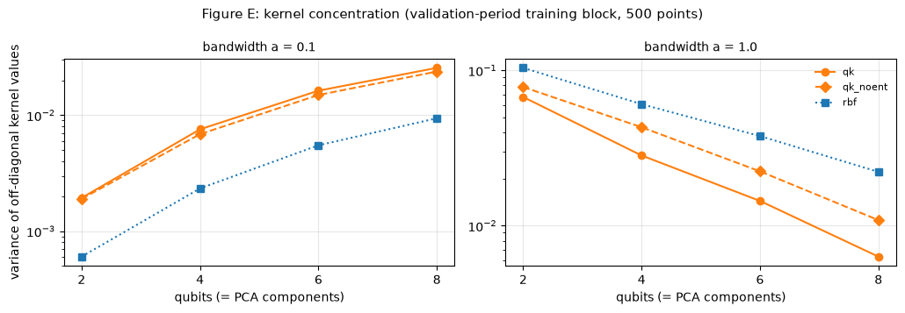

# Outputs of `22b_week6_quantum_kernel.ipynb`
Exported 2026-10-12 13:41 from the saved notebook file.

## Cell 1: setup
_execution count: 1_

```
pennylane 0.45.1 | kinds ['qk', 'qk_noent', 'rbf'] | qubits (4, 8) | subsamples [(0.01, 1), (0.05, 2)] | scales (0.01, 0.03, 0.1, 0.3, 1.0)
```

## Cell 2: unit checks (no real data)
_execution count: 2_

```
(a) broadcast vs single circuit: max |diff| 0.0e+00 | diag(K) - 1: 4.0e-15
(b) no-entanglement kernel vs product of one-qubit kernels: max |diff| 8.9e-16
(c) closed form vs solve: 1.1e-10 | (d) min eigenvalue 2.80e-04 | (e) RBF max diff 2.2e-16
{'broadcast_equals_single_circuit': True, 'fidelity_diag_is_one': True, 'noent_is_product_kernel': True, 'kernel_ridge_closed_form': True, 'gram_psd': True, 'rbf_formula': True} 
UNIT CHECKS PASSED
```

## Cell 3: DRY RUN on synthetic data (small: 2 and 4 qubits, two bandwidths; deleted afterwards)
_execution count: 3_

```
qk       q2 | n_train 977 | best a 0.3 | val MAE 0.3571 / 0.6251 / 0.7904
qk       q4 | n_train 977 | best a 0.3 | val MAE 0.3571 / 0.6256 / 0.8022
qk_noent q2 | n_train 977 | best a 0.3 | val MAE 0.3571 / 0.6225 / 0.7876
qk_noent q4 | n_train 977 | best a 0.3 | val MAE 0.3571 / 0.6239 / 0.7982
rbf      q2 | n_train 977 | best a 0.3 | val MAE 0.3549 / 0.6087 / 0.7581
rbf      q4 | n_train 977 | best a 0.3 | val MAE 0.3543 / 0.6062 / 0.7613
DRY RUN PASSED
```

## Cell 4: real data; training subsamples, PCA explained variance, timing of one fit (8 qubits, largest subsample)
_execution count: 4_

```
shape: (2, 6)
┌──────────┬──────┬─────────┬─────────────────────┬──────────────────┬──────────────────┐
│ fraction ┆ thin ┆ n_train ┆ first_origin        ┆ pca_explained_n4 ┆ pca_explained_n8 │
│ ---      ┆ ---  ┆ ---     ┆ ---                 ┆ ---              ┆ ---              │
│ f64      ┆ i64  ┆ i64     ┆ str                 ┆ f64              ┆ f64              │
╞══════════╪══════╪═════════╪═════════════════════╪══════════════════╪══════════════════╡
│ 0.01     ┆ 1    ┆ 1953    ┆ 2021-07-28 08:00:00 ┆ 0.701            ┆ 0.769            │
│ 0.05     ┆ 2    ┆ 4911    ┆ 2021-07-22 20:52:00 ┆ 0.801            ┆ 0.862            │
└──────────┴──────┴─────────┴─────────────────────┴──────────────────┴──────────────────┘
validation origins: 42,575
one 8-qubit fit on the largest subsample: 34 s | 60 fits in total -> rough upper bound 34 min (4-qubit and 1% fits are much faster)
```

## Cell 5: SCREEN all configurations (kind x qubits x subsample x bandwidth). Resumable per configuration.
_execution count: 5_

```
[13:17:27] qk q4 fraction 0.01 thin 1
    qk       q4 0.01/1 a=0.01 | n_train 1,953 | offdiag mean 0.999 var 1.88e-06 | val MAE 0.2837 / 0.4235 / 0.6018 | 2 s
    qk       q4 0.01/1 a=0.03 | n_train 1,953 | offdiag mean 0.993 var 1.42e-04 | val MAE 0.2822 / 0.4194 / 0.5979 | 2 s
    qk       q4 0.01/1 a=0.1  | n_train 1,953 | offdiag mean 0.929 var 8.52e-03 | val MAE 0.2775 / 0.4173 / 0.5950 | 2 s
    qk       q4 0.01/1 a=0.3  | n_train 1,953 | offdiag mean 0.639 var 6.22e-02 | val MAE 0.2814 / 0.4240 / 0.6050 | 2 s
    qk       q4 0.01/1 a=1.0  | n_train 1,953 | offdiag mean 0.183 var 3.19e-02 | val MAE 0.2865 / 0.4303 / 0.6092 | 2 s
```

```stderr
wandb: [wandb.login()] Loaded credentials for https://api.wandb.ai from /Users/aryaneuse/.netrc.
```

```
[13:18:18] qk_noent q4 fraction 0.01 thin 1
    qk_noent q4 0.01/1 a=0.01 | n_train 1,953 | offdiag mean 0.999 var 1.87e-06 | val MAE 0.2837 / 0.4235 / 0.6017 | 2 s
    qk_noent q4 0.01/1 a=0.03 | n_train 1,953 | offdiag mean 0.993 var 1.39e-04 | val MAE 0.2822 / 0.4191 / 0.5975 | 2 s
    qk_noent q4 0.01/1 a=0.1  | n_train 1,953 | offdiag mean 0.931 var 8.15e-03 | val MAE 0.2780 / 0.4195 / 0.5959 | 2 s
    qk_noent q4 0.01/1 a=0.3  | n_train 1,953 | offdiag mean 0.649 var 6.24e-02 | val MAE 0.2814 / 0.4258 / 0.6060 | 2 s
    qk_noent q4 0.01/1 a=1.0  | n_train 1,953 | offdiag mean 0.224 var 4.45e-02 | val MAE 0.2864 / 0.4299 / 0.6098 | 2 s
[13:19:05] rbf q4 fraction 0.01 thin 1
    rbf      q4 0.01/1 a=0.01 | n_train 1,953 | offdiag mean 1.000 var 4.71e-07 | val MAE 0.2834 / 0.4226 / 0.6019 | 2 s
    rbf      q4 0.01/1 a=0.03 | n_train 1,953 | offdiag mean 0.996 var 3.65e-05 | val MAE 0.2832 / 0.4221 / 0.6015 | 2 s
    rbf      q4 0.01/1 a=0.1  | n_train 1,953 | offdiag mean 0.963 var 2.93e-03 | val MAE 0.2807 / 0.4166 / 0.5953 | 2 s
    rbf      q4 0.01/1 a=0.3  | n_train 1,953 | offdiag mean 0.762 var 4.55e-02 | val MAE 0.2765 / 0.4165 / 0.5990 | 2 s
    rbf      q4 0.01/1 a=1.0  | n_train 1,953 | offdiag mean 0.231 var 6.36e-02 | val MAE 0.2791 / 0.4234 / 0.6043 | 2 s
[13:19:44] qk q8 fraction 0.01 thin 1
    qk       q8 0.01/1 a=0.01 | n_train 1,953 | offdiag mean 0.998 var 5.91e-06 | val MAE 0.2836 / 0.4233 / 0.6009 | 11 s
    qk       q8 0.01/1 a=0.03 | n_train 1,953 | offdiag mean 0.986 var 4.42e-04 | val MAE 0.2817 / 0.4188 / 0.5972 | 9 s
    qk       q8 0.01/1 a=0.1  | n_train 1,953 | offdiag mean 0.870 var 2.44e-02 | val MAE 0.2764 / 0.4163 / 0.5952 | 9 s
    qk       q8 0.01/1 a=0.3  | n_train 1,953 | offdiag mean 0.485 var 7.18e-02 | val MAE 0.2798 / 0.4243 / 0.6059 | 9 s
    qk       q8 0.01/1 a=1.0  | n_train 1,953 | offdiag mean 0.050 var 6.96e-03 | val MAE 0.2866 / 0.4304 / 0.6088 | 8 s
[13:21:05] qk_noent q8 fraction 0.01 thin 1
    qk_noent q8 0.01/1 a=0.01 | n_train 1,953 | offdiag mean 0.998 var 5.90e-06 | val MAE 0.2836 / 0.4232 / 0.6009 | 5 s
    qk_noent q8 0.01/1 a=0.03 | n_train 1,953 | offdiag mean 0.986 var 4.35e-04 | val MAE 0.2818 / 0.4185 / 0.5969 | 5 s
    qk_noent q8 0.01/1 a=0.1  | n_train 1,953 | offdiag mean 0.873 var 2.28e-02 | val MAE 0.2766 / 0.4181 / 0.5956 | 5 s
    qk_noent q8 0.01/1 a=0.3  | n_train 1,953 | offdiag mean 0.496 var 7.20e-02 | val MAE 0.2800 / 0.4262 / 0.6075 | 5 s
    qk_noent q8 0.01/1 a=1.0  | n_train 1,953 | offdiag mean 0.072 var 1.12e-02 | val MAE 0.2865 / 0.4301 / 0.6096 | 5 s
[13:22:06] rbf q8 fraction 0.01 thin 1
    rbf      q8 0.01/1 a=0.01 | n_train 1,953 | offdiag mean 0.999 var 1.48e-06 | val MAE 0.2832 / 0.4224 / 0.6015 | 2 s
    rbf      q8 0.01/1 a=0.03 | n_train 1,953 | offdiag mean 0.993 var 1.15e-04 | val MAE 0.2830 / 0.4219 / 0.6012 | 2 s
    rbf      q8 0.01/1 a=0.1  | n_train 1,953 | offdiag mean 0.929 var 8.85e-03 | val MAE 0.2795 / 0.4157 / 0.5949 | 2 s
    rbf      q8 0.01/1 a=0.3  | n_train 1,953 | offdiag mean 0.635 var 7.06e-02 | val MAE 0.2757 / 0.4180 / 0.6013 | 2 s
    rbf      q8 0.01/1 a=1.0  | n_train 1,953 | offdiag mean 0.100 var 2.23e-02 | val MAE 0.2806 / 0.4272 / 0.6081 | 2 s
[13:22:47] qk q4 fraction 0.05 thin 2
    qk       q4 0.05/2 a=0.01 | n_train 4,911 | offdiag mean 0.999 var 2.56e-06 | val MAE 0.2808 / 0.4157 / 0.5888 | 24 s
    qk       q4 0.05/2 a=0.03 | n_train 4,911 | offdiag mean 0.993 var 1.92e-04 | val MAE 0.2796 / 0.4158 / 0.5878 | 24 s
    qk       q4 0.05/2 a=0.1  | n_train 4,911 | offdiag mean 0.931 var 9.31e-03 | val MAE 0.2769 / 0.4150 / 0.5919 | 24 s
    qk       q4 0.05/2 a=0.3  | n_train 4,911 | offdiag mean 0.649 var 5.11e-02 | val MAE 0.2813 / 0.4229 / 0.6013 | 24 s
    qk       q4 0.05/2 a=1.0  | n_train 4,911 | offdiag mean 0.164 var 2.75e-02 | val MAE 0.2866 / 0.4298 / 0.6049 | 26 s
[13:25:33] qk_noent q4 fraction 0.05 thin 2
    qk_noent q4 0.05/2 a=0.01 | n_train 4,911 | offdiag mean 0.999 var 2.54e-06 | val MAE 0.2808 / 0.4159 / 0.5895 | 23 s
    qk_noent q4 0.05/2 a=0.03 | n_train 4,911 | offdiag mean 0.993 var 1.84e-04 | val MAE 0.2796 / 0.4152 / 0.5877 | 24 s
    qk_noent q4 0.05/2 a=0.1  | n_train 4,911 | offdiag mean 0.932 var 9.05e-03 | val MAE 0.2764 / 0.4202 / 0.5957 | 24 s
    qk_noent q4 0.05/2 a=0.3  | n_train 4,911 | offdiag mean 0.660 var 5.02e-02 | val MAE 0.2820 / 0.4243 / 0.6011 | 25 s
    qk_noent q4 0.05/2 a=1.0  | n_train 4,911 | offdiag mean 0.209 var 4.03e-02 | val MAE 0.2866 / 0.4297 / 0.6048 | 24 s
[13:28:12] rbf q4 fraction 0.05 thin 2
    rbf      q4 0.05/2 a=0.01 | n_train 4,911 | offdiag mean 1.000 var 6.40e-07 | val MAE 0.2810 / 0.4127 / 0.5878 | 22 s
    rbf      q4 0.05/2 a=0.03 | n_train 4,911 | offdiag mean 0.996 var 4.90e-05 | val MAE 0.2810 / 0.4120 / 0.5868 | 25 s
    rbf      q4 0.05/2 a=0.1  | n_train 4,911 | offdiag mean 0.963 var 3.53e-03 | val MAE 0.2780 / 0.4085 / 0.5831 | 23 s
    rbf      q4 0.05/2 a=0.3  | n_train 4,911 | offdiag mean 0.769 var 3.95e-02 | val MAE 0.2741 / 0.4100 / 0.5907 | 23 s
    rbf      q4 0.05/2 a=1.0  | n_train 4,911 | offdiag mean 0.217 var 5.75e-02 | val MAE 0.2814 / 0.4231 / 0.5984 | 23 s
[13:30:44] qk q8 fraction 0.05 thin 2
    qk       q8 0.05/2 a=0.01 | n_train 4,911 | offdiag mean 0.998 var 3.76e-06 | val MAE 0.2714 / 0.4178 / 0.5882 | 32 s
    qk       q8 0.05/2 a=0.03 | n_train 4,911 | offdiag mean 0.986 var 2.76e-04 | val MAE 0.2690 / 0.4157 / 0.5854 | 33 s
    qk       q8 0.05/2 a=0.1  | n_train 4,911 | offdiag mean 0.864 var 1.25e-02 | val MAE 0.2636 / 0.4171 / 0.5941 | 34 s
    qk       q8 0.05/2 a=0.3  | n_train 4,911 | offdiag mean 0.394 var 4.32e-02 | val MAE 0.2706 / 0.4238 / 0.6036 | 33 s
    qk       q8 0.05/2 a=1.0  | n_train 4,911 | offdiag mean 0.020 var 1.67e-03 | val MAE 0.2866 / 0.4299 / 0.6060 | 33 s
[13:34:05] qk_noent q8 fraction 0.05 thin 2
    qk_noent q8 0.05/2 a=0.01 | n_train 4,911 | offdiag mean 0.998 var 3.74e-06 | val MAE 0.2714 / 0.4179 / 0.5889 | 29 s
    qk_noent q8 0.05/2 a=0.03 | n_train 4,911 | offdiag mean 0.986 var 2.66e-04 | val MAE 0.2690 / 0.4162 / 0.5862 | 30 s
    qk_noent q8 0.05/2 a=0.1  | n_train 4,911 | offdiag mean 0.866 var 1.20e-02 | val MAE 0.2633 / 0.4207 / 0.5952 | 29 s
    qk_noent q8 0.05/2 a=0.3  | n_train 4,911 | offdiag mean 0.421 var 4.13e-02 | val MAE 0.2725 / 0.4240 / 0.6028 | 29 s
    qk_noent q8 0.05/2 a=1.0  | n_train 4,911 | offdiag mean 0.048 var 6.66e-03 | val MAE 0.2862 / 0.4301 / 0.6060 | 29 s
[13:37:13] rbf q8 fraction 0.05 thin 2
    rbf      q8 0.05/2 a=0.01 | n_train 4,911 | offdiag mean 0.999 var 9.42e-07 | val MAE 0.2706 / 0.4178 / 0.5870 | 22 s
    rbf      q8 0.05/2 a=0.03 | n_train 4,911 | offdiag mean 0.993 var 7.15e-05 | val MAE 0.2702 / 0.4158 / 0.5857 | 24 s
    rbf      q8 0.05/2 a=0.1  | n_train 4,911 | offdiag mean 0.927 var 4.90e-03 | val MAE 0.2663 / 0.4095 / 0.5812 | 22 s
    rbf      q8 0.05/2 a=0.3  | n_train 4,911 | offdiag mean 0.569 var 4.49e-02 | val MAE 0.2592 / 0.4102 / 0.5960 | 22 s
    rbf      q8 0.05/2 a=1.0  | n_train 4,911 | offdiag mean 0.042 var 9.84e-03 | val MAE 0.2627 / 0.4247 / 0.6047 | 24 s

screen handled in 22.3 min
```

## Cell 6: best bandwidth per configuration (validation) and comparison with the notebook-21 models at the 1% block
_execution count: 6_

```
best bandwidth per configuration (validation):
shape: (12, 13)
┌──────────┬──────────┬──────────┬──────┬───┬─────────────┬──────────┬──────────┬───────────┐
│ kind     ┆ n_qubits ┆ fraction ┆ thin ┆ … ┆ var_offdiag ┆ skill_h1 ┆ skill_h5 ┆ skill_h15 │
│ ---      ┆ ---      ┆ ---      ┆ ---  ┆   ┆ ---         ┆ ---      ┆ ---      ┆ ---       │
│ str      ┆ i64      ┆ f64      ┆ i64  ┆   ┆ str         ┆ f64      ┆ f64      ┆ f64       │
╞══════════╪══════════╪══════════╪══════╪═══╪═════════════╪══════════╪══════════╪═══════════╡
│ qk       ┆ 4        ┆ 0.01     ┆ 1    ┆ … ┆ 8.52e-03    ┆ 0.032    ┆ 0.029    ┆ 0.016     │
│ qk_noent ┆ 4        ┆ 0.01     ┆ 1    ┆ … ┆ 8.15e-03    ┆ 0.03     ┆ 0.024    ┆ 0.015     │
│ rbf      ┆ 4        ┆ 0.01     ┆ 1    ┆ … ┆ 4.55e-02    ┆ 0.035    ┆ 0.031    ┆ 0.01      │
│ qk       ┆ 8        ┆ 0.01     ┆ 1    ┆ … ┆ 2.44e-02    ┆ 0.035    ┆ 0.032    ┆ 0.016     │
│ qk_noent ┆ 8        ┆ 0.01     ┆ 1    ┆ … ┆ 2.28e-02    ┆ 0.035    ┆ 0.027    ┆ 0.015     │
│ rbf      ┆ 8        ┆ 0.01     ┆ 1    ┆ … ┆ 8.85e-03    ┆ 0.025    ┆ 0.033    ┆ 0.017     │
│ qk       ┆ 4        ┆ 0.05     ┆ 2    ┆ … ┆ 1.92e-04    ┆ 0.024    ┆ 0.033    ┆ 0.028     │
│ qk_noent ┆ 4        ┆ 0.05     ┆ 2    ┆ … ┆ 1.84e-04    ┆ 0.024    ┆ 0.034    ┆ 0.028     │
│ rbf      ┆ 4        ┆ 0.05     ┆ 2    ┆ … ┆ 3.53e-03    ┆ 0.03     ┆ 0.05     ┆ 0.036     │
│ qk       ┆ 8        ┆ 0.05     ┆ 2    ┆ … ┆ 2.76e-04    ┆ 0.061    ┆ 0.033    ┆ 0.032     │
│ qk_noent ┆ 8        ┆ 0.05     ┆ 2    ┆ … ┆ 2.66e-04    ┆ 0.061    ┆ 0.032    ┆ 0.031     │
│ rbf      ┆ 8        ┆ 0.05     ┆ 2    ┆ … ┆ 4.90e-03    ┆ 0.071    ┆ 0.047    ┆ 0.039     │
└──────────┴──────────┴──────────┴──────┴───┴─────────────┴──────────┴──────────┴───────────┘

1% block (1,967 train origins): validation skill vs persistence
shape: (13, 4)
┌──────────────────┬──────────┬──────────┬───────────┐
│ model            ┆ skill_h1 ┆ skill_h5 ┆ skill_h15 │
│ ---              ┆ ---      ┆ ---      ┆ ---       │
│ str              ┆ f64      ┆ f64      ┆ f64       │
╞══════════════════╪══════════╪══════════╪═══════════╡
│ rbf_q8           ┆ 0.025    ┆ 0.033    ┆ 0.017     │
│ qk_q8            ┆ 0.035    ┆ 0.032    ┆ 0.016     │
│ rbf_q4           ┆ 0.035    ┆ 0.031    ┆ 0.01      │
│ LightGBM         ┆ 0.068    ┆ 0.03     ┆ 0.005     │
│ qk_q4            ┆ 0.032    ┆ 0.029    ┆ 0.016     │
│ qk_noent_q8      ┆ 0.035    ┆ 0.027    ┆ 0.015     │
│ qk_noent_q4      ┆ 0.03     ┆ 0.024    ┆ 0.015     │
│ RF control       ┆ 0.038    ┆ 0.02     ┆ 0.002     │
│ QRC              ┆ 0.035    ┆ 0.019    ┆ 0.002     │
│ MLP control      ┆ -0.035   ┆ -0.001   ┆ -0.021    │
│ hybrid QNN       ┆ -0.027   ┆ -0.029   ┆ -0.004    │
│ GRU (univariate) ┆ -0.025   ┆ -0.079   ┆ -0.087    │
│ PatchTST         ┆ -0.107   ┆ -0.163   ┆ -0.135    │
└──────────────────┴──────────┴──────────┴───────────┘
```

## Cell 7: Diebold-Mariano (Holm per horizon) at the 1% block: kernels vs each other and vs the 1% models (seed 0)
_execution count: 7_

```
full table: reports/week6/qkernel_dm_pairs_val.csv; shown: pairs with the entangled quantum kernels
shape: (63, 9)
┌─────┬─────────────┬───────────────┬────────┬───┬─────────┬─────────────┬───────────────┬──────────────────┐
│ h   ┆ model_a     ┆ model_b       ┆ MAE_a  ┆ … ┆ DM_stat ┆ DM_p_holm   ┆ better        ┆ significant_5pct │
│ --- ┆ ---         ┆ ---           ┆ ---    ┆   ┆ ---     ┆ ---         ┆ ---           ┆ ---              │
│ i64 ┆ str         ┆ str           ┆ f64    ┆   ┆ f64     ┆ f64         ┆ str           ┆ bool             │
╞═════╪═════════════╪═══════════════╪════════╪═══╪═════════╪═════════════╪═══════════════╪══════════════════╡
│ 1   ┆ qk_q4       ┆ qk_noent_q4   ┆ 0.2775 ┆ … ┆ -2.36   ┆ 0.253821    ┆ qk_q4         ┆ false            │
│ 1   ┆ qk_q4       ┆ rbf_q4        ┆ 0.2775 ┆ … ┆ 3.13    ┆ 0.031671    ┆ rbf_q4        ┆ true             │
│ 1   ┆ qk_q4       ┆ qk_q8         ┆ 0.2775 ┆ … ┆ 6.58    ┆ 1.2664e-9   ┆ qk_q8         ┆ true             │
│ 1   ┆ qk_q4       ┆ qk_noent_q8   ┆ 0.2775 ┆ … ┆ 4.36    ┆ 0.000261    ┆ qk_noent_q8   ┆ true             │
│ 1   ┆ qk_q4       ┆ rbf_q8        ┆ 0.2775 ┆ … ┆ -6.22   ┆ 1.1532e-8   ┆ qk_q4         ┆ true             │
│ 1   ┆ qk_q4       ┆ lightgbm_f001 ┆ 0.2775 ┆ … ┆ 8.75    ┆ 7.1234e-17  ┆ lightgbm_f001 ┆ true             │
│ 1   ┆ qk_q4       ┆ qrc_f001      ┆ 0.2775 ┆ … ┆ 2.22    ┆ 0.346713    ┆ qrc_f001      ┆ false            │
│ 1   ┆ qk_q4       ┆ rf_f001       ┆ 0.2775 ┆ … ┆ 0.59    ┆ 1.0         ┆ rf_f001       ┆ false            │
│ 1   ┆ qk_q4       ┆ hqnn_f001     ┆ 0.2775 ┆ … ┆ -22.32  ┆ 1.2618e-108 ┆ qk_q4         ┆ true             │
│ 1   ┆ qk_q4       ┆ mlp_f001      ┆ 0.2775 ┆ … ┆ -15.66  ┆ 1.3446e-53  ┆ qk_q4         ┆ true             │
│ 1   ┆ qk_q4       ┆ persistence   ┆ 0.2775 ┆ … ┆ -10.44  ┆ 6.6022e-24  ┆ qk_q4         ┆ true             │
│ 1   ┆ qk_noent_q4 ┆ qk_q8         ┆ 0.278  ┆ … ┆ 6.54    ┆ 1.6231e-9   ┆ qk_q8         ┆ true             │
│ 1   ┆ rbf_q4      ┆ qk_q8         ┆ 0.2765 ┆ … ┆ 0.4     ┆ 1.0         ┆ qk_q8         ┆ false            │
│ 1   ┆ qk_q8       ┆ qk_noent_q8   ┆ 0.2764 ┆ … ┆ -0.83   ┆ 1.0         ┆ qk_q8         ┆ false            │
│ 1   ┆ qk_q8       ┆ rbf_q8        ┆ 0.2764 ┆ … ┆ -9.1    ┆ 2.9874e-18  ┆ qk_q8         ┆ true             │
│ 1   ┆ qk_q8       ┆ lightgbm_f001 ┆ 0.2764 ┆ … ┆ 7.98    ┆ 4.2128e-14  ┆ lightgbm_f001 ┆ true             │
│ 1   ┆ qk_q8       ┆ qrc_f001      ┆ 0.2764 ┆ … ┆ 0.82    ┆ 1.0         ┆ qrc_f001      ┆ false            │
│ 1   ┆ qk_q8       ┆ rf_f001       ┆ 0.2764 ┆ … ┆ -0.51   ┆ 1.0         ┆ qk_q8         ┆ false            │
│ 1   ┆ qk_q8       ┆ hqnn_f001     ┆ 0.2764 ┆ … ┆ -23.25  ┆ 9.6562e-118 ┆ qk_q8         ┆ true             │
│ 1   ┆ qk_q8       ┆ mlp_f001      ┆ 0.2764 ┆ … ┆ -17.12  ┆ 6.0175e-64  ┆ qk_q8         ┆ true             │
│ 1   ┆ qk_q8       ┆ persistence   ┆ 0.2764 ┆ … ┆ -11.6   ┆ 1.9336e-29  ┆ qk_q8         ┆ true             │
│ 5   ┆ qk_q4       ┆ qk_noent_q4   ┆ 0.4173 ┆ … ┆ -3.34   ┆ 0.021524    ┆ qk_q4         ┆ true             │
│ 5   ┆ qk_q4       ┆ rbf_q4        ┆ 0.4173 ┆ … ┆ 0.93    ┆ 1.0         ┆ rbf_q4        ┆ false            │
│ 5   ┆ qk_q4       ┆ qk_q8         ┆ 0.4173 ┆ … ┆ 2.76    ┆ 0.128565    ┆ qk_q8         ┆ false            │
│ 5   ┆ qk_q4       ┆ qk_noent_q8   ┆ 0.4173 ┆ … ┆ -1.69   ┆ 1.0         ┆ qk_q4         ┆ false            │
│ 5   ┆ qk_q4       ┆ rbf_q8        ┆ 0.4173 ┆ … ┆ 2.01    ┆ 0.754102    ┆ rbf_q8        ┆ false            │
│ 5   ┆ qk_q4       ┆ lightgbm_f001 ┆ 0.4173 ┆ … ┆ -0.01   ┆ 1.0         ┆ qk_q4         ┆ false            │
│ 5   ┆ qk_q4       ┆ qrc_f001      ┆ 0.4173 ┆ … ┆ -4.99   ┆ 0.00002     ┆ qk_q4         ┆ true             │
│ 5   ┆ qk_q4       ┆ rf_f001       ┆ 0.4173 ┆ … ┆ -1.48   ┆ 1.0         ┆ qk_q4         ┆ false            │
│ 5   ┆ qk_q4       ┆ hqnn_f001     ┆ 0.4173 ┆ … ┆ -19.97  ┆ 5.6973e-87  ┆ qk_q4         ┆ true             │
│ 5   ┆ qk_q4       ┆ mlp_f001      ┆ 0.4173 ┆ … ┆ -14.02  ┆ 5.8635e-43  ┆ qk_q4         ┆ true             │
│ 5   ┆ qk_q4       ┆ persistence   ┆ 0.4173 ┆ … ┆ -7.87   ┆ 1.5440e-13  ┆ qk_q4         ┆ true             │
│ 5   ┆ qk_noent_q4 ┆ qk_q8         ┆ 0.4195 ┆ … ┆ 4.25    ┆ 0.000649    ┆ qk_q8         ┆ true             │
│ 5   ┆ rbf_q4      ┆ qk_q8         ┆ 0.4165 ┆ … ┆ 0.2     ┆ 1.0         ┆ qk_q8         ┆ false            │
│ 5   ┆ qk_q8       ┆ qk_noent_q8   ┆ 0.4163 ┆ … ┆ -3.88   ┆ 0.002903    ┆ qk_q8         ┆ true             │
│ 5   ┆ qk_q8       ┆ rbf_q8        ┆ 0.4163 ┆ … ┆ 0.77    ┆ 1.0         ┆ rbf_q8        ┆ false            │
│ 5   ┆ qk_q8       ┆ lightgbm_f001 ┆ 0.4163 ┆ … ┆ -1.1    ┆ 1.0         ┆ qk_q8         ┆ false            │
│ 5   ┆ qk_q8       ┆ qrc_f001      ┆ 0.4163 ┆ … ┆ -5.99   ┆ 7.2634e-8   ┆ qk_q8         ┆ true             │
│ 5   ┆ qk_q8       ┆ rf_f001       ┆ 0.4163 ┆ … ┆ -2.35   ┆ 0.353227    ┆ qk_q8         ┆ false            │
│ 5   ┆ qk_q8       ┆ hqnn_f001     ┆ 0.4163 ┆ … ┆ -21.85  ┆ 4.9732e-104 ┆ qk_q8         ┆ true             │
│ 5   ┆ qk_q8       ┆ mlp_f001      ┆ 0.4163 ┆ … ┆ -15.36  ┆ 1.5571e-51  ┆ qk_q8         ┆ true             │
│ 5   ┆ qk_q8       ┆ persistence   ┆ 0.4163 ┆ … ┆ -8.31   ┆ 4.1861e-15  ┆ qk_q8         ┆ true             │
│ 15  ┆ qk_q4       ┆ qk_noent_q4   ┆ 0.595  ┆ … ┆ -1.3    ┆ 1.0         ┆ qk_q4         ┆ false            │
│ 15  ┆ qk_q4       ┆ rbf_q4        ┆ 0.595  ┆ … ┆ -3.58   ┆ 0.010495    ┆ qk_q4         ┆ true             │
│ 15  ┆ qk_q4       ┆ qk_q8         ┆ 0.595  ┆ … ┆ -0.48   ┆ 1.0         ┆ qk_q4         ┆ false            │
│ 15  ┆ qk_q4       ┆ qk_noent_q8   ┆ 0.595  ┆ … ┆ -1.13   ┆ 1.0         ┆ qk_q4         ┆ false            │
│ 15  ┆ qk_q4       ┆ rbf_q8        ┆ 0.595  ┆ … ┆ 0.08    ┆ 1.0         ┆ rbf_q8        ┆ false            │
│ 15  ┆ qk_q4       ┆ lightgbm_f001 ┆ 0.595  ┆ … ┆ -4.02   ┆ 0.002013    ┆ qk_q4         ┆ true             │
│ 15  ┆ qk_q4       ┆ qrc_f001      ┆ 0.595  ┆ … ┆ -7.14   ┆ 5.3400e-11  ┆ qk_q4         ┆ true             │
│ 15  ┆ qk_q4       ┆ rf_f001       ┆ 0.595  ┆ … ┆ -4.29   ┆ 0.000728    ┆ qk_q4         ┆ true             │
│ 15  ┆ qk_q4       ┆ hqnn_f001     ┆ 0.595  ┆ … ┆ -5.49   ┆ 0.000002    ┆ qk_q4         ┆ true             │
│ 15  ┆ qk_q4       ┆ mlp_f001      ┆ 0.595  ┆ … ┆ -12.72  ┆ 2.9851e-35  ┆ qk_q4         ┆ true             │
│ 15  ┆ qk_q4       ┆ persistence   ┆ 0.595  ┆ … ┆ -4.47   ┆ 0.000325    ┆ qk_q4         ┆ true             │
│ 15  ┆ qk_noent_q4 ┆ qk_q8         ┆ 0.5959 ┆ … ┆ 0.78    ┆ 1.0         ┆ qk_q8         ┆ false            │
│ 15  ┆ rbf_q4      ┆ qk_q8         ┆ 0.599  ┆ … ┆ 3.78    ┆ 0.005099    ┆ qk_q8         ┆ true             │
│ 15  ┆ qk_q8       ┆ qk_noent_q8   ┆ 0.5952 ┆ … ┆ -0.8    ┆ 1.0         ┆ qk_q8         ┆ false            │
│ 15  ┆ qk_q8       ┆ rbf_q8        ┆ 0.5952 ┆ … ┆ 0.27    ┆ 1.0         ┆ rbf_q8        ┆ false            │
│ 15  ┆ qk_q8       ┆ lightgbm_f001 ┆ 0.5952 ┆ … ┆ -4.0    ┆ 0.002113    ┆ qk_q8         ┆ true             │
│ 15  ┆ qk_q8       ┆ qrc_f001      ┆ 0.5952 ┆ … ┆ -7.11   ┆ 6.1766e-11  ┆ qk_q8         ┆ true             │
│ 15  ┆ qk_q8       ┆ rf_f001       ┆ 0.5952 ┆ … ┆ -4.15   ┆ 0.001219    ┆ qk_q8         ┆ true             │
│ 15  ┆ qk_q8       ┆ hqnn_f001     ┆ 0.5952 ┆ … ┆ -5.62   ┆ 9.4651e-7   ┆ qk_q8         ┆ true             │
│ 15  ┆ qk_q8       ┆ mlp_f001      ┆ 0.5952 ┆ … ┆ -13.21  ┆ 4.6952e-38  ┆ qk_q8         ┆ true             │
│ 15  ┆ qk_q8       ┆ persistence   ┆ 0.5952 ┆ … ┆ -4.38   ┆ 0.000478    ┆ qk_q8         ┆ true             │
└─────┴─────────────┴───────────────┴────────┴───┴─────────┴─────────────┴───────────────┴──────────────────┘
```

## Cell 8: kernel concentration diagnostic: variance of off-diagonal kernel values vs qubits (500 train points, 1% block)
_execution count: 8_

```
shape: (24, 5)
┌──────────┬──────────┬───────┬──────────────┬─────────────┐
│ kind     ┆ n_qubits ┆ scale ┆ mean_offdiag ┆ var_offdiag │
│ ---      ┆ ---      ┆ ---   ┆ ---          ┆ ---         │
│ str      ┆ i64      ┆ f64   ┆ f64          ┆ str         │
╞══════════╪══════════╪═══════╪══════════════╪═════════════╡
│ qk       ┆ 2        ┆ 0.1   ┆ 0.9626       ┆ 1.935e-03   │
│ qk_noent ┆ 2        ┆ 0.1   ┆ 0.9629       ┆ 1.898e-03   │
│ rbf      ┆ 2        ┆ 0.1   ┆ 0.9805       ┆ 6.029e-04   │
│ qk       ┆ 4        ┆ 0.1   ┆ 0.9276       ┆ 7.561e-03   │
│ qk_noent ┆ 4        ┆ 0.1   ┆ 0.9292       ┆ 6.868e-03   │
│ rbf      ┆ 4        ┆ 0.1   ┆ 0.9621       ┆ 2.336e-03   │
│ qk       ┆ 6        ┆ 0.1   ┆ 0.8977       ┆ 1.628e-02   │
│ qk_noent ┆ 6        ┆ 0.1   ┆ 0.9          ┆ 1.495e-02   │
│ rbf      ┆ 6        ┆ 0.1   ┆ 0.9452       ┆ 5.503e-03   │
│ qk       ┆ 8        ┆ 0.1   ┆ 0.8716       ┆ 2.563e-02   │
│ qk_noent ┆ 8        ┆ 0.1   ┆ 0.8743       ┆ 2.382e-02   │
│ rbf      ┆ 8        ┆ 0.1   ┆ 0.9295       ┆ 9.417e-03   │
│ qk       ┆ 2        ┆ 1.0   ┆ 0.4152       ┆ 6.744e-02   │
│ qk_noent ┆ 2        ┆ 1.0   ┆ 0.4425       ┆ 7.821e-02   │
│ rbf      ┆ 2        ┆ 1.0   ┆ 0.3961       ┆ 1.039e-01   │
│ qk       ┆ 4        ┆ 1.0   ┆ 0.1666       ┆ 2.833e-02   │
│ qk_noent ┆ 4        ┆ 1.0   ┆ 0.2213       ┆ 4.305e-02   │
│ rbf      ┆ 4        ┆ 1.0   ┆ 0.2167       ┆ 6.061e-02   │
│ qk       ┆ 6        ┆ 1.0   ┆ 0.0892       ┆ 1.443e-02   │
│ qk_noent ┆ 6        ┆ 1.0   ┆ 0.1236       ┆ 2.238e-02   │
│ rbf      ┆ 6        ┆ 1.0   ┆ 0.1469       ┆ 3.776e-02   │
│ qk       ┆ 8        ┆ 1.0   ┆ 0.0495       ┆ 6.313e-03   │
│ qk_noent ┆ 8        ┆ 1.0   ┆ 0.0729       ┆ 1.086e-02   │
│ rbf      ┆ 8        ┆ 1.0   ┆ 0.101        ┆ 2.221e-02   │
└──────────┴──────────┴───────┴──────────────┴─────────────┘
```



## Cell 9: summary
_execution count: 9_

```
written: /Users/aryaneuse/Desktop/Uni Project/datacenter-power-forecasting/reports/week6/week6_qkernel.json | /Users/aryaneuse/Desktop/Uni Project/datacenter-power-forecasting/reports/figures/week6/E_kernel_concentration.png
```

## Cell 10: export outputs (save the notebook first with Cmd+S, then run this cell)
_execution count: 10_

```
written 22b_week6_quantum_kernel_outputs.md | code cells 11 | figures 0
```

## Cell 11
_execution count: None_

(no output)
