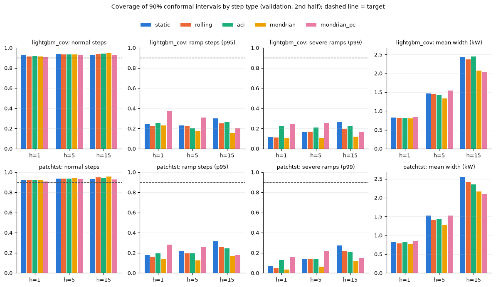
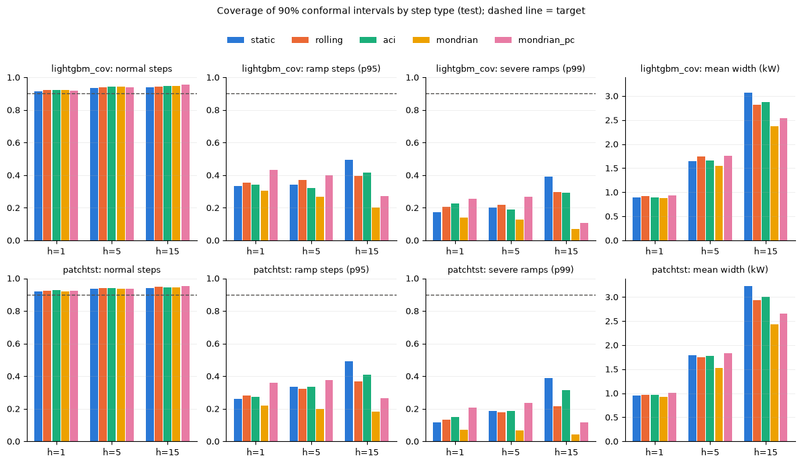
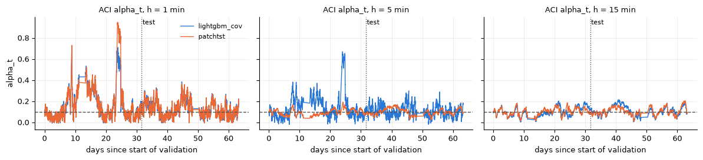
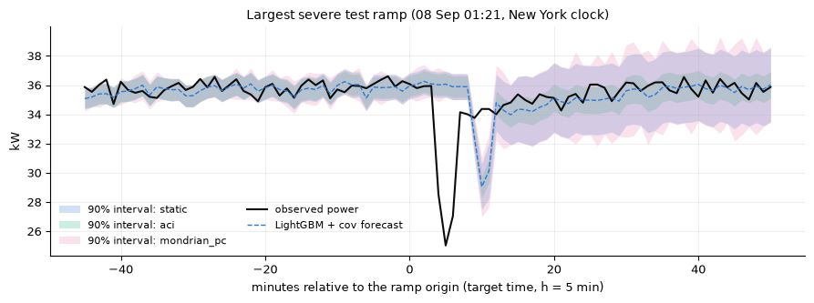

# Outputs of `24_week7_conformal.ipynb`
Exported 2026-10-13 23:44 from the saved notebook file.

## Cell 1: setup, inputs and integrity checks (validation only)
_execution count: 1_

```
validation forecasts:
shape: (4, 4)
┌──────────────┬───────┬───────┬───────┐
│ model        ┆ 1     ┆ 5     ┆ 15    │
│ ---          ┆ ---   ┆ ---   ┆ ---   │
│ str          ┆ u32   ┆ u32   ┆ u32   │
╞══════════════╪═══════╪═══════╪═══════╡
│ lightgbm     ┆ 42575 ┆ 42567 ┆ 42547 │
│ lightgbm_cov ┆ 42575 ┆ 42567 ┆ 42547 │
│ patchtst     ┆ 42575 ┆ 42567 ┆ 42547 │
│ persistence  ┆ 42575 ┆ 42567 ┆ 42547 │
└──────────────┴───────┴───────┴───────┘
y of every stored forecast equals P(t+h) of the modelling dataset: OK
Week 4 test predictions unchanged since their freeze record: True
conformal freeze record exists: False (if True, the conformal test run was already done once)
configurations per model and horizon: 57
```

## Cell 2: unit checks of the conformal module on synthetic data (no project data)
_execution count: 2_

```
PASS  static, exchangeable data: coverage 0.90 +- 0.01  [0.9012666666666667]
PASS  static abs under a variance shift under-covers (< 0.7)  [0.47395]
PASS  ACI h=1: |mean err - alpha| <= Prop. 4.1 bound  [(np.float64(0.0001), 0.00453)]
PASS  ACI h=1: coverage after the shift 0.90 +- 0.01  [0.90005]
PASS  ACI h=15: |mean err - alpha| <= Prop. 4.1 bound (h>1: empirical)  [(np.float64(0.0001), 0.00453)]
PASS  ACI h=15: coverage after the shift 0.90 +- 0.01  [0.9]
PASS  delayed feedback: known_count
PASS  conformal quantile n=99, alpha 0.1 -> 90th value
PASS  alpha_t <= 0 -> infinite, >= 1 -> empty
PASS  rolling window = last W known scores (brute force)

ALL UNIT CHECKS PASSED
```

## Cell 3: validation screen: every configuration for every model and horizon (about 5-8 min)
_execution count: 3_

```
  lightgbm_cov  h= 1: 57 configurations |     8 s
  lightgbm_cov  h= 5: 57 configurations |    15 s
  lightgbm_cov  h=15: 57 configurations |    24 s
  patchtst      h= 1: 57 configurations |    32 s
  patchtst      h= 5: 57 configurations |    40 s
  patchtst      h=15: 57 configurations |    47 s
  lightgbm      h= 1: 57 configurations |    55 s
  lightgbm      h= 5: 57 configurations |    63 s
  lightgbm      h=15: 57 configurations |    70 s
  persistence   h= 1: 57 configurations |    78 s
  persistence   h= 5: 57 configurations |    86 s
  persistence   h=15: 57 configurations |    94 s
screen: 684 runs -> reports/week7/conformal_val_screen.csv
```

## Cell 4: selection on validation (rule fixed in the header) and the ACI bound check
_execution count: 4_

```
shape: (60, 12)
┌──────────────┬─────┬──────────────────────────┬──────────┬───┬───────────┬────────┬─────────────┬────────────┐
│ model        ┆ h   ┆ cfg                      ┆ rule_met ┆ … ┆ width_all ┆ iscore ┆ cov_day_min ┆ n_infinite │
│ ---          ┆ --- ┆ ---                      ┆ ---      ┆   ┆ ---       ┆ ---    ┆ ---         ┆ ---        │
│ str          ┆ i64 ┆ str                      ┆ bool     ┆   ┆ f64       ┆ f64    ┆ f64         ┆ i64        │
╞══════════════╪═════╪══════════════════════════╪══════════╪═══╪═══════════╪════════╪═════════════╪════════════╡
│ lightgbm     ┆ 1   ┆ aci|abs|W10080|g0.01     ┆ true     ┆ … ┆ 0.843     ┆ 1.515  ┆ 0.867       ┆ 73         │
│ lightgbm     ┆ 1   ┆ mondrian|vol60|W1440     ┆ true     ┆ … ┆ 0.785     ┆ 1.516  ┆ 0.865       ┆ 0          │
│ lightgbm     ┆ 1   ┆ mondrian_pc|res60|W1440  ┆ true     ┆ … ┆ 0.861     ┆ 1.464  ┆ 0.857       ┆ 0          │
│ lightgbm     ┆ 1   ┆ rolling|res60|W10080     ┆ true     ┆ … ┆ 0.813     ┆ 1.519  ┆ 0.872       ┆ 0          │
│ lightgbm     ┆ 1   ┆ static|res60             ┆ true     ┆ … ┆ 0.82      ┆ 1.52   ┆ 0.877       ┆ 0          │
│ lightgbm     ┆ 5   ┆ aci|vol60|W10080|g0.001  ┆ true     ┆ … ┆ 1.428     ┆ 2.948  ┆ 0.856       ┆ 0          │
│ lightgbm     ┆ 5   ┆ mondrian|vol60|W10080    ┆ true     ┆ … ┆ 1.273     ┆ 2.927  ┆ 0.852       ┆ 0          │
│ lightgbm     ┆ 5   ┆ mondrian_pc|res60|W1440  ┆ true     ┆ … ┆ 1.629     ┆ 2.924  ┆ 0.862       ┆ 0          │
│ lightgbm     ┆ 5   ┆ rolling|vol60|W4320      ┆ true     ┆ … ┆ 1.412     ┆ 2.945  ┆ 0.855       ┆ 0          │
│ lightgbm     ┆ 5   ┆ static|res60             ┆ true     ┆ … ┆ 1.497     ┆ 2.989  ┆ 0.864       ┆ 0          │
│ lightgbm     ┆ 15  ┆ aci|vol60|W4320|g0.001   ┆ true     ┆ … ┆ 2.438     ┆ 4.378  ┆ 0.796       ┆ 0          │
│ lightgbm     ┆ 15  ┆ mondrian|vol60|W10080    ┆ true     ┆ … ┆ 2.161     ┆ 4.205  ┆ 0.828       ┆ 0          │
│ lightgbm     ┆ 15  ┆ mondrian_pc|abs|W1440    ┆ true     ┆ … ┆ 2.098     ┆ 4.337  ┆ 0.745       ┆ 0          │
│ lightgbm     ┆ 15  ┆ rolling|vol60|W4320      ┆ true     ┆ … ┆ 2.48      ┆ 4.389  ┆ 0.805       ┆ 0          │
│ lightgbm     ┆ 15  ┆ static|res60             ┆ true     ┆ … ┆ 2.523     ┆ 4.49   ┆ 0.845       ┆ 0          │
│ lightgbm_cov ┆ 1   ┆ aci|abs|W10080|g0.01     ┆ true     ┆ … ┆ 0.82      ┆ 1.46   ┆ 0.881       ┆ 76         │
│ lightgbm_cov ┆ 1   ┆ mondrian|res60|W1440     ┆ true     ┆ … ┆ 0.807     ┆ 1.492  ┆ 0.822       ┆ 0          │
│ lightgbm_cov ┆ 1   ┆ mondrian_pc|res60|W1440  ┆ true     ┆ … ┆ 0.842     ┆ 1.421  ┆ 0.837       ┆ 0          │
│ lightgbm_cov ┆ 1   ┆ rolling|res60|W1440      ┆ true     ┆ … ┆ 0.815     ┆ 1.493  ┆ 0.809       ┆ 0          │
│ lightgbm_cov ┆ 1   ┆ static|res60             ┆ true     ┆ … ┆ 0.823     ┆ 1.497  ┆ 0.886       ┆ 0          │
│ lightgbm_cov ┆ 5   ┆ aci|abs|W10080|g0.005    ┆ true     ┆ … ┆ 1.438     ┆ 2.909  ┆ 0.848       ┆ 127        │
│ lightgbm_cov ┆ 5   ┆ mondrian|vol60|W1440     ┆ true     ┆ … ┆ 1.337     ┆ 2.908  ┆ 0.808       ┆ 0          │
│ lightgbm_cov ┆ 5   ┆ mondrian_pc|res60|W1440  ┆ true     ┆ … ┆ 1.545     ┆ 2.867  ┆ 0.838       ┆ 0          │
│ lightgbm_cov ┆ 5   ┆ rolling|res60|W10080     ┆ true     ┆ … ┆ 1.44      ┆ 2.927  ┆ 0.86        ┆ 0          │
│ lightgbm_cov ┆ 5   ┆ static|res60             ┆ true     ┆ … ┆ 1.47      ┆ 2.926  ┆ 0.87        ┆ 0          │
│ lightgbm_cov ┆ 15  ┆ aci|vol60|W10080|g0.001  ┆ true     ┆ … ┆ 2.452     ┆ 4.298  ┆ 0.8         ┆ 0          │
│ lightgbm_cov ┆ 15  ┆ mondrian|vol60|W10080    ┆ true     ┆ … ┆ 2.077     ┆ 4.117  ┆ 0.826       ┆ 0          │
│ lightgbm_cov ┆ 15  ┆ mondrian_pc|abs|W1440    ┆ true     ┆ … ┆ 2.035     ┆ 4.252  ┆ 0.79        ┆ 0          │
│ lightgbm_cov ┆ 15  ┆ rolling|vol60|W1440      ┆ true     ┆ … ┆ 2.366     ┆ 4.295  ┆ 0.801       ┆ 0          │
│ lightgbm_cov ┆ 15  ┆ static|res60             ┆ true     ┆ … ┆ 2.434     ┆ 4.395  ┆ 0.853       ┆ 0          │
│ patchtst     ┆ 1   ┆ aci|abs|W10080|g0.01     ┆ true     ┆ … ┆ 0.835     ┆ 1.514  ┆ 0.865       ┆ 63         │
│ patchtst     ┆ 1   ┆ mondrian|vol60|W10080    ┆ true     ┆ … ┆ 0.763     ┆ 1.513  ┆ 0.862       ┆ 0          │
│ patchtst     ┆ 1   ┆ mondrian_pc|res60|W1440  ┆ true     ┆ … ┆ 0.857     ┆ 1.467  ┆ 0.81        ┆ 0          │
│ patchtst     ┆ 1   ┆ rolling|vol60|W10080     ┆ true     ┆ … ┆ 0.782     ┆ 1.517  ┆ 0.851       ┆ 0          │
│ patchtst     ┆ 1   ┆ static|res60             ┆ true     ┆ … ┆ 0.825     ┆ 1.518  ┆ 0.874       ┆ 0          │
│ patchtst     ┆ 5   ┆ aci|vol60|W10080|g0.001  ┆ true     ┆ … ┆ 1.436     ┆ 2.93   ┆ 0.848       ┆ 0          │
│ patchtst     ┆ 5   ┆ mondrian|vol60|W10080    ┆ true     ┆ … ┆ 1.287     ┆ 2.908  ┆ 0.846       ┆ 0          │
│ patchtst     ┆ 5   ┆ mondrian_pc|res60|W10080 ┆ true     ┆ … ┆ 1.523     ┆ 2.906  ┆ 0.858       ┆ 0          │
│ patchtst     ┆ 5   ┆ rolling|vol60|W4320      ┆ true     ┆ … ┆ 1.409     ┆ 2.924  ┆ 0.853       ┆ 0          │
│ patchtst     ┆ 5   ┆ static|res60             ┆ true     ┆ … ┆ 1.525     ┆ 2.953  ┆ 0.869       ┆ 0          │
│ patchtst     ┆ 15  ┆ aci|vol60|W4320|g0.001   ┆ true     ┆ … ┆ 2.349     ┆ 4.342  ┆ 0.801       ┆ 0          │
│ patchtst     ┆ 15  ┆ mondrian|vol60|W10080    ┆ true     ┆ … ┆ 2.168     ┆ 4.19   ┆ 0.832       ┆ 0          │
│ patchtst     ┆ 15  ┆ mondrian_pc|abs|W1440    ┆ true     ┆ … ┆ 2.095     ┆ 4.287  ┆ 0.766       ┆ 0          │
│ patchtst     ┆ 15  ┆ rolling|vol60|W4320      ┆ true     ┆ … ┆ 2.413     ┆ 4.358  ┆ 0.802       ┆ 0          │
│ patchtst     ┆ 15  ┆ static|res60             ┆ true     ┆ … ┆ 2.55      ┆ 4.473  ┆ 0.84        ┆ 0          │
│ persistence  ┆ 1   ┆ aci|abs|W1440|g0.01      ┆ true     ┆ … ┆ 0.878     ┆ 1.556  ┆ 0.883       ┆ 46         │
│ persistence  ┆ 1   ┆ mondrian|vol60|W10080    ┆ true     ┆ … ┆ 0.863     ┆ 1.555  ┆ 0.875       ┆ 0          │
│ persistence  ┆ 1   ┆ mondrian_pc|res60|W10080 ┆ true     ┆ … ┆ 0.82      ┆ 1.559  ┆ 0.862       ┆ 0          │
│ persistence  ┆ 1   ┆ rolling|res60|W10080     ┆ true     ┆ … ┆ 0.82      ┆ 1.559  ┆ 0.862       ┆ 0          │
│ persistence  ┆ 1   ┆ static|vol60             ┆ true     ┆ … ┆ 0.863     ┆ 1.555  ┆ 0.878       ┆ 0          │
│ persistence  ┆ 5   ┆ aci|vol60|W10080|g0.001  ┆ true     ┆ … ┆ 1.497     ┆ 3.149  ┆ 0.861       ┆ 0          │
│ persistence  ┆ 5   ┆ mondrian|vol60|W10080    ┆ true     ┆ … ┆ 1.333     ┆ 3.14   ┆ 0.856       ┆ 0          │
│ persistence  ┆ 5   ┆ mondrian_pc|vol60|W10080 ┆ true     ┆ … ┆ 1.432     ┆ 3.143  ┆ 0.842       ┆ 0          │
│ persistence  ┆ 5   ┆ rolling|vol60|W10080     ┆ true     ┆ … ┆ 1.432     ┆ 3.143  ┆ 0.842       ┆ 0          │
│ persistence  ┆ 5   ┆ static|res60             ┆ true     ┆ … ┆ 1.626     ┆ 3.224  ┆ 0.869       ┆ 0          │
│ persistence  ┆ 15  ┆ aci|vol60|W4320|g0.001   ┆ true     ┆ … ┆ 2.448     ┆ 4.62   ┆ 0.806       ┆ 0          │
│ persistence  ┆ 15  ┆ mondrian|vol60|W10080    ┆ true     ┆ … ┆ 2.205     ┆ 4.509  ┆ 0.828       ┆ 0          │
│ persistence  ┆ 15  ┆ mondrian_pc|vol60|W4320  ┆ true     ┆ … ┆ 2.451     ┆ 4.613  ┆ 0.812       ┆ 0          │
│ persistence  ┆ 15  ┆ rolling|vol60|W4320      ┆ true     ┆ … ┆ 2.451     ┆ 4.613  ┆ 0.812       ┆ 0          │
│ persistence  ┆ 15  ┆ static|res60             ┆ true     ┆ … ┆ 2.614     ┆ 4.772  ┆ 0.843       ┆ 0          │
└──────────────┴─────┴──────────────────────────┴──────────┴───┴───────────┴────────┴─────────────┴────────────┘

ACI average miscoverage vs Prop. 4.1 bound (validation run; guaranteed only for h = 1):
shape: (12, 8)
┌──────────────┬─────┬─────────────────────────┬───────┬──────────┬─────────┬─────────┬────────┐
│ model        ┆ h   ┆ cfg                     ┆ T     ┆ mean_err ┆ gap     ┆ bound   ┆ within │
│ ---          ┆ --- ┆ ---                     ┆ ---   ┆ ---      ┆ ---     ┆ ---     ┆ ---    │
│ str          ┆ i64 ┆ str                     ┆ i64   ┆ f64      ┆ f64     ┆ f64     ┆ bool   │
╞══════════════╪═════╪═════════════════════════╪═══════╪══════════╪═════════╪═════════╪════════╡
│ lightgbm_cov ┆ 1   ┆ aci|abs|W10080|g0.01    ┆ 42524 ┆ 0.09994  ┆ 0.00006 ┆ 0.00214 ┆ true   │
│ lightgbm_cov ┆ 5   ┆ aci|abs|W10080|g0.005   ┆ 42508 ┆ 0.09988  ┆ 0.00012 ┆ 0.00426 ┆ true   │
│ lightgbm_cov ┆ 15  ┆ aci|vol60|W10080|g0.001 ┆ 42468 ┆ 0.09957  ┆ 0.00043 ┆ 0.02122 ┆ true   │
│ patchtst     ┆ 1   ┆ aci|abs|W10080|g0.01    ┆ 42524 ┆ 0.09999  ┆ 0.00001 ┆ 0.00214 ┆ true   │
│ patchtst     ┆ 5   ┆ aci|vol60|W10080|g0.001 ┆ 42508 ┆ 0.10039  ┆ 0.00039 ┆ 0.0212  ┆ true   │
│ patchtst     ┆ 15  ┆ aci|vol60|W4320|g0.001  ┆ 42468 ┆ 0.10039  ┆ 0.00039 ┆ 0.02122 ┆ true   │
│ lightgbm     ┆ 1   ┆ aci|abs|W10080|g0.01    ┆ 42524 ┆ 0.09996  ┆ 0.00004 ┆ 0.00214 ┆ true   │
│ lightgbm     ┆ 5   ┆ aci|vol60|W10080|g0.001 ┆ 42508 ┆ 0.10016  ┆ 0.00016 ┆ 0.0212  ┆ true   │
│ lightgbm     ┆ 15  ┆ aci|vol60|W4320|g0.001  ┆ 42468 ┆ 0.10032  ┆ 0.00032 ┆ 0.02122 ┆ true   │
│ persistence  ┆ 1   ┆ aci|abs|W1440|g0.01     ┆ 42524 ┆ 0.09992  ┆ 0.00008 ┆ 0.00214 ┆ true   │
│ persistence  ┆ 5   ┆ aci|vol60|W10080|g0.001 ┆ 42508 ┆ 0.10039  ┆ 0.00039 ┆ 0.0212  ┆ true   │
│ persistence  ┆ 15  ┆ aci|vol60|W4320|g0.001  ┆ 42468 ┆ 0.10049  ┆ 0.00049 ┆ 0.02122 ┆ true   │
└──────────────┴─────┴─────────────────────────┴───────┴──────────┴─────────┴─────────┴────────┘

chosen configurations saved to reports/week7/conformal_val.json
```

## Cell 5: validation figure: coverage on normal / ramp / severe-ramp steps and mean width per method
_execution count: 5_



```
lightgbm_cov: ramp coverage 0.15-0.37 | normal 0.911-0.951 | best ramp coverage by method: static=0.26, rolling=0.23, aci=0.24, mondrian=0.19, mondrian_pc=0.30
patchtst: ramp coverage 0.12-0.31 | normal 0.908-0.958 | best ramp coverage by method: static=0.24, rolling=0.21, aci=0.21, mondrian=0.14, mondrian_pc=0.24
```

## Cell 6: freeze record (written BEFORE the test split is opened)
_execution count: 6_

```
freeze record conformal_test_freeze.json | git 96597605437198fbfb9cb0a5da4aee2b50ccbbd4 | SHA-256 of 7 files
```

## Cell 7: OPEN THE TEST SPLIT (once): intervals for the frozen forecasts, chosen configurations
_execution count: 7_

```
  lightgbm_cov: done
  patchtst: done
  lightgbm: done
  persistence: done
test intervals: 2,553,780 rows | sha256 2625c2397de79bc8...

ACI bound over the whole validation + test run (h = 1 guaranteed; h > 1 empirical):
shape: (12, 7)
┌──────────────┬─────┬───────┬──────────┬─────────┬─────────┬────────┐
│ model        ┆ h   ┆ T     ┆ mean_err ┆ gap     ┆ bound   ┆ within │
│ ---          ┆ --- ┆ ---   ┆ ---      ┆ ---     ┆ ---     ┆ ---    │
│ str          ┆ i64 ┆ i64   ┆ f64      ┆ f64     ┆ f64     ┆ bool   │
╞══════════════╪═════╪═══════╪══════════╪═════════╪═════════╪════════╡
│ lightgbm_cov ┆ 1   ┆ 85099 ┆ 0.09989  ┆ 0.00011 ┆ 0.00107 ┆ true   │
│ lightgbm_cov ┆ 5   ┆ 85075 ┆ 0.09984  ┆ 0.00016 ┆ 0.00213 ┆ true   │
│ lightgbm_cov ┆ 15  ┆ 85015 ┆ 0.10006  ┆ 0.00006 ┆ 0.0106  ┆ true   │
│ patchtst     ┆ 1   ┆ 85099 ┆ 0.09988  ┆ 0.00012 ┆ 0.00107 ┆ true   │
│ patchtst     ┆ 5   ┆ 85075 ┆ 0.10021  ┆ 0.00021 ┆ 0.01059 ┆ true   │
│ patchtst     ┆ 15  ┆ 85015 ┆ 0.10016  ┆ 0.00016 ┆ 0.0106  ┆ true   │
│ lightgbm     ┆ 1   ┆ 85099 ┆ 0.09991  ┆ 0.00009 ┆ 0.00107 ┆ true   │
│ lightgbm     ┆ 5   ┆ 85075 ┆ 0.10035  ┆ 0.00035 ┆ 0.01059 ┆ true   │
│ lightgbm     ┆ 15  ┆ 85015 ┆ 0.10022  ┆ 0.00022 ┆ 0.0106  ┆ true   │
│ persistence  ┆ 1   ┆ 85099 ┆ 0.09988  ┆ 0.00012 ┆ 0.00107 ┆ true   │
│ persistence  ┆ 5   ┆ 85075 ┆ 0.10025  ┆ 0.00025 ┆ 0.01059 ┆ true   │
│ persistence  ┆ 15  ┆ 85015 ┆ 0.10018  ┆ 0.00018 ┆ 0.0106  ┆ true   │
└──────────────┴─────┴───────┴──────────┴─────────┴─────────┴────────┘
```

## Cell 8: test results and validation -> test comparison
_execution count: 8_

```
=== TEST: 90% intervals (seed-0 forecasts) ===
shape: (60, 15)
┌──────────────┬─────┬─────────────┬─────────┬───┬──────────────────────┬────────────┬────────┬──────────┐
│ model        ┆ h   ┆ method      ┆ cov_all ┆ … ┆ share_days_below_0p8 ┆ n_infinite ┆ n_ramp ┆ n_severe │
│ ---          ┆ --- ┆ ---         ┆ ---     ┆   ┆ ---                  ┆ ---        ┆ ---    ┆ ---      │
│ str          ┆ i64 ┆ str         ┆ f64     ┆   ┆ f64                  ┆ i64        ┆ i64    ┆ i64      │
╞══════════════╪═════╪═════════════╪═════════╪═══╪══════════════════════╪════════════╪════════╪══════════╡
│ lightgbm     ┆ 1   ┆ aci         ┆ 0.9     ┆ … ┆ 0.0                  ┆ 59         ┆ 1659   ┆ 426      │
│ lightgbm     ┆ 1   ┆ mondrian    ┆ 0.898   ┆ … ┆ 0.0                  ┆ 0          ┆ 1659   ┆ 426      │
│ lightgbm     ┆ 1   ┆ mondrian_pc ┆ 0.899   ┆ … ┆ 0.0                  ┆ 0          ┆ 1659   ┆ 426      │
│ lightgbm     ┆ 1   ┆ rolling     ┆ 0.899   ┆ … ┆ 0.0                  ┆ 0          ┆ 1659   ┆ 426      │
│ lightgbm     ┆ 1   ┆ static      ┆ 0.898   ┆ … ┆ 0.0                  ┆ 0          ┆ 1659   ┆ 426      │
│ lightgbm     ┆ 5   ┆ aci         ┆ 0.899   ┆ … ┆ 0.0                  ┆ 0          ┆ 2969   ┆ 786      │
│ lightgbm     ┆ 5   ┆ mondrian    ┆ 0.883   ┆ … ┆ 0.067                ┆ 0          ┆ 2969   ┆ 786      │
│ lightgbm     ┆ 5   ┆ mondrian_pc ┆ 0.901   ┆ … ┆ 0.0                  ┆ 0          ┆ 2969   ┆ 786      │
│ lightgbm     ┆ 5   ┆ rolling     ┆ 0.896   ┆ … ┆ 0.0                  ┆ 0          ┆ 2969   ┆ 786      │
│ lightgbm     ┆ 5   ┆ static      ┆ 0.894   ┆ … ┆ 0.0                  ┆ 0          ┆ 2969   ┆ 786      │
│ lightgbm     ┆ 15  ┆ aci         ┆ 0.9     ┆ … ┆ 0.0                  ┆ 0          ┆ 3705   ┆ 1059     │
│ lightgbm     ┆ 15  ┆ mondrian    ┆ 0.88    ┆ … ┆ 0.1                  ┆ 0          ┆ 3705   ┆ 1059     │
│ lightgbm     ┆ 15  ┆ mondrian_pc ┆ 0.893   ┆ … ┆ 0.033                ┆ 0          ┆ 3705   ┆ 1059     │
│ lightgbm     ┆ 15  ┆ rolling     ┆ 0.897   ┆ … ┆ 0.067                ┆ 0          ┆ 3705   ┆ 1059     │
│ lightgbm     ┆ 15  ┆ static      ┆ 0.902   ┆ … ┆ 0.0                  ┆ 0          ┆ 3705   ┆ 1059     │
│ lightgbm_cov ┆ 1   ┆ aci         ┆ 0.9     ┆ … ┆ 0.0                  ┆ 73         ┆ 1659   ┆ 426      │
│ lightgbm_cov ┆ 1   ┆ mondrian    ┆ 0.899   ┆ … ┆ 0.0                  ┆ 0          ┆ 1659   ┆ 426      │
│ lightgbm_cov ┆ 1   ┆ mondrian_pc ┆ 0.899   ┆ … ┆ 0.0                  ┆ 0          ┆ 1659   ┆ 426      │
│ lightgbm_cov ┆ 1   ┆ rolling     ┆ 0.9     ┆ … ┆ 0.0                  ┆ 0          ┆ 1659   ┆ 426      │
│ lightgbm_cov ┆ 1   ┆ static      ┆ 0.893   ┆ … ┆ 0.0                  ┆ 0          ┆ 1659   ┆ 426      │
│ lightgbm_cov ┆ 5   ┆ aci         ┆ 0.9     ┆ … ┆ 0.0                  ┆ 131        ┆ 2969   ┆ 786      │
│ lightgbm_cov ┆ 5   ┆ mondrian    ┆ 0.894   ┆ … ┆ 0.0                  ┆ 0          ┆ 2969   ┆ 786      │
│ lightgbm_cov ┆ 5   ┆ mondrian_pc ┆ 0.9     ┆ … ┆ 0.0                  ┆ 0          ┆ 2969   ┆ 786      │
│ lightgbm_cov ┆ 5   ┆ rolling     ┆ 0.899   ┆ … ┆ 0.0                  ┆ 0          ┆ 2969   ┆ 786      │
│ lightgbm_cov ┆ 5   ┆ static      ┆ 0.891   ┆ … ┆ 0.0                  ┆ 0          ┆ 2969   ┆ 786      │
│ lightgbm_cov ┆ 15  ┆ aci         ┆ 0.899   ┆ … ┆ 0.0                  ┆ 0          ┆ 3705   ┆ 1059     │
│ lightgbm_cov ┆ 15  ┆ mondrian    ┆ 0.881   ┆ … ┆ 0.067                ┆ 0          ┆ 3705   ┆ 1059     │
│ lightgbm_cov ┆ 15  ┆ mondrian_pc ┆ 0.894   ┆ … ┆ 0.033                ┆ 0          ┆ 3705   ┆ 1059     │
│ lightgbm_cov ┆ 15  ┆ rolling     ┆ 0.895   ┆ … ┆ 0.0                  ┆ 0          ┆ 3705   ┆ 1059     │
│ lightgbm_cov ┆ 15  ┆ static      ┆ 0.901   ┆ … ┆ 0.0                  ┆ 0          ┆ 3705   ┆ 1059     │
│ patchtst     ┆ 1   ┆ aci         ┆ 0.9     ┆ … ┆ 0.0                  ┆ 64         ┆ 1659   ┆ 426      │
│ patchtst     ┆ 1   ┆ mondrian    ┆ 0.892   ┆ … ┆ 0.0                  ┆ 0          ┆ 1659   ┆ 426      │
│ patchtst     ┆ 1   ┆ mondrian_pc ┆ 0.899   ┆ … ┆ 0.0                  ┆ 0          ┆ 1659   ┆ 426      │
│ patchtst     ┆ 1   ┆ rolling     ┆ 0.899   ┆ … ┆ 0.0                  ┆ 0          ┆ 1659   ┆ 426      │
│ patchtst     ┆ 1   ┆ static      ┆ 0.893   ┆ … ┆ 0.0                  ┆ 0          ┆ 1659   ┆ 426      │
│ patchtst     ┆ 5   ┆ aci         ┆ 0.9     ┆ … ┆ 0.0                  ┆ 0          ┆ 2969   ┆ 786      │
│ patchtst     ┆ 5   ┆ mondrian    ┆ 0.883   ┆ … ┆ 0.067                ┆ 0          ┆ 2969   ┆ 786      │
│ patchtst     ┆ 5   ┆ mondrian_pc ┆ 0.896   ┆ … ┆ 0.0                  ┆ 0          ┆ 2969   ┆ 786      │
│ patchtst     ┆ 5   ┆ rolling     ┆ 0.897   ┆ … ┆ 0.0                  ┆ 0          ┆ 2969   ┆ 786      │
│ patchtst     ┆ 5   ┆ static      ┆ 0.893   ┆ … ┆ 0.0                  ┆ 0          ┆ 2969   ┆ 786      │
│ patchtst     ┆ 15  ┆ aci         ┆ 0.9     ┆ … ┆ 0.0                  ┆ 0          ┆ 3705   ┆ 1059     │
│ patchtst     ┆ 15  ┆ mondrian    ┆ 0.879   ┆ … ┆ 0.1                  ┆ 0          ┆ 3705   ┆ 1059     │
│ patchtst     ┆ 15  ┆ mondrian_pc ┆ 0.894   ┆ … ┆ 0.033                ┆ 0          ┆ 3705   ┆ 1059     │
│ patchtst     ┆ 15  ┆ rolling     ┆ 0.897   ┆ … ┆ 0.067                ┆ 0          ┆ 3705   ┆ 1059     │
│ patchtst     ┆ 15  ┆ static      ┆ 0.901   ┆ … ┆ 0.0                  ┆ 0          ┆ 3705   ┆ 1059     │
│ persistence  ┆ 1   ┆ aci         ┆ 0.9     ┆ … ┆ 0.0                  ┆ 16         ┆ 1659   ┆ 426      │
│ persistence  ┆ 1   ┆ mondrian    ┆ 0.898   ┆ … ┆ 0.0                  ┆ 0          ┆ 1659   ┆ 426      │
│ persistence  ┆ 1   ┆ mondrian_pc ┆ 0.9     ┆ … ┆ 0.0                  ┆ 0          ┆ 1659   ┆ 426      │
│ persistence  ┆ 1   ┆ rolling     ┆ 0.9     ┆ … ┆ 0.0                  ┆ 0          ┆ 1659   ┆ 426      │
│ persistence  ┆ 1   ┆ static      ┆ 0.894   ┆ … ┆ 0.0                  ┆ 0          ┆ 1659   ┆ 426      │
│ persistence  ┆ 5   ┆ aci         ┆ 0.9     ┆ … ┆ 0.0                  ┆ 0          ┆ 2969   ┆ 786      │
│ persistence  ┆ 5   ┆ mondrian    ┆ 0.885   ┆ … ┆ 0.0                  ┆ 0          ┆ 2969   ┆ 786      │
│ persistence  ┆ 5   ┆ mondrian_pc ┆ 0.894   ┆ … ┆ 0.0                  ┆ 0          ┆ 2969   ┆ 786      │
│ persistence  ┆ 5   ┆ rolling     ┆ 0.894   ┆ … ┆ 0.0                  ┆ 0          ┆ 2969   ┆ 786      │
│ persistence  ┆ 5   ┆ static      ┆ 0.895   ┆ … ┆ 0.0                  ┆ 0          ┆ 2969   ┆ 786      │
│ persistence  ┆ 15  ┆ aci         ┆ 0.9     ┆ … ┆ 0.0                  ┆ 0          ┆ 3705   ┆ 1059     │
│ persistence  ┆ 15  ┆ mondrian    ┆ 0.88    ┆ … ┆ 0.067                ┆ 0          ┆ 3705   ┆ 1059     │
│ persistence  ┆ 15  ┆ mondrian_pc ┆ 0.897   ┆ … ┆ 0.067                ┆ 0          ┆ 3705   ┆ 1059     │
│ persistence  ┆ 15  ┆ rolling     ┆ 0.897   ┆ … ┆ 0.067                ┆ 0          ┆ 3705   ┆ 1059     │
│ persistence  ┆ 15  ┆ static      ┆ 0.903   ┆ … ┆ 0.0                  ┆ 0          ┆ 3705   ┆ 1059     │
└──────────────┴─────┴─────────────┴─────────┴───┴──────────────────────┴────────────┴────────┴──────────┘

=== validation (2nd half) -> test ===
shape: (60, 10)
┌──────────────┬─────┬─────────────┬─────────┬───┬──────────┬───────────────┬────────────┬────────┐
│ model        ┆ h   ┆ method      ┆ val_cov ┆ … ┆ test_cov ┆ test_cov_ramp ┆ test_width ┆ d_cov  │
│ ---          ┆ --- ┆ ---         ┆ ---     ┆   ┆ ---      ┆ ---           ┆ ---        ┆ ---    │
│ str          ┆ i64 ┆ str         ┆ f64     ┆   ┆ f64      ┆ f64           ┆ f64        ┆ f64    │
╞══════════════╪═════╪═════════════╪═════════╪═══╪══════════╪═══════════════╪════════════╪════════╡
│ lightgbm     ┆ 1   ┆ aci         ┆ 0.899   ┆ … ┆ 0.9      ┆ 0.285         ┆ 0.957      ┆ 0.001  │
│ lightgbm     ┆ 1   ┆ mondrian    ┆ 0.897   ┆ … ┆ 0.898    ┆ 0.233         ┆ 0.93       ┆ 0.001  │
│ lightgbm     ┆ 1   ┆ mondrian_pc ┆ 0.899   ┆ … ┆ 0.899    ┆ 0.354         ┆ 0.99       ┆ -0.0   │
│ lightgbm     ┆ 1   ┆ rolling     ┆ 0.898   ┆ … ┆ 0.899    ┆ 0.275         ┆ 0.967      ┆ 0.002  │
│ lightgbm     ┆ 1   ┆ static      ┆ 0.9     ┆ … ┆ 0.898    ┆ 0.275         ┆ 0.96       ┆ -0.002 │
│ lightgbm     ┆ 5   ┆ aci         ┆ 0.901   ┆ … ┆ 0.899    ┆ 0.321         ┆ 1.753      ┆ -0.001 │
│ lightgbm     ┆ 5   ┆ mondrian    ┆ 0.9     ┆ … ┆ 0.883    ┆ 0.193         ┆ 1.52       ┆ -0.017 │
│ lightgbm     ┆ 5   ┆ mondrian_pc ┆ 0.899   ┆ … ┆ 0.901    ┆ 0.375         ┆ 1.868      ┆ 0.002  │
│ lightgbm     ┆ 5   ┆ rolling     ┆ 0.901   ┆ … ┆ 0.896    ┆ 0.311         ┆ 1.73       ┆ -0.004 │
│ lightgbm     ┆ 5   ┆ static      ┆ 0.896   ┆ … ┆ 0.894    ┆ 0.324         ┆ 1.79       ┆ -0.002 │
│ lightgbm     ┆ 15  ┆ aci         ┆ 0.898   ┆ … ┆ 0.9      ┆ 0.401         ┆ 2.967      ┆ 0.002  │
│ lightgbm     ┆ 15  ┆ mondrian    ┆ 0.905   ┆ … ┆ 0.88     ┆ 0.182         ┆ 2.428      ┆ -0.025 │
│ lightgbm     ┆ 15  ┆ mondrian_pc ┆ 0.883   ┆ … ┆ 0.893    ┆ 0.251         ┆ 2.637      ┆ 0.01   │
│ lightgbm     ┆ 15  ┆ rolling     ┆ 0.904   ┆ … ┆ 0.897    ┆ 0.361         ┆ 2.912      ┆ -0.007 │
│ lightgbm     ┆ 15  ┆ static      ┆ 0.887   ┆ … ┆ 0.902    ┆ 0.483         ┆ 3.235      ┆ 0.015  │
│ lightgbm_cov ┆ 1   ┆ aci         ┆ 0.899   ┆ … ┆ 0.9      ┆ 0.344         ┆ 0.899      ┆ 0.001  │
│ lightgbm_cov ┆ 1   ┆ mondrian    ┆ 0.896   ┆ … ┆ 0.899    ┆ 0.303         ┆ 0.884      ┆ 0.003  │
│ lightgbm_cov ┆ 1   ┆ mondrian_pc ┆ 0.896   ┆ … ┆ 0.899    ┆ 0.431         ┆ 0.932      ┆ 0.003  │
│ lightgbm_cov ┆ 1   ┆ rolling     ┆ 0.895   ┆ … ┆ 0.9      ┆ 0.355         ┆ 0.92       ┆ 0.004  │
│ lightgbm_cov ┆ 1   ┆ static      ┆ 0.908   ┆ … ┆ 0.893    ┆ 0.334         ┆ 0.887      ┆ -0.015 │
│ lightgbm_cov ┆ 5   ┆ aci         ┆ 0.899   ┆ … ┆ 0.9      ┆ 0.32          ┆ 1.66       ┆ 0.001  │
│ lightgbm_cov ┆ 5   ┆ mondrian    ┆ 0.897   ┆ … ┆ 0.894    ┆ 0.266         ┆ 1.547      ┆ -0.003 │
│ lightgbm_cov ┆ 5   ┆ mondrian_pc ┆ 0.897   ┆ … ┆ 0.9      ┆ 0.4           ┆ 1.76       ┆ 0.003  │
│ lightgbm_cov ┆ 5   ┆ rolling     ┆ 0.898   ┆ … ┆ 0.899    ┆ 0.371         ┆ 1.739      ┆ 0.002  │
│ lightgbm_cov ┆ 5   ┆ static      ┆ 0.905   ┆ … ┆ 0.891    ┆ 0.343         ┆ 1.648      ┆ -0.014 │
│ lightgbm_cov ┆ 15  ┆ aci         ┆ 0.901   ┆ … ┆ 0.899    ┆ 0.414         ┆ 2.872      ┆ -0.002 │
│ lightgbm_cov ┆ 15  ┆ mondrian    ┆ 0.9     ┆ … ┆ 0.881    ┆ 0.204         ┆ 2.376      ┆ -0.02  │
│ lightgbm_cov ┆ 15  ┆ mondrian_pc ┆ 0.885   ┆ … ┆ 0.894    ┆ 0.271         ┆ 2.545      ┆ 0.009  │
│ lightgbm_cov ┆ 15  ┆ rolling     ┆ 0.896   ┆ … ┆ 0.895    ┆ 0.394         ┆ 2.812      ┆ -0.001 │
│ lightgbm_cov ┆ 15  ┆ static      ┆ 0.889   ┆ … ┆ 0.901    ┆ 0.493         ┆ 3.07       ┆ 0.012  │
│ patchtst     ┆ 1   ┆ aci         ┆ 0.899   ┆ … ┆ 0.9      ┆ 0.272         ┆ 0.97       ┆ 0.001  │
│ patchtst     ┆ 1   ┆ mondrian    ┆ 0.899   ┆ … ┆ 0.892    ┆ 0.22          ┆ 0.925      ┆ -0.006 │
│ patchtst     ┆ 1   ┆ mondrian_pc ┆ 0.891   ┆ … ┆ 0.899    ┆ 0.359         ┆ 1.012      ┆ 0.009  │
│ patchtst     ┆ 1   ┆ rolling     ┆ 0.897   ┆ … ┆ 0.899    ┆ 0.281         ┆ 0.973      ┆ 0.001  │
│ patchtst     ┆ 1   ┆ static      ┆ 0.905   ┆ … ┆ 0.893    ┆ 0.259         ┆ 0.951      ┆ -0.012 │
│ patchtst     ┆ 5   ┆ aci         ┆ 0.9     ┆ … ┆ 0.9      ┆ 0.337         ┆ 1.77       ┆ 0.0    │
│ patchtst     ┆ 5   ┆ mondrian    ┆ 0.901   ┆ … ┆ 0.883    ┆ 0.199         ┆ 1.529      ┆ -0.018 │
│ patchtst     ┆ 5   ┆ mondrian_pc ┆ 0.897   ┆ … ┆ 0.896    ┆ 0.376         ┆ 1.829      ┆ -0.001 │
│ patchtst     ┆ 5   ┆ rolling     ┆ 0.9     ┆ … ┆ 0.897    ┆ 0.324         ┆ 1.748      ┆ -0.003 │
│ patchtst     ┆ 5   ┆ static      ┆ 0.9     ┆ … ┆ 0.893    ┆ 0.335         ┆ 1.787      ┆ -0.007 │
│ patchtst     ┆ 15  ┆ aci         ┆ 0.898   ┆ … ┆ 0.9      ┆ 0.409         ┆ 3.005      ┆ 0.002  │
│ patchtst     ┆ 15  ┆ mondrian    ┆ 0.908   ┆ … ┆ 0.879    ┆ 0.182         ┆ 2.428      ┆ -0.029 │
│ patchtst     ┆ 15  ┆ mondrian_pc ┆ 0.882   ┆ … ┆ 0.894    ┆ 0.263         ┆ 2.653      ┆ 0.011  │
│ patchtst     ┆ 15  ┆ rolling     ┆ 0.903   ┆ … ┆ 0.897    ┆ 0.368         ┆ 2.936      ┆ -0.006 │
│ patchtst     ┆ 15  ┆ static      ┆ 0.892   ┆ … ┆ 0.901    ┆ 0.49          ┆ 3.226      ┆ 0.009  │
│ persistence  ┆ 1   ┆ aci         ┆ 0.9     ┆ … ┆ 0.9      ┆ 0.186         ┆ 1.029      ┆ 0.0    │
│ persistence  ┆ 1   ┆ mondrian    ┆ 0.908   ┆ … ┆ 0.898    ┆ 0.153         ┆ 1.022      ┆ -0.01  │
│ persistence  ┆ 1   ┆ mondrian_pc ┆ 0.896   ┆ … ┆ 0.9      ┆ 0.18          ┆ 1.041      ┆ 0.004  │
│ persistence  ┆ 1   ┆ rolling     ┆ 0.896   ┆ … ┆ 0.9      ┆ 0.18          ┆ 1.041      ┆ 0.004  │
│ persistence  ┆ 1   ┆ static      ┆ 0.908   ┆ … ┆ 0.894    ┆ 0.165         ┆ 1.013      ┆ -0.015 │
│ persistence  ┆ 5   ┆ aci         ┆ 0.9     ┆ … ┆ 0.9      ┆ 0.265         ┆ 1.815      ┆ 0.0    │
│ persistence  ┆ 5   ┆ mondrian    ┆ 0.9     ┆ … ┆ 0.885    ┆ 0.133         ┆ 1.598      ┆ -0.015 │
│ persistence  ┆ 5   ┆ mondrian_pc ┆ 0.901   ┆ … ┆ 0.894    ┆ 0.248         ┆ 1.775      ┆ -0.006 │
│ persistence  ┆ 5   ┆ rolling     ┆ 0.901   ┆ … ┆ 0.894    ┆ 0.248         ┆ 1.775      ┆ -0.006 │
│ persistence  ┆ 5   ┆ static      ┆ 0.904   ┆ … ┆ 0.895    ┆ 0.269         ┆ 1.856      ┆ -0.009 │
│ persistence  ┆ 15  ┆ aci         ┆ 0.898   ┆ … ┆ 0.9      ┆ 0.349         ┆ 3.016      ┆ 0.002  │
│ persistence  ┆ 15  ┆ mondrian    ┆ 0.904   ┆ … ┆ 0.88     ┆ 0.13          ┆ 2.496      ┆ -0.024 │
│ persistence  ┆ 15  ┆ mondrian_pc ┆ 0.903   ┆ … ┆ 0.897    ┆ 0.314         ┆ 2.976      ┆ -0.005 │
│ persistence  ┆ 15  ┆ rolling     ┆ 0.903   ┆ … ┆ 0.897    ┆ 0.314         ┆ 2.976      ┆ -0.005 │
│ persistence  ┆ 15  ┆ static      ┆ 0.891   ┆ … ┆ 0.903    ┆ 0.422         ┆ 3.247      ┆ 0.013  │
└──────────────┴─────┴─────────────┴─────────┴───┴──────────┴───────────────┴────────────┴────────┘

per model and horizon: smallest test interval score among methods with coverage 0.90 +- 0.02 (reporting only, not a selection):
shape: (12, 7)
┌──────────────┬─────┬─────────────┬─────────┬──────────┬───────────┬────────┐
│ model        ┆ h   ┆ method      ┆ cov_all ┆ cov_ramp ┆ width_all ┆ iscore │
│ ---          ┆ --- ┆ ---         ┆ ---     ┆ ---      ┆ ---       ┆ ---    │
│ str          ┆ i64 ┆ str         ┆ f64     ┆ f64      ┆ f64       ┆ f64    │
╞══════════════╪═════╪═════════════╪═════════╪══════════╪═══════════╪════════╡
│ lightgbm     ┆ 1   ┆ mondrian_pc ┆ 0.899   ┆ 0.354    ┆ 0.99      ┆ 1.566  │
│ lightgbm     ┆ 5   ┆ mondrian_pc ┆ 0.901   ┆ 0.375    ┆ 1.868     ┆ 2.963  │
│ lightgbm     ┆ 15  ┆ mondrian_pc ┆ 0.893   ┆ 0.251    ┆ 2.637     ┆ 4.614  │
│ lightgbm_cov ┆ 1   ┆ mondrian_pc ┆ 0.899   ┆ 0.431    ┆ 0.932     ┆ 1.462  │
│ lightgbm_cov ┆ 5   ┆ mondrian_pc ┆ 0.9     ┆ 0.4      ┆ 1.76      ┆ 2.825  │
│ lightgbm_cov ┆ 15  ┆ mondrian_pc ┆ 0.894   ┆ 0.271    ┆ 2.545     ┆ 4.491  │
│ patchtst     ┆ 1   ┆ mondrian_pc ┆ 0.899   ┆ 0.359    ┆ 1.012     ┆ 1.565  │
│ patchtst     ┆ 5   ┆ mondrian_pc ┆ 0.896   ┆ 0.376    ┆ 1.829     ┆ 2.928  │
│ patchtst     ┆ 15  ┆ mondrian_pc ┆ 0.894   ┆ 0.263    ┆ 2.653     ┆ 4.607  │
│ persistence  ┆ 1   ┆ aci         ┆ 0.9     ┆ 0.186    ┆ 1.029     ┆ 1.648  │
│ persistence  ┆ 5   ┆ aci         ┆ 0.9     ┆ 0.265    ┆ 1.815     ┆ 3.079  │
│ persistence  ┆ 15  ┆ aci         ┆ 0.9     ┆ 0.349    ┆ 3.016     ┆ 4.76   │
└──────────────┴─────┴─────────────┴─────────┴──────────┴───────────┴────────┘
```

## Cell 9: test figures: coverage by step type; ACI alpha_t trajectory; intervals around a test ramp event
_execution count: 9_







## Cell 10: summary JSON and Week 7 checklist (conformal part)
_execution count: 10_

```
DONE  [main] split conformal on LightGBM and the best network, target 90%
DONE  [main] coverage and width reported separately for normal and ramp steps
DONE  rolling + ACI with delayed updates (h = 5, 15), alpha_t trajectory, bound check h = 1
DONE  test split used once for the conformal group (freeze record)

test coverage range (main models, all methods): 0.879-0.901; ramp 0.182-0.493; severe 0.042-0.389
```

## Cell 11: export outputs (save the notebook first with Cmd+S after cell 10 has finished, then run this cell)
_execution count: 11_

```
written 24_week7_conformal_outputs.md | code cells 11 | figures 0
```

## Cell 12
_execution count: None_

(no output)
