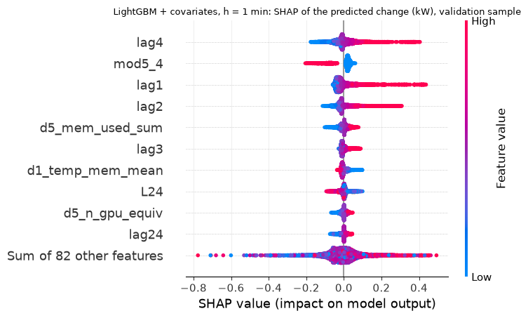
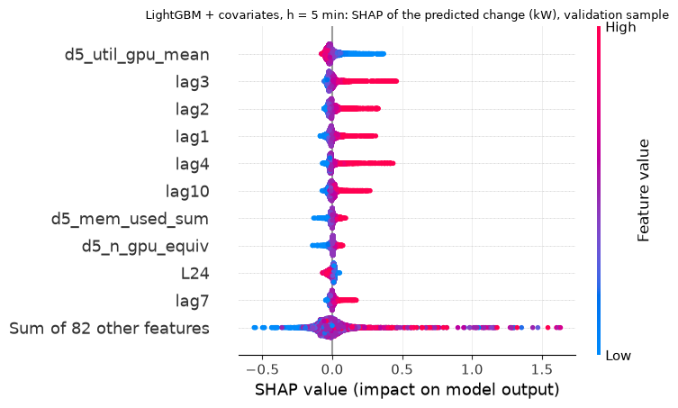
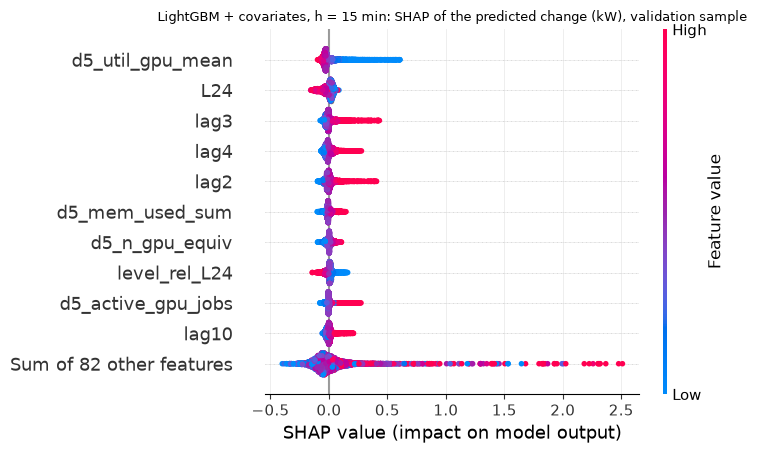
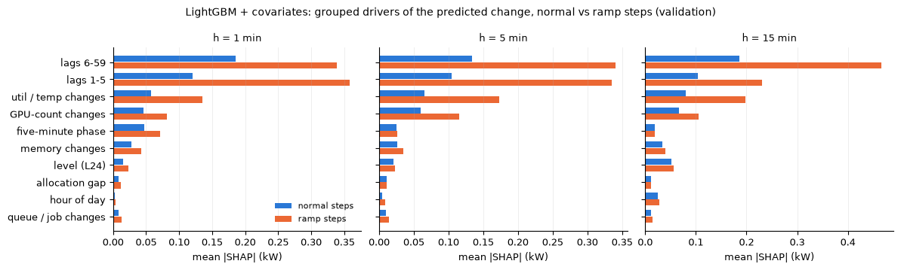

# Outputs of `25_week7_shap.ipynb`
Exported 2026-10-14 00:18 from the saved notebook file.

## Cell 1: setup and package check
_execution count: 1_

```stderr
/opt/miniconda3/envs/dcpower/lib/python3.11/site-packages/tqdm/auto.py:21: TqdmWarning: IProgress not found. Please update jupyter and ipywidgets. See https://ipywidgets.readthedocs.io/en/stable/user_install.html
  from .autonotebook import tqdm as notebook_tqdm
```

```
lightgbm 4.7.0 | shap 0.51.0 | numpy 2.4.6
usable validation origins: {1: 42575, 5: 42567, 15: 42547}
```

## Cell 2: re-create the frozen LightGBM models (seed 0) and check them against the stored validation forecasts
_execution count: 2_

```
  h= 1: refit done | 38 s
  h= 5: refit done | 68 s
  h=15: refit done | 87 s
shape: (6, 6)
┌──────────────┬─────┬──────────┬────────┬─────────────────┬──────┐
│ model        ┆ h   ┆ features ┆ rounds ┆ max_abs_diff_kW ┆ ok   │
│ ---          ┆ --- ┆ ---      ┆ ---    ┆ ---             ┆ ---  │
│ str          ┆ i64 ┆ i64      ┆ i64    ┆ f64             ┆ bool │
╞══════════════╪═════╪══════════╪════════╪═════════════════╪══════╡
│ lightgbm_cov ┆ 1   ┆ 92       ┆ 966    ┆ 0.0             ┆ true │
│ lightgbm     ┆ 1   ┆ 67       ┆ 692    ┆ 0.0             ┆ true │
│ lightgbm_cov ┆ 5   ┆ 92       ┆ 491    ┆ 0.0             ┆ true │
│ lightgbm     ┆ 5   ┆ 67       ┆ 646    ┆ 0.0             ┆ true │
│ lightgbm_cov ┆ 15  ┆ 92       ┆ 284    ┆ 0.0             ┆ true │
│ lightgbm     ┆ 15  ┆ 67       ┆ 90     ┆ 0.0             ┆ true │
└──────────────┴─────┴──────────┴────────┴─────────────────┴──────┘
REPRODUCTION PASSED
```

## Cell 3: exact TreeSHAP on validation origins (random sample + all ramp origins); additivity check
_execution count: 3_

```
  lightgbm_cov  h= 1: 7,657 origins (6,000 random, 1,903 ramp) | additivity max error 7.33e-15 kW | 6.3 s
  lightgbm      h= 1: 7,657 origins (6,000 random, 1,903 ramp) | additivity max error 6.66e-15 kW | 11.3 s
  lightgbm_cov  h= 5: 8,086 origins (6,000 random, 2,444 ramp) | additivity max error 7.55e-15 kW | 5.3 s
  lightgbm      h= 5: 8,086 origins (6,000 random, 2,444 ramp) | additivity max error 7.99e-15 kW | 6.7 s
  lightgbm_cov  h=15: 8,315 origins (6,000 random, 2,740 ramp) | additivity max error 3.81e-12 kW | 15.7 s
  lightgbm      h=15: 8,315 origins (6,000 random, 2,740 ramp) | additivity max error 4.88e-15 kW | 1.3 s
```

## Cell 4: top-10 features (mean |SHAP| on the random sample) and grouped importance
_execution count: 4_

```
=== top-10 features, lightgbm_cov (mean |SHAP| in kW of predicted change; validation sample) ===
shape: (10, 4)
┌──────┬──────────────────┬──────────────────┬────────────────────┐
│ rank ┆ h=1              ┆ h=5              ┆ h=15               │
│ ---  ┆ ---              ┆ ---              ┆ ---                │
│ i64  ┆ str              ┆ str              ┆ str                │
╞══════╪══════════════════╪══════════════════╪════════════════════╡
│ 1    ┆ lag4             ┆ d5_util_gpu_mean ┆ d5_util_gpu_mean   │
│ 2    ┆ mod5_4           ┆ lag3             ┆ L24                │
│ 3    ┆ lag1             ┆ lag2             ┆ lag3               │
│ 4    ┆ lag2             ┆ lag1             ┆ lag4               │
│ 5    ┆ d5_mem_used_sum  ┆ lag4             ┆ lag2               │
│ 6    ┆ lag3             ┆ lag10            ┆ d5_mem_used_sum    │
│ 7    ┆ d1_temp_mem_mean ┆ d5_mem_used_sum  ┆ d5_n_gpu_equiv     │
│ 8    ┆ L24              ┆ d5_n_gpu_equiv   ┆ level_rel_L24      │
│ 9    ┆ d5_n_gpu_equiv   ┆ L24              ┆ d5_active_gpu_jobs │
│ 10   ┆ lag24            ┆ lag7             ┆ lag10              │
└──────┴──────────────────┴──────────────────┴────────────────────┘
shape: (30, 6)
┌─────┬──────┬────────────────────┬─────────────────────┬──────────────────┬───────┐
│ h   ┆ rank ┆ feature            ┆ group               ┆ mean_abs_shap_kW ┆ share │
│ --- ┆ ---  ┆ ---                ┆ ---                 ┆ ---              ┆ ---   │
│ i64 ┆ i64  ┆ str                ┆ str                 ┆ f64              ┆ f64   │
╞═════╪══════╪════════════════════╪═════════════════════╪══════════════════╪═══════╡
│ 1   ┆ 1    ┆ lag4               ┆ lags 1-5            ┆ 0.0407           ┆ 0.075 │
│ 1   ┆ 2    ┆ mod5_4             ┆ five-minute phase   ┆ 0.0383           ┆ 0.071 │
│ 1   ┆ 3    ┆ lag1               ┆ lags 1-5            ┆ 0.0378           ┆ 0.07  │
│ 1   ┆ 4    ┆ lag2               ┆ lags 1-5            ┆ 0.0351           ┆ 0.065 │
│ 1   ┆ 5    ┆ d5_mem_used_sum    ┆ memory changes      ┆ 0.0179           ┆ 0.033 │
│ 1   ┆ 6    ┆ lag3               ┆ lags 1-5            ┆ 0.0132           ┆ 0.024 │
│ 1   ┆ 7    ┆ d1_temp_mem_mean   ┆ util / temp changes ┆ 0.0128           ┆ 0.024 │
│ 1   ┆ 8    ┆ L24                ┆ level (L24)         ┆ 0.0126           ┆ 0.023 │
│ 1   ┆ 9    ┆ d5_n_gpu_equiv     ┆ GPU-count changes   ┆ 0.0123           ┆ 0.023 │
│ 1   ┆ 10   ┆ lag24              ┆ lags 6-59           ┆ 0.0111           ┆ 0.02  │
│ 5   ┆ 1    ┆ d5_util_gpu_mean   ┆ util / temp changes ┆ 0.0375           ┆ 0.076 │
│ 5   ┆ 2    ┆ lag3               ┆ lags 1-5            ┆ 0.0293           ┆ 0.059 │
│ 5   ┆ 3    ┆ lag2               ┆ lags 1-5            ┆ 0.0274           ┆ 0.055 │
│ 5   ┆ 4    ┆ lag1               ┆ lags 1-5            ┆ 0.027            ┆ 0.054 │
│ 5   ┆ 5    ┆ lag4               ┆ lags 1-5            ┆ 0.0258           ┆ 0.052 │
│ 5   ┆ 6    ┆ lag10              ┆ lags 6-59           ┆ 0.0202           ┆ 0.041 │
│ 5   ┆ 7    ┆ d5_mem_used_sum    ┆ memory changes      ┆ 0.0178           ┆ 0.036 │
│ 5   ┆ 8    ┆ d5_n_gpu_equiv     ┆ GPU-count changes   ┆ 0.0155           ┆ 0.031 │
│ 5   ┆ 9    ┆ L24                ┆ level (L24)         ┆ 0.0151           ┆ 0.03  │
│ 5   ┆ 10   ┆ lag7               ┆ lags 6-59           ┆ 0.0149           ┆ 0.03  │
│ 15  ┆ 1    ┆ d5_util_gpu_mean   ┆ util / temp changes ┆ 0.0502           ┆ 0.081 │
│ 15  ┆ 2    ┆ L24                ┆ level (L24)         ┆ 0.032            ┆ 0.051 │
│ 15  ┆ 3    ┆ lag3               ┆ lags 1-5            ┆ 0.029            ┆ 0.047 │
│ 15  ┆ 4    ┆ lag4               ┆ lags 1-5            ┆ 0.0288           ┆ 0.046 │
│ 15  ┆ 5    ┆ lag2               ┆ lags 1-5            ┆ 0.0281           ┆ 0.045 │
│ 15  ┆ 6    ┆ d5_mem_used_sum    ┆ memory changes      ┆ 0.0222           ┆ 0.036 │
│ 15  ┆ 7    ┆ d5_n_gpu_equiv     ┆ GPU-count changes   ┆ 0.0203           ┆ 0.033 │
│ 15  ┆ 8    ┆ level_rel_L24      ┆ level (L24)         ┆ 0.0199           ┆ 0.032 │
│ 15  ┆ 9    ┆ d5_active_gpu_jobs ┆ GPU-count changes   ┆ 0.0188           ┆ 0.03  │
│ 15  ┆ 10   ┆ lag10              ┆ lags 6-59           ┆ 0.0181           ┆ 0.029 │
└─────┴──────┴────────────────────┴─────────────────────┴──────────────────┴───────┘

=== top-10 features, lightgbm (univariate) ===
shape: (10, 4)
┌──────┬────────┬───────────────┬───────────────┐
│ rank ┆ 1      ┆ 5             ┆ 15            │
│ ---  ┆ ---    ┆ ---           ┆ ---           │
│ i64  ┆ str    ┆ str           ┆ str           │
╞══════╪════════╪═══════════════╪═══════════════╡
│ 1    ┆ lag1   ┆ lag1          ┆ lag2          │
│ 2    ┆ mod5_4 ┆ lag2          ┆ lag1          │
│ 3    ┆ lag2   ┆ lag5          ┆ L24           │
│ 4    ┆ lag4   ┆ lag3          ┆ lag5          │
│ 5    ┆ L24    ┆ L24           ┆ lag4          │
│ 6    ┆ lag3   ┆ lag4          ┆ lag3          │
│ 7    ┆ lag9   ┆ lag10         ┆ lag10         │
│ 8    ┆ lag24  ┆ lag7          ┆ hour_cos      │
│ 9    ┆ lag14  ┆ lag8          ┆ level_rel_L24 │
│ 10   ┆ lag44  ┆ level_rel_L24 ┆ lag15         │
└──────┴────────┴───────────────┴───────────────┘

=== grouped share of mean |SHAP| (random sample) ===
shape: (10, 7)
┌─────────────────────┬─────────────────┬─────────────┬─────────────────┬─────────────┬──────────────────┬──────────────┐
│ group               ┆ lightgbm_cov h1 ┆ lightgbm h1 ┆ lightgbm_cov h5 ┆ lightgbm h5 ┆ lightgbm_cov h15 ┆ lightgbm h15 │
│ ---                 ┆ ---             ┆ ---         ┆ ---             ┆ ---         ┆ ---              ┆ ---          │
│ str                 ┆ f64             ┆ f64         ┆ f64             ┆ f64         ┆ f64              ┆ f64          │
╞═════════════════════╪═════════════════╪═════════════╪═════════════════╪═════════════╪══════════════════╪══════════════╡
│ GPU-count changes   ┆ 0.087           ┆ null        ┆ 0.126           ┆ null        ┆ 0.112            ┆ null         │
│ allocation gap      ┆ 0.016           ┆ null        ┆ 0.022           ┆ null        ┆ 0.019            ┆ null         │
│ five-minute phase   ┆ 0.089           ┆ 0.124       ┆ 0.05            ┆ 0.062       ┆ 0.031            ┆ 0.04         │
│ hour of day         ┆ 0.005           ┆ 0.011       ┆ 0.01            ┆ 0.029       ┆ 0.041            ┆ 0.067        │
│ lags 1-5            ┆ 0.241           ┆ 0.381       ┆ 0.237           ┆ 0.396       ┆ 0.177            ┆ 0.425        │
│ lags 6-59           ┆ 0.353           ┆ 0.433       ┆ 0.294           ┆ 0.441       ┆ 0.323            ┆ 0.346        │
│ level (L24)         ┆ 0.029           ┆ 0.05        ┆ 0.043           ┆ 0.072       ┆ 0.083            ┆ 0.121        │
│ memory changes      ┆ 0.052           ┆ null        ┆ 0.054           ┆ null        ┆ 0.055            ┆ null         │
│ queue / job changes ┆ 0.016           ┆ null        ┆ 0.02            ┆ null        ┆ 0.019            ┆ null         │
│ util / temp changes ┆ 0.112           ┆ null        ┆ 0.145           ┆ null        ┆ 0.139            ┆ null         │
└─────────────────────┴─────────────────┴─────────────┴─────────────────┴─────────────┴──────────────────┴──────────────┘
```

## Cell 5: ramp vs normal steps: which drivers grow at ramps; agreement with LightGBM gain importance
_execution count: 5_

```
=== mean |SHAP| (kW) on normal vs ramp steps, lightgbm_cov ===
shape: (30, 6)
┌──────────────┬─────┬─────────────────────┬────────┬────────┬──────────────────┐
│ model        ┆ h   ┆ group               ┆ normal ┆ ramp   ┆ ramp_over_normal │
│ ---          ┆ --- ┆ ---                 ┆ ---    ┆ ---    ┆ ---              │
│ str          ┆ i64 ┆ str                 ┆ f64    ┆ f64    ┆ f64              │
╞══════════════╪═════╪═════════════════════╪════════╪════════╪══════════════════╡
│ lightgbm_cov ┆ 1   ┆ GPU-count changes   ┆ 0.0461 ┆ 0.0814 ┆ 1.7683           │
│ lightgbm_cov ┆ 1   ┆ allocation gap      ┆ 0.0089 ┆ 0.0115 ┆ 1.2978           │
│ lightgbm_cov ┆ 1   ┆ five-minute phase   ┆ 0.0473 ┆ 0.0707 ┆ 1.4931           │
│ lightgbm_cov ┆ 1   ┆ hour of day         ┆ 0.0028 ┆ 0.0039 ┆ 1.4106           │
│ lightgbm_cov ┆ 1   ┆ lags 1-5            ┆ 0.1205 ┆ 0.3581 ┆ 2.9708           │
│ lightgbm_cov ┆ 1   ┆ lags 6-59           ┆ 0.1855 ┆ 0.3384 ┆ 1.8245           │
│ lightgbm_cov ┆ 1   ┆ level (L24)         ┆ 0.0155 ┆ 0.0238 ┆ 1.5316           │
│ lightgbm_cov ┆ 1   ┆ memory changes      ┆ 0.0274 ┆ 0.0431 ┆ 1.5716           │
│ lightgbm_cov ┆ 1   ┆ queue / job changes ┆ 0.0082 ┆ 0.0127 ┆ 1.5429           │
│ lightgbm_cov ┆ 1   ┆ util / temp changes ┆ 0.0573 ┆ 0.1355 ┆ 2.3664           │
│ lightgbm_cov ┆ 5   ┆ GPU-count changes   ┆ 0.0594 ┆ 0.115  ┆ 1.9356           │
│ lightgbm_cov ┆ 5   ┆ allocation gap      ┆ 0.011  ┆ 0.0104 ┆ 0.9413           │
│ lightgbm_cov ┆ 5   ┆ five-minute phase   ┆ 0.025  ┆ 0.0259 ┆ 1.0337           │
│ lightgbm_cov ┆ 5   ┆ hour of day         ┆ 0.0048 ┆ 0.0089 ┆ 1.8435           │
│ lightgbm_cov ┆ 5   ┆ lags 1-5            ┆ 0.1047 ┆ 0.335  ┆ 3.1999           │
│ lightgbm_cov ┆ 5   ┆ lags 6-59           ┆ 0.134  ┆ 0.3406 ┆ 2.5429           │
│ lightgbm_cov ┆ 5   ┆ level (L24)         ┆ 0.0212 ┆ 0.023  ┆ 1.0833           │
│ lightgbm_cov ┆ 5   ┆ memory changes      ┆ 0.0266 ┆ 0.035  ┆ 1.317            │
│ lightgbm_cov ┆ 5   ┆ queue / job changes ┆ 0.0094 ┆ 0.014  ┆ 1.4768           │
│ lightgbm_cov ┆ 5   ┆ util / temp changes ┆ 0.0658 ┆ 0.1729 ┆ 2.6285           │
│ lightgbm_cov ┆ 15  ┆ GPU-count changes   ┆ 0.0674 ┆ 0.1048 ┆ 1.5545           │
│ lightgbm_cov ┆ 15  ┆ allocation gap      ┆ 0.0116 ┆ 0.0119 ┆ 1.0234           │
│ lightgbm_cov ┆ 15  ┆ five-minute phase   ┆ 0.0191 ┆ 0.0193 ┆ 1.0143           │
│ lightgbm_cov ┆ 15  ┆ hour of day         ┆ 0.0253 ┆ 0.0277 ┆ 1.0964           │
│ lightgbm_cov ┆ 15  ┆ lags 1-5            ┆ 0.1038 ┆ 0.2307 ┆ 2.2219           │
│ lightgbm_cov ┆ 15  ┆ lags 6-59           ┆ 0.1863 ┆ 0.4666 ┆ 2.5045           │
│ lightgbm_cov ┆ 15  ┆ level (L24)         ┆ 0.0521 ┆ 0.0569 ┆ 1.0921           │
│ lightgbm_cov ┆ 15  ┆ memory changes      ┆ 0.0343 ┆ 0.0398 ┆ 1.1622           │
│ lightgbm_cov ┆ 15  ┆ queue / job changes ┆ 0.0119 ┆ 0.0142 ┆ 1.1915           │
│ lightgbm_cov ┆ 15  ┆ util / temp changes ┆ 0.08   ┆ 0.1976 ┆ 2.4701           │
└──────────────┴─────┴─────────────────────┴────────┴────────┴──────────────────┘

covariate share of mean |SHAP| (lightgbm_cov):
shape: (3, 4)
┌─────┬───────┬────────┬───────┐
│ h   ┆ all   ┆ normal ┆ ramp  │
│ --- ┆ ---   ┆ ---    ┆ ---   │
│ i64 ┆ f64   ┆ f64    ┆ f64   │
╞═════╪═══════╪════════╪═══════╡
│ 1   ┆ 0.283 ┆ 0.285  ┆ 0.263 │
│ 5   ┆ 0.366 ┆ 0.373  ┆ 0.321 │
│ 15  ┆ 0.345 ┆ 0.347  ┆ 0.315 │
└─────┴───────┴────────┴───────┘

agreement of SHAP with LightGBM gain importance:
shape: (6, 4)
┌──────────────┬─────┬───────────────────────┬───────────────┐
│ model        ┆ h   ┆ spearman_gain_vs_shap ┆ top10_overlap │
│ ---          ┆ --- ┆ ---                   ┆ ---           │
│ str          ┆ i64 ┆ f64                   ┆ i64           │
╞══════════════╪═════╪═══════════════════════╪═══════════════╡
│ lightgbm_cov ┆ 1   ┆ 0.828                 ┆ 7             │
│ lightgbm     ┆ 1   ┆ 0.818                 ┆ 8             │
│ lightgbm_cov ┆ 5   ┆ 0.925                 ┆ 7             │
│ lightgbm     ┆ 5   ┆ 0.746                 ┆ 9             │
│ lightgbm_cov ┆ 15  ┆ 0.818                 ┆ 6             │
│ lightgbm     ┆ 15  ┆ 0.83                  ┆ 9             │
└──────────────┴─────┴───────────────────────┴───────────────┘
```

## Cell 6: figures: beeswarm (lightgbm_cov, h = 1 / 5 / 15) and grouped importance on normal vs ramp steps
_execution count: 6_









## Cell 7: summary JSON and checklist
_execution count: 7_

```
DONE  [main] SHAP on LightGBM, top-10 features reported (reports/week7/shap_top10_val.csv)
h= 1: lag4, mod5_4, lag1, lag2, d5_mem_used_sum ...
h= 5: d5_util_gpu_mean, lag3, lag2, lag1, lag4 ...
h=15: d5_util_gpu_mean, L24, lag3, lag4, lag2 ...
```

## Cell 8: export outputs (save the notebook first with Cmd+S after cell 7 has finished, then run this cell)
_execution count: 8_

```
written 25_week7_shap_outputs.md | code cells 10 | figures 0
```

## Cell 9
_execution count: None_

(no output)

## Cell 10
_execution count: None_

(no output)
