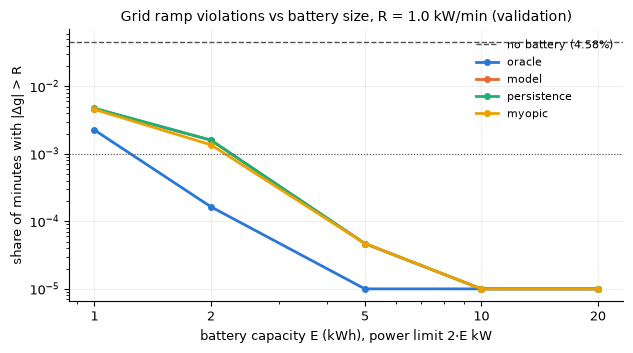
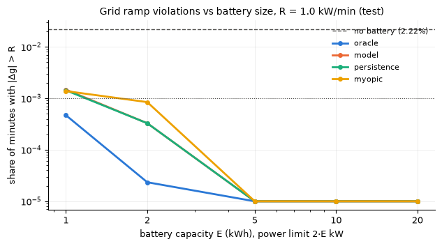
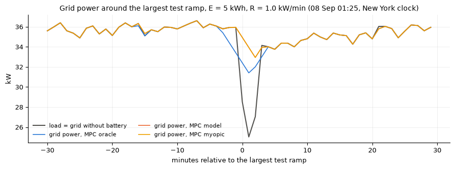

# Outputs of `26_week7_mpc.ipynb`
Exported 2026-10-14 10:39 from the saved notebook file.

## Cell 1: setup
_execution count: 1_

```
cvxpy 1.9.3 | solvers ['CLARABEL', 'SCS', 'SCIPY', 'HIGHS', 'OSQP']
val: 2 segments, 42,636 minutes simulated (of 42,636 valid)
test: 2 segments, 42,636 minutes simulated (of 42,636 valid)
freeze record exists: False
validation forecast trajectories (lightgbm_cov): 42,547
```

## Cell 2: unit checks on synthetic data (no project data)
_execution count: 2_

```
PASS  no battery: one violation of 5 kW excess  [1]
PASS  oracle: battery removes the step violation (max ramp <= R)  [1.0]
PASS  persistence: battery removes the step violation (max ramp <= R)  [1.0]
PASS  myopic: battery removes the step violation (max ramp <= R)  [1.0]
PASS  SoC follows the battery model exactly
PASS  grid = P - pd + pc
PASS  oracle starts moving before the step (anticipation)  [2.512]
PASS  persistence cannot anticipate (g = P before the step)
PASS  trajectory interpolation
PASS  segments

ALL UNIT CHECKS PASSED
```

## Cell 3: validation sweep (cached per run; about 40 min)
_execution count: 3_

```
  val oracle      E=   1 R=1:    44 s
  val model       E=   1 R=1:    44 s
  val persistence E=   1 R=1:    45 s
  val myopic      E=   1 R=1:    28 s
  val oracle      E=   2 R=1:    42 s
  val model       E=   2 R=1:    44 s
  val persistence E=   2 R=1:    43 s
  val myopic      E=   2 R=1:    26 s
  val oracle      E=   5 R=1:    43 s
  val model       E=   5 R=1:    42 s
  val persistence E=   5 R=1:    42 s
  val myopic      E=   5 R=1:    26 s
  val oracle      E=  10 R=1:    43 s
  val model       E=  10 R=1:    42 s
  val persistence E=  10 R=1:    46 s
  val myopic      E=  10 R=1:    27 s
  val oracle      E=  20 R=1:    46 s
  val model       E=  20 R=1:    48 s
  val persistence E=  20 R=1:    43 s
  val myopic      E=  20 R=1:    33 s
validation done in 13.3 min
```

## Cell 4: validation results and needed capacity
_execution count: 4_

```
shape: (21, 13)
┌─────┬───────┬─────────────┬────────────┬───┬─────────┬─────────┬─────────────┬──────────┐
│ R   ┆ E_kWh ┆ scenario    ┆ viol_steps ┆ … ┆ soc_min ┆ soc_max ┆ solver_fail ┆ fallback │
│ --- ┆ ---   ┆ ---         ┆ ---        ┆   ┆ ---     ┆ ---     ┆ ---         ┆ ---      │
│ f64 ┆ f64   ┆ str         ┆ i64        ┆   ┆ f64     ┆ f64     ┆ i64         ┆ i64      │
╞═════╪═══════╪═════════════╪════════════╪═══╪═════════╪═════════╪═════════════╪══════════╡
│ 1.0 ┆ 0.0   ┆ no battery  ┆ 1954       ┆ … ┆ null    ┆ null    ┆ null        ┆ null     │
│ 1.0 ┆ 1.0   ┆ oracle      ┆ 96         ┆ … ┆ 0.4222  ┆ 0.5856  ┆ 0           ┆ 0        │
│ 1.0 ┆ 1.0   ┆ model       ┆ 199        ┆ … ┆ 0.3595  ┆ 0.6942  ┆ 0           ┆ 89       │
│ 1.0 ┆ 1.0   ┆ persistence ┆ 202        ┆ … ┆ 0.3611  ┆ 0.6942  ┆ 0           ┆ 0        │
│ 1.0 ┆ 1.0   ┆ myopic      ┆ 194        ┆ … ┆ 0.1449  ┆ 0.9     ┆ 0           ┆ 0        │
│ 1.0 ┆ 2.0   ┆ oracle      ┆ 7          ┆ … ┆ 0.3806  ┆ 0.5916  ┆ 0           ┆ 0        │
│ 1.0 ┆ 2.0   ┆ model       ┆ 68         ┆ … ┆ 0.3191  ┆ 0.6868  ┆ 0           ┆ 89       │
│ 1.0 ┆ 2.0   ┆ persistence ┆ 68         ┆ … ┆ 0.317   ┆ 0.6986  ┆ 0           ┆ 0        │
│ 1.0 ┆ 2.0   ┆ myopic      ┆ 58         ┆ … ┆ 0.2629  ┆ 0.8557  ┆ 0           ┆ 0        │
│ 1.0 ┆ 5.0   ┆ oracle      ┆ 0          ┆ … ┆ 0.4672  ┆ 0.5931  ┆ 0           ┆ 0        │
│ 1.0 ┆ 5.0   ┆ model       ┆ 2          ┆ … ┆ 0.2482  ┆ 0.6914  ┆ 0           ┆ 89       │
│ 1.0 ┆ 5.0   ┆ persistence ┆ 2          ┆ … ┆ 0.2468  ┆ 0.6926  ┆ 0           ┆ 0        │
│ 1.0 ┆ 5.0   ┆ myopic      ┆ 2          ┆ … ┆ 0.1715  ┆ 0.7532  ┆ 0           ┆ 0        │
│ 1.0 ┆ 10.0  ┆ oracle      ┆ 0          ┆ … ┆ 0.4859  ┆ 0.5554  ┆ 0           ┆ 0        │
│ 1.0 ┆ 10.0  ┆ model       ┆ 0          ┆ … ┆ 0.2741  ┆ 0.629   ┆ 0           ┆ 89       │
│ 1.0 ┆ 10.0  ┆ persistence ┆ 0          ┆ … ┆ 0.2687  ┆ 0.6266  ┆ 0           ┆ 0        │
│ 1.0 ┆ 10.0  ┆ myopic      ┆ 0          ┆ … ┆ 0.2392  ┆ 0.6266  ┆ 0           ┆ 0        │
│ 1.0 ┆ 20.0  ┆ oracle      ┆ 0          ┆ … ┆ 0.493   ┆ 0.5277  ┆ 0           ┆ 0        │
│ 1.0 ┆ 20.0  ┆ model       ┆ 0          ┆ … ┆ 0.376   ┆ 0.5645  ┆ 0           ┆ 89       │
│ 1.0 ┆ 20.0  ┆ persistence ┆ 0          ┆ … ┆ 0.3696  ┆ 0.5633  ┆ 0           ┆ 0        │
│ 1.0 ┆ 20.0  ┆ myopic      ┆ 0          ┆ … ┆ 0.3696  ┆ 0.5633  ┆ 0           ┆ 0        │
└─────┴───────┴─────────────┴────────────┴───┴─────────┴─────────┴─────────────┴──────────┘

needed capacity (violation share <= 0.1%), validation, R = 1.0: {'oracle': 2.0, 'model': 5.0, 'persistence': 5.0, 'myopic': 5.0}
```



## Cell 5: freeze record (written BEFORE the test month is simulated)
_execution count: 5_

```
freeze record mpc_test_freeze.json | git 96597605437198fbfb9cb0a5da4aee2b50ccbbd4
```

## Cell 6: TEST month (once): main grid at R = 1 and the R sensitivity at E = 5 (about 55 min; cached per run)
_execution count: 6_

```
test forecast trajectories (lightgbm_cov): 42,547
  test oracle      E=   1 R=1:    46 s
  test model       E=   1 R=1:    45 s
  test persistence E=   1 R=1:    46 s
  test myopic      E=   1 R=1:    27 s
  test oracle      E=   2 R=1:    46 s
  test model       E=   2 R=1:    47 s
  test persistence E=   2 R=1:    48 s
  test myopic      E=   2 R=1:    27 s
  test oracle      E=   5 R=1:    48 s
  test model       E=   5 R=1:    60 s
  test persistence E=   5 R=1:    56 s
  test myopic      E=   5 R=1:    30 s
  test oracle      E=  10 R=1:    56 s
  test model       E=  10 R=1:    58 s
  test persistence E=  10 R=1:    59 s
  test myopic      E=  10 R=1:    36 s
  test oracle      E=  20 R=1:    60 s
  test model       E=  20 R=1:    60 s
  test persistence E=  20 R=1:    57 s
  test myopic      E=  20 R=1:    35 s
  test oracle      E=   5 R=0.5:    59 s
  test model       E=   5 R=0.5:    60 s
  test persistence E=   5 R=0.5:   134 s
  test myopic      E=   5 R=0.5:    27 s
  test oracle      E=   5 R=2:    42 s
  test model       E=   5 R=2:    42 s
  test persistence E=   5 R=2:    42 s
  test myopic      E=   5 R=2:    26 s
test done in 23.0 min
```

## Cell 7: test results: violations, needed capacity, value of the forecast; figures
_execution count: 7_

```
shape: (31, 13)
┌─────┬───────┬─────────────┬────────────┬───┬─────────┬─────────┬─────────────┬──────────┐
│ R   ┆ E_kWh ┆ scenario    ┆ viol_steps ┆ … ┆ soc_min ┆ soc_max ┆ solver_fail ┆ fallback │
│ --- ┆ ---   ┆ ---         ┆ ---        ┆   ┆ ---     ┆ ---     ┆ ---         ┆ ---      │
│ f64 ┆ f64   ┆ str         ┆ i64        ┆   ┆ f64     ┆ f64     ┆ i64         ┆ i64      │
╞═════╪═══════╪═════════════╪════════════╪═══╪═════════╪═════════╪═════════════╪══════════╡
│ 0.5 ┆ 0.0   ┆ no battery  ┆ 4517       ┆ … ┆ null    ┆ null    ┆ null        ┆ null     │
│ 0.5 ┆ 5.0   ┆ model       ┆ 0          ┆ … ┆ 0.2519  ┆ 0.6478  ┆ 0           ┆ 89       │
│ 0.5 ┆ 5.0   ┆ myopic      ┆ 23         ┆ … ┆ 0.1     ┆ 0.9     ┆ 0           ┆ 0        │
│ 0.5 ┆ 5.0   ┆ oracle      ┆ 0          ┆ … ┆ 0.466   ┆ 0.553   ┆ 0           ┆ 0        │
│ 0.5 ┆ 5.0   ┆ persistence ┆ 0          ┆ … ┆ 0.2521  ┆ 0.6482  ┆ 0           ┆ 0        │
│ 1.0 ┆ 0.0   ┆ no battery  ┆ 945        ┆ … ┆ null    ┆ null    ┆ null        ┆ null     │
│ 1.0 ┆ 1.0   ┆ model       ┆ 63         ┆ … ┆ 0.371   ┆ 0.648   ┆ 0           ┆ 89       │
│ 1.0 ┆ 1.0   ┆ myopic      ┆ 59         ┆ … ┆ 0.1246  ┆ 0.816   ┆ 0           ┆ 0        │
│ 1.0 ┆ 1.0   ┆ oracle      ┆ 20         ┆ … ┆ 0.4392  ┆ 0.5668  ┆ 0           ┆ 0        │
│ 1.0 ┆ 1.0   ┆ persistence ┆ 61         ┆ … ┆ 0.3635  ┆ 0.648   ┆ 0           ┆ 0        │
│ 1.0 ┆ 2.0   ┆ model       ┆ 14         ┆ … ┆ 0.3219  ┆ 0.6109  ┆ 0           ┆ 89       │
│ 1.0 ┆ 2.0   ┆ myopic      ┆ 36         ┆ … ┆ 0.1     ┆ 0.6832  ┆ 0           ┆ 0        │
│ 1.0 ┆ 2.0   ┆ oracle      ┆ 1          ┆ … ┆ 0.4184  ┆ 0.5508  ┆ 0           ┆ 0        │
│ 1.0 ┆ 2.0   ┆ persistence ┆ 14         ┆ … ┆ 0.3219  ┆ 0.6106  ┆ 0           ┆ 0        │
│ 1.0 ┆ 5.0   ┆ model       ┆ 0          ┆ … ┆ 0.3473  ┆ 0.6054  ┆ 0           ┆ 89       │
│ 1.0 ┆ 5.0   ┆ myopic      ┆ 0          ┆ … ┆ 0.1191  ┆ 0.6664  ┆ 0           ┆ 0        │
│ 1.0 ┆ 5.0   ┆ oracle      ┆ 0          ┆ … ┆ 0.4793  ┆ 0.5359  ┆ 0           ┆ 0        │
│ 1.0 ┆ 5.0   ┆ persistence ┆ 0          ┆ … ┆ 0.3473  ┆ 0.605   ┆ 0           ┆ 0        │
│ 1.0 ┆ 10.0  ┆ model       ┆ 0          ┆ … ┆ 0.312   ┆ 0.5844  ┆ 0           ┆ 89       │
│ 1.0 ┆ 10.0  ┆ myopic      ┆ 0          ┆ … ┆ 0.3095  ┆ 0.5832  ┆ 0           ┆ 0        │
│ 1.0 ┆ 10.0  ┆ oracle      ┆ 0          ┆ … ┆ 0.4897  ┆ 0.5212  ┆ 0           ┆ 0        │
│ 1.0 ┆ 10.0  ┆ persistence ┆ 0          ┆ … ┆ 0.3095  ┆ 0.5832  ┆ 0           ┆ 0        │
│ 1.0 ┆ 20.0  ┆ model       ┆ 0          ┆ … ┆ 0.406   ┆ 0.5422  ┆ 0           ┆ 89       │
│ 1.0 ┆ 20.0  ┆ myopic      ┆ 0          ┆ … ┆ 0.4048  ┆ 0.5416  ┆ 0           ┆ 0        │
│ 1.0 ┆ 20.0  ┆ oracle      ┆ 0          ┆ … ┆ 0.4948  ┆ 0.5106  ┆ 0           ┆ 0        │
│ 1.0 ┆ 20.0  ┆ persistence ┆ 0          ┆ … ┆ 0.4048  ┆ 0.5416  ┆ 0           ┆ 0        │
│ 2.0 ┆ 0.0   ┆ no battery  ┆ 165        ┆ … ┆ null    ┆ null    ┆ null        ┆ null     │
│ 2.0 ┆ 5.0   ┆ model       ┆ 0          ┆ … ┆ 0.3766  ┆ 0.5649  ┆ 0           ┆ 89       │
│ 2.0 ┆ 5.0   ┆ myopic      ┆ 0          ┆ … ┆ 0.3499  ┆ 0.5649  ┆ 0           ┆ 0        │
│ 2.0 ┆ 5.0   ┆ oracle      ┆ 0          ┆ … ┆ 0.4845  ┆ 0.5125  ┆ 0           ┆ 0        │
│ 2.0 ┆ 5.0   ┆ persistence ┆ 0          ┆ … ┆ 0.3766  ┆ 0.5649  ┆ 0           ┆ 0        │
└─────┴───────┴─────────────┴────────────┴───┴─────────┴─────────┴─────────────┴──────────┘

needed capacity (violation share <= 0.1%), test, R = 1.0: {'oracle': 1.0, 'model': 2.0, 'persistence': 2.0, 'myopic': 2.0}  (validation: {'oracle': 2.0, 'model': 5.0, 'persistence': 5.0, 'myopic': 5.0})

excess ramp (kW summed over violating minutes) and the share of the oracle's improvement over 'myopic' that each forecast achieves:
shape: (5, 7)
┌───────┬───────────────┬────────────────────┬──────────────┬───────────────┬────────────────────────────┬─────────────────────────────────┐
│ E_kWh ┆ excess_myopic ┆ excess_persistence ┆ excess_model ┆ excess_oracle ┆ model_share_of_oracle_gain ┆ persistence_share_of_oracle_ga… │
│ ---   ┆ ---           ┆ ---                ┆ ---          ┆ ---           ┆ ---                        ┆ ---                             │
│ f64   ┆ f64           ┆ f64                ┆ f64          ┆ f64           ┆ f64                        ┆ f64                             │
╞═══════╪═══════════════╪════════════════════╪══════════════╪═══════════════╪════════════════════════════╪═════════════════════════════════╡
│ 1.0   ┆ 63.639        ┆ 69.706             ┆ 68.959       ┆ 18.551        ┆ -0.118                     ┆ -0.135                          │
│ 2.0   ┆ 32.334        ┆ 15.49              ┆ 15.347       ┆ 0.912         ┆ 0.541                      ┆ 0.536                           │
│ 5.0   ┆ 0.0           ┆ 0.0                ┆ 0.0          ┆ 0.0           ┆ NaN                        ┆ NaN                             │
│ 10.0  ┆ 0.0           ┆ 0.0                ┆ 0.0          ┆ 0.0           ┆ NaN                        ┆ NaN                             │
│ 20.0  ┆ 0.0           ┆ 0.0                ┆ 0.0          ┆ 0.0           ┆ NaN                        ┆ NaN                             │
└───────┴───────────────┴────────────────────┴──────────────┴───────────────┴────────────────────────────┴─────────────────────────────────┘
```





## Cell 8: summary JSON and the Week 7 checklist
_execution count: 8_

```
DONE  [main] battery model SoC(k+1) = SoC(k) + eta*P_b*dt/E with power and energy limits
DONE  [main] MPC with cvxpy, 15-minute horizon, ramp limit on P_grid = P_dc - P_b
DONE  [main] four scenarios: oracle, best model, naive (persistence), no forecast (myopic)
DONE  [main] metrics: max ramp, violations, needed battery capacity
DONE  [main] split conformal (notebook 24)
DONE  [main] SHAP on LightGBM (notebook 25)
supplementary QAOA job shifting: not started (dropped first under the plan's rule)
```

## Cell 9: export outputs (save the notebook first with Cmd+S after cell 8 has finished, then run this cell)
_execution count: 9_

```
written 26_week7_mpc_outputs.md | code cells 10 | figures 1 in 26_week7_mpc_outputs_figures
```

## Cell 10
_execution count: None_

(no output)
